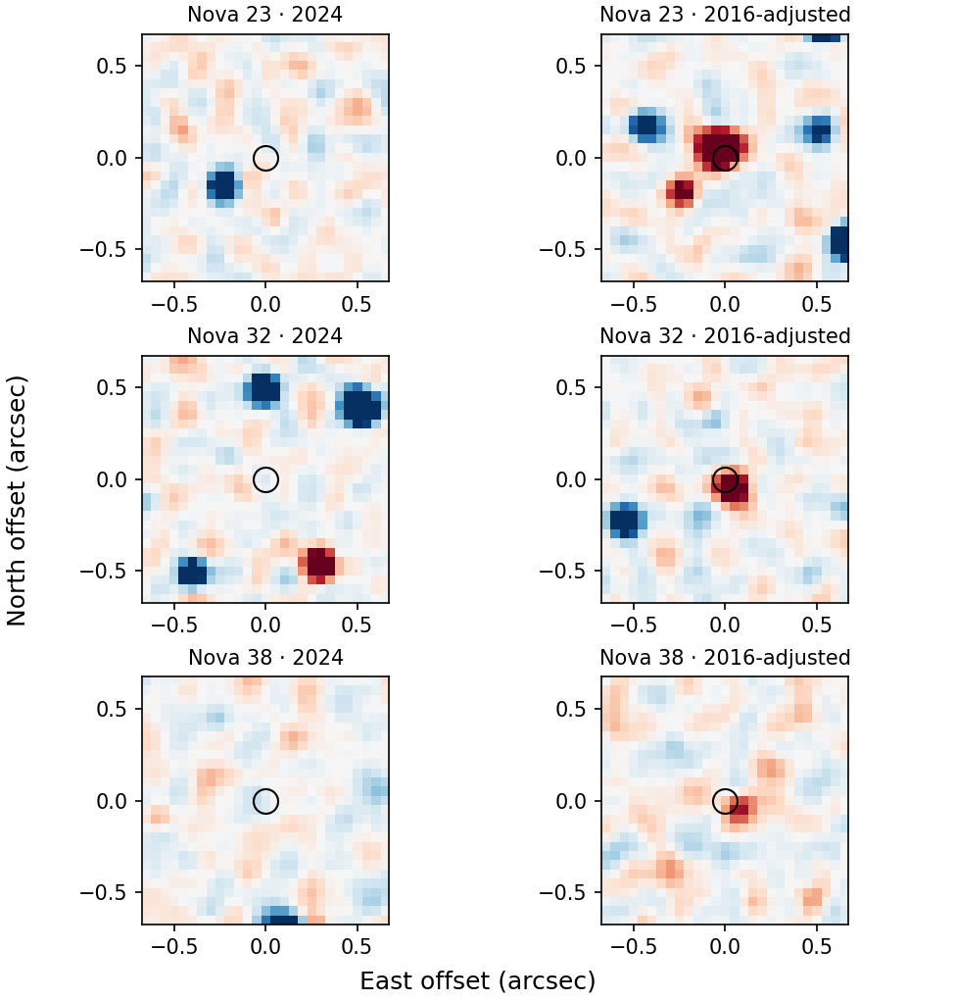

# Three M87 nova positions in the published jet map

Three ACS sources are displaced by approximately 60, 10 and 60 arcsec in Table 1 and Figure 1 of Lessing et al. (2024, ApJ 973, 144). At the earlier survey positions, adjusted by the typical ACS-to-Gaia shift, Hubble images recover variable point sources at the expected epochs. Replacing their positions changes the count in the full-field 36° sector aligned with the jet from 25 to 24. All three lie beyond the 31.5 arcsec radius used in the inner analysis before and after correction. The correction therefore leaves the membership of the paper's strongest, jet-length-limited sample intact. The nova identifications themselves are from Shara et al. (2016). The contribution here is the image-based recovery of their coordinates and its effect on the published jet map.

| 2006 ACS ID | 2024 published position | HST difference-image position (ICRS, deg) | Shift | Image evidence |
|---|---|---|---:|---|
| 23 | 12:30:47.88 +12:23:54.01 | 187.69949, +12.38167 | 60.0″ | Two bright visits and both F606W and F814W recover the source. Four difference images give peak/local-scatter ratios of 16.9–32.3. |
| 32 | 12:30:46.92 +12:22:24.20 | 187.69551, +12.37617 | 10.0″ | Three early-minus-late differences recover the fading source in two bands, with ratios of 10.0–14.3. |
| 38 | 12:30:45.47 +12:23:48.08 | 187.68943, +12.41335 | 60.0″ | A four-visit F814W stack recovers the source against both an early template and a template taken a decade later. The ratios are 6.3 and 6.9. Shara et al. classified this faint variable among the less secure nova candidates. |

Rounded positions reflect the pixel measurements. Precision in absolute astrometry is limited by the HST product WCS. The comparison windows and templates overlap, so the ratios in this table are descriptive and cannot be combined as independent detection significances. Neither position hypothesis was optimized on the difference images before choosing the 0.15″ search box. The earlier position was predicted from the published 2016 position, with approximately 1″ removed in declination.

In each pair the black circle marks the tested position. The maps span 1.35 arcsec per side and share a diverging scale from −8 to +8 local scatter units. Source 38 has the weakest signal and its position rests on stacked F814W measurements.

## Effect on the jet sector

The 2006 coordinates are from Lessing et al. Table 1 and the 2017 coordinates are from Shara et al. (2023) Table 2. The centroid of M87 was taken as 12:30:49.423, +12:23:28.04. A straight-line fit to the cyan jet line in the embedded Figure 2 image gives position angle 289.713° east of north. The 135-object counts in successive 36° bins from that centerline toward decreasing position angle are reproduced exactly from the published tables.

| Coordinates | Full-field histogram |
|---|---|
| Published tables and Figure 3 | 25, 16, 12, 14, 13, 11, 10, 10, 14, 10 |
| Three positions remeasured | 24, 16, 13, 14, 13, 11, 10, 10, 14, 10 |

Source 38 moves from 0.6° to approximately 34.3° from the centerline, outside the 18° half-width. Source 23 also changes sectors and source 32 stays in the same sector. Net counts for individual sectors include both moves. The shift of one object out of the jet bin survives rotating the adopted jet axis by ±2°. For the fixed, idealized probability of 0.1 per sector, the one-sided binomial probability for the jet bin changes from 0.00185 to 0.00390. Those values are calculated for one pre-specified sector and omit the galaxy light distribution, footprint, radial selection function, and any scan over sectors. They cannot replace the paper's completeness-weighted probabilities.

Using the rounded tabular coordinates and this radius gives 62 inner objects, as in the paper. Our inner jet bin contains 12, compared with the paper's 13. The exact inner histogram cannot be reproduced with this angular/radial convention. Our replacement leaves every inner-bin membership unchanged because none of the three objects is inside the radius in either coordinate set. Re-simulation of the published enhancement factors requires the original detection-efficiency model.

The printed-map check is independent of the wedge-count check. We used 2017 positions to locate the 2017 cyan markers in the upper panel of Figure 1, then predicted the locations of the 2006 pink crosses. All three 2024 positions land within one embedded-image pixel of a pink marker. The earlier positions are 18.5, 17.2 and 104.6 pixels from the nearest detected pink cross, respectively. The 2016 discovery chart, Figure 1, places each in the earlier part of the field.

## Reproduce

Run `python analyze.py --plot` in this directory using NumPy, SciPy, Astropy and Matplotlib. The script verifies each pixel-array digest, projects the supplied HST cutouts onto a 0.05″ grid, and regenerates the photometry, positions, counts and figure. For each hypothesis the brightest residual in a ±0.15″ box is located and centroided with positive weights. A median filter removes smoothly varying galaxy light. The noise scale is the median absolute deviation multiplied by 1.4826 in an annulus 0.25–1.10″ from the hypothesis. For the faint source 38, images are aligned using surrounding structure in the annulus before subtraction.

The two dates in the source-38 baselines are the December 2005 visits of GO-10543 and a 2016 February ACS/WFC F814W visit of GO-13731. The short visit labels are expanded into full MAST product names in the manifest. The raw cutouts contain 77×77 unscaled, big-endian float32 SCI pixels from the named DRC products. Each payload has a SHA-256 digest and a local WCS. `python fetch_pixels.py` fetches byte ranges from MAST, checks the pixels and mapping against the frozen files and rebuilds the archive. Drizzled pixels correlate locally. The jet-sector calculation uses published positions, so existing sub-pixel astrometric shifts or detector model differences do not account for 10–60″ errors.

## Sources and prior work

- [Lessing et al. 2024, Figures 1–3 and Table 1](https://stsci-opo.org/STScI-01J8T4398VD1G2K90XFNS917HW.pdf). PDF SHA-256 ea343ed770797f021eaf66df22a833c0fe8be3c2d8943a9b719d1e7c14a37bc2.
- [Shara et al. 2016, original map, time series and catalog](https://doi.org/10.3847/0067-0049/227/1/1). [2016 machine-readable tables](https://vizier.cfa.harvard.edu/viz-bin/VizieR?-source=J/ApJS/227/1).
- [Shara et al. 2023, 94-object comparison table](https://vizier.cfa.harvard.edu/viz-bin/VizieR?-source=J/ApJS/269/42/table2).
- [MAST Hubble archive](https://mast.stsci.edu/). GO-10543 original survey. GO-13731 independent late template.

The rejected initial recurrence hypothesis was a separate result of the cross-survey search. The closest of 3,854 coordinate pairs was 2006 #14 / 2017 #10, 0.224″. Registering their ACS and WFC3 images showed distinct peaks about four 0.04″ grid elements apart along both axes. This pair is excluded from the interpretation above.
