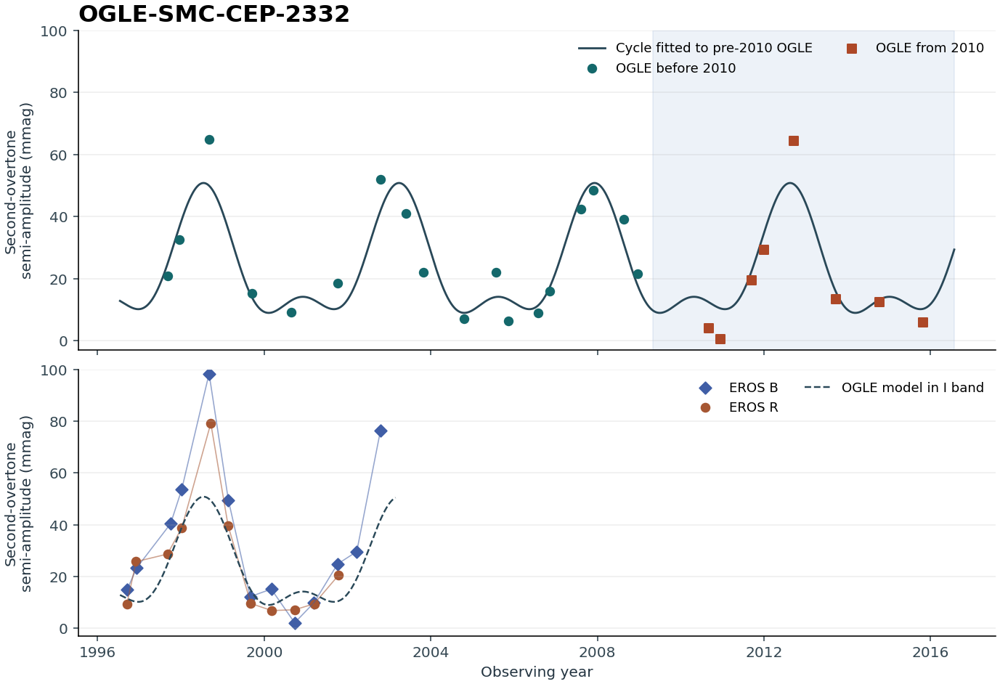

# A 4.7-year pulsation-amplitude cycle in OGLE-SMC-CEP-2332

The 0.6690282-day second radial overtone of this known Small Magellanic Cloud Cepheid repeatedly grows and fades. Across 26 intervals of OGLE I-band photometry covering 1997–2016, its semi-amplitude ranges from 0.0005 to 0.0647 mag. A periodic fit gives **1,720 days (4.71 years)**. The stronger, 0.8308702-day first overtone stays visible and tends to weaken when the second overtone strengthens (Spearman ρ = −0.689). The new measurement concerns the long cycle in this particular star. Both radial pulsation periods and similar modulation in other double-overtone Cepheids were previously published. [OGLE catalog](https://ogle.astrouw.edu.pl/ogle/ogle4/OCVS/smc/cep/) · [EROS beat Cepheids](https://cdsarc.cds.unistra.fr/viz-bin/ReadMe/J/A%2BA/495/249) · [Modulation in LMC Cepheids](https://doi.org/10.1111/j.1365-2966.2009.14428.x)



## How the star was selected

We examined all 728 F/1O and 1O/2O objects in the two OGLE-IV Magellanic Cloud catalogs. There were 503 with eligible I-band measurements in both the early and late 900-day windows. A window required 55 valid measurements, 350 days of coverage and a well-conditioned simultaneous harmonic fit. Two stars changed which mode had the larger measured semi-amplitude, but only by margins of 0.0014 and 0.0025 mag at the closer endpoint. We found no compelling exchange of the dominant mode. The full eligible sample is in [screen.csv](screen.csv).

We then examined overtone amplitude changes. SMC-2332 had the largest fractional reduction of the shorter-period amplitude using a 0.004 mag denominator floor and the largest absolute log change of the mode ratio using a 0.002 mag floor. Five comparison targets were also inspected (SMC-0076, 1661, 2170, 3278 and 3610). The later OGLE data contributed to target selection. The temporal split below tests whether old data can predict later measurements for this selected target. It does not provide a blind population-wide discovery probability. [Initial checkpoint](SEARCH.md) · [All six follow-ups](modulation.json)

## The amplitude cycle

The older OGLE release contains 1,032 eligible measurements from June 1997 to May 2009. The newer release has 487 from May 2010 to July 2016. We use the published HJD minus 2450000 time and magnitudes, simultaneous sinusoids at the two catalogued periods, harmonics and combination frequencies. Each 190-day interval has its own amplitudes, phases and mean. Intervals require at least 24 measurements, 28 days of coverage and a well-conditioned fit. Eighteen early and eight later intervals pass. A two-harmonic curve models the slow change of the second-overtone amplitude.

| Test | Result |
| --- | --- |
| Fit the cycle on 1997–2009 only, predict the eight 2010–2016 amplitudes | 1,715 days. Correlation 0.976. RMS error 0.0073 mag versus 0.0198 mag for the older constant baseline. |
| Change the time windows to 160, 220 or 270 days, or offset the 190-day bins by half a bin | Combined periods range from 1,718 to 1,762 days across all five runs. Older-model correlations in the later data range from 0.884 to 0.976. |
| Fit all 26 intervals, dropping one at a time | 1,714–1,727 days. This measures sensitivity to individual bins. |
| Use a different telescope, EROS-2 at La Silla | The OGLE curve correlates with 11 red and 13 blue EROS amplitude measurements at 0.883 and 0.926, respectively. The two channels share observing nights. |
| Inject a constant 0.030 mag second overtone on the real OGLE cadence with night-block sign resampling of residuals | The largest peak-to-peak range in 350 simulations was 0.0318 mag. The measured range was 0.0642 mag. This checks cadence and residual scatter for this star. |

From November 2010 to May 2011, the fixed-period fit gives 0.0005 mag. The 97.5th percentile of the night-bootstrap estimates is 0.0147 mag. Allowing the second-overtone frequency to vary by ±0.003 cycles/day gives 0.0111 mag. From June to December 2012 it returns at 0.0643 mag, with a 0.0504–0.0990 mag percentile interval over accepted night bootstraps. A frequency refit gives 0.0646 mag. These windows were selected as extrema. An amplitude is nonnegative, so bootstrap percentiles near zero do not establish a detection. The first overtone measures 0.128 and 0.108 mag in the same windows. [Window measurements](segments.csv) · [Sampling checks](validation_2332.json)

## Independent observations and competing explanations

The target lies at J2000 00h55m03.02s, −73°13′59.1″. The EROS source sm0011n28414 is 0.331″ from the OGLE position and appears among this star's SIMBAD identifiers. EROS and OGLE observed in different passbands with different telescopes. EROS covers part of the older OGLE baseline, so it tests the same episodes with independent photons. The EROS observation times use the II/390 HJD offset. [EROS light curves](https://cdsarc.cds.unistra.fr/viz-bin/cat/II/390) · [Catalog identifiers](literature/2332_identifiers.csv)

The closest resolved DECam source, DELVE-MC 0141m732.33717, lies 0.29″ from OGLE. The model predicts a weak second overtone during the dense October–November 2020 visit. In 57–59 measurements per filter, the fitted second-overtone semi-amplitudes are 0.027, 0.017, 0.013 and 0.008 mag in g, r, i and z. The first overtone is 0.222, 0.149, 0.114 and 0.102 mag. There are only four or five observing nights per filter. Omitting one night moves the i-band estimate between 0.008 and 0.022 mag. This is a limited check of a weak epoch. For this short fit we use exposure start times with an approximate heliocentric correction. [DELVE survey and release](https://datalab.noirlab.edu/data/delve) · [Per-filter results](validation_2332.json)

A separate, more restrictive model tried to predict the **individual pulsation phases** as well as their changing amplitudes. A set of fixed frequencies and sidebands fitted before 2010 performed worse than a constant-pulsation model on the later DECam light curves (RMS 0.073 versus 0.053 mag across 44 nights). The slow amplitude cycle survives the OGLE and EROS tests. Exact long-term phase coherence and a physical mechanism remain unresolved. [Waveform test](clock_results.json)

TESS observed seven sectors at this position. In a target-centered 1.6-pixel aperture with four common instrumental components removed, the fitted second-overtone amplitude was below the 95th percentile of the nearby control-frequency amplitudes in **all seven**. Several amplitude maps also peaked away from the target. Those sectors give no independent detection of the second overtone with this extraction. [Pixel checks](tess_checks.json)

A beat between close frequencies can produce a varying envelope. Changes in blending or observing cadence can also affect fitted amplitudes. The anticorrelation of the two modes, independent EROS photometry and sampling controls constrain those alternatives. None distinguishes resonant energy exchange from beating. An independent dense, resolved time series spanning successive predicted amplitude peaks and troughs could test the model and resolve sidebands. Based on OGLE alone, successive maxima follow HJD 2454444 + 1720 × integer days, with model sensitivity of tens of days per extrapolated cycle.

## Literature and reproduction

A 2″ SIMBAD query returned one source and six indexed references, including the 2009 EROS beat-Cepheid catalog, the OGLE releases, VMC, and Gaia. Searches on November 14, 2026 for the OGLE ID, EROS IDs, the OGLE field designation and terms for double-overtone modulation found earlier classifications and class-level work. We did not locate a prior 4.7-year measurement for this object. Publication priority has not been established. [Six object-linked references](literature/2332_references.csv) · [Queries and hashes](literature_manifest.csv)

Use Python 3, NumPy, SciPy and Matplotlib. The optional TESS replay also uses Astropy. Scripts resolve data paths relative to this directory. The frozen receipts contain input URLs, byte counts and SHA-256 digests. OGLE and EROS magnitudes are used as published. Compare refreshed digests to the committed receipts before interpreting a different result. Credit for the observations belongs to the OGLE project, EROS Collaboration, DECam observers and DELVE/NOIRLab, and NASA TESS and MAST.

```bash
python fetch.py > refreshed_ogle.txt
diff -u manifest.txt refreshed_ogle.txt
python screen.py
python follow_fetch.py
python delve_fetch.py
python modulation.py
python waveform.py
python validate_2332.py
python figure.py
python tess_fetch.py
python tess_modes.py
```

The OCVS database endpoint labelled as updated in 2024 returned the same last observation for SMC-2332 as the public OGLE-IV release. The latest OGLE point used here is in July 2016. The later measurements come from independent instruments. The 2026 peak in the extrapolated ephemeris has no validating measurement in this package.
