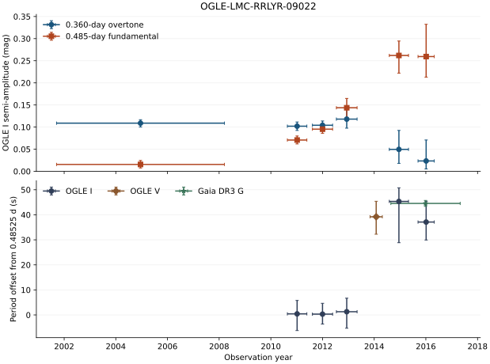

# A pulsation-mode reversal and a 44-second period increase in OGLE-LMC-RRLYR-09022

The Large Magellanic Cloud RR Lyrae star OGLE-LMC-RRLYR-09022 changed from first-overtone-dominated to fundamental-dominated pulsation. In OGLE's I band the fundamental grew from a first-harmonic semi-amplitude of **0.015 mag** in 2001–2008 to **0.262 mag** in 2014–2015. In the intervening years the two oscillations were visible together. The growing fundamental also lengthened from **0.485255 days** in 2011–2012 to **0.485766 days** in the independent Gaia solution, a difference of **44.1 seconds**. Both clocks can be measured from OGLE alone. OGLE I still favors the shorter period in the July 2012–May 2013 season. OGLE V favors the longer period in the November 2013–April 2014 season. Those season fits cannot date a discrete jump.

The object and the release classifications were known. OGLE-III lists it as RRc, OGLE-IV as RRd, and Gaia DR3 as RRab. This investigation measures the trajectory from the archived brightness observations. EROS independently establishes the early overtone. Gaia confirms the later fundamental within 0.052 arcsec of the OGLE position. The data do not establish permanent disappearance of the overtone. [OGLE-III catalog](https://acta.astrouw.edu.pl/Vol59/n1/a_59_1_1.html) · [OGLE-IV catalog](https://acta.astrouw.edu.pl/Vol66/n2/a_66_2_1.html) · [EROS archive](https://doi.org/10.1051/0004-6361/202557321) · [Gaia RR Lyrae products](https://gaia.aip.de/metadata/gaiadr3/vari_rrlyrae/)



Horizontal bars span each observation window. OGLE vertical bars are conditional 95% night-bootstrap intervals. The Gaia point uses its published period uncertainty. The period panel shows seconds relative to 0.48525 days.

## What the surveys measured

| Archive and window | Measurements | Overtone semi-amplitude (mag) | Fundamental semi-amplitude (mag) | Fundamental period (d) |
|---|---:|---:|---:|---:|
| EROS blue, 1996–2003 | 475 | 0.086 | 0.006 at the early OGLE fundamental period | Weak in these data |
| OGLE-III I, 2001–2008 | 360 | 0.109 [0.100, 0.117] | 0.015 [0.007, 0.024] | Weak in these data |
| OGLE-IV I, 2010–2011 | 201 | 0.102 | 0.071 | 0.485252 |
| OGLE-IV I, 2011–2012 | 229 | 0.104 | 0.095 | 0.485255 |
| OGLE-IV I, 2012–2013 | 106 | 0.118 | 0.144 | 0.485263 |
| OGLE-IV V, 2013–2014 | 85 | 0.084 | 0.452 | 0.485703 |
| OGLE-IV I, 2014–2015 | 60 | 0.050 | 0.262 [0.222, 0.295] | 0.485779 |
| OGLE-IV I, 2015–2016 | 41 | 0.023 | 0.259 [0.213, 0.332] | 0.485677 |
| Gaia DR3 G, 2014–2017 | 39 accepted | Unconstrained | 0.414 | 0.48576555 ± 0.00000696 |

Amplitudes are first Fourier harmonic semi-amplitudes in the instrument's own band. The growth estimate compares the same OGLE passband. The weak early fundamental estimate depends on the frequency search. In the two sparsely sampled final I seasons the weak overtone fit reaches the edge of its local frequency interval. Its reported period and amplitude in those seasons cannot establish a further period shift or disappearance. All windows with at least 30 observations, the uncertainties, and the actual start and end times are available in [measurements.json](measurements.json).

## Tests of the interpretation

- **A sampling artifact.** An unrestricted 1.2–4.5 cycles/day search of the 2011–2012 I residuals after subtracting the overtone puts its strongest peak at 0.485235 days. Injecting a 0.262-mag fundamental onto the early observations, with their actual cadence and residuals, recovers 0.260–0.264 mag across the central 95% of 1,000 phases. A signal of the later size would have been visible early.
- **A fixed fundamental period.** Night bootstraps give 0.485208–0.485304 d in 2011–2012 I and 0.485623–0.485775 d in 2013–2014 V. The independently fitted late I period also agrees with Gaia. On 39 Gaia measurements, leave-one-night-out brightness prediction errors were 0.204 mag using the late OGLE period, 0.357 using the early fundamental, and 0.342 for constant light. On the subsequent 41-point OGLE-I season the same test gives 0.109, 0.185 and 0.223 mag respectively. The two periods come only from OGLE. Each held-out night's brightness is evaluated using a waveform fitted to the other nights of that instrument and evaluation window.
- **Two unrelated, blended variables.** Gaia resolves a slightly brighter neighbor 1.19 arcsec away. In linear flux an additive blend of two stationary, individually non-sinusoidal waveforms produces each star's harmonics. Sum and difference frequencies are an additional prediction of a coupled or nonlinear source. After fitting three harmonics of each mode, the 2011–2012 OGLE flux still contains combination terms of 3.13% and 1.87% of the median flux at the sum and difference. A joint test found zero of 5,000 night-wise sign flips as large. Both halves of that season and the neighboring well-sampled seasons recover the effect. These are targeted tests after selection. The sign-flip assumptions and shared OGLE reduction limit their interpretation. Seeing-dependent blending or instrumental nonlinearity remains possible. Spatially resolved two-period photometry would test it directly.
- **An undetected early fundamental.** EROS source lm0561m6445 has 597 paired Red/Blue rows. Applying a 0.16-mag error limit separately leaves 495 Red and 475 Blue measurements. Their independently fitted overtone periods are 0.360411 and 0.360408 d. At the early OGLE fundamental clock the two semi-amplitudes are only 0.005 and 0.006 mag. The EROS reference is blended. Its amplitudes cannot be directly compared with OGLE, and the EROS measurements cannot exclude a weak fundamental at another period.
- **Later observations.** NOIRLab Source Catalog DR2 includes 61 gri detections in 2018–2019 over 17 nights. In the 54 g/r detections, 53 carry extraction flags and the typical seeing is about 2.1 arcsec. SMASH resolves two sources 1.17 arcsec apart at this location. The late NSC data cannot establish a fundamental-only state. The catalog identifiers and recheck queries are in [the source and priority record](sources.md).

The physical mechanism driving the change remains open. Related mode switches with fundamental-period changes of tens of seconds have been published for other RR Lyrae stars. A higher-resolution time series could test whether the weak overtone persists on this star and whether the fundamental has kept its Gaia-era period. [Comparison cases](https://acta.astrouw.edu.pl/Vol67/n4/pdf/pap_67_4_2.pdf)

## Search and reproducibility

We compared the shared OGLE identifiers in both Magellanic Clouds and required centroids within one arcsecond. Of **27,291** shared IDs, **27,283** met the position cut. There were **58** classification differences after combining RRc/RRe and RRd/aRRd. Fifty had a pair of periods with short-to-long ratio between 0.70 and 0.77 and sufficient seasonal coverage. This star ranks first on the change in seasonal amplitude ratio. The classification differences selected the sample, so these counts cannot give a population transition rate. Eight same-ID sources with greater centroid displacements and sources with different IDs across releases were outside the screen. [Branch checkpoint](https://github.com/dovvnloading/Open-Space/commit/57881d97387014d75eefb438f7ec04d061a0ab31) · [All 58 dispositions](screen.csv)

The target replay used Python 3.12.14, NumPy 2.3.5, SciPy 1.17.0 and Matplotlib 3.10.8. The compact ZIP contains the exact OGLE, EROS and Gaia responses for this source and its Gaia comparison cone. Its manifest records each URL, raw-byte SHA-256 and size. The code also hashes scientific TAP and VizieR rows separately because job IDs and server timestamps can change. OGLE and EROS use their published heliocentric dates. Gaia uses its published barycentric TCB times. The fits use relative time within a survey, with no cross-survey phase constraint.

```sh
cd results/magellanic-rr-lyrae-mode-transitions
python -m zipfile -e target-inputs.zip raw-cache
python measure.py
python checks.py
python holdout.py
python plot.py
```

To repeat the whole two-cloud catalog search over the network, run `python screen.py`. Its 120 catalog and photometry input digests are in [screen-inputs.csv](screen-inputs.csv). To retrieve the target input packet again, run `python freeze.py`. The screening statistic is a ranking quantity. The stellar measurements and holdout tests use the observations directly. [Source and priority record](sources.md) · [Independent checks](independent-checks.json) · [Held-out predictions](holdout.json)
