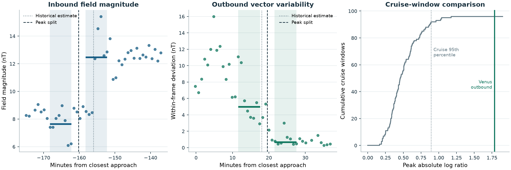

# Magnetic fluctuations recover Mariner 5's outbound Venus bow shock

**Noteworthy reproducibility finding · Measured.** In the restored October 2026 Mariner 5 archive, within-frame magnetic vector variability fell from **4.994 to 0.670 nT** near the historically identified outbound bow-shock crossing on 19 October 1967. The drop was larger than the peak change in each of **96** eligible cruise windows scanned with the same rule, and it survived deleting any one frame from either scoring window. Mean field magnitude also decreased, but its strongest split missed the frozen timing tolerance. This quantifies how strongly the old outbound marker appears in the newly digitized data. [NASA PDS release](https://pds.nasa.gov/datasearch/subscription-service/SS-20261031.shtml) · [Frozen protocol](PROTOCOL.md) · [Result ledger](summary.json)

## One flyby, three magnetic measures

NASA's mission report places the inbound and outbound crossings approximately 156 minutes before and 18 minutes after closest approach. The original team used the magnetometer and Faraday-cup plasma probe. The outbound identification leaned on the drop in fluctuations and recovery of plasma velocity. The plasma instrument measured one energy spectrum roughly every five minutes. The published markers therefore provide approximate reference times informed by both instruments. We were unable to verify a contemporaneous, machine-readable plasma series at that cadence. [NASA SP-190, Figure 2-27 and accompanying text](https://ntrs.nasa.gov/api/citations/19720013159/downloads/19720013159.pdf) · [Bridge et al. 1967, Figure 2](https://doi.org/10.1126/science.158.3809.1669) · [NSSDCA data inventory](https://nssdc.gsfc.nasa.gov/planetary/venus_data.html)

The encounter table has **356** valid, distinct frames. The label describes three unevenly spaced readings per nominal 50.4-second frame. Bridge et al. describe five triaxial measurements per 50.4 seconds. We use the released frame statistics without assuming which original measurements were omitted. The archived UTC column reproduces the rounded encounter-time column at its saved precision. These are two representations of one time axis. Four gaps exceed 80 seconds across the encounter table. The largest gap is 252 seconds. [Byte-verified encounter table](mag_venus_encounter_data.csv) · [PDS encounter label](mag_venus_encounter_data.xml)

For each reference, we scanned candidate splits within ten minutes. The score is the absolute log ratio of medians in two windows two to eight minutes from each split. We used the mean field magnitude, the root sum of squares of the three component standard deviations, and the standard deviation of the magnitude. Both variability metrics use a 0.2 nT floor when scoring the log ratio. The raw medians below omit the floor. Each listed split used eight frames per side. [Scores and sample support](summary.json)

| Reference | Metric | Before → after (nT) | Peak offset (min) | Peak score | Cruise peaks at least as high |
| --- | --- | ---: | ---: | ---: | ---: |
| Inbound | Mean magnitude | 7.650 → 12.475 | −4.20 | 0.489 | 5 |
| Inbound | Vector variability | 1.056 → 2.537 | 0.00 | 0.779 | 11 |
| Inbound | Magnitude variability | 0.230 → 0.840 | +1.68 | 0.883 | 2 |
| Outbound | Mean magnitude | 15.090 → 8.570 | −5.16 | 0.566 | 2 |
| Outbound | Vector variability | 4.994 → 0.670 | +1.56 | 1.787 | 0 |
| Outbound | Magnitude variability | 2.865 → 0.195 | +0.72 | 2.049 | 0 |

The outbound variability peaks passed both the five-minute match and the cruise-strength criterion. Neither variability result depended on a single frame. The strongest egress magnitude change peaked 5.16 minutes early. It missed the timing rule by 0.16 minutes, less than one frame. An exploratory scan restricted to five minutes placed the strongest magnitude change 3.48 minutes early, with a score of 0.483, below the cruise threshold of 0.513. At the exact historical marker, the magnitude score was 0.290 and the vector variability score was 1.653. Longer 3–12 minute windows moved the vector-variability peak from 1.56 minutes after the marker to 1.80 minutes before it. The sensible precision is a few minutes. The inbound magnitude increase reproduced at the historical marker, and its optimized score fell just below the cruise threshold. The inbound magnitude-variability channel passed. [Frozen and exploratory comparisons](summary.json)

## Cruise controls and archive limits

The strict quality filter retained **4,409** low-rate cruise frames from 4,662 selected frames. Ninety-six of 120 blocks across 29 dates met the support rule. The maximum vector-variability score in cruise was **1.176**, below the outbound score of 1.787. The outbound score also exceeded all nine eligible same-day comparison blocks. Those blocks include parts of the Venus interaction region and can share structure with the encounter. Nearby dates from the same spacecraft give an empirical comparison, and correlated controls preclude a calibrated false-alarm probability. [Cruise subset](cruise-controls.csv) · [Selection counts and digest](cruise-inputs.json) · [Source and flag guide receipts](sources.json)

Cruise contains the separate readings. The encounter provides their summarized means and standard deviations in another coordinate system. The rotation-invariant variability comparison avoids comparing individual axes across frames in different coordinate systems. If the encounter's standard deviations use the sample convention, multiplying by the conversion factor for three readings reduces the outbound vector score to 1.745, still above all cruise windows. The two variability metrics share the MAG readings. The separate Earth bow-shock check had no qualifying frames before the published time under the frozen quality filter. Its accepted post-shock data cannot supply a positive control. Venus Express studies provide examples where plasma and MAG both resolve a crossing, but this analysis did not include those data. [Archive user guide](https://pds-ppi.igpp.ucla.edu/data/mr5-mag/document/bundle_user_guide.pdf) · [Venus Express comparison](https://doi.org/10.1002/2016JA022413) · [Sensitivity and control scores](summary.json)

## Reproduce

Run from this folder with Python 3.10 or newer. The standard-library analysis verifies the encounter table and compact cruise inputs, then regenerates every reported comparison.

~~~text
python analyze.py --output summary.json
~~~

To regenerate the cruise subset, retrieve the full archive CSV listed in [sources.json](sources.json) and run `python prepare_cruise.py --input MAG_CRUISE_CSV --receipt sources.json --output cruise-controls.csv --stats cruise-inputs.json`. The extractor verifies the original size and SHA-256 before reading it. The original CSV and source PDFs are staged on D. The figure can be regenerated with Matplotlib using `python plot.py --output mariner5-bow-shock.png`.
