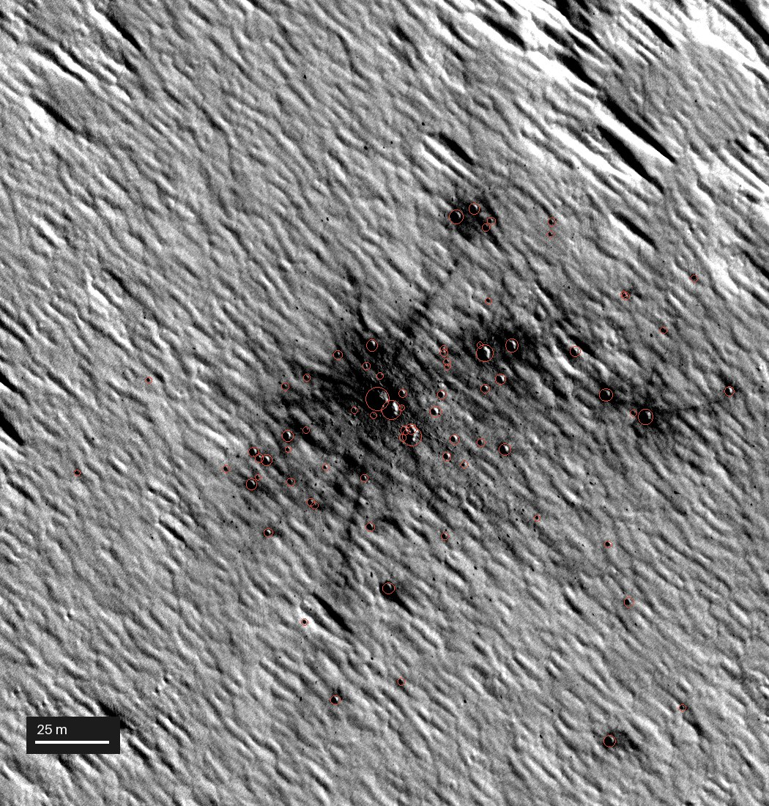

# Direct check against HiRISE pixels

The authors used field ESP_066902_1830 as their published illustration of the mapping procedure (Neidhart et al. 2023, Figure 1). We selected that field independently of its neighbor statistic. It contains 76 craters and has a smaller-than-average neighbor-gap reduction of 0.56 percentile points. The crop below covers 262.5 × 275 m at the original red-channel resolution of 0.25 m/pixel. Red circles mark the catalog positions, with a two-pixel margin around the tabulated rim radii. Image credit NASA/JPL-Caltech/University of Arizona. [Original observation](https://www.uahirise.org/ESP_066902_1830) · [Published example](https://doi.org/10.1029/2022JE007611)



We projected all catalog centers into the map-projected RED product using its PDS label. At each crater we sampled 32 azimuths at 0.3, 0.7, and 1.8 times its tabulated radius, interpolating bilinearly in native 10-bit digital numbers. We compared the outer ring brightness to the mean brightness of the two inner rings. Seventy-one of 76 locations have a darker interior. The site-average contrast was 46.97 digital numbers. We translated the complete aperture pattern by 3.5, 5.5, and 9.5 m in 48 directions at each distance. The 144 translated average contrasts ranged from −6.46 to +5.04. These shifts are correlated and give a spatial comparison rather than independent trial probabilities.

A second measurement used the tabulated centers as its only catalog input. At each center we estimated the width of the dark feature by maximizing the scale-normalized Laplacian of Gaussian across 30 logarithmically spaced filter widths (0.6–9 pixels). Only after choosing widths did we compare them with catalog diameters. Their Spearman rank correlation was 0.563 across 76 positions, compared with a median of 0.026 across the 144 translations (range −0.261 to 0.520). Four registered estimates reached the upper scale bound. This exploratory estimator includes crater shadows and disturbed material. It measures an apparent image-feature width and can disagree with the physical rim diameter. Both checks use the original mapping exposure. Neither checks every field or establishes what caused the population association.

## Reproduction

Use Python 3.11 or later, NumPy, SciPy, openpyxl, Pillow and GDAL with the JPEG-2000 driver. Supply the same catalog ZIP as in the parent directory. The full HiRISE product is about 411 MB. All three input SHA-256 digests are checked. From this directory run:

```sh
base='https://hirise-pds.lpl.arizona.edu/PDS/RDR/ESP/ORB_066900_066999/ESP_066902_1830/ESP_066902_1830_RED'
curl -fL "${base}.JP2" -o ESP_066902_1830_RED.JP2
curl -fL "${base}.LBL" -o ESP_066902_1830_RED.LBL
python check_image.py ../cluster_data.zip ESP_066902_1830_RED.JP2 ESP_066902_1830_RED.LBL rerun
```
