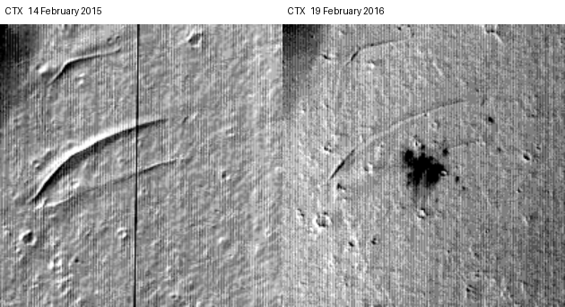
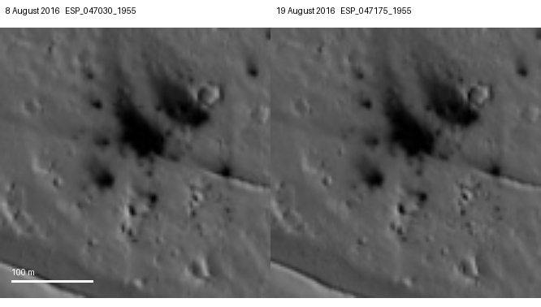
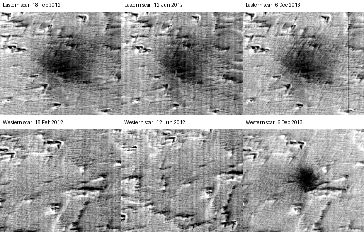

# Two apparent Martian impact pairs resolved in spacecraft images

Two catalog entries 82 m apart at 15.572° N, 234.090° E appear to record impacts in disjoint intervals. Raw Mars Reconnaissance Orbiter Context Camera (CTX) images show a single new dark impact scar between **14 February 2015 and 19 February 2016**. Two August 2016 HiRISE observations show the same cluster of dark features. The before and after images cited for the purported earlier event missed the site by over 8,100 km. The evidence supports treating these entries as a duplicate site for analyses of dated impacts. The two records alone cannot establish a second event.

The observing units were the before and after photographs cited by the Daubar et al. catalog. We tested whether their actual mapped footprints contained the catalog coordinates and whether successive observations revealed a distinct scar. This audit started with a search for temporally distinct, unusually close impact pairs. The two sub-kilometer candidates with non-overlapping catalog intervals were 82 m and 381 m apart. The latter represents two real, sequential disturbances separated by about 2.26 km. [Catalog paper](https://doi.org/10.1029/2021JE007145) · [Original 1,203-site table](https://doi.org/10.5281/zenodo.6604912)

## The apparent repeat impact

| Catalog row (HiRISE observation) | Equivalent crater diameter | Published interval | Imaging evidence |
|---|---:|---|---|
| ESP_047030_1955 | 7.99 m | 9 Feb 2008 to 26 Feb 2014 | Neither CTX footprint includes the cluster. The actual HiRISE image is from 8 Aug 2016. |
| ESP_047175_1955 | 7.94 m | 14 Feb 2015 to 19 Feb 2016 | Both CTX footprints include the cluster. The dark scar appears in the second image. The HiRISE image is from 19 Aug 2016. |



The panels show the same terrain, matched on four pre-existing landmarks outside the scar with a similarity transform. The registration residual was 6.3 CTX pixels RMS. The images have different illumination, with stronger relief shading in 2015. Each displays its own 1st–99th percentile contrast stretch. These products resolve the surface disturbance. HiRISE better resolves its structure. CTX image credit NASA/JPL-Caltech/MSSS. [CTX PDS archive](https://doi.org/10.17189/1520266)



The common field spans 333 m. The unfiltered pixel correlation is 0.9771 over 111 × 111 samples on a 3 m grid after translating the second map by −36 m east and +51 m south in the sampling coordinates. The offset is a registration measurement. Both maps share the same cluster, neighboring crater rims and terrain. The CTX and HiRISE images bound the impact date and resolve the cluster. They provide no exact time for the impact. Image credit NASA/JPL-Caltech/UArizona. [8 August observation](https://www.uahirise.org/ESP_047030_1955) · [19 August observation](https://www.uahirise.org/ESP_047175_1955)

## Two real disturbances formed 2.26 km apart

A second pair at about 1.75° S, 221.29° E has valid observing footprints. Its two catalog coordinates imply a separation of 381 m. We located the eastern and western impact scars in separate map-projected HiRISE observations and measured their separation as **2.258 km**. Both appear in the same December 2013 CTX image, providing an independent plate-scale check of **2.262 km**. The interval between the February and June observations establishes that the two disturbances formed **at least 115 Earth days apart**. This excludes a common instantaneous fragmentation event for these scars.

| Scar | HiRISE map used for position | Catalog position (° N, ° E) | Measured blast-zone center (° N, ° E) | Catalog-to-center offset |
|---|---|---|---|---:|
| Eastern | ESP_034503_1780, 6 Dec 2013 | −1.7507, 221.2941 | −1.7459, 221.3013 | 0.51 km |
| Western | ESP_034859_1780, 2 Jan 2014 | −1.7500, 221.2877 | −1.7616, 221.2665 | 1.43 km |



The eastern disturbance is already present on 18 February 2012; the western site still lacks a dark scar on 12 June 2012. On 6 December 2013 both are visible. Each panel is a 200 × 170 native-sample cutout centered by surrounding terrain and displayed with its own percentile stretch. The observations establish a sequence without requiring an impact flash or inferred impact time. Image credit NASA/JPL-Caltech/MSSS. [Eastern HiRISE observation](https://www.uahirise.org/ESP_034503_1780) · [Western HiRISE observation](https://www.uahirise.org/ESP_034859_1780)

We located each diffuse blast-zone center as a local minimum in a 12-pixel Gaussian-smoothed HiRISE browse image and converted the image coordinates with the PDS map label. Repeating with widths of 8, 16 and 20 pixels gave separations from 2.257 to 2.274 km. The center measurement is sensitive to the shape of the dark ejecta and uses meter-scale browse imagery. The quoted coordinates locate the blast zones and have no absolute geodetic error calibration. In the independent CTX after frame the centers differ by 405 samples and 104 lines. Multiplying the 418.1-pixel separation by the archived 5.41 m/pixel image scale gives 2.262 km, before a geometric-distortion correction. Both impact sites were published. The contribution here is the two-instrument separation measurement, the correction to the apparent 381 m pairing, and the visible three-epoch sequence.

## Five sites with geographically incompatible image assignments

There are 1,808 CTX endpoints for 1,122 sites in the published table, representing 1,656 unique CTX images. All cited IDs resolved in the Planetary Data System (PDS) footprint archive, including three uniquely matched abbreviated IDs with agreeing acquisition dates. Of these endpoints, 1,774 contain the published coordinate and 34 put it outside the polygon. Eight miss by 609–8,310 km. All other misses are at most 11.3 km. We use 100 km for the gross-error summary below. The same eight survive any threshold from 12 to 600 km. Each of the five HiRISE map labels independently brackets the listed coordinates in latitude and longitude. [PDS coverage downloads](https://ode.rsl.wustl.edu/mars/coverage/coveragefilelist.aspx?insthost=mro&inst=ctx&prodType=edr)

| Site | Before-image miss | After-image miss | Where the cited images actually fall |
|---|---:|---:|---|
| ESP_047030_1955 | 8,136 km | 8,310 km | Near 25° E. The August 2016 HiRISE image records the same cluster as ESP_047175_1955 near 234° E. |
| ESP_063406_2240 | 4,772 km | 4,806 km | Both cover the separately listed southern site ESP_063406_1385. The two HiRISE products share an orbit number. |
| ESP_045098_2175 | — | 2,529 km | The after image covers ESP_044887_1735. This audit treats only CTX endpoints. |
| ESP_065775_2000 | 0 km | 1,808 km | The after image covers ESP_066594_1915. |
| ESP_068345_1850 | 630 km | 610 km | Both cover ESP_068305_1855. |

Six of the eight misplaced endpoints are also cited for a different catalog site which they cover. Invalid brackets should be treated as missing temporal evidence unless independently recovered. Other observations could still establish the dates. For the other four sites, this analysis establishes the footprint contradictions and leaves the true formation dates open. The 26 smaller misses are retained for inspection, including near-edge cases sensitive to footprint accuracy. We have not inferred a revised global impact rate.

Three further after-image acquisition dates in the spreadsheet disagree with the archive. The archived product for ESP_066551_1300 was acquired on 10 September 2020 (table lists 1 September), ESP_066566_2090 on 12 April 2020 (lists 1 April), and ESP_066587_2040 on 27 August 2020 (lists 1 August). All three footprints cover their sites.

## Reproduction

Run from this directory. The committed endpoint extract contains catalog coordinates, IDs and dates, full matched product IDs, acquisition times and PDS footprint vertices. The audit requires only Python 3 and runs offline.

```sh
python audit.py > reproduced.csv
diff outside.csv reproduced.csv
```

The geometric test uses a longitude-unwrapped polygon and ray crossings for containment. For each miss, it measures the shortest great-circle distance to an edge on a sphere of mean Mars radius 3,389.5 km, including segment endpoints. Misses use distance to the footprint boundary. The archive truncates some vertices, especially longitudes, so kilometer-scale edge assignments need independent verification.

For regeneration from upstream data, download the inputs named in [sources.csv](sources.csv) into a separate data directory and verify their SHA-256 checksums. The PDS bulk coverage file is periodically updated. This extract freezes the 31 August 2026 version. Rebuilding uses Python 3 with openpyxl and pyshp. Rendering the image comparisons uses NumPy, SciPy and Pillow.

```sh
python extract.py /path/to/data/mars.xlsx /path/to/data/allctx.zip > extracted.csv
diff endpoints.csv extracted.csv
python compare_images.py /path/to/data rebuilt-cluster.png
python compare_ctx.py rebuilt-change.png
python adjacent_sites.py /path/to/data rebuilt-adjacent.png
```

The two CTX comparisons download only the 901-line PDS strips listed in [ctx-strips.csv](ctx-strips.csv) and [adjacent-strips.csv](adjacent-strips.csv), verifying each byte range against its hash. The fixed landmark coordinates and crop center are in the script. Independent reruns can compare alternate registration methods or retrieve the entire original EDRs. [All endpoints](endpoints.csv) · [All off-footprint endpoints](outside.csv)
