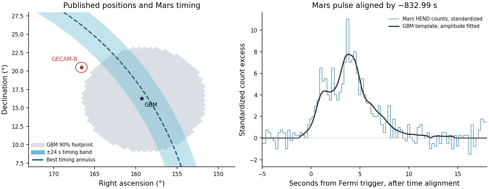

# Mars Odyssey timing tests for GRB 250902A and GRB 260307A

**Conditional timing constraint: the ring depends on correctly identifying the same physical pulse at Mars and at Fermi.** The Mars Odyssey HEND data contain a candidate pulse matching the Fermi GBM profile of **GRB 250902A**. If the association and empirical clock calibration are correct, its inferred arrival time at Mars is **832.99 s before Fermi**, and the resulting timing annulus passes **3.92°** from the GECAM-B centroid and about 0.66° from the Fermi catalog centroid. An incorrect matched peak would change the annulus; this is not a validated independent sky localization. GECAM-B gives a statistical-only 1σ radius of 0.7°. Under that pulse association, its centroid predicts arrival 50.39 s earlier at Mars than the observed best fit. Instrument systematics, an incorrect matched peak, or a problem in an archival timing convention remain possible. The measurement is an independent directional test of an already known burst. [Fermi trigger and position](https://gcn.nasa.gov/circulars/41648) · [GECAM-B position](https://gcn.nasa.gov/circulars/41687)

**GRB 260307A** has a second candidate HEND pulse 692.68 s after Fermi. The match persists in four overlapping energy selections. Its score barely exceeds the strongest background block, making this a lower-confidence candidate. The event's GECAM-B and CALET announcements report independent gamma-ray detections. [Fermi trigger and position](https://gcn.nasa.gov/circulars/43939) · [GECAM-B](https://gcn.nasa.gov/circulars/43961) · [GCN event history](https://gcn.nasa.gov/circulars/events/grb-260307a)

| Burst | Fermi trigger | Mars minus Fermi, s | Match score | Off-date blocks ≥ event | Largest off-date score | GBM 90% footprint | Within ±2 s | Within ±24 s |
|---|---|---:|---:|---:|---:|---:|---:|---:|
| 250902A | bn250902062 | −832.99 | 26.79 | 0 / 2,906 | 21.70 | 158.00 deg² | 4.23 deg² | 50.53 deg² |
| 260307A | bn260307478 | +692.68 | 11.23 | 0 / 2,355 | 11.16 | 418.81 deg² | 5.55 deg² | 66.71 deg² |

These areas intersect equal-area pixels in the public GBM 90% footprint with a specified timing interval. The intersection has no calibrated joint 90% coverage. A model-dependent ±2 s slice shows the geometric precision available when the same pulse dominates both instruments. The ±24 s slice accommodates the largest measured precision-control mismatch. Neither width sets a bound on future timing errors. The GECAM-B centroid still lies outside the ±24 s slice. A full GECAM systematics model or a new independent localization could change the interpretation. Table values use the unrounded measurements in the accompanying CSVs.



## Selection and prior art

An exploratory search of 4,420 GBM burst rows for repeat episodes was inconclusive. The December 2015 Mars signal turned out to be listed by the Interplanetary Network. That work prompted a separate retrospective search for timing localizations in more recent bursts. The screen ranks catalog fluence among bursts dated 2024-10-01 through 2026-03-31, excluding the first and last 3.5% of each UTC day, requiring a catalog statistical position error ≥0.5° and 0.2 < T90 < 15 s. It takes the 12 brightest. The calibration takes the 16 brightest from 2023-01-01 through 2026-03-31 with the same time-of-day margins, error <0.01° and 0.1 < T90 < 100 s. The ranking requires a finite fluence. [HEASARC GBM catalog](https://heasarc.gsfc.nasa.gov/W3Browse/all/fermigbrst.html) · [IPN master list](https://ipn3.ssl.berkeley.edu/masterli.txt)

Eight of the 12 screen rows produced scores above 6. Six have published IPN localizations. The trigger ending 250309318 belongs to GRB 250309**B**. Its optical afterglow predicts a lag within 0.153 s of the measured delay. The five remaining published IPN box centers predict lags within 0.28 s. Those boxes used HEND data and independently validate the reduction against another team's results. The optical afterglow provides independent sky information. The two candidate events were identified by matching exact Fermi trigger IDs to circulars. A search of the event histories, GRBweb and indexed literature through 2026-11-15 found no public HEND triangulation of either finalist. Private IPN holdings and uncataloged reports cannot be excluded. [250309B IPN and optical association](https://gcn.nasa.gov/circulars/39652) · [250902A event history](https://gcn.nasa.gov/circulars/events/grb-250902a) · [Controls and position references](reference_positions.csv)

## Timing, backgrounds and limitations

1. Read type-3 HEND records with a zero BAD_CODE. Each daily PDS4 product stores 240 outer-profile bytes at 0.25 s intervals. The XML defines the data layout. The frame UTC labels refer to the GRS collection interval. Applying them directly as profile centers gives tens-of-seconds offsets. For zero-indexed bin j this analysis uses **UTC − 30 s + (j+½) × 0.25 s + phase − 39.75 s**. The phase in seconds is the signed, wrap-corrected difference between 256 × T2 and T1, divided by 1024. The 39.75 s term is an empirical calibration from known-direction bursts, not an instrument-team clock certification. [Example PDS4 label](https://pds-geosciences.wustl.edu/ody/ody-m-grs-2-edr-v1/odge1_xxxx/2025/20250902/hend_spectra_20250902.xml) · [Odyssey GRS](https://pds-geosciences.wustl.edu/missions/odyssey/grs.html)
2. Bin the corrected Mars data on a 0.25 s UTC grid. Normalize against a running median of 10 s medians over 210 s, weighted by observed bin coverage. Sum background-subtracted GBM CTIME channels 3–6 from the first up to three triggered NaI detectors in DET_MASK order. Bin at 0.25 s, smooth with a 0.375 s Gaussian standard deviation and suppress bins below twice the off-pulse robust noise or 2% of peak. The exact selected files are frozen in the manifest. The four energy choices use the same photons in part and test sensitivity only.
3. Cross-correlate with the normalized GBM template, requiring >90% coverage by squared template weight. Search a lag half-window of 5 s plus three times the Earth–Mars light distance multiplied by the GBM positional width in radians. The width combines the reported statistical error and a 3.7° working systematic in quadrature. The precise-position calibrators use ±80 s. The geometrical prediction is minus the Earth-to-Mars vector dotted with the source unit vector, divided by c. The official GBM map, normalized over all native pixels, supplies the smallest 90%-mass pixel set. Divide each native pixel into 64 children to estimate the geometric areas. Planet-center baselines neglect spacecraft offsets at approximately the 0.04 s level and baseline evolution at approximately the 0.2 s level over the propagation time. A true inter-spacecraft solution would require both spacecraft histories.
4. The ten calibration matches with score ≥6 include nine residuals within 1.07 s and one serious 23.75 s failure in GRB 251118A, which has a Swift afterglow. Different peaks can align in broad, multipeaked profiles. The other six calibrators and all four weak screen rows are retained in measurements.csv. The offset calibration and exploratory target selection preclude a blind survey-level discovery significance. [GRB 251118A Swift position](https://gcn.nasa.gov/circulars/42782)
5. Compare the maximum over the **whole event lag window** to maxima over nonoverlapping equal-duration blocks, retaining blocks with at least 90% finite lag trials. The main control used the eight preceding and eight following UTC days per burst. Add-one rank fractions are 1/2907 and 1/2356. A nominal 12-target multiplication gives 0.0041 and 0.0051. These descriptive rates depend on background comparability and finite-sample resolution. Multiple blocks share an observing day and some contain real astrophysical or particle transients. The adjacent-day analysis was performed only for the two finalists. The same-day controls for every row appear in measurements.csv. The event-day ±2 lag half-window around the prediction was excluded from those controls.

The best next independent measurement is an IPN-team comparison with native HEND packet timing or a published inter-spacecraft annulus. For 250902A an independent image localization can distinguish the GECAM and GBM directions.

## Replay and data

Use Python 3.12 with NumPy, SciPy, Astropy and astropy-healpix. Run from this directory. The cache receives the published daily HEND files, Fermi CTIME files and Fermi probability maps. SHA-256 checks prevent silent changes. Use an empty output directory to compare against these committed CSVs.

```sh
python replay.py --cache /tmp/grb-mars-archive --out /tmp/grb-mars-replay
```

The optional `--targets-only` switch replays both finalists and their controls without downloading calibrator products. [Raw URLs and hashes](manifest.csv) · [Frozen catalog and ephemerides](cohort.csv) · [Scores and nondetections](measurements.csv) · [All control days](controls.csv) · [Matched light curves](profiles.csv) · [Analytic annuli](annuli.csv) · [Footprint intersections](areas.csv) · [Energy sensitivity](channels.csv) · [External-position checks](reference_checks.csv)

The HEASARC TAP query was `SELECT TOP 10000 name,trigger_name,ra,dec,trigger_time,error_radius,t90,t90_error,fluence FROM fermigbrst`, default VOTable format, SHA-256 `1bfcb388bc37b67805c8829549138c36c25821e9d51c420dd611e84f874c5f4e`. For each event JPL Horizons supplied a geometric geocentric Mars vector with COMMAND=499, CENTER=500@399, EPHEM_TYPE=VECTORS, REF_PLANE=FRAME, OUT_UNITS=KM-S, VEC_TABLE=2 and TLIST set to MJD+2400000.5 rounded through the six-decimal MJD input (four decimals for bn231214850). This approximates the UTC epoch as TDB and has negligible effect at the reported timing precision. Each frozen vector is published in cohort.csv. [HEASARC TAP](https://heasarc.gsfc.nasa.gov/xamin/vo/tap/) · [JPL Horizons API](https://ssd-api.jpl.nasa.gov/doc/horizons.html)
