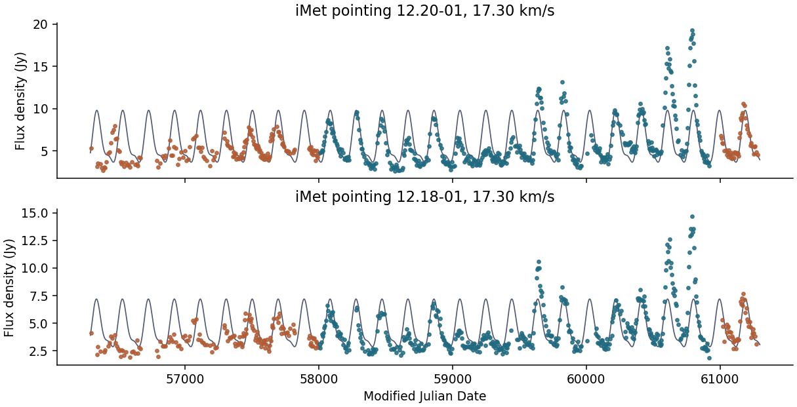

# A roughly 194-day modulation in the G12 methanol maser field

The 6.7 GHz methanol feature at about **+17.30 km/s** recurs on a **194-day cycle** in the iMet pointings labeled 12.203−0.107 and 12.181−0.123. In the first pointing, the 10th to 90th percentile range was **4.2–14.4 Jy** in the MJD 60000–61000 panel. A model fitted to the middle three panels predicts the variations in the later MJD 61000+ panel with correlations of **0.81 and 0.77** for the two pointings. Both beams cover the same sky structures and observing epochs. [Ibaraki 12.203−0.107 light curves](https://vlbi.sci.ibaraki.ac.jp/iMet/data/12.20-01/) · [Ibaraki 12.181−0.123 light curves](https://vlbi.sci.ibaraki.ac.jp/iMet/data/12.18-01/)

| Measurement | Pointing 12.203−0.107 | Pointing 12.181−0.123 |
|---|---:|---:|
| Period fitted in MJD 58000–61000 | 194.04 d | 194.19 d |
| Reference maximum, MJD | 59054.63 | 59054.09 |
| Period range on omitting a training panel | 192.60–194.84 d | 192.24–195.41 d |
| Early panel MJD 56000–57000, bins and correlation | 50, −0.26 | 45, −0.14 |
| Early panel MJD 57000–58000, bins and correlation | 112, +0.59 | 108, +0.48 |
| Later panel MJD 61000–62000, available bins and correlation | 44, +0.81 | 41, +0.77 |
| Later panel, correlation after dividing by ~19.8 km/s comparison line | +0.72 | +0.74 |

The earliest panel fails the frozen phase prediction in both pointings. The panel-level omission range, changing flare amplitudes and early failure limit how far the ephemeris can be extrapolated. The historical data do not determine whether the excitation changed or the early sampling missed flares. The two fitted ephemerides predict a maximum **around 9–10 December 2026**. That date is a central estimate and the flares have substantial width. Spatially resolved spectroscopy spanning the preceding and following weeks would test both phase and source identity.

**Two locations can produce this velocity.** Nguyen et al.'s GLOSTAR VLA catalog resolves a 17.26 km/s, 2.15 Jy/beam component at G12.2027−0.1073 and a 17.28 km/s, 2.23 Jy/beam component at G12.2093−0.1023. Their separation is 28.8 arcseconds, well inside the approximately 4.6-arcminute monitoring beam. The single-dish evidence establishes a modulation in the field. It cannot assign it to either site or distinguish one variable emitter from a blend. [GLOSTAR catalog](https://cdsarc.cds.unistra.fr/viz-bin/cat/J/A%2BA/666/A59) · [GLOSTAR paper](https://doi.org/10.1051/0004-6361/202244115)

**Prior observations.** Tanabe and Yonekura report long variability in this field. Their Table 4 lists 19.81, 22.07, 22.44 and 22.88 km/s and periods around 880 and 1,270 days. The feature measured here is at a different velocity and period. On 15 November 2026 we checked this paper, Yasui et al.'s 2015 named list and source-name/period searches including G12.181, G12.203, G12.209, 17.3 km/s, 193–195 days and Japanese observing-program material. We found no explicit report of this feature. The observing team's overview leaves roughly 20 periodic sources unnamed, so a claim of first detection would exceed the evidence. [Tanabe and Yonekura 2024](https://arxiv.org/abs/2402.17314) · [Yasui et al. 2015](https://vlbi.sci.ibaraki.ac.jp/vcon15/proc/Yasui.pdf) · [Ibaraki survey overview](https://doi.org/10.1017/S174392132300251X)

**Measurement.** This feature ranked first in the exploratory search of 541 eligible traces, with the neighboring beam's counterpart also near the top. A dedicated extraction measured the plotting symbols at the calibrated flux scales of the twelve original light-curve panels. Five-day bins limit oversampling of large symbols. The three middle panels provided the period search and two-harmonic template. The earliest two and latest panels served as separate checks. The plotted epochs and fluxes have digitization errors and do not carry the telescope's per-spectrum error bars. A gain change common to both velocity channels would cancel in the ratio test. Independent spectroscopy would provide a stronger check than these overlapping beams. [Selection and calibration methods](README.md) · [Input URLs and digests](g12-panels.json) · [Digitized measurements](g12-bins.csv) · [Fits and controls](g12-measurements.json)

From this directory, run `python g12.py --cache /tmp/imet-panels --out .`. The script verifies each input digest and reproduces the figure, timing and checks. The [monitoring program acknowledgment](README.md#reproduction) applies to these measurements.
