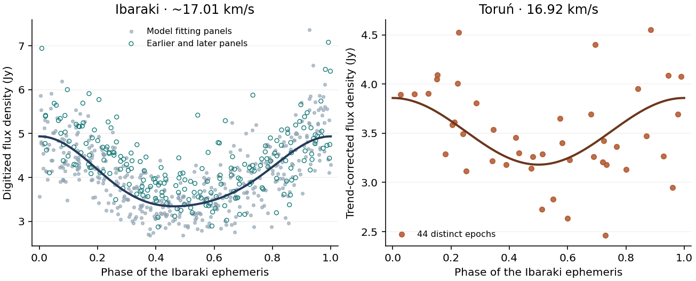

# Independent recovery of the G28.011−0.426 maser cycle in 2009–2013 data

Yasui et al. reported a **111.5-day** maser candidate in this field in 2015. We recover that cycle in **previously noise-classified Toruń observations from 2009–2013** using a prediction from later Japanese data. The feature is 6.7 GHz methanol emission near **+17 km/s**. [Original 2015 detection](https://vlbi.sci.ibaraki.ac.jp/vcon15/proc/Yasui.pdf)

A period and phase measured in three Ibaraki monitoring panels predict the signal in three other panels and in **44 earlier observations at Toruń, Poland**. The two archives span July 2009 to August 2026, with gaps. The Toruń authors characterized this source's changes as dominated by noise. Applying the timing measured in Japan recovers a positive cosine amplitude of **0.339 ± 0.095 Jy** in their 16.92 km/s feature. [Ibaraki 28.02−0.44 pointing](https://vlbi.sci.ibaraki.ac.jp/iMet/data/28.02-04/) · [Toruń monitoring paper](https://doi.org/10.1093/mnras/stx2693) · [Independent test and measurements](torun/README.md)



The same survey also found a **194-day feature** toward G12 in a velocity channel outside the published long-period analysis. [G12 evidence and source ambiguity](G12.md)

## The prediction and its tests

We fitted a constant and two Fourier harmonics to five-day bins for the blue, approximately 17.01 km/s Ibaraki feature in MJD 58000–61000. The fitted curve spans **1.59 Jy peak to trough**. Its maximum falls at **MJD 59067.65 + 112.75746 × E**, for integer cycle number E. The digits specify the reproducible prediction. Dropping each training panel in turn gave periods of **112.53–112.89 days**. The post-selection model used all three middle panels. Only the first, second and sixth panels were reserved from the screen and fit. [Model coefficients and per-panel checks](measurements.json) · [Digitized bins](digitized.csv)

| Ibaraki panels | Approximate observed MJD range | Five-day bins | Correlation with frozen model |
|---|---:|---:|---:|
| First, early check | 56295–56996 | 51 | 0.54 |
| Second, early check | 57007–57993 | 115 | 0.72 |
| Third, used in fit | 58004–58994 | 143 | 0.70 |
| Fourth, used in fit | 59005–59959 | 159 | 0.72 |
| Fifth, used in fit | 60004–60917 | 157 | 0.79 |
| Sixth, late check | 61007–61280 | 50 | 0.79 |

The Polish observations were tested after freezing the Japanese ephemeris. At the predicted maximum, the 16.92 km/s cosine amplitude is positive in both chronological halves, **+0.360 and +0.331 Jy**. A fit allowing correlated noise gives **+0.336 ± 0.109 Jy**, with a one-sided conditional simulation probability of **0.00095**. Moving-block resampling gives **0.00050–0.00140** across four block lengths. These probabilities apply to the specified line, period and phase in the independent data. The weaker Toruń 16.13 km/s feature changes in the same direction. Both features use the same 44 spectra. [Frozen-period tests](torun/fixed_phase.json) · [Vector extraction from the published figure](torun/extract.py)

## What varies

The Ibaraki feature near 16.19 km/s gives a separate best fit of 112.77 days. A feature near 24.7 km/s gives 112.98 days. The 23.8 km/s comparison feature shows little coherence with the blue-channel prediction in the three training panels (correlations 0.03, 0.10 and 0.05 on matched bins). Dividing the blue flux by the green comparison flux retains a positive correlation in all six panels. These controls and the independent telescope disfavor a shared instrumental gain change.

The Ibaraki pointing has an older coordinate-based name, 28.02−0.44. European VLBI Network imaging resolved the G28.011−0.426 blueshifted spots at 15.8–18.0 km/s and a compact redshifted group at 23.3–28.5 km/s. The repeating velocities occur in both mapped groups. The time series come from single-dish beams and do not identify the individual changing spot in either group. The record establishes a repeating intensity variation. It leaves the pumping mechanism and the possible presence of a binary unresolved. [Interferometric maps and Table 2](https://doi.org/10.1051/0004-6361/201527541)

## Selection, prior reports and interpretation

The accessible iMet index contained 407 source directories. We obtained all three middle panels for 393. Screening up to eight plotted colors yielded 541 eligible traces in 166 pointings. A coarse sinusoid search used 38–340 days, scoring agreement separately on the first 2,000 and final 1,000 days of the three-panel discovery interval. The blue G28 trace ranked second by the smaller of these two correlations, at a grid period of 112.33 days. This ranking selected a target for measurement. Lines connecting sparse markers, seasonal coverage, repeated pointings on the same sky and shared receiver errors make it unsuitable for calculating survey-wide significance. The fine measurement detects filled marker cores in the native raster, bins them and explicitly checks the unused pages. The relative pixel calibration gives approximate epochs and fluxes. The original Ibaraki single-epoch spectra are available from the observing team on request. [Screen](screen.py) · [Ranked traces](screening.csv) · [Source list, missing panels and digests](screen-sources.csv) · [Target panel URLs and digests](panels.json)

On 15 November 2026 we checked both coordinate names, the 112/113-day range, machine-readable catalogs and Japanese workshop material. Yasui et al.'s 2015 poster explicitly lists **G028.02−00.44 at 111.5 days** among newly detected periodic sources. Its early Hitachi observations overlap the earliest public panels. The Polish data were acquired separately. Szymczak et al. subsequently described the variations in their own measurements as dominated by noise. This contribution recovers those earlier Polish measurements at the predicted phase, establishes long-term coherence and quantifies the response of several velocity channels. We found no earlier explicit report of the Toruń phase recovery in the checked records. [Yasui et al., 2015 workshop poster](https://vlbi.sci.ibaraki.ac.jp/vcon15/proc/Yasui.pdf) · [Toruń survey](https://doi.org/10.1093/mnras/stx2693) · [Ibaraki survey overview](https://doi.org/10.1017/S174392132300251X)

**Prospective test.** The frozen curve reaches its next maximum after the search date around **30 January 2027**. Repeated spectra covering the preceding and following weeks can test the phase and velocity dependence at another observatory. Scatter among individual flares and the panel-omission period range limit the accuracy of any single predicted peak.

## Reproduction

From this directory, use Python with NumPy, SciPy, pandas, Pillow and Matplotlib. The Toruń vector extraction additionally requires PyMuPDF. Cache the original inputs outside the repository. The live Ibaraki figures can change as new epochs arrive. The digests identify the precise versions analyzed. The checked-in measurement bins remain usable for the reported fits and figure.

```sh
python measure.py --cache /tmp/imet-panels --out .
python torun/validate.py
python plot.py
```

The full selection can be replayed separately with `python screen.py --cache /tmp/imet-panels --out screening.csv`. The [Toruń extraction notes](torun/README.md) give its source download, hash and extraction command. They also record how closely a rerun of `torun/validate.py` matches: the conditional simulation probability quoted above as 0.00095 is a count of 18 in 20,000 draws, and reruns under other NumPy builds counted 17 and 22.

This work is partially supported by the Inter-university collaborative project "Japanese VLBI Network (JVN)" of NAOJ and by the Japan Society for the Promotion of Science (JSPS) KAKENHI Grant Numbers JP21H01120 and JP21H00032.
