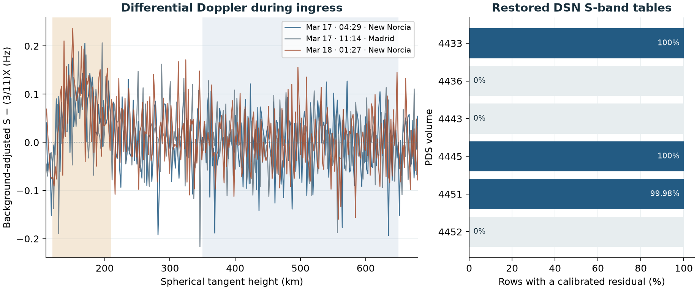

# Six restored Mars Express S-band tables carry X-band field labels

**Noteworthy archive correction · Correction.** In all six Mars Express DSN passes added on 26 October 2026, the DPS labels call their observed, predicted, and calibrated residual frequency fields X-band. The observed native carriers are near **2.2965 GHz**, in S-band. Three passes supply no calibrated S-band residual at any native sample, even though their carrier and predicted frequency fields are populated. The 17 March 2024 Madrid pass is among the three with usable calibrated pairs. Its radio ray crossed the Martian limb several hours before the modeled arrival interval of the storm associated with the first published visible aurora detection on Mars. [NASA release](https://pds.nasa.gov/datasearch/subscription-service/SS-20261031.shtml) · [Native product receipts](radio-sources.json) · [Primary aurora study](https://pmc.ncbi.nlm.nih.gov/articles/PMC12077521/)

## What the restored DSN tables contain

We identified bands using the product type, the measured carrier and the instrument documentation. The six DPS companion DPX products are X-band files. The analyzed pairs with valid calibration put the X carrier near 8.42 GHz. The new DSN file labels use X-band names for both sides. For the valid pairs, subtracting each native prediction from the observed carrier reproduces the native calibrated shift within 2 microhertz. The recorded differential column uses the underlying observed carriers, so its presence and the presence of a calibrated residual are separate checks. [MaRS instrument description](https://sci.esa.int/c/portal/doc.cfm?fobjectid=34889) · [Exact PDS labels](native-labels.zip) · [Native row audit](radio-reduction.json)

| Volume | Date in 2024 | DSN station | Native S-band rows | Calibrated S residuals present | Archive S/X differential present |
| --- | --- | --- | ---: | ---: | ---: |
| 4433 | March 17 | 65 | 21,030 | 21,030 | 21,030 |
| 4436 | March 19 | 63 | 21,000 | 0 | 21,000 |
| 4443 | March 24 | 63 | 21,010 | 0 | 21,005 |
| 4445 | March 26 | 14 | 21,000 | 21,000 | 21,000 |
| 4451 | March 30 | 65 | 20,840 | 20,835 | 20,835 |
| 4452 | October 27 | 63 | 20,370 | 0 | 1,710 |

These counts cover full native files. All six S-band tables have positive observed carrier values on every row. In the three passes with missing S-band residuals, the calculated difference between the published observed and predicted frequencies can be large. We kept the archive's missing calibration flags, which restrict the frozen calibrated analysis to three DSN passes. The finding establishes a field-name discrepancy and an availability limit for this release. It does not establish the cause of the missing calibration. [Native values and receipt counts](radio-reduction.json) · [Compact calibrated pairs](radio-seconds.zip)

## The March 17–18 limb comparison

Reconstructed SPICE geometry places the 120–210 km portion of the two New Norcia passes near 67° north and a solar zenith angle near 87°. The two scored passes differ by **0.51°** in median tangent latitude and **0.66°** in median solar zenith angle, with **nine** common 10 km bins. The Madrid pass falls between them in UTC and crosses a similar latitude and solar illumination. The median absolute differences between the independent spherical radii and the native S-band radius field are below 0.5 km in the analyzed tracks between 100 and 700 km. This checks consistency with the archived geometric convention. Both methods approximate the ray and share mission ephemeris inputs. The calculation omits station displacement, refractive bending and the Martian ellipsoid and terrain. [Frozen protocol](PROTOCOL.md) · [Geometry grid](geometry-2s.zip) · [Kernels and hashes](kernel-receipt.json) · [Pass measurements](summary.json)

We use separate S and X medians from at least five valid native records in each UTC second. The native epochs within each second can differ. We evaluate each paired second at the midpoint of its bin, with two-second geometry interpolated in time. For a coherent link, S − (3/11)X applied to calibrated residuals suppresses a common fractional Doppler component. We fit a linear background from 350–650 km and score each ingress at 120–210 km. Residuals can include plasma along the full path and remaining station or instrument terms. The method measures a radio-frequency difference and does not retrieve a vertical electron-density profile. [Methods](PROTOCOL.md) · [Reduced radio series](radio-seconds.zip)

| Pass | Matched limb seconds | Median absolute limb residual, linear background (Hz) | Limb/background ratio |
| --- | ---: | ---: | ---: |
| March 17 early, New Norcia TCL2 (4432) | 48 | 0.0781 | 1.93 |
| March 17 later, Madrid (4433) | 47 | 0.0677 | 1.89 |
| March 18, New Norcia TCL2 (4434) | 47 | 0.0952 | 2.36 |
| March 26, Goldstone (4445) | 47 | 0.0225 | 1.72 |
| March 30, Madrid (4451) | 49 | 0.0470 | 1.45 |

In the main fit, the usable New Norcia receiver shows a median increase of **0.0213 Hz** across the nine matched altitude bins. An offset-only fit leaves a smaller pass-level difference. Changing the linear background interval to 300–600 km gives **0.0866 Hz** before and **0.0806 Hz** after, reversing the ordering. The earlier pass also fell below the frozen twofold limb-to-background threshold. The two TCL1 S-band files supplied no usable carrier or predicted samples in either pass. Both passes have TCL1 X-band coverage, but the missing S band prevents the planned dual-band receiver check. We did not find evidence meeting the frozen criteria for a storm-related change in the Martian ionosphere. An independent fixed-width replay reproduced the reported TCL2 contrast to within 0.01 in the contrast ratio. [Matched bins and fit sensitivity](summary.json) · [Receiver coverage](radio-reduction.json)

## Independent context

The published model places the leading edge at 00:51 UTC on March 18 with uncertainty of seven hours. The low-altitude part of 4434 is within that modeled window. The published MAVEN energetic-particle enhancement and the rover aurora observation were later. The deposited Mars Express telemetry has one counter at **56** during both March 17 passes and **59** during 4434, with three increments first recorded between the latter two passes. The other counter stays at 55 around the three passes. The source header does not specify a timezone or timestamp basis, so these counter comparisons are approximate. The counters indicate cumulative memory errors and provide no direct plasma-density measurement along the radio path. [Primary paper](https://pmc.ncbi.nlm.nih.gov/articles/PMC12077521/) · [EDAC source](https://zenodo.org/records/13364069) · [Context extraction](context.json)

For DSS-65 on March 17, the IGS archive's UPC rapid grid gives vertical TEC estimates of **34.11**, **40.70**, and **44.77 TECU** at 10:00, 11:00 and 12:00 UTC. The other grids have missing values at the required neighboring cells. The bilinear samples describe the column above the station using a coarse hourly grid. They cannot correct the exact slant radio path or resolve a feature lasting tens of seconds. [NASA SPDF source](https://spdf.gsfc.nasa.gov/pub/data/gps/tec1hr_igs/2024/) · [DSS-65 coordinates](https://pds.nasa.gov/ds-view/pds/viewContext.jsp?identifier=urn:nasa:pds:context:telescope:madrid.dss65_34m-post2005) · [Grid values and RMS](context.json)

## Reproduce

From this folder, reproduce the fitted comparisons with the standard library on Python 3.10 or later.

~~~text
python analyze.py --output summary.json
~~~

The native tables stay on D in the original full-resolution form. To regenerate the compact data, retrieve the [original table files](radio-sources.json) and their pinned labels, then run `python prepare_radio.py --data-root NATIVE_DIRECTORY --output replay-radio.zip --receipt replay-radio.json`. To regenerate the independent geometry, download the [six kernels](kernel-receipt.json), install NumPy and SpiceyPy, and run `python replay_geometry.py --kernels KERNEL_DIRECTORY --output replay-geometry.csv`. All three native source reductions verify pinned files before reading them. The [context script](prepare_context.py) uses the EDAC text and GNSS CDF references embedded in [context.json](context.json). Regenerate the figure with Matplotlib using `python plot.py --output replay-figure.png`.
