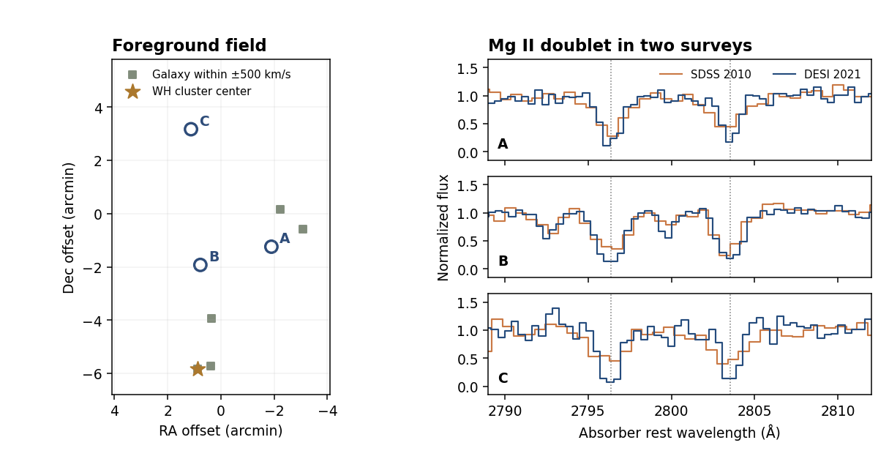

# Three strong Mg II systems in the J0108 foreground at redshift 0.960

Three different quasars show strong intervening Mg II doublets within a full rest-frame velocity span of **192.7 km/s**. The sightlines span **2.544 Mpc proper** at the absorber redshift. A fourth object, the central galaxy of the previously catalogued cluster candidate WH-J010803.3−011341, has a secure DESI redshift 364 km/s above the median absorber. The observation is a three-sightline association in a spectroscopically populated environment. Its extent describes the separation of the three measurements. Separate galaxy halos in the same structure can produce this geometry.

| Sightline | SDSS J2000 name | DESI quasar z | Mg II z | W2796 (Å) | W2803 (Å) |
|---|---|---:|---:|---:|---:|
| A | 010752.22−010904.9 | 3.27799 | 0.960152 | 1.318 | 1.017 |
| B | 010802.90−010946.0 | 3.32229 | 0.960403 | 1.695 | 1.401 |
| C | 010804.31−010440.2 | 1.28419 | 0.959144 | 1.428 | 1.124 |

The angular separations A–B, A–C, B–C are 2.7553′, 5.3477′, 5.1093′. The corresponding transverse distances are 1.311, 2.544, 2.431 proper Mpc for flat ΛCDM with H₀ = 70 km/s/Mpc and Ωₘ = 0.3. The table gives the released DESI Mg II fit measurements. Independent SDSS spectra of all three quasars recover the absorption at the DESI-defined wavelengths. Anand et al.’s separate SDSS DR16 Fe II-confirmed catalog includes C at z = 0.959064. [Catalog measurement errors](j0108-absorbers.csv) · [Pair geometry](sightline-separations.csv) · [Pixel measurements and independent spectra](spectra/) · [DESI DR1 Mg II catalog](https://data.desi.lbl.gov/doc/releases/dr1/vac/mgii-absorber/) · [Anand et al. catalogs](https://wwwmpa.mpa-garching.mpg.de/SDSS/MgII/)

## Survey-wide selection and sky shuffles

The discovery pass included DESI Mg II and SDSS Fe II-confirmed Mg II positions and inspected multiple radii and line-strength cuts. The following DESI-only reconstruction avoids duplicate observations across releases. The input contains 270,529 Mg II systems. Main-survey rows with ZWARN = 0, minimum doublet line S/N ≥3, maximum ≥5, W2796 >0.3 Å and quasar-to-absorber log-velocity offset >5,000 km/s yield 138,061 systems on 105,650 quasars. Every pair in each retained triangle must exceed 4 arcsec and fall within the stated diameter.

Of 207,362 absorber-record triangles within 15′, six have W2796 ≥1 Å in all three beams and full velocity range ≤500 km/s. J0108 is the most compact. Among 5,184 triangles within 6′, J0108 alone meets W2796 ≥1 Å and span ≤250 km/s. The observing unit for the search is a triple of absorber records on distinct sightlines. Multiple absorbers in one spectrum generate multiple opportunities on the same sky triangle. [All six comparison systems](all-strong-triplets.csv) · [Selection counts](selection.json)

Two controls reassign complete absorber lists to the fixed quasar positions. Each permutation retains multiplicity, the within-spectrum redshift sequence, and absorber equivalent widths. Within equal multiplicity and 0.1-wide quasar-redshift bins, objects are sorted by quasar redshift and split into pools of at most 80. Donors that could violate the 5,000 km/s cut at the lowest redshift in the pool stay fixed. The regional variant also restricts exchange to 60° RA by 30° Dec bins. Both use seed 8871 and enumerate all eligible triangles within 6′ for each realization.

Across 5,000 shuffles, **42** all-sky and **49** regional realizations produce at least one strong triplet within 6′ and 250 km/s (plus-one tail fractions 0.0086 and 0.0100). This quantifies chance realignment across the surveyed positions at these exploratory cuts. Radius, line strength and velocity were examined during this investigation. These numbers do not incorporate the choice of cuts or distinguish a shared halo from galaxy clustering. The shuffles preserve sampled sky positions and broad selection, while disrupting real foreground clustering.

## Additional sightlines

A fixed-redshift extraction tested all 14 secure background quasars within 12′ available on discovery healpixel 17997. A ±325 km/s aperture around each transition at the common median redshift recovers all three discovery doublets. The 11 additional sightlines yield no further pair with both lines at ≥3σ. One sensitive sightline at RA 16.915848°, Dec −1.178488°, 5.77′ from the centroid, gives W2796 = −0.06 ± 0.19 Å (measurement plus 3σ = 0.51 Å). Another at radius 5.00′ shows a stronger nominal 2803 line, W2803 = 1.04 ± 0.16 Å and W2796 = 0.45 ± 0.16 Å. The latter fails the two-line criterion and has an inverted apparent ratio. Several other spectra have errors above 1 Å. These data support spatial variation and do not measure an area covering fraction. [All 14 sightlines and errors](neighboring-sightlines.csv)



The foreground panel shows the five secure galaxies within the 6′ aperture and velocity slice. The spectrum panel compares the same three quasars on SDSS plate 4226 and in DESI. All six independent SDSS plate-4226 lines are significant at ≥7.5 formal standard errors with the fixed-redshift aperture. [Pixel-level measurements and uncertainties](spectra/README.md)

## Foreground spectroscopy and known structures

The mean quasar position is RA 16.999238°, Dec −1.130688°. Within 6′ of it, five distinct DESI main/dark galaxies have ZWARN = 0, Δχ² ≥25 and velocities within ±500 km/s of median z = 0.960152. The 28 contiguous, nonoverlapping comparison windows centered at offsets ±1,000 through ±14,000 km/s in the same aperture have median 0 and maximum 4 galaxies. Within 12′ there are eight galaxies and one control window contains nine. The aperture sensitivity is available in the complete control table. Spectroscopy samples targets incompletely and the galaxies have ordinary large-scale clustering. [Catalog rows with impact parameters](foreground-galaxies.csv) · [All control radii and widths](galaxy-control-windows.csv)

Wen & Han catalogued WH-J010803.3−011341 (ID 78385) at RA 17.01375°, Dec −1.22795°, with photometric redshift 0.9455, 10 assigned members and R500 = 0.567 Mpc. Its central galaxy matches DESI 39627754815095287 within 0.0184″ at spectroscopic z = 0.9625344, Δχ² = 370. Relative to this center, A, B and C lie **2.55, 1.86 and 4.29 proper Mpc** away. The nearest galaxy in the ±500 km/s secure sample to any of the three beams lies 0.64 Mpc from A. Additional galaxies at smaller impact parameter could be below DESI’s selection limit.

The 47-member candidate J010745.7−010713, already listed in the Y21 catalog, has photometric z = 0.9719 and R500 = 0.820 Mpc. Its center lies 1.18 Mpc from A and lacks a <2″ redshift match in these DESI files. Another nearby candidate center at photometric z = 0.9857 has DESI z = 0.953410. The SDSS DR16 quasar J010749.01−010722.3 at z = 0.956848 lies 113.46″ (0.90 proper Mpc) from A. These objects give plausible alternatives to assigning the absorbers to the gas of a single cluster. [Cluster crossmatches and all three distances](cluster-crossmatches.csv) · [Original 15′ Wen & Han VizieR response](wen-han-cone.tsv) · [SDSS DR16Q query](dr16q-cone.tsv) · [Wen & Han 2024](https://arxiv.org/abs/2404.02002)

## Prior work and scope of the claim

All individual quasar and absorber records, the cluster candidates, and the survey spectra are archival. Coherent Mg II in nearby sightlines is established. The 2026 SDSS statistical pair analysis covers about 50 kpc to 1 Mpc. Even the shortest J0108 side is 1.31 Mpc. Searches on 2026-11-15 for the full and truncated SDSS coordinate names above, the corresponding DESI coordinate strings, WH-J010803.3−011341, J010745.7−010713, and combinations with Mg II, z≈0.96, quasar pair or triplet found no previous description of this specific three-sightline association. Survey tables or unindexed work could already contain it. The galaxy central redshift constrains a local structure. Its projected distances and the sparse sightlines leave the host assignment and gas connectivity open. [SDSS pair study](https://arxiv.org/abs/2604.13162)

## Reproduce

Requires Python with NumPy, SciPy and Astropy. Download the input FITS files to a separate working directory, then run these commands from this result directory. The checked-in VizieR cone retains the catalog response used by the second command.

```sh
python search.py /path/to/MgII-Absorbers-DR1.fits --out . --shuffles 5000
python environment.py /path/to/redrock-files --out .
python neighboring_sightlines.py /path/to/redrock-files/redrock-main-dark-17997.fits /path/to/coadd-main-dark-17997.fits --out .
```

The first command verifies the official VAC checksum and rebuilds the survey population, triplets, permutations and candidate rows. The second uses the four redrock-main-dark-PIXEL.fits files at the URLs in the provenance file. Those four nested NSIDE=64 pixels cover the 15′ environment cone. Foreground redshifts and positions are joined by matching TARGETID row order. The Wen & Han table query used VizieR J/ApJS/272/39/table2 with center 16.999238 −1.130688 and radius 15 arcmin. The analogous 6′ SDSS name query used VizieR VII/289. [DESI catalog FITS download](https://data.desi.lbl.gov/public/dr1/vac/dr1/mgii-absorber/v1.0/MgII-Absorbers-DR1.fits) · [Redrock URLs and checksums](foreground-provenance.json)
