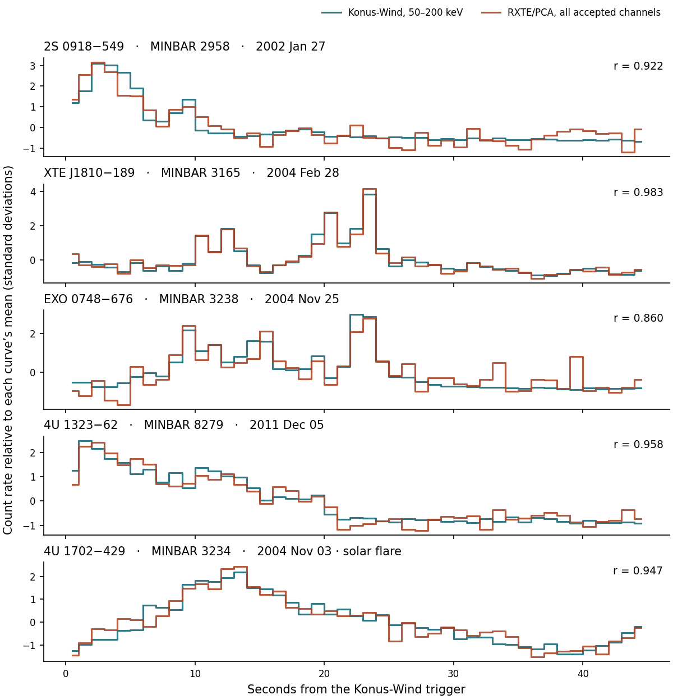

# Four gamma-ray bursts and a solar flare in a thermonuclear burst catalog

On 2011 December 5, RXTE recorded two soft X-ray bursts toward the neutron-star binary 4U 1323−62, 650.6 seconds apart. A harder flash between them has the time profile of GRB 111205A. The Interplanetary Network (IPN) triangulated that gamma-ray burst **51.54° from the RXTE pointing**. In the first 20 seconds of the middle event, RXTE measured **624 ± 34 excess hard counts** and **28 ± 25 excess soft counts**. The first and third events showed the opposite spectral behavior. Assigning all three entries to the neutron star would create the shortest of 21 rapid three-entry windows in the selected sample. [IPN localization](https://gcn.nasa.gov/circulars/12626) · [Konus-Wind detection](https://gcn.nasa.gov/circulars/12627) · [MINBAR entry 8279](https://burst.sci.monash.edu/wiki/index.php?n=MINBAR.8279)

A search across the published Multi-INstrument Burst ARchive (MINBAR) found three further bursts recorded by Konus-Wind and one solar flare whose profiles appear in the RXTE data. Two gamma-ray bursts have independent IPN positions that exclude the RXTE pointing. The five associations concern the origins of catalog entries. The Konus and IPN teams had already reported the external transients.



## The five associations

Each correlation compares the same 45 seconds in one-second bins using all accepted RXTE pulse heights. Positive lag means RXTE received the fitted profile later than Wind. The control column shows the highest correlation after the same lag search in 20 windows elsewhere in that RXTE pointing. The controls include the flanking soft bursts where covered.

| MINBAR ID and catalog source | Konus trigger, UTC | External signal | Lag (s) | Pearson r | Largest control r |
|---|---|---|---:|---:|---:|
| 2958 · 2S 0918−549 | 2002 Jan 27 07:07:13.958 | GRB, also detected by Ulysses and Mars Odyssey | −7.25 | 0.922 | 0.493 |
| 3165 · XTE J1810−189 | 2004 Feb 28 00:08:44.351 | GRB 040228, hard trigger H3066 | +0.75 | 0.983 | 0.406 |
| 3238 · EXO 0748−676 | 2004 Nov 25 16:07:07.399 | GRB, also detected by Mars Odyssey and RHESSI | −3.25 | 0.860 | 0.575 |
| 8279 · 4U 1323−62 | 2011 Dec 05 13:10:50.301 | GRB 111205A | −0.25 | 0.958 | 0.788 |
| 3234 · 4U 1702−429 | 2004 Nov 03 03:28:30.983 | Solar flare, GOES class M1.6 | +3.50 | 0.947 | 0.530 |

The 2004 February event supplies a second localization test. HETE distinguished several pulses that morning. The first hard pulse, H3066, is the one matched here. The RXTE pointing was 15.95° from even the full centerline of its narrow IPN annulus. Projecting Wind's geocentric position onto the two endpoints of the published allowed arc predicts RXTE-minus-Wind delays of +0.765 and +0.786 s, consistent with the measured +0.75 s. First differences of the two count histories correlate at 0.960, so even their rapid rises and falls agree. The event is one of four entries assigned to XTE J1810−189 before the 2008 outburst. This analysis addresses this one entry. [IPN H3066 solution](https://gcn.nasa.gov/circulars/2538) · [HETE triggers](https://gcn.nasa.gov/circulars/2536) · [MINBAR entry 3165](https://burst.sci.monash.edu/wiki/index.php?n=MINBAR.3165)

For GRB 111205A, the IPN-center delay prediction is +0.023 s. At zero fitted shift the all-channel correlation is already 0.954. MINBAR lists MJD 55900.54923, giving 13:10:53.472 UTC at its printed precision (0.864 s per last digit). It is 3.171 s after the fractional Konus trigger, or 3.472 s after the whole-second screening timestamp. These catalog start estimates differ from the fitted profile lag. The neutron-star pointing predicts +3.287 s. For the 2002 and November 2004 GRBs, the light-curve fits give −7.25 and −3.25 s, while the RXTE pointing predicts +1.92 and +0.27 s. For the M1.6 solar flare, the Sun direction gives about +4.2 s. These are comparisons of one-second bins in different energy bands. Grid spacings of 0.25 s are a numerical sampling choice. The results do not measure source positions to subsecond timing precision. For example, the 2002 fitted lag exceeds the full Wind-to-Earth light time by 0.37 s. [Konus 2002 trigger](http://www.ioffe.ru/LEA/kw/triggers/2002/kw20020127_25633.html) · [2004 GRB](http://www.ioffe.ru/LEA/kw/triggers/2004/kw20041125_58027.html) · [Solar flare](http://www.ioffe.ru/LEA/kw/triggers/2004/kw20041103_12510.html) · [Geocentric vectors and queries](data/wind_vectors.csv)

## How the apparent triplet changed the search

The exploratory search ranked three consecutive entries with the same target, instrument label and observation ID and at most 45 minutes between each pair. We excluded IGR J17480−2446 because its published, nearly continuous rapid bursting is a separate physical regime. We retained all catalog flags and included overlapping three-entry windows from longer trains. The shortest window spanned 10.8432 minutes, with nominal gaps of 6.7248 and 4.1184 minutes. The next shortest spanned 12.6576 minutes toward 4U 1608−522. All 21 windows and all 7,111 input rows are available for replay. [Catalog](https://doi.org/10.26093/cds/vizier.22490032) · [Rapid bursting in IGR J17480−2446](https://doi.org/10.1088/0004-637X/748/2/82) · [Ranked windows](measurements.json)

RXTE's two active proportional counter units independently measured the hard excess during event 8279. The background is a 100-second interval ending 20 seconds before each event. For the 20-second event window, the background estimate is one fifth of those counts. Errors propagate on- and off-window Poisson variances. The soft band covers event-mode pulse-height indices 0–11 and the hard band 35–63. The FITS header maps those indices to detector channels. These measurements are counts at the instrument, without a spectral response model for off-axis illumination.

| MINBAR entry | Soft excess, PCUs 2 + 4 | Hard excess, PCUs 2 + 4 |
|---|---:|---:|
| 8278 | 3,164 ± 61 | −2 ± 22 |
| 8279 | 28 ± 25 | 624 ± 34 |
| 8280 | 485 ± 32 | −29 ± 22 |

For event 8279 the hard excess is 287 counts in PCU 2 and 337 counts in PCU 4. A single-counter breakdown cannot account for both or for the simultaneous independent waveform. A fainter underlying thermonuclear signal could be hidden in these data. [On- and off-window counts by detector](data/triplet_counts.csv) · [RXTE event-mode data](https://heasarc.gsfc.nasa.gov/FTP/xte/data/archive/AO15/P96405/96405-01-05-01/pca/)

## Timing search and controls

After identifying GRB 111205A we cross-matched 7,111 MINBAR DR1 entries (including 2,288 RXTE/PCA) and 3,219 entries in the Konus-Wind trigger indexes for 1996–2012. The indexes contain 2,135 entries classified GRB or sGRB. All four GRB matches fall within 10 seconds of a catalog start. We retained every trigger-class match within 35 seconds for follow-up. The three wider-window solar-flare coincidences include two controls. The integer-second trigger index is used only for screening. The detailed timing uses the fractional trigger stamps in the Konus data headers.

Shifting all MINBAR times from −12 to +12 hours in one-minute steps produces at least four GRB coincidences within 10 seconds for 5 of 1,440 nonzero shifts. The trigger window and population were explored after seeing the first event. Shifts share the same observations. This diagnostic measures the frequency of such counts under time shifts and does not give a discovery false-alarm probability. The individual waveform and localization tests provide the attribution evidence.

For each candidate we downloaded the original RXTE event-mode FITS records from HEASARC and the Konus team's numerical 64-millisecond 50–200 keV light curve from NASA GCN. We converted local RXTE TT using the FITS reference epoch and clock correction and the UTC leap-second offset. We compared the first 45 seconds after the Konus trigger, accepting only completely covered RXTE bins in the good-time intervals. Both data streams were binned to one second. We tested lags from −10 to +10 s in quarter-second steps and repeated that fit at ±60, ±120, …, ±600 s in the same RXTE visit. The direct RXTE reduction and Konus data are independent. Hard/soft channel splits and detectors share the same RXTE visit. [Konus light-curve format](https://gcn.gsfc.nasa.gov/gcn/konus_grbs.html) · [Data links and raw hashes](data/inputs.json)

We retained MINBAR 2474 (4U 1728−34) and 2573 (Aql X−1) as timing coincidences with solar triggers. Both have published bright, thermal spectra and carry a telemetry-gap flag. For 2474, the event-mode data fail the complete-window condition. For 2573 the best hard-band correlation is 0.142, despite a moderately similar broad-band envelope. We do not reclassify either event. All seven matches, their catalog flags and the sensitivity to energy band are recorded. The trigger search covers the published Konus triggered list; it misses external events which did not trigger Konus. [All matches and controls](measurements.json)

## Attribution and prior reports

Galloway and collaborators compiled and measured these RXTE events. Their catalog flags 2958, 3234, 3238 and 8279 with **f** for faint emission or a background problem preventing time-resolved spectroscopy. Entry 3165 carries **b** for an offset pointing. The 2020 paper explicitly describes how hard GRBs can register from outside the PCA field and discusses a *different*, previously removed event coincident with a November 8, 2004 Konus burst. The published errata, seven event pages, original GRB circulars and target/GRB literature searches checked here did not identify the five specific associations reported above. A newly recognized counterpart is distinct from discovery of the original transient. [MINBAR, sections 3.1.2 and 6.6 and Table 13](https://arxiv.org/abs/2003.00685) · [MINBAR errata](https://burst.sci.monash.edu/wiki/index.php?n=MINBAR.Errata) · [Original GRB 111205A reports](https://gcn.nasa.gov/circulars/events/grb-111205a)

Credit belongs to the RXTE/PCA observers and instrument team, NASA HEASARC, Galloway et al. and CDS/VizieR, the Ioffe Institute Konus-Wind team, the IPN and HETE localization teams, NASA GCN, and NASA/JPL Horizons. The evidence deposited here consists of catalog projections, extracted time bins and source receipts. Each original observer's data release remains identifiable from the URLs.

## Replay

From this directory with Python and NumPy installed, run the commands below. The offline analysis reproduces the screening, profile matches, time shifts and geometric checks. Matplotlib is required only for the figure.

```sh
python analyze.py > /tmp/minbar-measurements.json
diff measurements.json /tmp/minbar-measurements.json
python plot.py
```

To regenerate the catalog projections, RXTE/Konus counts and download receipts from the missions, install Astropy and NumPy, then run the archive extraction. The JSON receipt hashes the exact downloaded bytes. VizieR embeds the request date in its header and live catalog pages can change. Compare the normalized tables when verifying a new download. The separate frozen JPL vector table includes the complete per-epoch query URLs; the geometry analysis uses those vectors directly. The projection uses the geocenter; RXTE's low-Earth orbit changes the arrival time by at most about 0.024 s.

```sh
python extract.py /tmp/minbar-cache /tmp/minbar-products
diff data/rxte_profiles.csv /tmp/minbar-products/rxte_profiles.csv
diff data/konus_profiles.csv /tmp/minbar-products/konus_profiles.csv
```
