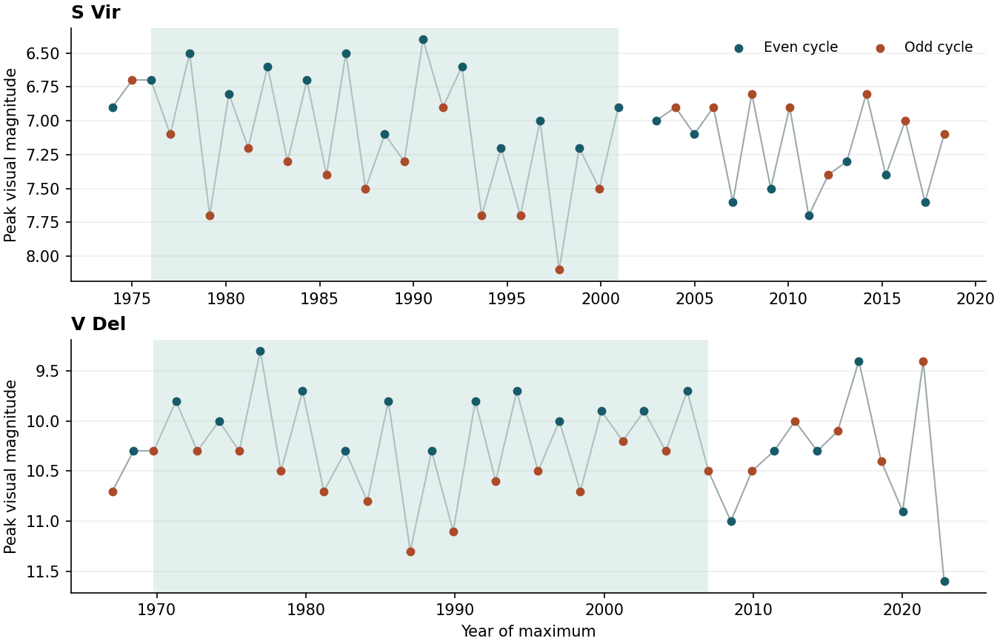

# S Virginis maxima show a reversal in bright–faint cycle parity

S Virginis had **25 consecutive alternating maxima from January 1976 through December 2000**. Using the catalogue's cycle numbers, even cycles were brighter. Across eight disjoint even–odd pairs from December 2002 through April 2018, the odd member was brighter every time. The later interval contains 16 measured peaks. The statement about that interval compares the members of each pair. Individual observer estimates reproduce both signs under the same timing and quality cuts.

**The physical cause of this S Virginis reversal remains unknown.** The observations show opposite bright–faint orderings of catalogued cycles in two intervals; they do not establish a specific pulsation mechanism, an instantaneous physical switch, or the precise date of the transition.



| S Vir evidence | Jan 1976 – Dec 2000 | Dec 2002 – Apr 2018 |
|---|---:|---:|
| Catalogue odd minus even, mean of disjoint pairs | Even cycles brighter by 0.675 mag | Odd cycles brighter by 0.425 mag |
| AAVSO visual, within 25 days of fitted peak, excluding discrepant estimates | 11/11 even brighter, mean 0.627 mag | 8/8 odd brighter, mean 0.541 mag |
| AAVSO validated visual only, same observer, offset from peak matched within 3 days | 11/11 even brighter, mean 0.614 mag | 5/5 odd brighter, mean 0.460 mag |
| Catalogue fit including a time trend and two annual harmonics, odd minus even | +0.666 mag | −0.487 mag |

A magnitude difference of +0.666 corresponds to the even-cycle peaks being about 1.85 times as bright in the visual band. Individual pair strengths varied. In the matched-observer comparison, differences are aggregated first within each observer, then within each pair. The observing unit is the pair. The AAVSO estimates can also contribute to catalogue maxima, so the two reductions share observations. [Karlsson's maxima catalogue](https://var.saaf.se/mirainfotab.php?varname=S+Vir) · [AAVSO International Database](https://aavso.org/search-and-download-data/)

**The missing peak between the two intervals is present in the observations.** Catalogue cycles 18 and 20 are 734 days apart, close to two ordinary cycles. The 57 AAVSO estimates retrieved around their midpoint show the star brightening to visual magnitude 6.7 on JD 2452260.6 and 2452265.0 in late 2001, followed by a sustained decline. This supports the catalogue cycle count across the gap. The observations leave the exact date and mechanism of the reversal open. The later archive also includes two complete Johnson V pairs within 25 days of maximum. Both put the odd cycle first in brightness. [Gap observations](s-vir-gap.csv) · [Later observations](s-vir-late-maximum.csv)

**Hipparcos provides a limited, independent consistency check of the earlier ordering.** For S Vir (HIP 66100) there are three groups of Hipparcos transits within 25 days of maxima. Cycle 8 had median Hp 6.3850 at −0.68 d (5 transits), cycle 9 had 6.7568 at +6.99 d (2), and cycle 10 had 6.6098 at −17.35 d (4). Their bright–faint–bright order is consistent with the visual series, but different offsets from maximum, the distinct Hp passband and the small number of transits prevent treating this as a separate confirmation of the full alternating sequence. [ESA Hipparcos Epoch Photometry Annex, §2.5](https://cdsarc.u-strasbg.fr/ftp/more/HIP/cdroms/docs/vol1/sect2_05.pdf)

## V Delphini and S Cygni

V Del had **27 consecutive alternating maxima from October 1969 to December 2006**, with a mean absolute change of 0.731 mag between successive peaks. Matched observations by the same observer within three days of the same peak offset favor the even cycle in 9/9 eligible pairs, averaging 0.867 mag. In the full visual reduction within 25 days the corresponding figures are 12/12 and 1.179 mag. Fitting the peak series with a linear trend and two annual harmonics gives an odd-minus-even difference of 0.716 mag. Its roughly 530-day period makes seasonal coverage a particularly important alternative. Percy & Bagby already identified V Del as possibly double-mode, with frequencies near half the pulsation frequency. Our contribution is the dated sequence and later measurements consistent with a breakdown of that ordering. [Percy & Bagby 1999, Table 2, p. 207](https://web.archive.org/web/20180726213420id_/http://iopscience.iop.org/article/10.1086/316314/pdf) · [V Del catalogue](https://var.saaf.se/mirainfotab.php?varname=V+Del)

The ASAS-3 automated camera measured V = 9.625 near the cycle 24 maximum in 2005 and 11.510 near cycle 26 in 2008, a **1.885 mag decline at the same cycle parity**. These measurements are within one day of the catalogue maxima in a common field. At almost identical offsets on the rise (−28.18 and −28.46 days), cycle 27 was 0.874 mag brighter than cycle 26, reversing the earlier order. This comparison has a 0.28-day mismatch. The chosen field has no A/B-quality coverage within 25 days of cycles 23 or 25. These sparse ASAS measurements sample a later change in ordering; they do not establish when the underlying behavior changed. [ASAS-3 source light curve](https://www.astrouw.edu.pl/cgi-asas/asas_cgi_get_data?204746+1920.1,asas3)

S Cyg had a shorter 22-peak sequence from July 1996 to March 2015. The mean absolute adjacent step was 0.600 mag. Of ten eligible visual pairs, nine favor the even cycle and one ties. Of five Johnson V pairs, four favor the even cycle. We retain it as a secondary candidate. [S Cyg catalogue](https://var.saaf.se/mirainfotab.php?varname=S+Cyg)

## Population and selection

The screen covers **52,377 numeric maxima in 510 stars** in Karlsson's five constellation indexes. Rank each star by the longest consecutive sequence for which every change in magnitude reverses sign from the previous change. A missing cycle or a tie in the catalogue's published precision breaks the run. The five longest star-level sequences are χ Cyg (33 peaks), R Hor (28), V Del (27), S Vir (25) and RU Her (25). Known examples include χ Cyg, R Cyg and RU Her. The 1980 paper on R Hor explicitly reports the twice-period alternation, and we removed it from consideration as a discovery. [Catalogue and survey provenance](SOURCES.md) · [Bateson & Wood 1980](https://articles.adsabs.harvard.edu/pdf/1980PVSS....8....1B) · [Hoai et al. 2024](https://arxiv.org/abs/2411.18044)

| Distribution of synthetic peak histories | Empirical upper-tail rank, all 510 stars | After excluding χ Cyg, R Cyg, RU Her and R Hor |
|---|---:|---:|
| Individual peaks shuffled within star | 1/2,001 | 3/2,001 |
| Blocks of four observations | 2/2,001 | 4/2,001 |
| Blocks of eight observations | 6/2,001 | 12/2,001 |
| Blocks of twelve observations | 6/2,001 | 13/2,001 |
| Per-star fitted lag-one correlation, preserving observed amplitudes and ties | 2/2,001 | 3/2,001 |

Each simulated survey and the observed survey search every integer threshold from 15 through 33 peaks. For each threshold count qualifying stars, then rank each survey's most unusual threshold across all 2,001 surveys. The block model with twelve observations still finds 30 of 506 stars with at least 16 successive alternating peaks. Its reported rank of 13/2,001 (0.0065) includes threshold selection. These simulations do not reproduce shared observer selection, arbitrarily long correlations or all decisions made while exploring the catalogue. They are a population-level sensitivity check. They do not assign a discovery probability to S Vir. [Per-star results](star-runs.csv) · [Simulation outputs](population-reference.txt)

## Interpretation and prior reports

The object-specific addition we could substantiate is the dated reversal of cycle parity in S Vir. Peak variability and multiperiodicity in Mira stars have a long observational history. We checked exact names, aliases, maxima, alternating cycles, secondary periods and the linked SIMBAD bibliography on 2026-11-15. Baroni reported S Vir's brightest magnitude in a single observer's 1978–1997 series. Nhung et al. tabulated overall scatter. Neither primary text reported the two intervals and opposite parity measured here. The search cannot establish absolute publication priority. Pulsation-mode interaction, beating of nearby frequencies, and time-dependent cycle variability remain possible. Independent multiband measurements over a further sequence could distinguish persistent phase coherence from a drifting beat. [Baroni 2004](https://articles.adsabs.harvard.edu/pdf/2004JAVSO..32...61B) · [Nhung et al. 2025](https://arxiv.org/abs/2507.18936) · [Percy & Bagby 1999](https://doi.org/10.1086/316314)

## Reproduction

Run these commands in this directory. The ranking and observer checks use Python's standard library. The seasonal checks and simulation also require NumPy, the lag-one simulation requires SciPy, and the plot requires Matplotlib.

```sh
python replay.py > reproduced-runs.csv
diff star-runs.csv reproduced-runs.csv
python comparisons.py
python s-vir-reversal.py
python season.py
OPENBLAS_NUM_THREADS=1 python population.py > reproduced-population.txt
diff population-reference.txt reproduced-population.txt
python plot.py
```
