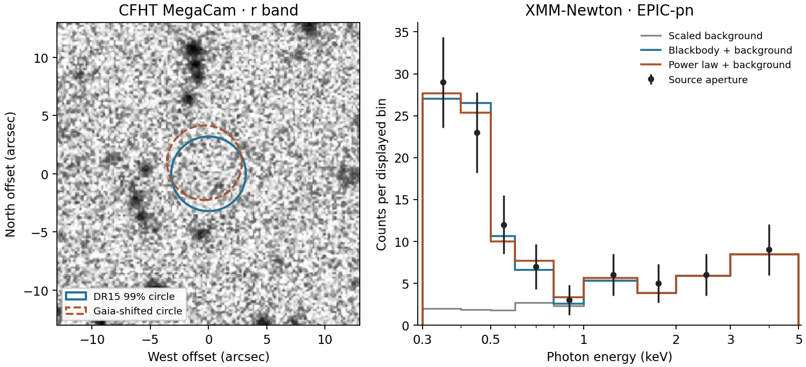

# Mission 03 · A search for thermally emitting isolated neutron stars in 5XMM-DR15

**5XMM J085618.5+380711 is an ultrasoft, optically faint X-ray source worth a second observation. Its available spectrum and optical limits leave several physical interpretations viable. This investigation establishes no new isolated neutron star.** The same X-ray detection appeared in 4XMM. The literature and repository review found no prior source-specific proposal for a thermal isolated-neutron-star interpretation. A previous four-class catalogue assigned the source a stellar probability of 0.724. That classifier had no isolated-neutron-star class and no matched optical or infrared object for this source. [Prior identifications and scope of the search](overlap/PRIOR_ART.md)

The left panel covers 26 arcsec on a side. The circles show the nominal 99% XMM localization and the same region shifted by the field's Gaia offsets. The right panel shows counts in unequal energy bins, including background. Display curves use the measured scaled background and are aggregated from the response-folded fits. The spectral analysis used 28 bins and profiled the background in each.

## Evidence for J085618.5+380711

| Measurement | Result | Interpretation |
| --- | --- | --- |
| DR15 position and source | 134.077254°, +38.119831° ICRS, Galactic latitude +40.12°, SRCID 3030258180100013 | Circularized 99% radius 3.20 arcsec, including the release's 0.88 arcsec per-axis systematic. Eight Gaia reference pairs give an east/north offset of +0.35/+0.95 arcsec. |
| Catalogue colours and flux | HR1 = −0.718 ± 0.072, HR2 = −0.990 ± 0.111, observed 0.2–2 keV flux (1.60 ± 0.16) × 10⁻¹⁴ erg cm⁻² s⁻¹ | Errors on the summed band flux are in quadrature. HR2 is near the physical boundary, so its Gaussian error is only a selection margin. |
| Original observation | 0302581801 in October 2005, 9.36 arcmin off-axis. In 0.2–1 keV, pn has 133 aperture counts over 28.4 estimated background, MOS2 has 35 over 4.7. | Independent cameras detect a compact excess in the same epoch. MOS1 has no exposure at this position. The observation targeted a galaxy cluster 10.3 arcmin from the source. |
| Spectrum and variability | Absorbed blackbody kT = 54.3 eV, 90% profile interval 37.3–73.6 eV. pn has 100 fitted counts including approximately 34 background counts. | The fitted 0.2–2 keV flux is 2.46 × 10⁻¹⁴, including extrapolation below 0.3 keV. Four time bins show no compelling flare. Long-term persistence is unmeasured. |
| Optical and infrared | Nearest Gaia, AllWISE, Legacy Surveys and primary PS1 entries lie about 23, 12, 11 and 9 arcsec away respectively. Neither CFHT error circle has a 5σ optical peak. | Conditional limits for an unresolved object are g_AB >25.09 and r_AB >24.84 using the maximum measured aperture flux across both regions plus 5σ. The nearest peak detected in both filters is 6.6 arcsec from the X-ray position. |
| X-ray/optical ratio | F(0.2–2 keV)/(ν fν,r) >7.9 using the catalogue flux and 6231 Å. It becomes >6.6 using the catalogue flux minus 1.645 reported errors, or >12.2 using the best-fit blackbody flux. | These bounds depend on the X-ray flux choice. Published ratios based on integrated optical bands use a different denominator. The present lower bound cannot identify the accretor or emitting surface. |
| eROSITA | No release-2 cumulative main-catalogue entry within 30 arcsec. The public 0.2–2.3 keV upper limits are 1.48 × 10⁻¹³ for eRASS1 and 8.41 × 10⁻¹⁴ erg cm⁻² s⁻¹ after three scans. | Both survey limits exceed the XMM flux under their respective spectral conventions. They provide no independent evidence of fading or persistence. |

The fitted blackbody corresponds to an apparent emitting radius of 5.43 km per kpc at the free-column best fit. A 10 km emitting surface would lie at about 1.84 kpc, and a full 7,000 km white-dwarf photosphere would require about 1.29 Mpc. The normalization changes to 3.58 km per kpc when the column is fixed to the HI4PI value. A white-dwarf accretion spot or soft accreting binary can have a much smaller emitting area. The single epoch has limited power to test an orbital period, a hard tail, or an outburst.

A solar-abundance, line-emitting plasma has Poisson deviance 24.22, versus 25.56 for the blackbody, when both can fit the absorption. Its fitted column (2.76 × 10²¹ cm⁻²) is well above the beam-averaged Galactic atomic column (3.08 × 10²⁰ cm⁻²). Fixing that column gives 28.30 for the plasma and 25.66 for the blackbody. Optical faintness and the absence of a bright flare count against a conventional nearby active star, while the spectral fit alone admits a cool plasma. The absorbed power law reaches the steep fitting boundary, Γ = 8. An ordinary hard AGN continuum is a poor physical description. A soft-excess nucleus, transient accretor or a faint host galaxy remains possible. Low counts, the missing second epoch and the optical limit prevent a reliable population probability. [Pointed data, model details and archive receipts](XRAY.md) · [CFHT photometry](OPTICAL.md)

## How the source was selected

The input is the checksum-verified, source-only 5XMM-DR15 v1.0 FITS from 9 June 2026. We searched every one of its 818,656 unique source rows, independent of the repository's magnetar, pulsar and transient target lists. We checked the repository at commit a6280716 and all 107 PRs preceding this one. The novelty checks include 166 reference positions and an additional 147-source historical ROSAT sample.

| Search stage | Rows | What was tested |
| --- | ---: | --- |
| Common quality, morphology, counts, position and soft flux | 93,450 | Point sources, ≥100 fitted counts, observed soft flux ≥10⁻¹⁴ and the documented field-quality cuts |
| Primary measured colours | 185 | Interior hardness values, including their uncertainties, followed by hard-band and variability screens |
| Censored branch | 8 | HR2 at −1 retained separately for pointed-data checks |
| Two supplementary branches | 12 + 116 | A two-camera very-soft search and a bright, absorption-tolerant search, developed after inspecting initial results |
| DR14 positional comparison | 22 | From a new, explicitly defined set of 765 DR15 sources, no counterpart within 15 arcsec of any of 692,109 DR14 slim positions |
| Unique positions across all five queues | **338** | The DR14 comparison added 17 previously unselected sources |

Every selected position has an independent Gaia DR3, AllWISE and Legacy Surveys query result recorded in the counterpart table. PS1 coverage and query failures are labeled individually. An empty catalogue cone supplies no limiting magnitude. The machine-readable ledger marks possible associations and outstanding field checks. Only selected targets received pointed spectral and image analysis. The geometric screen is intentionally conservative about claiming counterparts in crowded fields.

Two of eight known thermal control sources passed the original cuts. All six missed controls passed the hardness selection and triggered the long-term variability veto, even though their measured brightest-to-faintest flux ratios were 1.06–1.47. DR15 is a collection of targeted pointings with heterogeneous depth. Absorption, crowding, counting statistics, temporal sampling and the unpropagated astrometric correction affect recovery. These results do not estimate the number of neutron stars remaining in DR15. [Full selection and recovery tests](SELECTION.md) · [DR14 differential](DIFFERENCE.md) · [All reviewed positions](results/review-ledger.csv)

## Rejection tests and follow-up

- **J052015.5−654420** appeared optically blank in the formal DR15 circle. The observation ID, pointing offset and published optical identification associate the field with the LMC helium-burning white-dwarf binary [HP99] 159. Its optical counterpart is 6.95 arcsec from the DR15 centroid. A fixed-radius optical veto would have missed it. [Object-history checks](overlap/PRIOR_ART.md)
- **J114051.9−641848** is already a published 4XMM INS candidate. **J081952.3−131932** passes the DR14 absence test and was independently identified by eROSITA. Neither supports a new claim here. [Published-position audit](overlap/PRIOR_ART.md)
- **J180019.4+080504** has a 77 eV pn fit. A calibrated PS1 stack gives an r-band local 5σ sensitivity of only 22.27 AB, corresponding to F_X/(ν fν,r) of about 0.8 at that sensitivity. The short XMM exposures leave the apparent long-term flux changes unresolved. **J210351.3−181038** has a Gaia/PS1 counterpart and a power law fits its pointed spectrum better. **J190116.4−220057** lies in bright nova wings at the pn chip edge. [Pointed checks](XRAY.md) · [PS1 image measurement](results/j180019-ps1-depth.json)

- Several additional apparent blank sources lie in pointings on SN 1006, G296.1−0.5, RX J0852 or RCW 103. The ledger holds these for diffuse-emission review. An unresolved fit in a structured remnant does not establish a point source. [Observation headers](results/field-targets.json)
- **J150831.7+374025 and J213004.5−065011** both passed the censored-hardness search and appeared optically blank. Their apparent spectra drove the blackbody temperature to the 20 eV lower fitting boundary. In J150831, 424 of 630 clean pn events landed in one physical pixel. In J213004, 142 of 143 accepted-pattern MOS1 events carried a detector flag, with 141 on a single pixel. Both are rejected. [Original event-pixel audits](ARTIFACTS.md)

A second pointed observation of J085618 would test whether it persists at the 2005 flux and provide a new centroid. A subarcsecond localization would reduce optical confusion and permit a proper-motion comparison across the long baseline. A higher-count soft X-ray spectrum would test for plasma lines, absorption and a hard component. At the catalogue flux, an r-band non-detection to **27.60 AB** at the new position would push F_X/(ν fν,r) past 100. Optical spectroscopy or a measured parallax for a counterpart would test the stellar alternatives directly.

## Reproducibility

[Catalogue and control replay](SELECTION.md) · [Prior-work tables](overlap/PRIOR_ART.md) · [Multiwavelength replay](CROSSMATCH.md) · [Observation-level fits](XRAY.md) · [Optical image replay](OPTICAL.md) · [Investigation log](LOG.md)

This research has made use of data obtained from the 5XMM serendipitous source catalog compiled by the XMM-Newton Survey Science Center, the XMM2ATHENA project and in collaboration with the XMM-Newton SOC.
