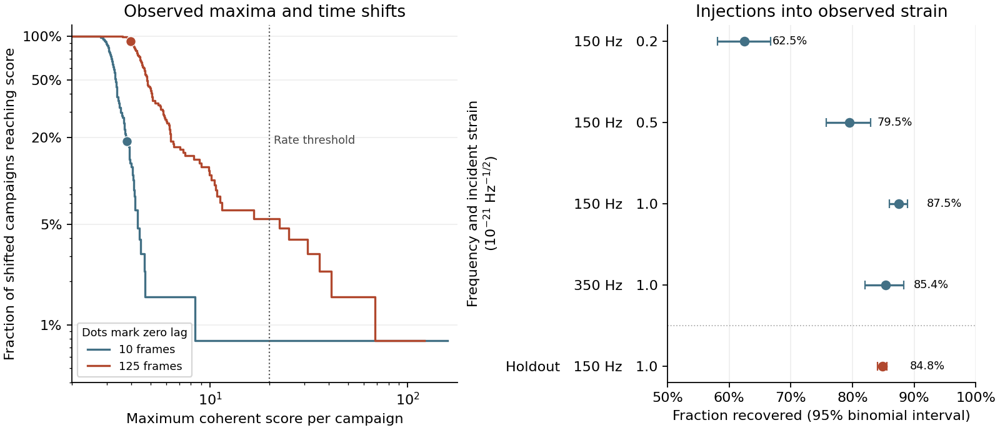

# A rate limit for 150 Hz bursts in public O4b strain

The disjoint 125-frame search gives a **pointwise 90% upper limit of 0.601 additional bursts per day** for a specified linearly polarized source population. It applies at incident root-sum-square strain **1 × 10⁻²¹ Hz⁻¹ᐟ²**, central frequency **150 Hz**, quality factor **Q=9**, isotropic directions and uniform polarization and phase, at nominal calibration. The search recorded **zero foreground seconds at or above the fixed score threshold of 20**. The first ten frames and the subsequent extension together contain 539,386 s of searched Hanford–Livingston data, distributed across O4b.

| Measurement | Initial ten monthly frames | Disjoint 125-frame extension |
| --- | ---: | ---: |
| Scheduled seconds | 40,960 | 512,000 |
| Coincident searchable seconds | 40,315 | 499,071 |
| Shifted exposure from 128 offsets | 57.15 days | 703.05 days |
| Loudest unshifted score | 3.792 | 3.977 |
| Shifted campaign maxima equal or louder | 24/128 | 118/128 |
| Empirical campaign tail with one added to numerator and denominator | 0.194 | 0.922 |
| Foreground / shifted seconds with score ≥20 | 0 / 1 | 0 / 7 |
| Primary 150 Hz injection recoveries | 1,792 / 2,048 | 6,950 / 8,192 |
| Lower 95% effective exposure | 0.402 days | 4.988 days |
| Pointwise 90% upper rate | 7.445/day | **0.601/day** |
| Upper rates with at least 90% joint coverage for both primary results | 9.194/day | **0.741/day** |

The initial 2,048 injections sample retained live seconds. The extension's 8,192 injections sample all 512,000 scheduled seconds, counting excluded time as missed. This folds data loss into its 84.84% recovery fraction. The time-shifted searches reuse detector data and only calibrate the noise background. All rate-threshold foreground seconds enter the count, with zero background subtraction. Low event occupancy, a stationary arrival process and independence from the frozen public-event masks are assumptions of the rate calculation. The amplitude is held fixed. [Audited counts and confidence limits](results/audit_results.json) · [Sensitivity and statistical methods](METHODS.md)

*The left panel compares the maximum from each time-shifted survey with the simultaneous-detector result (dots). In the injection panel, the upper four rows use the original ten frames and the lower row uses the extension. Bars are two-sided 95% binomial intervals.*

## Loudest foreground and controls

In the extension the highest score was **3.977** at GPS **1400736219.718750**, in a 0.125 s tile spanning 32–96 Hz. Its phase-coherent H/L delay was -8.50 ms. 118 shifted campaigns and 316 shifted seconds reached the same score. The public-event lookup found no match within ±32 s. The independent 4,096 Hz time-domain analysis measured a -7.57 ms intersite delay and coherence 0.747. Hanford and Livingston's strongest Fourier bins were 48 and 80 Hz. Removing the published instrumental-line and active continuous-wave intervals left on-source band powers of 3.30 and 3.25 times their respective off-source medians. Across seven possible Virgo delays from −28 to +28 ms, the largest normalized Virgo band energy was 2.12. Ten of 58 off-source comparisons reached that value under the same delay scan. In the released auxiliary frame, 5 of 57 comparison windows reached the on-source maximum across the 23 eligible channels. The checks leave the instrumental origin unresolved. The loudness is consistent with the measured background. [Foreground follow-up](results/holdout_followup/foreground_1400736219.json) · [Per-offset counts and threshold crossings](results/holdout/campaign.json)

The equal-exposure check retained the same 357,759 Hanford seconds at every one of the 129 alignments and intersected Livingston validity at every offset. Its zero-lag maximum was 3.977, which 106/128 shifted maxima reached. The corresponding empirical rank fraction was 0.829. This check addresses the nonwrapping offsets' differing exposure. Nearby noise and the reuse of detector samples still correlate slide trials. [Equal-exposure diagnostic](results/holdout/common_exposure.json)

The original ten frames produced a maximum of 3.792 at GPS 1420959618.03125. The independent algorithm recovered the same polarity, with delay −1.71 ms and coherence 0.517. Virgo band power was 1.08 times its local median. Of 58 off-source auxiliary windows, 36 reached the on-source channel maximum. The one shifted score above 20 was 159.0 in July, pairing two detector epochs 36 s apart. This measured noise extreme motivates using observed time shifts in addition to simulations. [January diagnostic](results/diagnostics/1420955648.json) · [Initial shifted distribution](results/background.png)

The held-out GW250114 control was the highest-ranked trigger in its separate 1,266 s of searchable strain, with score 228.1 at GPS 1420878141.21875, within 19 ms of the catalogue timestamp. Primary and independent intersite delays were −2.50 and −2.44 ms, respectively. A separate simulated broadband burst injected at +3.906 ms and opposite polarity was recovered at +4.0 ms with coherence 0.989. The same disturbance in Hanford alone gave zero target score. In 192 independent colored Gaussian noise pairs, zero lag ranked first in 10 cases. [Real event control](results/epochs/1420877824.json) · [Synthetic controls](noise_controls.json)

## Coverage and interpretation

We searched for coherent power over 32–896 Hz without merger templates. The extension evaluated 43,918,248 foreground and 5,345,466,544 background time-frequency tiles before gating, followed by 13,153,702 foreground and 1,599,763,789 background lag evaluations. The score maximizes over duration, band, window position, physical delay and polarity before forming each time-shifted campaign maximum. With 128 shifts, the smallest attainable plus-one rank is 1/129. The combined investigation would require ≤0.005 per campaign to meet the two-search 1% criterion. Longer off-time backgrounds would be needed for a discovery claim even for a foreground louder than every sampled shift.

The extension scheduled 5.31% of the 9,634,082 s of overlapping public H1/L1 DATA during O4b, before quality cuts. Selections used only calendar slots and public DATA segments. Instrument lines, continuous-wave hardware injections, auxiliary witnesses and alternate time-domain analysis were checked on leading foreground events. The published calibration-error envelopes at 150 Hz spanned magnitude ratios 0.900–1.100 in Hanford and 0.951–1.044 in Livingston over the extension. Only one H1 block reached the ±10% envelope. Calibration systematics are separate from the statistical confidence limits. Requiring phase-consistent excess in both H1 and L1 makes the search less sensitive to signals with a weak response in one detector. Virgo was an independent follow-up detector. [Selection and exclusions](results/holdout_selection.json) · [Calibration context and product gaps](results/holdout_followup/calibration.json) · [GWOSC open data](https://gwosc.org/O4/O4b/)

[Research methods and prior work](METHODS.md) · [Commands and archive contents](REPRODUCE.md) · [Investigation log](LOG.md) · [Frozen public-event tables](public_event_receipts.json)

We acknowledge the Gravitational Wave Open Science Center and the LIGO Scientific, Virgo, and KAGRA collaborations for the calibrated strain data, public event lists and detector-quality products. We also acknowledge the national funding agencies and observatories listed in GWOSC's acknowledgment. The O4b strain is released under CC BY 4.0. [LVK O4b open-data paper](https://arxiv.org/abs/2605.27090) · [O4b dataset DOI](https://doi.org/10.7935/8emv-ag54) · [GWOSC acknowledgment](https://gwosc.org/acknowledgement/)
