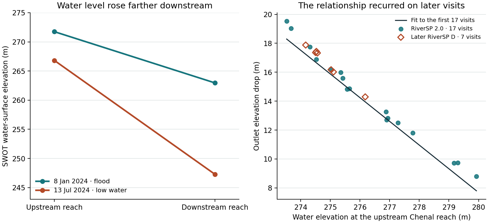
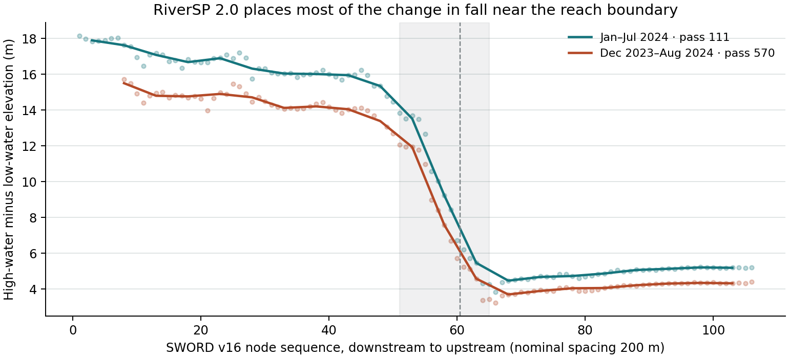

# High water reduces the elevation drop across the Congo’s Kinsuka rapids

In SWOT RiverSP 2.0, the January 2024 flood stood 15.68 m above July low water at a reach below the outlet of Malebo Pool and 4.94 m above it at the adjacent upstream reach. **The water-surface drop between them contracted by 10.74 m, from 19.53 m to 8.79 m.** Reprocessing the same orbit in RiverSP D gives a 10.73 m contraction before filtering, but the upper reach fails the January quality cutoff. Later low- and intermediate-stage observations and independent gauges from 1954 support a recurring response to river stage. A lasting change in the rapids remains unestablished.



## The spatial result

Across roughly 2 km near 15.22° E, 4.32° S, the median January–July elevation rise in five-node groups fell from **13.52 m downstream to 5.46 m upstream**. RiverSP 2.0 thus places 8.06 m of the contraction in this section. RiverSP D retains all five downstream nodes and none of the five upstream nodes for that pair of dates. Published gauges and engineering surveys already document a hydraulic control at Kinsuka. Our literature review found no equivalent published measurement of this event-specific profile. [Node locations, movement sensitivity and all values](congo/profile/README.md) · [Bilingual prior-art audit](congo/literature.md)

On a second orbit, in December 2023 and August 2024, RiverSP 2.0 measured a local contraction of 7.35 m. Restricting both releases to the same usable nodes gives **7.11 m in 2.0 and 7.62 m in D**. The December node elevations changed by about 22 m between releases in this section. Much of that offset cancels in a local elevation difference. At the scale of the two full reaches, the same orbit gives a 9.67 m contraction in 2.0 and a 2.92 m increase in D before filtering. Upper-reach coverage in D was below the 80% threshold on both dates. The cross-release agreement applies only to the local contrast on those shared nodes. [Same-acquisition reach values and eligibility](congo/holdout/event_by_release.csv) · [Node-level comparison](congo/profile/README.md)



## Congo measurements

| Observation | What it establishes |
| --- | --- |
| SWOT pass 111 on 8 January and 13 July 2024 | Both reaches had complete node coverage. Downstream equivalent width increased from 746 to 1,234 m, while water-surface slope declined from 1.60 to 0.65 m/km. Upstream and downstream reach-center separations and the uncertainty calculation are in the [reach analysis](congo/README.md). |
| 17 visits with a separate upstream stage indicator | A 1 m rise in the Chenal, about 130 river km upstream of the lower site, corresponded to a 1.64 m decrease in the water-surface drop. The three-visit block-bootstrap interval was 1.41–1.96 m of decrease. The same direction occurred within each of three processing versions. Irregular visit spacing and exploratory site selection limit inference. |
| Seven later pass-111 visits, August 2025–August 2026 | On held-out dates, Spearman ρ was −0.964. The original fit predicted the drop with median absolute error 0.64 m. These later visits cover low and intermediate stages. [Holdout results](congo/holdout/README.md) |
| ICESat-2 laser heights on 13 March 2024 | An 11.94 m drop between two node neighborhoods agrees with 11.89 m from SWOT three days earlier. Only one date supplied both endpoints within 1 km. [Footprint and timing checks](laser/README.md) |
| Boat gauging and Sentinel-2 imagery | A 10 January acoustic Doppler measurement of about 75,000 m³/s corroborates the flood. The downstream SWOT consensus was 105,582 m³/s two days earlier. The different dates and sections limit absolute validation. Sentinel-2 classified 2.19 km² more water in January than July on identical clear pixels in the downstream corridor. Optical shorelines and an elevation model support local inundation, with too few upper-bank segments to recover the differential rise. [Independent sources](congo/README.md) · [Shoreline test](congo/shoreline/README.md) |
| Two independent gauges above and below Kinsuka in 1954 | Between 24 October and 4 December, Boye rose 3.95 m and Kinsuka-amont rose 1.02 m. The fall contracted by 2.93 m and subsequently recovered by 1.22 m. The two gauges have historical location descriptions and used their own vertical references. Their readings validate the sign of the hydraulic response at these rapids. [Transcription and original source](congo/historical_gauges/README.md) |

A larger downstream rise reduces the surface fall as the downstream water level covers more of the rapids. Changes in wetted channel area, velocity and how flow divides between channels can also contribute. Satellite elevations measure surface fall. A measurement of energy loss would require velocity observations at both ends. A second laser instrument, GEDI, measured a downstream fall on a 2019 crossing. None of its 517 common-water footprints in the v3 study window had acceptable GEDI retrieval quality. [GEDI coverage and screened measurements](congo/gedi/README.md) Four screened visits observed the reduced drop for 46 days around the flood. Removing that flood from the fit left three high-stage observations outside the remaining calibration range. Their 0.84–1.28 m residuals cannot establish a new hydraulic regime. Simultaneous repeated levels and velocities at the same surveyed cross-sections during another high flood would test the mechanism and the extreme-stage prediction.

## Upper Zambezi

The 2024 drought and 2025 recovery provide a check on the distinction between a physical flow change and a satellite retrieval error. The Chavuma gauge averaged 703.5 m³/s in April 2024 against a historical April mean of 1,770 m³/s. On 23 dates matched by day of month, the gauge averaged 775 m³/s in April 2024 and 3,034 m³/s in April 2025. February 2024 was the driest of the 44 Februaries through 2024 in the upstream Alto Zambeze rainfall series. Downstream Kariba reservoir levels, wetland imagery and regional stage records also document drought conditions. The historical monthly baseline has no published year-by-year spread. [Ground observations, precipitation and reservoir evidence](context/HYDROLOGICAL_CONTEXT.md)

At Chavuma, 33 quality-screened **unconstrained** consensus estimates had a same-local-day agency flow. The median satellite-to-gauge ratio was 1.81, with 31 overestimates. The satellite underestimated both matched flood flows in late March and April 2025. Its consensus equaled the SIC4DVar estimate on every one of these dates. At Nana’s Farm the consensus was missing on all 53 returned visits. The agency’s 2023–25 measurements postdate the training periods of the model priors. An independent acoustic Doppler transect at Chavuma on 17 May 2023 differed by 1.9% from the same-day agency flow, before these SWOT reach series began. [Matchup methods and gauge lineage](zambezi/PROVENANCE.md) · [All algorithms and time windows](zambezi/gauge_match_summary.csv)

A matched comparison between processing releases exposed a false stage-change candidate. On the same 18 April 2025 pass at Chavuma, RiverSP D put the surface **19.83 m higher** than v2.0. Three corresponding water-pixel node centroids shifted 266–547 m. The 14 April control pass differed by only 0.012–0.047 m at the three comparable nodes. The ground record and independent optical extent support a real seasonal recovery, while the same-acquisition discrepancy identifies an additional processing or geolocation problem. [Node comparisons](zambezi/reprocessing/nodes/node_comparison.csv) · [Sentinel-2 extent](optical/README.md)

For each of the 12 reaches we matched distinct visits on the same orbit within 14 days of their one-year anniversaries. We tested width and slope both with and without a requirement that paired stages agree within 0.20 m. Nine reaches contributed annual pairs under the primary quality criteria, and five contributed stage-matched pairs. Every pair crossed a processor change, and all accepted primary observations had quality flag 1 (suspect).

The annual comparisons are descriptive at this sample size. Each primary test had at most six nonzero 42-day block medians. Even if all six changes had the same sign, the two-sided sign test would give a raw p-value of 2/2⁶ = 0.03125. Correcting across 12 reaches and six outcomes gives an adjusted p-value of 1. A test would require at least 12 nonzero blocks, all with the same sign at that minimum, to pass the familywise 0.05 threshold. The available observations therefore cannot distinguish a persistent change from year-to-year variation with this test. [All pairs](zambezi/annual_pairs.csv) · [Screen results](zambezi/annual_screen.csv)

## Scope and reproduction

The search targeted 23 reaches in two African river systems. We prioritized areas with sparse spatial gauging and used two gauges in the upper Zambezi and the gauged upstream side of the Kinsuka rapids as controls. The primary measurements are the NASA/CNES SoS v3 unconstrained Africa granule, queried by reach through Hydrocron, RiverSP v2.0 and SWORD v16. Orbit, cycle, granule, processing version, uncertainties, source URL and checksums accompany the measurements. Discharge reconstruction uses SWOT geometry, so agreement between a flow estimate and its own input width, slope or height supplies no independent validation. [NASA product](https://doi.org/10.5067/SWOT-SOS-RD3) · [Archive version mapping](https://podaac.github.io/hydrocron/user-guide/versioning/) · [Repository audit and dated log](LOG.md)

From this directory the following commands replay the principal tables and figure using the checked-in source files. The analyses require Python, NumPy, pandas, SciPy and Matplotlib. Source-specific README files describe GDAL and network access for re-fetching imagery or laser data.

```sh
python congo/analyze.py
python congo/holdout/test_d.py
python congo/profile/profile.py
python congo/profile/compare_d.py
python congo/historical_gauges/analyze.py
python laser/check.py --event-only
python zambezi/coverage.py zambezi/data zambezi/coverage.csv
python zambezi/seasonal_screen.py
python zambezi/matchup.py zambezi/data context/zra_daily_gauges.csv zambezi
python zambezi/reprocessing.py compare zambezi/data zambezi/reprocessing
python context/analyze_context.py
python figure.py
```
