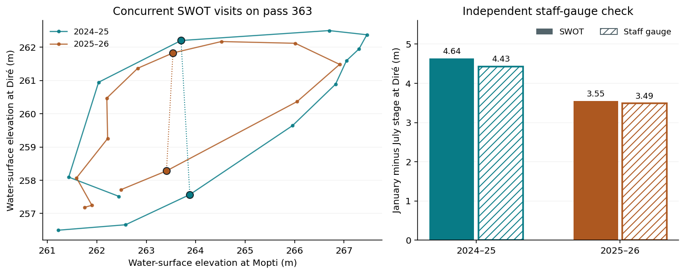

# A July water level at Mopti corresponded to two very different river states at Diré

Mali’s Inner Niger Delta delayed the arrival and recession of the annual flood. We measured the size of that effect on two flood cycles. On repeat passes of the SWOT satellite, the downstream Niger at Diré was **4.64 m higher in January 2025 than in July 2024**, while the upstream level at Mopti differed by 0.18 m. The comparison repeated the next flood season, with a **3.55 m** downstream difference at a 0.13 m upstream difference. Ground observations independently recover both contrasts. The evidence establishes a repeated seasonal response. A lasting change in the hydraulic relationship remains unverified.



## Same upstream stage on the rising and falling flood

We examined the geographically selected central reaches at the Mopti confluence (SWORD v16 14279000471) and near the delta outlet at Diré (14277700101). Reach elevations are orthometric metres, widths are SWOT equivalent widths, and times are UTC. On track 363 the satellite observed both sites within one minute. We paired all July–September rising-season visits with January–March recession visits in the same June–May flood year when Mopti elevations agreed within 0.20 m. These windows and the follow-up question were chosen during exploration. Only the two rows below matched in RiverSP D. At 75% observed nodes the joined series contained 41 simultaneous visits, including 13 in each of the two event seasons. The 80% primary threshold yielded zero central Diré visits in D. Most D observations used 46 of 58 nodes (79.31%). Both pairs used the same processing code within the pair, PGD0 in the first year and PID0 in the second. The newer year's dates fall outside the L4 v3 study window. [All concurrent visits](analysis/concurrent-stages.csv) · [Pair results and uncertainty](analysis/matched-limbs.csv)

| Satellite dates, July → January | Mopti elevation change | Diré elevation change | Diré equivalent width change | Diré slope change |
|---|---:|---:|---:|---:|
| 22 Jul 2024 → 26 Jan 2025 | −0.178 m | +4.636 m | +353 m | +0.56 cm/km |
| 12 Jul 2025 → 16 Jan 2026 | +0.131 m | +3.549 m | +291 m | +0.05 cm/km |

Taking the root-sum-square of the two reported elevation uncertainties gives 0.132 and 0.134 m at Diré under independent endpoint errors. The analogous slope uncertainties are 2.76 and 2.29 cm/km, larger than either slope difference. These calculations omit common track biases, water assignment and changing footprints. The three preselected central nodes gave two quality-eligible same-node checks in the first season (+4.651 m each) and one in the second (+3.556 m). RiverSP 2.0 measured a +4.640 m Diré rise for the first satellite pair at the 75% floor. Its Mopti difference was −0.439 m and failed the stage-matching criterion. The same-date downstream result is robust to this processing comparison, while the upstream match depends on release. The central widths are especially sensitive to satellite pass. Absolute interannual slope or width changes need stronger evidence. [Fixed-node pairs](analysis/matched-nodes.csv) · [All nine reaches across processing releases](swot/geometry/README.md)

### Independent measurements

| Source and temporal support | Mopti difference | Diré or downstream difference |
|---|---:|---:|
| Mali Météo/DNH, 21–31 July 2024 mean and 26 January 2025 daily gauge | −0.26 m | +4.43 m at Diré |
| DNH, daily gauges on 13 July 2025 and 19 January 2026 | +0.03 m | +3.49 m at Diré |
| DNH published historical means for 13 July and 19 January, averaging period unspecified | −0.05 m | +2.65 m at Diré |
| Sentinel-3A nadir altimeter, DAHITI 13763, about 46 km downstream of Diré | — | +5.01 m and +4.16 m, on dates within seven days of SWOT |

The first gauge comparison includes an eleven-day mean during a rising flood. The second uses two daily observations one and three days after SWOT. Each gauge has its own zero. The differences use observations within station, without combining absolute gauge and satellite elevations. The Sentinel-3A result uses the same instrument and track at both endpoints in each season. The nearer active nadir series missed an endpoint in each pair. The gauges and the nadir record corroborate the direction and approximate magnitude of these stage changes independently of SWOT. Their records do not directly constrain the measured slope differences. [Gauge observations and bulletin receipts](external/hydrometry/README.md) · [Nadir-altimetry dates and eligibility](nadir/README.md)

We searched nine historical nadir-altimetry sites for comparable July–January observations. The geographically closest pair spanning 2018–26 had zero complete seasons out of eight within 15 days of the two calendar dates. At an alternative pair, the 2024 upstream difference was +0.218 m, just outside the 0.20 m criterion. Relaxing it to 0.50 m admitted one pre-SWOT comparison, 2019, when the downstream crossing rose 3.93 m. Earlier Envisat/SARAL crossings yielded zero upstream-stage matches across five distinct years with four-date coverage. The ranking of the 2024 measurement against earlier stage-matched seasons remains unresolved. [Dates and coverage for the historical comparison](baseline/README.md)

There are two flood seasons with matched pairs. Even treating their signs as independent, a two-sided exact sign test of two positive changes gives **p = 0.50**. The large stage differences are resolved relative to measurement uncertainty. Two seasons cannot establish a shift in the population of floods. Delayed downstream arrival and drainage of floodplain storage explain why a high falling river can occupy more water area downstream at the same upstream level. Bani inflow and channel routing may also contribute. Neither pass measured exchange with floodplain storage directly.

## Nine-reach search for persistent change

Three reaches at each of Ké-Macina, Mopti and Diré were selected by geography and SWORD connectivity before examining the response. These station reaches provide ground anchors in a sparsely observed floodplain. The search covers these nine reaches only. Akka was added later for a specific candidate. Repository main and branch `mission-05/swot-river-anomalies` already contained the Congo and Zambezi campaign. Before creating this branch we examined all 122 remote branch tips, their paths and the research Markdown/reStructuredText on those tips, and the open pull request list (empty). We found no documented Inner Niger Delta study. The audit covers public repository records on 16 November 2026. [Branch heads](branch-audit.csv) · [Prior mission](../README.md) · [Site identifiers and selection coordinates](swot/geometry/sword_v16_study_reaches.json)

We retrieved NASA/CNES **SoS v3** discharge through the public Hydrocron interface mapped to RiverSP 2.0 and SWORD v16. CMR identifies the Africa results file as unconstrained, G3927135650-POCLOUD. We retained the exact service responses and decoded per-reach CSVs with granule IDs, processor codes, orbit, timestamps, quality flags, reference geometry and formal uncertainties. The continental NetCDF itself was not downloaded. The API exposes the consensus, five of the six flow-law algorithms, and the separate LakeFlow field. Of **543 reach-overpass records**, 389 carried suspect reach quality, 119 degraded and 35 bad. None carried good reach quality. The primary screen required good/suspect quality, a complete reach, at least 80% of nodes and good/suspect crossover calibration. All 300 retained rows had valid height, width and slope, and 193 had consensus discharge. Adjacent reaches share satellite passes. A stricter diagnostic removing geolocation-suspect, low-coverage and less favorable cross-track returns retained five rows and zero at the three central reaches. [NASA data](https://doi.org/10.5067/SWOT-SOS-RD3) · [Coverage and gaps](swot/swot_coverage.csv) · [Acquisition manifest](swot/v3/manifest.json)

We compared successive flood years on the same pass within 14 days of each visit’s calendar anniversary. Minimum-offset one-to-one matching was run separately with and without a 0.20 m stage-matching constraint. The primary v3 screen compared 2023–24 to available 2024–25 observations. There were 64 reach-level anniversary pairs across nine reaches, 37 with consensus discharge at both endpoints. Requiring a similar stage left 17 pairs across six reaches, six with discharge. Every primary anniversary pair crossed a processor change. We estimated the two-sided sign probability from nonzero 42-day block medians within each reach, with Bonferroni correction for nine reaches and seven tests per reach. Positive temporal dependence across blocks could further reduce effective sample size. The smallest nominal p was 0.0625 and the smallest family-adjusted p was 1.00. The 63 comparisons include all tested primary endpoints, including those with inadequate support. Missing or failed comparisons do not imply stability. [All matches](analysis/anniversary-pairs.csv) · [All tests, including D sensitivities](analysis/anniversary-tests.csv)

The D sensitivity screen shows why release matters. At the upstream western arm of Mopti, 17 stage-matched anniversary pairs across eight blocks gave a median block slope change of +1.19 cm/km from the 2024 to 2025 seasons (nominal p = 0.0078, 75% coverage). Every pair crossed a processing-code change. These data cannot distinguish changed channel slope from changed retrieval. At central Diré, all 41 available v3 consensus estimates numerically equaled MOMMA, and at central Ké-Macina all 51 equaled SIC4DVar. Among 19 eligible simultaneous discharge triples at the Mopti confluence, the two incoming estimates differed in sum from the downstream estimate by a median absolute 32% of downstream discharge. Complete triples ended on 2 September 2024, before the crest. Width and slope used to infer discharge share one satellite observation. Neither member agreement nor a confluence imbalance measures an independent storage change. [Topology and discharge triples](confluence/README.md)

We checked the actual unconstrained consensus against 20 agency-reported discharge values in the first ten DNH bulletins of 2024. Eight comparisons had an eligible positive consensus within two days of the agency reading, four per site. No dates matched exactly. The ratio of satellite to agency discharge ranged from 2.14–4.48 at Diré and 3.70–33.65 at Mopti. The unconstrained method uses an uncalibrated model prior. DNH’s rating version, uncertainty and exact channel coverage are unknown. The 26 January 2025 bulletin comparison supplies stage only for that date. These discrepancies preclude interpreting absolute consensus values as confirmed flow changes. [Dated discharges, exclusions and source lineage](external/hydrometry/README.md)

## Flood forcing and other possible changes

- **Rainfall and flood extent.** The upstream Niger–Bani basin averaged 871.9 mm of CHIRPS rainfall in July–September 2024, highest in the 35 seasons examined and 19.9% above the 1991–2020 mean. In a fixed 100 km² window at Mopti, Sentinel-2 classified 18.22 km² as open water near the 2024 crest versus 7.07 km² in 2023. Even assigning all ambiguous 2023 pixels to water gives 13.61 km². Pixel classes can miss water under vegetation. In our separate 16 km² Diré and Akka windows no scene passed the strict 98% clear-pixel screen. These windows cannot resolve a pre-2018 step. [Upstream rainfall](external/precipitation/README.md) · [Mopti optical measurements](external/optical/README.md) · [All outlet optical windows and hashes](optical/windows.csv)
- **Reservoir operations.** Independent Sentinel-3A observations at Sélingué gave sampled annual maximum water levels of 349.26, 349.38 and 349.33 m EGM2008 in 2023, 2024 and 2025. A 27-day sampling interval cannot resolve gate operations. The particularly wet 2024 basin is a plausible source of higher flood volume. Rainfall, inundation and reservoir level alone do not apportion the cause. [Reservoir measurements and source limitations](reservoir/README.md)
- **A possible downstream shift.** A quadratic fit of Diré annual peak on Akka peak through 2017 (starting 1955) left positive Diré residuals in all seven seasons from 2018 through 2024, about 8–28 cm, followed by −3.5 cm in 2025. A data producer reports losing access to daily Akka measurements from 2019. OPIDIN’s later annual entries have no per-year source flags. An independent same-satellite peak comparison between stations near Akka and downstream of Diré estimated a −1.5 cm conditional difference for 2018–24, with a model-based 95% interval of −9.4 to +6.3 cm and only two pre-2018 seasons. Using November–January instead gave +2.7 cm. The spatially displaced, sparsely sampled altimeters and unresolved gauge provenance leave the proposed shift unsubstantiated. With the longer-running Mopti gauge as predictor, a linear 1955–2023 fit predicts 583.1 cm at Diré for 2024, with a nominal 95% prediction interval of 559.4–606.8 cm. The reported 591 cm lies within it. [Annual stage fits](analysis/annual-stage-fits.csv) · [Akka comparison](akka/README.md) · [Independent peak tests](nadir/conditional_offset.csv)

Prior work documents attenuation, delayed flood peaks and looped stage–discharge relationships in this delta. OPIDIN reported the 716 cm 2024 Mopti crest contemporaneously. Our contribution is the reach-specific July–January measurement across two seasons and its independent replication. We did not establish an unprecedented mechanism or a persistent change in discharge. The clearest next test is to evaluate the same 0.20 m upstream-stage rule over a long concurrent daily record for both gauges and verify datum continuity, with simultaneous acoustic discharge transects or a documented current rating for claims about flow. [Literature search](literature.md)

## Reproduction

From this directory, Python 3 with NumPy, SciPy, pandas and Matplotlib replays the principal measurements offline. Hydrocron, imagery and precipitation acquisition scripts also support refetching. GDAL is required for imagery and precipitation. Source-specific README files describe units, data sources, selection and dependencies. The archived query responses are pinned because Hydrocron can replace prior processing of a given acquisition.

```sh
python swot/audit_swot.py swot/v3 swot
python analysis/screen.py
python analysis/station_checks.py
python confluence/closure.py swot/v3
python akka/peak_matchup.py
python swot/geometry/compare_releases.py
python swot/geometry/node_checks.py
python nadir/analyze.py
python baseline/compare.py
python baseline/historical.py
python analysis/figure.py
```
