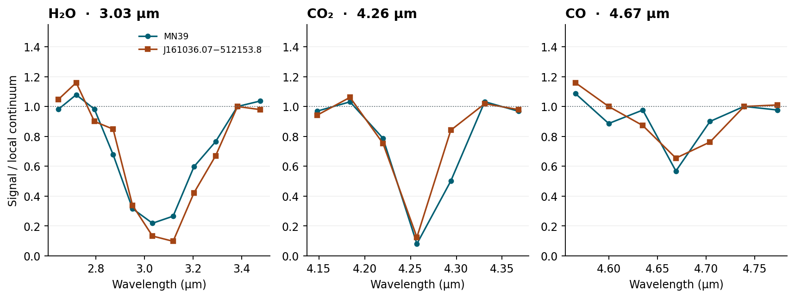

# Three infrared absorption bands along two sightlines near MN39

The SPHEREx DR1 all-sky cube shows deep absorption at **3.033, 4.257 and 4.669 μm** toward the central star of MN39 and **AllWISE J161036.07−512153.8**, 93.66 arcsec away. The wavelengths and band shapes are consistent with water ice, carbon dioxide ice and CO absorption. At the center of the CO₂ band, only **8.1% and 12.5%** of the fitted local continua remain. Eight other bright field sources retain at least 54.6% in the same measurement. These are two distinct lines of sight through absorbing material. The second is well outside the published 35-arcsec diameter of the MN39 mid-infrared shell. Their distances and the depth of the absorbing material along either line of sight are unknown. [SPHEREx DR1 cube](https://doi.org/10.26131/IRSA679) · [Spitzer shell, Table 1](https://doi.org/10.1111/j.1365-2966.2010.16469.x) · [SPHEREx molecular-band identifications](https://arxiv.org/abs/2610.38043)

| Sightline (ICRS) | 3.033 μm H₂O | 4.257 μm CO₂ | 4.669 μm CO |
|---|---:|---:|---:|
| MN39, 242.610558°, −51.357039° | 0.219 | 0.081 | 0.568 |
| J161036.07−512153.8, 242.650318°, −51.364950° | 0.133 | 0.125 | 0.655 |

Each number is central-channel signal divided by the local continuum. The broad water depression spans multiple channels. The CO₂ band extends into the adjacent red channel. The lower-resolution 4.669 μm CO feature can include gas-phase contributions. Absolute abundances, grain environment and a physical connection between the absorbing columns require further evidence.

## Measurement and controls

The input is a lossless 39 × 39 pixel crop from order-5 tile 10542 with all 102 channels, coverage, flags and celestial astrometry. The pixels are 12.9 arcsec wide. The standard extraction sums surface brightness within 1.5 pixels of each catalog position and subtracts the median per-pixel sky from a 3–5 pixel annulus. In each feature we interpolate **log continuum signal linearly with wavelength** between the median signals and wavelengths in the two flanking windows. The water windows are 2.646–2.794 and 3.293–3.476 μm, CO₂ windows 4.148–4.184 and 4.331–4.368 μm, and CO windows 4.566–4.635 and 4.704–4.773 μm. The continuum windows were chosen in inspecting the data. The resulting ratios describe observed channels and depend on continuum placement. [Extraction](analyze.py) · [Channel measurements and quality flags](spectrum.csv)

For apertures of 1.0, 1.5 and 2.0 pixels and sky annuli of 3–5 or 4–6 pixels, the MN39 CO₂ transmission stays between 0.060 and 0.086. The comparison sightline also retains a deep CO₂ minimum for all six extractions. Water on the fainter comparison source is more background-sensitive. Nine field sources satisfy the same external selection of AllWISE W1 and W2 both brighter than 10 mag at radii 45–110 arcsec. J161036.07−512153.8 was identified among these after examining their spectra. The other eight yield CO₂ ratios of 0.546–1.162. Nearby weaker absorption is possible. No population occurrence rate or independent statistical significance follows from this selection. [All aperture results](band-tests.csv) · [All nine field spectra at the band centers](comparison-spectra.csv)

All occupied source-aperture pixels have the SOURCE bit alone (combined mask `0x200000`) in each of the three band-center planes. The CO₂ aperture has 5–14 hits per pixel for MN39 and 7–15 for the neighbor. The cube reports contributing hit counts and propagated flags. All pixels in each source aperture must have finite signal and positive coverage in each measured channel. Different signal and continuum channels can be observed at different times, and the detector and sky projection can sample the two stars differently. The tile's inputs span 2025 August 2 to 2026 April 11. The cube does not identify individual exposures for each pixel or give a per-pixel variance. Standard-aperture flag words and minimum hit counts for MN39 are tabulated for every channel. The packed inputs also preserve the neighbor's flags. Thin features in this product can depend on sampling in wavelength. The visit-level CO₂ check below uses original images from the public mission data mirror. Field controls and the second sightline disfavor a single variable star or a common channel-calibration error as a complete explanation, but do not establish simultaneity or a result from independent surveys. [Product documentation and known issues](https://irsa.ipac.caltech.edu/spherex-archive-documentation/spherex-data-products/)

Some MN39 continuum pixels have the OVERFLOW warning for approaching saturation. We repeated each feature measurement on the identical set of aperture and sky pixels that have nominal flags (zero or SOURCE only), positive coverage and finite values in the center channel and every continuum anchor. At radius 1.5 pixels, MN39 retains five of seven source pixels and transmissions 0.196, 0.055 and 0.569. The neighbor retains all eight pixels for CO₂ and CO and gives 0.125 and 0.655. Its strict water-channel signal falls below the local sky and does not support an additional numerical ratio. Background-subtracted central values can also turn negative in larger masked apertures where the brighter core has been removed. [Fixed-pixel quality tests](strict-mask.csv) · [Flag definitions](https://irsa.ipac.caltech.edu/onlinehelp/spherex/spherex/sp.html)

The comparison source has 214 clean NEOWISE exposure pairs in 21 visits from 2014–2024. Visit medians span 8.907–9.050 mag in W1 and 7.793–7.970 mag in W2, both in the unsaturated regime. Its 4.257 μm spectral deficit is 2.25 mag relative to the local continuum. The historical broadband variability is much smaller, although it does not measure the source state during the SPHEREx exposures. [Comparison-source visits](neighbor-wise-epochs.csv)

Three ATLASGAL submillimeter clumps within the search field have measured line-of-sight velocities of −44.8, −45.2 and −45.5 km/s and belong to the cataloged complex G331.351+00.113 (adopted group distance 2.9 kpc). Its nearest cataloged clump peaks are 31.7 arcsec from MN39 and 96.2 arcsec from J161036. A fourth clump in the field has velocity −76.8 km/s. This provides evidence of dense material in the field at multiple velocities. Neither the cataloged clump positions nor the unresolved ice spectra fix the distance to the absorbing material. [ATLASGAL source measurements](inputs/atlasgal-field.tsv) · [Urquhart et al. 2018](https://doi.org/10.1093/mnras/stx2258)

## A six-minute test of the carbon dioxide band

On 2025 August 12, SPHEREx detector 5 recorded both sources together in four consecutive exposures of pointing `2025W33_1B_0225`. Its variable-wavelength filter sampled the sources at progressively longer wavelengths as the spacecraft stepped between exposures. The first exposure started at 05:04:50 UTC and the last at 05:11:17 UTC. This sequence tests whether the CO₂ dip in the survey cube requires observations separated by months.

| Native detector measurement | At ~4.157 μm | At ~4.193 μm | At ~4.229 μm | At ~4.265 μm | Last / mean of first two |
|---|---:|---:|---:|---:|---:|
| MN39 | 669.2 | 725.2 | 536.7 | 68.5 | 0.098 |
| AllWISE J161036.07−512153.8 | 176.5 | 173.9 | 129.4 | 13.3 | 0.076 |

The entries are local-background-subtracted sums of MJy/sr samples in a 2.3-detector-pixel radius. Both sources are in the same four FITS images. Central wavelengths and bandpasses were evaluated separately at each location using the product’s tabular wavelength solution. The last exposure has a width of about 0.037 μm. The adjacent channels overlap. This table compares the low channel to two nearby **blue-side** continuum samples. The cube ratios above use continuum anchors on both sides, so the two estimators differ.

The nearest pixel to each source carried only the source flag in the low channel. Four other MN39 aperture pixels and one neighbor pixel carried additional flags. We also used only relative pixel offsets inside the aperture and free of every non-SOURCE flag across all four exposures, with the same offsets on each stamp after nearest-pixel centering. Five offsets survived for MN39 and ten for the neighbor. The final/blue-side ratios are **0.102 and 0.102**. Small apertures and subpixel centering limit the precision of this stricter comparison. The native sequence recovers a strong dip in both sources in 6.45 minutes. The individual observations belong to the same DR1 campaign as the cube. This validation addresses the CO₂ channel only. Absorption distance and a potential gas contribution to the separate 4.669 μm feature remain open.

Run `python single-visit/replay.py` to replay the compact native cutouts. Add `--fits-cache /path/to/cache` to download and verify all four complete FITS products and regenerate those cutouts. This requires NumPy and Astropy. The fixed visit was selected for coverage at the wavelength of the independently identified cube dip. It is a targeted check. [Exposure IDs and SHA-256 digests](single-visit/manifest.csv) · [Individual measurements, flags and exact times](single-visit/measurements.json)

## Source history and prior work

MN39 is a previously published candidate luminous blue variable. Gvaramadze and Kniazev published a VLT/ISAAC K-band spectrum in Figure 1. The SIMBAD identifier is `[GKF2010] MN39`, also `2MASS J16102654−5121253` and `MGE G331.3971+00.1685`. At the same position, VarWISE Pure reports a variable with a machine-assigned `cv` label and no period. SPLICES includes MN39 as photometrically selected target 3080171634003279880. A four-arcsec search at the neighbor returns no SPLICES entry. Those catalogs precede the spectral measurement here. The observations do not establish a new variable, confirm either stellar classification or locate ice within the ejecta. [Candidate and K-band spectrum](https://www.aspbooks.org/publications/508/207.pdf) · [VarWISE](https://irsa.ipac.caltech.edu/data/WISE/VarWISE/overview.html) · [SPLICES](https://doi.org/10.26131/IRSA554)

We selected MN39 after an exploratory search of 66 parseable Table 1 name–coordinate entries in the Nazé et al. LBV compilation. The list has aliases and coordinates with missing printed declination signs were omitted. An earlier, separate 33-entry hydrogen-deficient-carbon-star screen yielded no robust new dust onset. Neither search defined a statistical population test. [Nazé et al. Table 1](https://arxiv.org/abs/1111.6375)

VISTA independently resolves the MN39 star 0.16 arcsec from its published position. Its annual median Ks faded from 10.57 in 2014 to 11.85 in 2019, a catalog flux ratio of 3.26. The early bright state exceeds the usual VVV saturation onset (Ks ≈ 11–12), which depends on observing conditions. Requiring DoPhot χ < 5 still gives 10.57 and 11.85, but the exact ratio can retain bright-end bias. [VVV photometric limits](https://doi.org/10.1093/mnras/stad3929) Eight local reference sources in the 0.014° by 0.008° query box with mean Ks brighter than 16 and usable measurements in both years shift by at most 0.17 mag. We used observations without photometric or ambiguous-match flags and with uncertainties below 0.12 mag. NEOWISE also shows the multi-year fade over 21 qualifying visits. Its bright early visits approach or exceed the W1/W2 saturation thresholds, which bias profile-fit fluxes upward. Both surveys support fading. The precise early-to-late flux change is calibration-dependent. The long-term variability makes timing a material caveat for the SPHEREx coadd. [VISTA time series](https://www.eso.org/qi/catalog/show/429) · [VISTA annual measurements](vista-epochs.csv) · [NEOWISE visits](wise-epochs.csv) · [NEOWISE saturation](https://irsa.ipac.caltech.edu/data/WISE/docs/release/NEOWISE/expsup/sec2_1c.html)

As of 2026 November 15, a position search within 60 arcsec of each sightline returned no Spitzer/IRS Enhanced Spectrum or ISO Astrophysical Spectroscopic Database entry. ISO's observation log around the field gives the nearest full-scan SWS observation about 12 arcmin from the field center. IRS wavelengths start beyond the three bands studied here. The nearest entries in AKARI's public Galactic H II spectra list are 0.529° and 0.506° away. Its diffuse-sky spectra begin 6.89° away. The AKARI mission-wide pointing query was unavailable. The individual catalogs and exact position searches are retained. These checks and searches under the object names did not locate an earlier report of these two spectra together. Other unpublished or unindexed slit observations and other catalogs may contain prior data. [Archived queries and positions](inputs/history/queries.json) · [ISO observation log](https://heasarc.gsfc.nasa.gov/W3Browse/all/isolog.html) · [Spitzer/IRS](https://doi.org/10.26131/IRSA399) · [AKARI](https://www.ir.isas.jaxa.jp/AKARI/Archive/)

## Replay

Run `python analyze.py` and `python strict_masks.py` with NumPy and Astropy, then `python figure.py` with Matplotlib. These commands work offline. To reconstruct the compact cube from the original 321 MB FITS file, download the tile and run `python extract.py Npix10542_cube.fits`. The extractor checks the full-file SHA-256 before copying its flux, coverage and flags. The two positions, table names, and query apertures are recorded in the scripts and source tables. [Original tile](https://nasa-irsa-spherex.s3.amazonaws.com/dr1/hips5_cube/hips_20261026/Norder5/Dir10000/Npix10542_cube.fits) · [ESO catalog facility](https://archive.eso.org/tap_cat/) · [NASA/IPAC catalogs](https://irsa.ipac.caltech.edu/)

This publication makes use of data products from the Spectro-Photometer for the History of the Universe, Epoch of Reionization and Ices Explorer (SPHEREx), which is a joint project of the Jet Propulsion Laboratory and the California Institute of Technology, funded by the National Aeronautics and Space Administration. Based on data obtained from the ESO Science Archive Facility with DOI [10.18727/archive/68](https://doi.org/10.18727/archive/68). This work uses data from NEOWISE, the AllWISE catalog, VarWISE and SPLICES served by NASA/IPAC IRSA.
