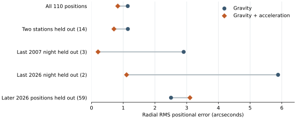

# An outward acceleration in the 19-year recovery of 2007 VE138 / 2026 VV15

A single gravitational orbit fits observations of **2007 VE138 and 2026 VV15 across 19.0 years**. A second connects **2017 RB15 and 2026 RG39 across 9.0 years**. The 2026 JPL snapshot gave each designation a separate orbit based on a short observing arc. In the joint solutions, the first object completes about twelve revolutions between apparitions and the second about five. At JD 2461200.5 TDB their fitted heliocentric osculating periods are 578.31 and 657.46 days.

| Candidate linkage | Arc spanned | Optical positions | Stations | Joint radial RMS | Withheld stations | Withheld positions | Withheld radial RMS |
|---|---|---:|---:|---:|---|---:|---:|
| 2007 VE138 / 2026 VV15 | 6943.4 days | 110 | 25 | 1.142″ | 595, J95 | 14 | 1.146″ |
| 2017 RB15 / 2026 RG39 | 3297.0 days | 62 | 13 | 0.926″ | F51, I52 | 20 | 1.984″ |
| 2026 SA12 / 2026 SW11 | September 22–23, 2026 | 48 | 12 | 0.910″ | H36 | 4 | 0.767″ |
| 2026 VO / 2026 VR1 | November 3–7, 2026 | 40 | 7 | 0.542″ | 291 | 9 | 0.557″ |

RMS is the root mean square of the two-dimensional angular residual, including cos(declination) on the right-ascension axis. Each holdout removes all measurements from the named stations before refitting the six state components. Candidate selection and starting catalog orbits used existing astrometry, so the station residuals are conditional predictive checks. The eight designations still had distinct primary identifiers when queried on 2026 November 15. Official linkage and designation decisions rest with the Minor Planet Center. Discovery credit belongs to the original observers. [Frozen identifier checks and discovery circulars](audit/ARCHIVE_AUDIT.md) · [MPC identification process](https://docs.minorplanetcenter.net/mpc-ops-docs/identifications/)

Three further observations verify the nine-year linkage on images excluded from the fit. In CFHT MegaCam exposures from September 15, 2017, the measured moving trail lies **0.52–0.59″ from the joint-orbit prediction** and moves nearly 20″ over 163 seconds. Each exposure has a different timestamp from the input astrometry. [Three independent images, measured coordinates and replay](cfht/README.md)

## An outward acceleration in 2007 VE138 / 2026 VV15

For the 19-year linkage, a fit that allows both radial and transverse acceleration gives **A₁ = (+1.424 ± 0.094) × 10⁻⁸ au/day² at 1 au**, directed away from the Sun. The uncertainty groups residuals by observatory and UTC date. The transverse component is consistent with zero in this fit. Adding both terms lowers radial RMS from 1.142″ to 0.828″ over 110 positions. On 14 positions excluded by observatory, RMS falls from 1.146″ to 0.707″. The result also survives omitting the last night of either apparition. One earlier-date test goes the other way: fitting the old apparition and the first eight later measurements predicts the remaining 59 at 3.103″ RMS with acceleration and 2.506″ with gravity. [Force model, sensitivity tests and full residuals](pressure/README.md)



A separate reduction with ASSIST, REBOUND and Astropy recovers the radial-only solution to within 0.01% of Find_Orb on the same positions. Applying the Gaia-based EFCC18 corrections to the appropriate 53 measurements, including every 2007 observation, gives **A₁ = +1.442 × 10⁻⁸ au/day²** and reduces the corrected-position RMS from 1.181″ to 0.840″. These tests use the same telescope observations. A third apparition or a measured range would supply independent physical evidence. [Independent orbit solution and individual catalog corrections](independent/README.md)

The acceleration corresponds to an effective radiation-pressure coefficient times area-to-mass ratio of about **0.063 m²/kg** if sunlight supplies the entire force. This is about 200 times the measured value for near-Earth asteroid 2009 BD. The fit measures an acceleration. It does not determine the object's mass, composition or propulsion mechanism. Recoil from outgassing, radiation pressure and residual astrometric bias remain alternatives. A retrospective integration across the Space Age finds a closest Earth-center passage of roughly 1.17 million km, in 2007. The four nominal fitted histories provide no direct Earth-launch encounter. A constant-force extrapolation and incomplete spacecraft records leave artificial provenance unresolved. [Physical interpretation](pressure/README.md) · [Launch and encounter checks](origin-check/README.md) · [Micheli et al. on 2009 BD](https://arxiv.org/abs/1106.0564)

## A prospective optical test

At La Palma (MPC 950) on **2026 November 15 at 19:30 UTC**, the radial-plus-transverse solution predicts **RA 283.16593°, Dec +42.39373°**, topocentric J2000, at approximately V = 20.8. Its center is 2.94″ from the gravity prediction. The target moves about 48″ per minute. Accurate exposure midtimes, non-sidereal tracking or trail fitting, and several independent positions would help discriminate the trajectories. This is a prediction. In April 2038 the two predictions differ by 4.57 arcminutes, so the small statistical error ellipse of either individual fit is insufficient for recovery planning. [Pointings, rates, model spreads and replay](forecasts/README.md)

## How the objects were selected

The protocol commit preceded ranking. The public SBDB snapshot contained 43,098 near-Earth asteroids, giving 928,697,253 unordered pairs. For each catalog orbit, the search constructs a vector from perihelion distance in au, the unit orbit pole and the eccentricity vector. The score is Euclidean distance between these vectors. The arbitrary scaling is part of the reproducible selection. A k-d tree exactly enumerates the 730 pairs within 0.025. Entries use catalog-supplied osculating epochs, which can differ for short arcs. All eight highest-ranked pairs have the same epoch. The score ignores orbital phase and observational uncertainty. We used similarity to choose candidates for astrometric testing and did not assign significance or a physical origin from the rank.

| Rank | Designations | Result of the check |
|---:|---|---|
| 1 | 2026 SW11 / 2026 SA12 | Same-apparition single-track candidate |
| 2 | 2018 NC15 / 2026 LD1 | Two sources resolved simultaneously at G96 |
| 3 | 2022 MY3 / 2022 OP8 | Previously published pair candidate |
| 4 | (857541) 2012 QG8 / 2024 GE1 | Previously published pair candidate |
| 5 | 2019 PR2 / 2019 QR6 | Published young asteroid pair |
| 6 | 2007 VE138 / 2026 VV15 | Common orbit across 19 years |
| 7 | 2017 RB15 / 2026 RG39 | Common orbit across 9 years |
| 8 | 2026 VO / 2026 VR1 | Same-apparition single-track candidate |

The four fitted cases were selected after ranking. The study does not estimate the completeness or false-identification rate of the entire catalog. All 730 ranks and the query receipt are included. Taylor et al. previously investigated candidate NEO linkages and nongravitational forces. [Ranking](ranking.csv) · [Query and input digest](screen.json) · [SBDB field definitions](https://ssd-api.jpl.nasa.gov/doc/sbdb_query.html) · [Taylor et al.](https://doi.org/10.3847/1538-4357/ad85e3) · [Previously published pair search](https://english.shao.cas.cn/ne/rn/202608/t20260812_1187831.html) · [Fatka et al. on 2019 PR2 / 2019 QR6](https://arxiv.org/abs/2112.01681)

## Why very similar orbits gave different answers

At G96 the control objects 2018 NC15 and 2026 LD1 appear at **eight identical station timestamps** on two nights, with separations of 1.250–1.270°. One moving point cannot produce those simultaneous positions. In contrast, for the September and November candidates, observations with the two labels form a continuous track at their common station. No same-station timestamps within three minutes of one another span the two labels in either candidate. A resolved double image on an original exposure would falsify the simplest one-object interpretation. The available tracklets leave very closely spaced companions unresolved. [MPC control measurements and observing history](audit/ARCHIVE_AUDIT.md)

We searched the identifiers and temporary discovery names together in the MPC query service, discovery and daily orbit circulars, Project Pluto discovery-track records and indexed literature. The checked records yielded separate entries without an explicit identification connecting either long pair. This establishes a bounded public prior-art check. A private or pending submission could precede this analysis. [Archive check](audit/ARCHIVE_AUDIT.md) · [Source response digests](audit/observation-receipts.json)

## Reproduction

Run the population screen with Python, NumPy and SciPy. An existing snapshot is read as supplied. An absent path triggers a current JPL query. The live catalog can change. Compare the digest and denominators with the archived receipt.

```sh
python screen.py /tmp/neo-sbdb.json /tmp/nea-ranking.csv
```

The orbit tests replay from frozen telescope measurements, station coordinates and seed elements. Each fit produces a state vector, osculating elements, residuals for every observation, and separate-label and station-withheld checks. [Build and replay instructions](orbits/README.md) · [Original observing positions](orbits/astrometry.csv) · [Fitted states and residuals](orbits/fits)
