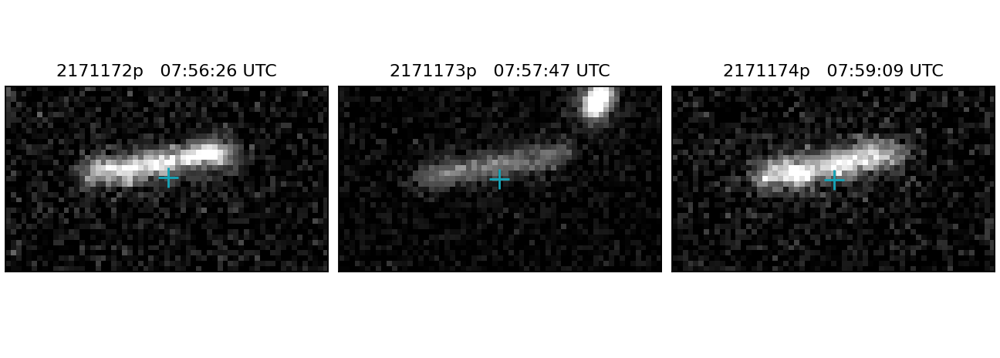

# The predicted 2017 RB15 track in three CFHT images

Three Canada–France–Hawaii Telescope MegaCam exposures on September 15, 2017 contain a moving trail at the position predicted by the 2017 RB15 / 2026 RG39 joint orbit. None of the three timestamps appears in the frozen MPC astrometry for either designation. The orbit fit contains CFHT observations from **September 13**, a different night. The new measurements verify the joint orbit on independent pixels within the older apparition. They provide no constraint on the acceleration of the separate object 2007 VE138 / 2026 VV15.

| CADC image | UTC exposure midpoint | Measured RA (°) | Measured Dec (°) | Separation from prediction |
|---|---|---:|---:|---:|
| 2171172p | 07:56:26.082 | 337.03998388 | −7.29051158 | 0.587″ |
| 2171173p | 07:57:47.540 | 337.04273136 | −7.29052472 | 0.520″ |
| 2171174p | 07:59:09.570 | 337.04551454 | −7.29052494 | 0.527″ |



The panels use the native detector axes and the same pixel scale. Each cyan cross marks the predicted midpoint. The trail traverses roughly 27 detector pixels in each 40-second exposure. Its centroid moves approximately 19.8″ between the first and last images. All three carry CFHT program 17BH99, PI Richard Wainscoat, and header target P10D35V-C000. The archive field name does not establish a designation linkage. The positions, times and measured motion provide that check.

## Measurement

The CADC Solar System Object Image Search supplied image IDs. We projected the frozen six-parameter orbit to MPC site 568 and requested 0.014° radius cutouts at each predicted direction. The predicted positions and source URLs are in `inputs.json`. For each exposure the script uses the midpoint from its FITS header, maps the modeled motion through the FITS WCS, and measures a trailed Gaussian and constant sky background. The centroids use the CFHT pipeline WCS (FK5, equinox J2000). Image-to-image motion is more precise than the absolute celestial zero point; the three declination residuals share a roughly +0.48″ offset.

A separate fixed-position test convolves each image with a 1.9-pixel Gaussian trailed along the predicted direction. The three central responses are 28.1, 25.3 and 32.2 local robust background scales above their respective medians. All 712 matched-offset controls have lower three-image mean response. Those empirical contrasts depend on the image filter, local sky and spatial correlation. They are not Gaussian probabilities or a search-wide significance. Time-variable astrometric systematics and sky contamination are assessed by the measured offsets and repeat motion across the three exposures. The integrated orbit does not use these measurements. [Frozen image queries and predictions](inputs.json) · [Centroids and measured contrasts](measurements.csv) · [CFHT archive and cutout service](https://www.cadc-ccda.hia-iha.nrc-cnrc.gc.ca/en/doc/data/)

## Replay

From this directory, with Python 3, NumPy, SciPy, Astropy and Matplotlib installed, run the following command. Input cutouts are cached and their SHA-256 digests checked before fitting.

```sh
python measure.py /tmp/nea-cfht-images /tmp/nea-cfht-measurements
```
