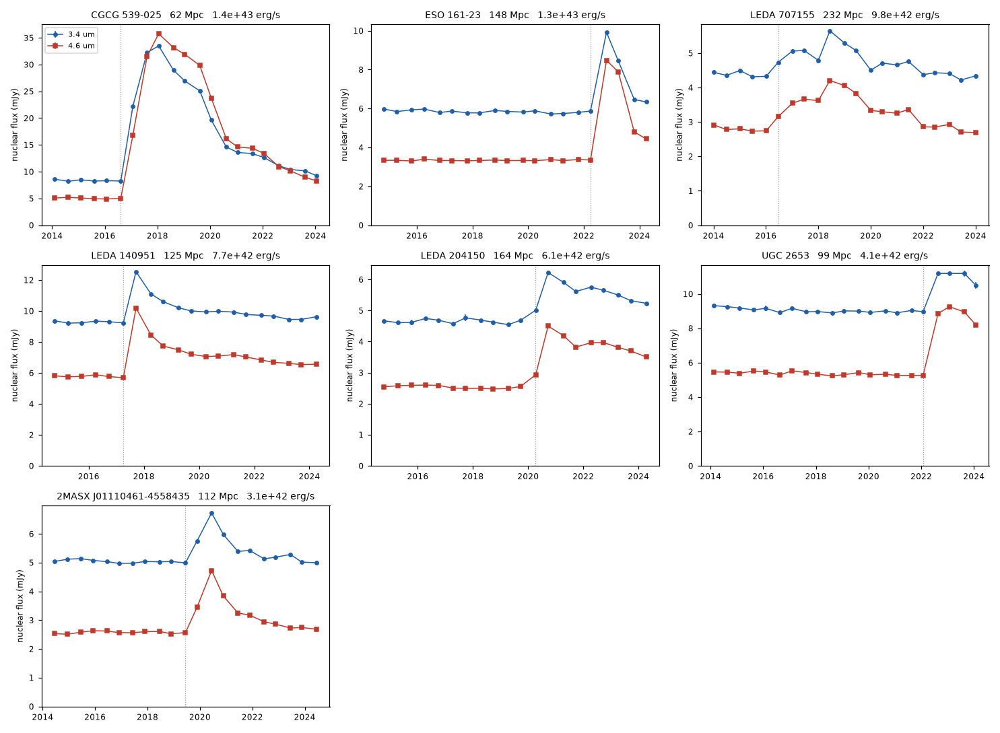

# The nucleus of CGCG 539-025 brightened sevenfold in the infrared and no one reported it

Between August 2016 and January 2017 the centre of the galaxy CGCG 539-025, 62 Mpc away, began an infrared outburst. By January 2018 it was 7.1 times brighter at 4.6 μm than it had been in six earlier NEOWISE visits. It has faded smoothly since and was still above its old level when the survey ended in 2024. The excess emission has the colour of 1,040 K dust, peaked at 1.4 × 10⁴³ erg/s and carried 1.5 × 10⁵¹ erg over seven years. The galaxy shows no sign of an active nucleus. No transient at this position is in the Transient Name Server, the Gaia alerts or the ZTF alert stream, and the flare is absent from the three published infrared flare samples we checked.

Dust that glows for years after a short flash is how tidal disruption events hidden by dust have been found. In those events a star passes too close to a galaxy's central black hole and is torn apart. This flare matches the published examples in rise time, temperature, luminosity and energy. It is the largest of seven unreported flares that pass every cut in a search of 43,916 nearby galaxies. They are candidates. Infrared photometry cannot separate a disrupted star from a dust-enshrouded supernova near the nucleus or the first outburst of a dormant active nucleus. [Flare table](data/flares.csv) · [Visit light curves](data/flare-light-curves.csv)



| Galaxy | Distance, Mpc | Last quiet visit | First bright visit | Rise at 4.6 μm, mag | Dust temperature, K | Peak luminosity, erg/s | Energy so far, erg | Left at last visit |
| --- | ---: | --- | --- | ---: | ---: | ---: | ---: | ---: |
| CGCG 539-025 | 62 | 2016-08-11 | 2017-01-24 | 2.13 | 1,040 | 1.4 × 10⁴³ | 1.5 × 10⁵¹ | 11% |
| ESO 161-23 | 148 | 2022-03-30 | 2022-10-26 | 1.01 | 1,010 | 1.3 × 10⁴³ | 3.3 × 10⁵⁰ | 22% |
| LEDA 707155 | 232 | 2016-06-20 | 2017-01-03 | 0.45 | 1,130 | 9.8 × 10⁴² | 8.8 × 10⁵⁰ | none |
| LEDA 140951 | 125 | 2017-04-04 | 2017-09-19 | 0.62 | 950 | 7.7 × 10⁴² | 5.6 × 10⁵⁰ | 18% |
| LEDA 204150 | 164 | 2020-04-10 | 2020-09-21 | 0.62 | 1,010 | 6.1 × 10⁴² | 4.5 × 10⁵⁰ | 49% |
| UGC 2653 | 99 | 2022-01-26 | 2022-08-22 | 0.60 | 760 | 4.1 × 10⁴² | 1.7 × 10⁵⁰ | 73% |
| 2MASX J01110461−4558435 | 112 | 2019-06-13 | 2019-11-23 | 0.66 | 1,000 | 3.1 × 10⁴² | 1.5 × 10⁵⁰ | 5% |

Luminosity and energy are for a blackbody through the two excess fluxes, with distances from redshift at 70 km/s/Mpc. "Left at last visit" is the 4.6 μm excess at the final visit as a share of the peak excess. The energy is a lower limit while a flare is still fading.

## CGCG 539-025

The galaxy is at 02:26:53.2, +41:41:21 (J2000), also IRAS 02237+4127, a barred spiral in a group at z = 0.0144. Its quiet nucleus had W1 − W2 = 0.10 mag, the colour of starlight, with visit-to-visit scatter of 1.0% and 2.3% in the two bands.

- **The flare is one smooth event.** The 4.6 μm flux went from 5.0 mJy to 16.8 mJy in the first bright visit, 31.5 mJy six months later and 35.7 mJy on 18 January 2018. It then fell in every one of the next twelve visits, to 8.3 mJy on 16 January 2024. The first bright visit is 80 times the baseline scatter above the old level.
- **A point source appeared.** The WISE profile fit to the nucleus had a reduced χ² near 54 at 3.4 μm before the flare, because the galaxy is extended. It dropped to 14–20 during the flare and climbed back towards 50 as the flare faded. None of the 257 exposures carries an artifact flag.
- **It is at the nucleus to WISE precision.** The centroid moved 0.28 ± 0.03 arcsec during the flare. Scaling by the share of flare light puts the new source 0.37 arcsec, or 110 pc, from the galaxy's infrared centroid. Systematic differences between an extended galaxy and a point source can produce an offset of this size.
- **Nothing happened in visible light afterwards.** ZTF season medians of the nucleus stay within 18.28–18.40 mag in g and 17.53–17.61 mag in r from 2018 to 2026 while the infrared excess fell by a factor of nine. The alert stream holds one isolated detection in 2024. ZTF began after the rise, so an optical flash in late 2016 is not excluded by these data.
- **No one reported it.** A 10 arcsec search of the Transient Name Server returns nothing. Gaia issued no alert. ROSAT did not detect the galaxy. The flare is not among the 18 events of Masterson et al., the 137 of Jiang et al. or the 823 of Necker et al., and literature searches on the galaxy's names found no report.

The published samples had reasons to miss it. The Flaires catalogue contains only 7 of the 44,599 galaxies searched here, because it avoids bright extended hosts. MIRONG is restricted to galaxies with SDSS spectra. We do not know why the Masterson et al. search, which used difference images of the same survey, did not list it. [Masterson et al.](https://doi.org/10.3847/1538-4357/ad18bb) · [Jiang et al.](https://ui.adsabs.harvard.edu/abs/2021ApJS..252...32J) · [Necker et al.](https://doi.org/10.1051/0004-6361/202451340)

A supernova is the main alternative. Ordinary supernovae emit 10⁴⁹ erg in total light. The most luminous interacting ones approach 10⁵¹ erg and can warm dust for years, but they are also among the brightest optical transients, and one at 62 Mpc would have been found by the 2017 sky surveys unless it sat behind several magnitudes of dust. Either reading makes this a previously unknown energetic explosion in a nearby galaxy nucleus.

## The other six

**ESO 161-23** was quiet on 30 March 2022 and at its peak by 26 October 2022, then lost 78% of the excess in 17 months. eROSITA did not detect the galaxy in 2020, which limits any earlier X-ray-bright nucleus to about 10⁴¹ erg/s. The centroid shift implies 0.29 arcsec. At declination −56° it is outside ZTF.

**LEDA 140951** flared between April and September 2017 and has decayed for seven years. eROSITA did not detect it in 2020, two and a half years into the flare. Its centroid moved by 0.03 ± 0.02 arcsec.

**UGC 2653** rose between January and August 2022 and is the coolest and slowest of the seven. ZTF covered it throughout and has no alert of any kind within 5 arcsec. The galaxy hosted the stripped-envelope supernova 2007D fifteen years earlier.

**LEDA 707155**, **LEDA 204150** and **2MASX J01110461−4558435** have smaller rises on equally flat baselines. LEDA 707155 has a broader peak than the rest. LEDA 204150 has no ZTF alert within 5 arcsec.

A further 20 unreported flares fail at least one cut: they have two or more peaks, a noisier baseline, a single bright visit at the end of the survey, or a lower luminosity. One of them, in MCG−05-52-018, follows a cluster of six ZTF detections in July–August 2022 that was never registered as a transient. Another, in LEDA 131533, was followed two and a half years later by the unclassified AT 2024hwi. [All 113 flares with classes and evidence](data/flares.csv)

## The search

The parent sample is the 2MASS Redshift Survey: 44,599 galaxies brighter than K = 11.75, most within 250 Mpc. We retrieved every NEOWISE-R single-exposure measurement within 5 arcsec of each position from the final 2024 release. Exposures within 3 arcsec that pass the frame-quality, South Atlantic Anomaly and Moon cuts were combined into one median flux per six-monthly visit and band. 43,916 galaxies have at least 12 two-band visits. [Huchra et al.](https://ui.adsabs.harvard.edu/abs/2012ApJS..199...26H) · [NEOWISE-R single-exposure table](https://doi.org/10.26131/IRSA144)

A flare needs a baseline of at least six visits whose scatter is below 10% in both bands, then a visit more than 5σ and 10% above that baseline in both bands, followed by a visit more than 3σ above it. That finds 113 flares. Flares that began before 2017 cannot be found, because the baseline would be too short.

| Class | Flares | Meaning |
| --- | ---: | --- |
| Published | 13 | In one of the three flare samples, in SIMBAD as a WISE transient, or identified in the literature |
| Reported transient | 13 | A Transient Name Server object within 10 arcsec, discovered from two years before to one year after the infrared onset |
| Off-nuclear | 5 | Centroid moved by more than 4σ and the implied source is more than 1 arcsec from the centre |
| Active nucleus | 55 | SIMBAD type, a quiescent W1 − W2 above 0.5 mag, or a ZTF alert object with 30 or more detections |
| Unreported | 27 | None of the above |

The seven in the table are the unreported flares with one peak, at least two visits after onset, baseline scatter of 3% or less at 4.6 μm, a rise of at least 0.4 mag and a peak blackbody luminosity of at least 3 × 10⁴² erg/s. The luminosity floor follows the 10⁴² erg/s threshold at 4.6 μm that Masterson et al. chose to exclude ordinary supernovae.

**Known events come back.** Nine of the 18 Masterson et al. events are 2MRS galaxies. Six of those began in 2016–2018 and all six are flagged. The other three began in 2014, before a baseline exists. Seven MIRONG flares and seven Flaires entries are 2MRS galaxies, and five of each are flagged. Three of those four misses also began before 2017. The fourth, SDSS J110958.34+370809.6, peaked in 2019 on a baseline that already varied by 14% and fails the quiet-baseline requirement. The search also returns the tidal disruption events AT 2019qiz and AT 2018dyk, the 2018 outburst of NGC 1566, the obscured event in SDSS J010320.39+140152.5 and the faint candidate AT 2023npi in UGC 113, each without using their published positions. [AT 2023npi](https://arxiv.org/abs/2511.19016) · [SDSS J0103+1401](https://arxiv.org/abs/2605.29616)

**The luminosities agree with published values.** For the two flagged galaxies that have a bolometric peak in the Flaires catalogue, we measure 1.65 × 10⁴³ against 1.61 × 10⁴³ erg/s and 5.97 × 10⁴³ against 6.88 × 10⁴³ erg/s.

**The centroid test separates disc events.** Five flares show centroid shifts that place the source 1.2 to 5.5 arcsec from the nucleus. Those are likely supernovae in the disc and are excluded.

## Limits

- The WISE beam is 6 arcsec. At these distances it covers the central 2–7 kpc, and the centroid test locates a source to a few tenths of an arcsecond at best.
- Profile-fit photometry of extended galaxies is biased in absolute terms. The measurements here are differences against each galaxy's own baseline.
- Visits are six months apart. Rise times are upper limits and peaks can fall between visits.
- A blackbody through two bands is a crude model. Dust at other temperatures adds energy that this estimate does not count.
- "Unreported" means absent from the catalogues and services queried on 14–15 November 2026. Unpublished candidate lists from other WISE searches may contain these sources.
- The classes use SIMBAD types, which are incomplete. A weak active nucleus without a catalogue entry would pass as a quiet galaxy.

## Next tests

An optical spectrum of CGCG 539-025 now would test for high-ionization coronal lines, which persist for years after dust-obscured disruption events and are not produced by supernovae. Radio surveys can test for an outflow: the VLA Sky Survey observed the field in three epochs between 2017 and 2024, all during the decline. SPHEREx has been mapping the whole sky at 0.75–5 μm since 2025, so its public spectral images give the present 3–5 μm flux of all seven nuclei and extend each light curve past the end of NEOWISE.

## No vanishing supergiant

The same pipeline was run on 17,704 catalogued red supergiant candidates in the Magellanic Clouds, M31, M33 and ten dwarf galaxies, looking for a star that faded for good, as a massive star collapsing directly to a black hole would. 9,551 have at least eight 3.4 μm visits: 4,739 in the LMC, 2,080 in the SMC, 1,165 in M33, 1,161 in M31 and 406 in the dwarfs. None passes the fade test: a final three-visit median below half the first five, with every one of those visits below 0.6. 99.1% ended within 0.8–1.25 times their starting flux. The largest declines, including one ratio of 0.47 in M33, are long-period variables caught at different phases. Stars that drop out of the catalogue are faint M31 sources near the detection limit, blends in the M31 bulge, and foreground stars whose proper motion carried them past the match radius. The M31 candidate of De et al. is not in the input catalogue, so this search does not test it. [Ren et al. 2021a](https://ui.adsabs.harvard.edu/abs/2021ApJ...907...18R) · [Ren et al. 2021b](https://ui.adsabs.harvard.edu/abs/2021ApJ...923..232R) · [De et al.](https://arxiv.org/abs/2410.14778) · [Supergiant results](data/supergiants.json)

## Replay

From this directory, with NumPy, SciPy, pandas, Matplotlib and Requests:

```sh
python summarize.py --flares data/detections.csv --epochs data/flare-light-curves.csv \
  --positions data/2mrs-positions.csv.gz --centroid data/centroid.csv --vet data/catalogue-records.json \
  --flaires data/flaires-positions.csv --masterson data/published-flares.csv \
  --notes notes.json --ztf data/ztf-alerts.json --out flares.csv
python figure.py flares.csv data/flare-light-curves.csv unreported-flares.png
```

These rebuild the flare table and figure from deposited measurements. The full search downloads about 550 MB from IRSA and takes about 90 minutes at three parallel requests:

```sh
python fetch.py data/2mrs-positions.csv.gz neowise --batch 300 --workers 3
python epochs.py neowise epochs.csv
python flares.py epochs.csv detections.csv
python centroid.py neowise detections.csv centroid.csv
python vet.py detections.csv data/2mrs-positions.csv.gz catalogue-records.json
python ztf_alerts.py flares.csv ztf-alerts.json
```

The Transient Name Server allows about one cone search a minute, so `vet.py` needs two hours for 113 positions. Its answers change as new transients are registered. Fluxes are in mJy on the Vega zero points 309.54 Jy and 171.787 Jy. Dates are UTC. Retrieval dates and file hashes are in [sources.json](sources.json).

This work uses data from the Wide-field Infrared Survey Explorer and NEOWISE, served by the NASA/IPAC Infrared Science Archive; the 2MASS Redshift Survey; SIMBAD and VizieR; the Transient Name Server; the Zwicky Transient Facility through IRSA and the ALeRCE broker; the eROSITA-DE first data release; and the Gaia Photometric Science Alerts. [IRSA](https://irsa.ipac.caltech.edu) · [TNS](https://www.wis-tns.org) · [ALeRCE](https://alerce.science) · [eROSITA-DE DR1](https://erosita.mpe.mpg.de/dr1/) · [Gaia alerts](http://gsaweb.ast.cam.ac.uk/alerts)
