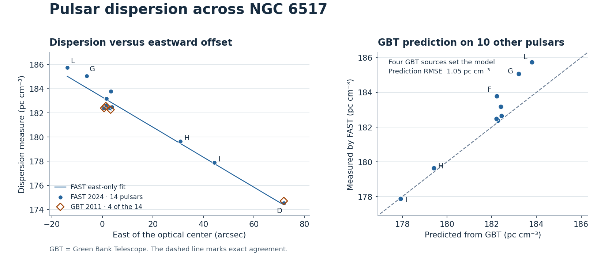

# The electron column falls eastward across NGC 6517

The 11.2 pc cm⁻³ spread in pulsar dispersion measures (DMs) in this globular cluster was already known. We find that angular position predicts much of that spread, including on different pulsars measured with a different telescope. Stars selected on their Gaia proper motions get redder in the direction in which the pulsar electron column falls. See [source tables, prior work and selection record](SOURCES.md).

## A prediction across telescopes

In 2011 Green Bank had timed four pulsars. Three lie near the center and D lies about 71 arcsec from them. We fixed an axis from the centroid of those three to D and fitted a line to the four published Green Bank positions and DMs. We then evaluated the line on the ten other pulsars with individually constrained positions in the later FAST timing study. The predicted and measured DMs have Pearson r = 0.969 and an RMS difference of 1.050 pc cm⁻³. Predicting the Green Bank mean gives 3.066 pc cm⁻³ and predicting its three-pulsar core mean gives 2.226. The ten predictions are low by 0.77 on average. The exact two-sided rank probability is 0.00582 under exchange of the ten pulsar labels. The sample and checks were selected retrospectively after a 15-cluster catalog screen.

| Evidence | Measurement |
|---|---|
| All 14 precisely timed FAST sightlines | DM = 183.257 − 0.1211 E + 0.0282 N, with east and north in arcsec about J2000 18h01m50.52s, −08°57′31.6″. R² = 0.968. The HC3 slope errors are 0.0172 and 0.0296 pc cm⁻³ arcsec⁻¹, respectively. They omit unknown spatial covariance. |
| Remove D and refit | R² = 0.937. The remaining sightlines predict D within 1.555 pc cm⁻³. |
| Leave out one source at a time | East-only RMS 0.614, east + north 0.707, radius-only 1.986, constant 3.007 pc cm⁻³. The data constrain the eastward component more tightly than the northward component. |
| Reprocess overlapping FAST observations | The independent stack-search DM estimates of Dai et al. give R² = 0.965 with the same 14 positions. |
| Test a smooth Galactic foreground | YMW16 predicts a DM range of 0.16–0.20 pc cm⁻³ over 8.70–10.60 kpc, with increasing DM to the east between D and L. The measured range is 11.203, increasing to the west. |
| Test a turbulent foreground | 26.24% of a million simulated isotropic Gaussian fields with a Kolmogorov structure-function exponent attain the observed R² at these positions. The fit alone leaves the distance and physical structure of the plasma open. |

## Checks using other observables

Three optical surveys show eastward increases in color of +0.086 mag per arcmin (Hubble F555W − F814W, 230 stars), +0.092 (Pan-STARRS r − i, 259 stars), and +0.107 (Gaia BP − RP, 331 stars). All eight angular-sector omissions preserve this sign in each catalog. These measurements cover 10–85 arcsec from the center, share a Gaia membership selection, and include overlapping stellar samples. They disfavor a simple model in which a single increase in both dust and free electrons produces both angular gradients. [Optical methods, coverage and prior photometry](optical.md)

A separate polarization measurement supplies a falsifiable check. B and D differ by 7.865 pc cm⁻³ in DM and only −3 ± 2.24 rad m⁻² in rotation measure. C and B differ by −0.046 pc cm⁻³ in DM and +26 ± 2.24 rad m⁻² in rotation measure. C's single, weakly polarized observation drives the discrepancy with a constant-field model. Simultaneous repeat polarimetry of B and C would test it. [Faraday measurements and error sensitivity](faraday.md)

## Reproduce and falsify

From this directory run `python analyze.py`, `python optical.py`, `python faraday.py`, and `python plot_radio.py`. The radio input rows, individual predictions, exact test, simulations and leave-one-out fits are in [radio-analysis.json](radio-analysis.json). The optical result includes the selected objects and the original archive queries. All data retrievals and literature checks were made on 2026-11-15. The source notes describe the optional initial catalog screen and smooth-Galaxy calculation.

A new timing position for pulsars P–R or S–V would allow the fitted angular model to be tested on another sightline, with no new slope fit. The current publications do not individually locate those seven sources. Comparison should use the empirical prediction errors above, since point-to-point scatter substantially exceeds the quoted timing precision.
