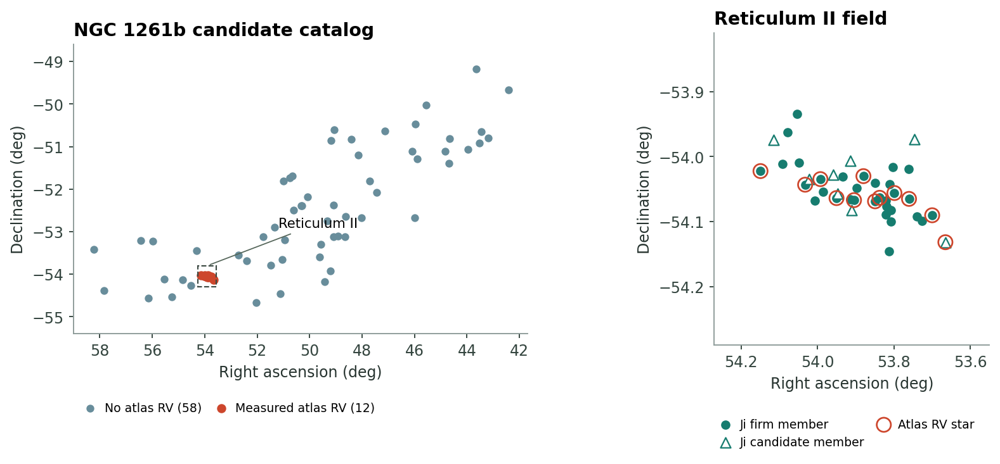

# The radial-velocity sample of NGC 1261b comes from Reticulum II

All 12 stars with published radial velocities in the 70-star STREAMFINDER list for NGC 1261b are spectroscopic members or candidate members of the ultrafaint dwarf galaxy Reticulum II. All 12 match by exact Gaia source ID. Each was classified as a firm Reticulum II member by at least one of two spectroscopic studies. Removing these 12 stars leaves **58 candidates and zero published velocities for the branch in this atlas**. The branch's apparent velocity concentration, 56.68–70.40 km/s with a median of 63.35 km/s, cannot provide independent spectroscopic evidence for tidal debris from the globular cluster NGC 1261.

Ibata et al. already marked the association of branch b with NGC 1261 as tentative. They excluded the NGC 1261 family from the 29 streams used to infer the Galactic mass distribution. The correction concerns membership and downstream reuse of the public catalog. It makes no revision to their mass fit. Other sky and proper-motion measurements still support investigation of the branch. [Ibata et al., 2024, *ApJ* 967, 89](https://doi.org/10.3847/1538-4357/ad382d)



## What the individual stars show

We compared all 24,540 stream-assigned rows in Ibata et al. Table 1 against all 129 spectroscopic targets in Ji et al. Table 1, including all 89 of their nonmembers. The catalog labels 32 firm and eight candidate members. Only stream IDs 12 and 14 yielded exact Gaia DR3/EDR3 ID matches anywhere in the 87-stream atlas. Both contain the **same twelve stars**. Every one also matches a target in Simon et al.'s spectroscopy of Reticulum II within 0.127–0.172 arcsec. Simon's earlier assessment gives ten firm and two tentative memberships. Ji's later assessment gives eleven firm and one candidate. The one Ji candidate is Simon's firm member DES J033439.66−540754.4. Both Simon tentative cases are firm members in Ji. All lie within 1.82 elliptical half-light radii of the dwarf. The stellar membership confidence comes from the underlying spectroscopy, photometry and astrometry. These papers sometimes reuse earlier measurements, so agreement need not imply independent velocity measurements for each star. [Ji et al., 2023, *AJ* 165, 100](https://doi.org/10.3847/1538-3881/acad84) · [Simon et al., 2015, *ApJ* 808, 95](https://doi.org/10.1088/0004-637X/808/1/95) · [Twelve identifications with measurements, flags and separations](matches.csv)

| Published atlas group | Candidates | Measured velocities | Of those, Reticulum II matches | Velocities left |
| --- | ---: | ---: | ---: | ---: |
| NGC 1261, ID 12 | 173 | 23 | 12 | 11 |
| NGC 1261a, ID 13 | 136 | 4 | 0 | 4 |
| NGC 1261b, ID 14 | 70 | 12 | 12 | 0 |

Eight of the twelve atlas velocities carry source code 22, Walker et al.'s Reticulum II spectroscopy. Four carry code 23, VizieR. Three stars are flagged as binaries by Ji et al. Four of the twelve were also targeted by Roederer et al. for high-resolution chemical analysis. Three of those stars (DES J033447.94−540525.0, J033523.85−540407.5 and J033607.75−540235.6) have measured [Eu/Fe] of +1.75, +1.68 and +1.64 dex, respectively. This distinctive chemical signature provides information beyond the line-of-sight velocities. [Walker et al., 2015](https://doi.org/10.1088/0004-637X/808/1/108) · [Roederer et al., 2016, Tables 1, 6 and 7](https://doi.org/10.3847/0004-6256/151/3/82)

## The public radial-velocity track outside the dwarf

Galstreams distributes an interpolated NGC 1261b track derived from this atlas. Only 28 of its 1,044 samples lie between the minimum and maximum right ascensions of the 12 measured stars (53.665298°–54.149159°). Right ascension increases monotonically along this particular track, so this interval also brackets the measured positions along the tabulation. **690 samples have a tabulated absolute radial velocity greater than the speed of light.** All 690 lie outside the measured range in right ascension. The signed extrema are −32,929,072 and +396,486 km/s. The ECSV explicitly specifies km/s. These numbers diagnose a failure of the derived velocity track outside its data support. The atlas itself reports stellar velocities of ordinary magnitude. [Pinned Galstreams ECSV](https://github.com/cmateu/galstreams/blob/6a304c05bea7f774390a11082ea127719e99b70a/galstreams/tracks/track.st.NGC1261b.ibata2024.ecsv) · [Numerical audit](track.json)

## One later spectrum outside Reticulum II

A separate exact-ID comparison with all 115 stars in Awad et al. (2025) Table B.1 recovers **one of the other 58**. Gaia DR3 **4734256791553917952**, 2.77° from the dwarf center, has a heliocentric velocity of **85.706 ± 3.365 km/s** and [Fe/H] **−1.114 ± 0.173 dex**. Awad et al. give it an NGC 1261 membership probability of 0.946. The atlas assigns this same star to all three NGC 1261 lists (IDs 12, 13 and 14). Its later spectrum therefore supports an NGC 1261 association in the overlap, but cannot on its own identify which proposed branch it traces. The branch-b catalog's zero off-dwarf velocities and the later catalog's one require different denominators. The two surveys did not use the same velocity sample. [Awad et al., 2025, Table B.1](https://doi.org/10.1051/0004-6361/202451930) · [VizieR catalog](https://cdsarc.cds.unistra.fr/viz-bin/cat/J/A+A/693/A69)

As a coverage check, Gaia DR3 returns all 70 IDs and zero published RVS velocities. The S⁵ public DR1 light catalog (31,777 rows from 2018–2019) contains zero positions within 6 arcsec of any of the 70. The subsequent targeted S⁵ study above supplies the measurement. These checks do not exhaust other archives. [Gaia DR3 mirror](https://dc.zah.uni-heidelberg.de/tableinfo/gaia.dr3lite) · [S⁵ DR1](https://doi.org/10.5281/zenodo.4695135) · [Computed coverage](external-coverage.json)

Run `python independent_coverage.py --cache /tmp/reticulum-ii-inputs` to repeat the three catalog checks. The script verifies the immutable S⁵ FITS bytes, the Awad data rows, and that the Gaia response contains exactly the requested IDs. Based on data acquired at the Anglo-Australian Telescope. We acknowledge the traditional owners of the land on which the AAT stands, the Gamilaraay people, and pay our respects to elders past and present. [Li et al.](https://doi.org/10.1093/mnras/stz2731)

## Selection and reproduction

An exploratory screen compared 152 machine-readable Galstreams track realizations with nonzero proper-motion data to 277 Galactic clusters and satellites with positions and both proper-motion components. The close approach of NGC 1261b to Reticulum II prompted the exact-ID test above. Multiple track versions were eligible, 15 of 192 searched stellar-member track files were unavailable during the exploratory screen, and 25 of the remaining 177 lacked proper motions. The exploratory ranking has no role in assigning a membership probability or deciding the 12 exact matches. [Galstreams track snapshot](https://github.com/cmateu/galstreams/tree/6a304c05bea7f774390a11082ea127719e99b70a) · [Local Volume Database snapshot](https://github.com/apace7/local_volume_database/tree/c40961a42d2beb302be1da90bca2016c284ef63c)

From this directory run the following command with Python 3 and Poppler's `pdftotext` available. It downloads the two original machine-readable tables and Simon's author PDF, checks each full-file SHA-256 against the digest embedded in the script, and writes the 12-source evidence table plus coverage for all 87 streams. The regeneration directory can be compared byte for byte to the checked-in CSVs.

```sh
python reproduce.py --cache /tmp/reticulum-ii-inputs --output /tmp/reticulum-ii-result
diff matches.csv /tmp/reticulum-ii-result/matches.csv
diff coverage.csv /tmp/reticulum-ii-result/coverage.csv
python track_audit.py --cache /tmp/reticulum-ii-inputs --output /tmp/reticulum-ii-result/track.json
diff track.json /tmp/reticulum-ii-result/track.json
# Optional figure, requires Matplotlib.
python plot.py --cache /tmp/reticulum-ii-inputs --output /tmp/reticulum-ii-result/sky.png
```

The code retains Gaia identifiers as strings, accepts an atlas heliocentric velocity when its source code is positive and its uncertainty is below the 300 km/s missing-value sentinel, tests for an exact Ji identifier, and uses a one-arcsecond great-circle match against all 59 Simon entries. Positions are used as published, without fitting an offset. The atlas gives decimal-degree equatorial coordinates labeled J2016.5, while the older table uses J2000 coordinates. The maximum observed separation is also below 0.2 arcsec. The search for exact IDs covers the complete published lists, including stars without velocities. [Original STREAMFINDER table](https://content.cld.iop.org/journals/0004-637X/967/2/89/revision1/apjad382dt1_mrt.txt) · [Original Ji table](https://content.cld.iop.org/journals/1538-3881/165/3/100/revision1/ajacad84t1_mrt.txt) · [Simon author PDF, Table 2](https://arxiv.org/pdf/1504.02889) · [Coverage, all 87 streams](coverage.csv)

## Literature scope and discriminating observation

We searched the public scholarly web on 2026-11-15 for combinations of “NGC1261b”, “NGC 1261b”, “NGC 1261”, “Reticulum II”, “Ret II”, “Ibata”, “stream”, “contamination” and “radial velocity”. We also inspected the Ibata paper, its related-stream flags and the S5 discussion in Awad et al. The latter discusses overlapping structures around NGC 1261 and compares 34 common stars with Ibata et al. We found no report identifying these twelve Reticulum II targets as the entire published branch-b velocity sample. This is a bounded literature search. [Awad et al., 2025](https://doi.org/10.1051/0004-6361/202451930)

Spectroscopy across the branch beyond the dwarf and the one subsequently measured star, especially at distinct positions along the narrow and broad portions of the branch, can test whether its velocities and metallicities follow the cluster's tidal-tail model. Chemical abundances and photometric distances can distinguish a Reticulum II population from NGC 1261 debris even where their sky positions, proper motions and line-of-sight velocities overlap. The member cross-identifications do not settle whether a stream exists outside the dwarf.
