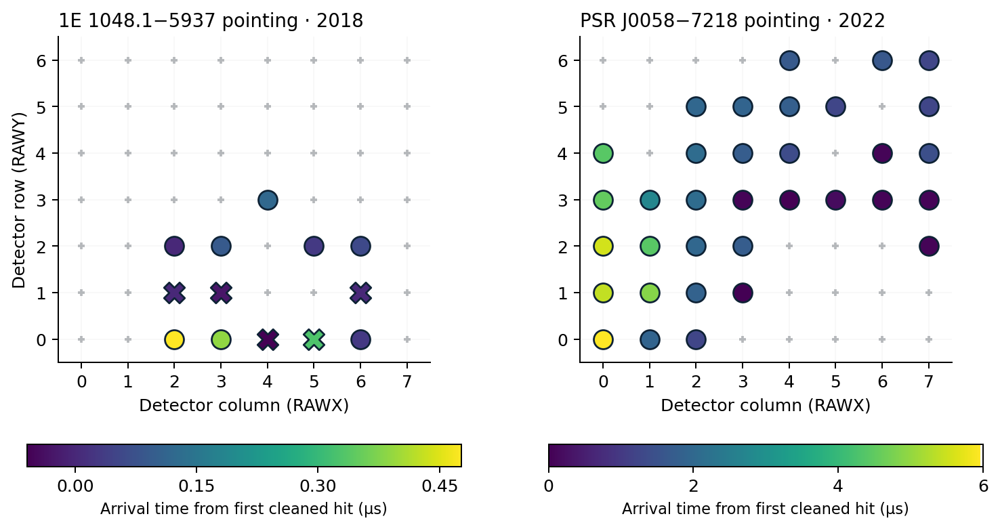

# Detector evidence challenges both reported microsecond magnetar bursts in the NICER catalog

Chu et al. identified two exceptionally short flashes in eight years of NICER observations. Both flashes can be recovered in the public event files. Their association with the two named magnetars is substantially weaker once the events removed by the standard pipeline, the readout of the individual detectors and the telescope pointing are examined. The 2018 flash coincides with five events that satisfy NICER’s particle-background rejection criterion. In the 2022 flash, all 34 events registered solely on the slow electronics, their times vary across the detector array, and the telescope pointed 13.17 arcmin from the proposed source. The other three catalog entries assigned to that Small Magellanic Cloud magnetar also occurred outside its nominal field of view. Both flashes also expose an absolute timing error in the catalog. Their measured barycentric times fall 69.184 seconds after their published TDB labels. That shift recovers a stronger signal in 843 of 944 comparable catalog windows and aligns seven bursts across seven separate observations with independent Fermi detections after the dense April 2020 storm is excluded. [Catalog-wide clock test](catalog-clock/README.md) · [Independent timing comparisons](clock-validation/README.md) [Published catalog](https://doi.org/10.3847/1538-4365/ae5655) · [Observation products and SHA-256 hashes](inputs.json)

| Measurement | 1E 1048.1−5937 pointing, 22 Nov 2018 | PSR J0058−7218 pointing, 24 Jul 2022 |
|---|---:|---:|
| Magnetar proposed by Chu et al. | 1E 1048.1−5937 | CXOU J010043.1−721134 |
| Published duration containing 90% of counts | 0.6 μs | 5 μs |
| All recorded events in the flash | 13 in 0.54 μs | 34 in 5.96 μs |
| Retained events at 0.5–8 keV | 7 | 32 |
| Fast-chain triggers among retained 0.5–8 keV events | 0/7 | 0/32 |
| Fast-chain triggers in detector- and energy-matched controls | 131/140 | 555/640 |
| Simultaneous events above the particle-rejection curve | 5 | 0 |

## What the detector recorded

NICER splits each detector signal between a slow chain that measures pulse height and a faster chain that measures time. The fast chain often misses low-energy photons. In the 2022 flash it missed every hit, including six with apparent energies of 2–8 keV and one at 13.39 keV. For other events in the same pointing at 2–8 keV, 974 of 989 activated the fast chain. In 2018 the corresponding counts were zero of one during the cleaned flash and 10,527 of 10,587 outside it. The stronger 2018 evidence comes from the discarded hits. Pulse height can represent a different amount of charge under an instrumental disturbance, so these nominal energies alone do not establish a photon spectrum. [NASA mission guide](https://heasarc.gsfc.nasa.gov/docs/nicer/mission_guide/) · [Counts by threshold](data/chain_counts.csv)

In 2018 five additional hits in five detectors span the same half-microsecond interval as the seven retained in-band events. All five carried a nominal 3.68–7.98 keV signal and activated both chains. Their slow/fast pulse-height ratios ranged from 1.96 to 3.97, above the corresponding 1.25–1.43 rejection thresholds computed as 1.1 + 120/PI, where PI is the channel number in units of 0.01 keV. NASA associates these ratios with events depositing charge away from the center of the silicon detector. The eighth cleaned hit had PI 42, below the catalog's band. All 13 hits lie inside a five-column by four-row rectangle on the eight-by-seven array. In 100,000 trials that preserve the number of hits in each electronics group, only 32 yielded an equally compact or smaller bounding rectangle. The trials draw distinct detectors in proportion to their 0.5–8 keV count rate outside the flash. This exploratory test uses the measured footprint to choose the statistic. The combination of co-located particle-like and slow-only hits favors a local disturbance for the 2018 cluster. The telemetry leaves its cause unresolved. [Events with coordinates, flags, ratios and deadtimes](data/events.csv) · [Instrument background discrimination](https://heasarc.gsfc.nasa.gov/docs/nicer/mission_guide/)

In 2022 all 34 unfiltered hits within the cluster survived cleaning. The two outside the catalog band had PI 47 and 1339. A further slow-only 4.74 keV hit arrived 209 μs later and is recorded separately in the released event window. Each cluster hit was in a different detector. Each event's recorded deadtime exceeded the entire cluster span, with minima of 14.57 μs in 2018 and 13.95 μs in 2022. A detector that had already fired would consequently have been unable to record a second hit during either flash. The absence of repeat hits therefore provides little discrimination between incident photons and a disturbance affecting several detectors. [NICER deadtime documentation](https://heasarc.gsfc.nasa.gov/docs/nicer/data_analysis/nicer_analysis_tips.html) · [Unfiltered event windows](data/events.csv)



Each colored symbol marks one unfiltered hit in the cluster. Circles survived cleaning. Crosses exceeded the particle-rejection curve. The axes give physical detector positions, and the two color scales use the time of the first cleaned hit as zero. In 2022 the earliest hits lie mainly to the right and the latest at the left edge. A least-squares plane in detector column and row explains 58.0% of arrival-time variance for the 32 in-band hits. Shuffling times **within each of the seven electronics groups** preserves their distinct clocks and channel membership. Only 62 of 100,000 shuffles produced as large a spatial trend. For the seven cleaned 2018 hits, 24,709 shuffles matched or exceeded the observed trend. This exploratory geometry test permits detector-dependent timing, energy and selection effects. It cannot measure a propagation speed or identify the disturbance. [Geometry replay](geometry.py) · [NASA detector layout](https://heasarc.gsfc.nasa.gov/docs/nicer/analysis_threads/iss_obstruction/)

## All four Small Magellanic Cloud assignments point elsewhere

Every catalog row assigned to CXOU J010043.1−721134 uses an observation targeted at PSR J0058−7218. We compared the magnetar’s published Chandra position, 01ʰ00ᵐ43.14ˢ, −72°11′33.8″, with each second of accepted pointing in those observations. The minimum separation anywhere in all 10,408 samples was 12.03 arcmin. This whole-observation result also covers uncertainty in converting the catalog's barycentric times to spacecraft times. The Galactic flash, by comparison, was 0.32 arcmin from the position of 1E 1048.1−5937. [Coordinates and source references](https://www.physics.mcgill.ca/~pulsar/magnetar/Tab1.html) · [Attitude samples and observation IDs](data/pointing.csv)

| Catalog date | Duration | Separation near the event | Full good-time range | Geomagnetic cutoff rigidity near the event |
|---|---:|---:|---:|---:|
| 2022-07-24 | 5 μs | 13.17′ | 12.06–13.71′ | 14.79 GeV/c |
| 2023-06-24 | 796 ms | 12.74′ | 12.15–13.59′ | 0.67 GeV/c |
| 2023-07-30 | 250 ms | 12.87′ | 12.04–13.72′ | 0.57 GeV/c |
| 2023-07-31 | 1,056 ms | 12.76′ | 12.03–13.52′ | 0.46 GeV/c |

NICER loses about half its response at 3 arcmin off axis. At 1.5 keV, in the official calibration maps, the largest ratio to the same profile's on-axis response was 0.000290 (rounded up) among all 140 profiles and 501 tabulated grid positions at offsets of at least 12 arcmin. This tests the sampled calibration grid at one energy. It supplies neither a broad-band source flux nor an absolute exclusion of stray light. At these large radii the rectangular maps sample only a subset of azimuths. NICER lacks imaging, so the pointing alone cannot establish an association with the target pulsar or any other source. The three longer events occurred at geomagnetic cutoff rigidities below 0.7 GeV/c, within the regime in which NASA reports electron precipitation flares. The microsecond SMC flash occurred in a very different geomagnetic environment. [Pointing response](https://heasarc.gsfc.nasa.gov/docs/nicer/data_analysis/nicer_analysis_tips.html) · [Vignetting calibration](https://heasarc.gsfc.nasa.gov/FTP/caldb/data/nicer/xti/bcf/vignette/) · [Non-X-ray flares](https://heasarc.gsfc.nasa.gov/docs/nicer/analysis_threads/flares/)

## Both microsecond epochs are 69.184 s later in TDB

The archive clusters identify the events without using the catalog clock. For each first cleaned hit, we applied the event file’s TT reference epoch and TIMEZERO, the Earth’s JPL DE430 barycentric position, the spacecraft position interpolated from the NICER orbit file with its own TIMEZERO, the Einstein correction from Earth's barycentric velocity and the spacecraft's geocentric position, and the solar Shapiro correction. The solar-system barycentric time in TDB for each is 69.184000 s after the zero-point explicitly labeled TDB in Figure 3, to six decimals. The corrected 2022 barycentric date is July 25. The absolute times below retain the numerical precision of the cross-check. Astrometric and detector errors apply, including to the absolute microsecond digits. [Figure 3 and time convention](https://doi.org/10.3847/1538-4365/ae5655) · [DE430 kernel](https://naif.jpl.nasa.gov/pub/naif/generic_kernels/spk/planets/de430.bsp) · [Timing replay](clock.py)

| Event | Spacecraft arrival in UTC | Published Figure 3 label in TDB | Recovered solar-system barycentric arrival in TDB |
|---|---|---|---|
| 2018 | Nov 22 12:01:41.173 | Nov 22 11:58:14.425441 | Nov 22 11:59:23.609441 |
| 2022 | Jul 24 23:55:38.643 | Jul 24 23:59:07.273212 | **Jul 25** 00:00:16.457212 |

At both epochs TT−UTC was 69.184 s. TDB−TT adds a small periodic term, and spacecraft arrival times also require a direction-dependent light-travel correction. Adding the measured constant fixes the two printed barycentric labels. It does not convert them directly into spacecraft UTC. Burst durations, spacings within each flash and detector-geometry comparisons are unaffected by a constant in the absolute time. [Catalog-wide timing comparison](catalog-clock/README.md)

## Controls and selection

The two cases were selected from the paper because they are its entire microsecond-duration class. We searched each entire cleaned event list for at least five 0.5–8 keV events in any sliding 10 μs window, merging overlapping windows. Each observation produced one cluster. The same unconstrained scan on the unscreened, calibrated UFA files retained slow-chain events with no reset or forced-trigger flags. It found the same two clusters, now with 12 and 32 in-band hits. [Full scan counts](data/cluster_scan.csv) · [Independent blank-sky observations](blank-sky/README.md)

For each cleaned flash hit we selected the 20 other 0.5–8 keV events in the same detector closest in PI, excluding ±1 second from the flash. Ties use chronological file order. Each detector appears once per flash, so the control sets are disjoint. Of 640 controls in 2022, 413 lay within 25% of the matched energy. In 2018, 127 of 140 did. The table retains the actual energy ranges for all matches. The separate 2–8 keV comparisons above use the full energy interval, avoiding dependence on the nearest-neighbor choice. [Matched samples](data/matched_controls.csv)

The documented SGR 1935+2154 burst storm in 2020 provides a positive control under intense count rates. In observation 3020560101, 485 intervals of 0.1 second contained at least 100 counts at 0.5–8 keV. Within those intervals the fast chain triggered on 208,211 of 208,301 counts (99.96%), including 188,788 of 188,793 at 2–8 keV. The storm has a harder spectrum and longer-duration bursts. A true flash confined to a few microseconds could produce pile-up within individual detectors, so the controls do not by themselves prove an instrumental origin. Dedicated response simulations or an independent telescope detection could test this remaining alternative. [Younes et al. storm observations](https://arxiv.org/abs/2009.07886) · [Control and calibration counts](data/comparison.json)

Chu et al. discovered the two flashes, published the event times and considered multi-detector hits, timing precision and a 3.31 Ms blank-sky search. This analysis adds the unfiltered detector ratios, matched trigger controls, detector geometry and the pointing check. A November 2026 search for the source pair, both burst epochs, the paper DOI and the terms NICER, detector, particle, fast chain and reanalysis located the original report and the instrument documentation. We did not locate a prior publication making these case-specific identifications. The detector and pointing cross-check concerns five catalog entries.

## Reproduce

For the compact packet, run from this directory:

```sh
python verify.py
python geometry.py
```

The first command uses the Python standard library. The second uses NumPy and a fixed random seed. The original-archive extraction uses Python 3.11 or newer, NumPy and Astropy. The independent clock calculation also uses jplephem.

```sh
python extract.py /tmp/nicer-inputs /tmp/nicer-results --download
diff -ru data /tmp/nicer-results
python clock.py /tmp/nicer-inputs
```

The manifest pins the original event, housekeeping, calibration, position and catalog files by SHA-256. Calibrated rows include event flags and slow/fast PI values. The archive's raw event TIME and each FITS extension's TIMEZERO are carried separately. The detector scan finds the clusters directly. The pointing ranges include every accepted second of the four pointings. Instrumental timing shifts can affect the measured shape. Cluster spans give intervals between archive timestamps. The original observations are NASA NICER/HEASARC products. Source assignments, catalog labels and durations are from Chu et al. (2026).
