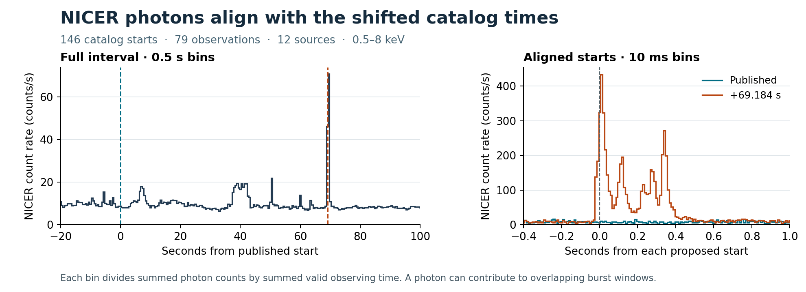

# A 69.184-second offset in the absolute times of a published magnetar burst catalog

A search for a counterpart at the time printed in Chu et al.'s NICER magnetar burst catalog can miss the burst by more than a minute. The first clean detector event in each of the two microsecond flashes arrives **69.184000 seconds later** at the solar-system barycenter than the time labeled TDB in Figure 3. That value equals TT minus UTC at both epochs. Using the same constant, without fitting other bursts, recovers the photon excess across the machine-readable catalog. The evidence identifies the offset in the published labels. Pinpointing where the offset entered the original analysis would require its timing pipeline. [Original catalog and Figure 3](https://doi.org/10.3847/1538-4365/ae5655) · [Two individual clock reconstructions](../README.md#both-microsecond-epochs-are-69184-s-later-in-tdb) · [Independent clock comparisons](../clock-validation/README.md)

## How often does the correction recover a burst?

The electronic table has 1,132 rows in 159 NICER observations. The article reports 1,130 bursts. We retain every row in the electronic table. For each, count the cleaned 0.5–8 keV events from 0.25 s before the predicted start through 0.25 s after the end of the reported duration. Count again in an identical window shifted forward by 69.184 s. Require complete coverage in both windows. With this rule, **843 of 944** pairs have more events at the later time, one ties and 100 have fewer. The median gain is 26 events per window. The median difference is positive in **120 of 121 observations** with paired coverage. The other 188 rows have at least one window outside accepted exposure or orbit coverage. The release includes these rows and every count, including zeros. [All 1,132 measurements](windows.csv)

| Paired comparison | Eligible rows | Later window wins / ties / losses | Events at printed time | Events at +69.184 s |
|---|---:|---:|---:|---:|
| 0.25 s margin, all sources | 944 | 843 / 1 / 100 | 115,351 | 274,146 |
| 0.25 s margin, excluding SGR 1935+2154 | 146 | 145 / 0 / 1 | 809 | 8,258 |
| 1 s margin, all sources | 931 | 786 / 4 / 141 | 290,172 | 388,987 |
| 1 s margin, excluding SGR 1935+2154 | 143 | 135 / 1 / 7 | 2,633 | 9,994 |

SGR 1935+2154 contributes 798 of the 944 narrow pairs. Its bursts cluster in time, so one window can include a different burst and an event can contribute to several windows. Its entries account for 99 of the 100 narrow-window losses. The remaining loss is XTE J1810−197, with 156 events at the printed time and 124 at the shifted time. We use paired counts, source exclusions and observation medians to expose this dependence. The totals are sums over windows. A row whose count increases has statistical evidence for the correction, with varying strength from row to row.

As a control on the direction and size of the shift, 783 rows have continuous exposure at all four narrow windows. Only the +69.184 s position more than doubles the count at the printed time.

| Shift from the printed-time prediction | −69.184 s | 0 s | +69.184 s | +138.368 s |
|---|---:|---:|---:|---:|
| Summed events, same 783 rows | 111,312 | 110,282 | 252,152 | 102,009 |



The 146 paired rows outside SGR 1935+2154 span 79 observations of 12 sources. Align their original event lists at the predicted spacecraft time, sum the 0.5–8 keV counts and divide each bin by its summed good-time exposure. The strongest 10 ms bin around the corrected epoch is centered at +69.194 s, with 632 events in 1.46 summed seconds of exposure (432.88 counts/s). The largest equal-width bin within −0.505 to +1.505 s of the printed epoch is 16.44 counts/s. Ninety-four burst windows across 11 sources contribute to the peak bin. Bright events carry more weight in this profile. Coverage and repeated windows are retained, and the rate uses recorded counts without a deadtime correction. [Measured profile](profile.csv) · [Figure replay](plot.py)

## Evidence from independent clocks

Across all 1,132 NICER rows and 1,254 Fermi/GBM detections, the corrected predictions match **20 distinct GBM bursts within 0.25 s**, compared with four at the printed times. All four literal matches and every match at either control offset come from the single 28 April 2020 storm. Exclude that observation and the corrected prediction still matches **seven Fermi bursts in seven other visits to three magnetars**. The printed time, −69.184 s and +138.368 s each give zero matches there. Six of the seven have on-board Fermi triggers. These timing matches were selected without a source-name filter and all agree in source assignment. [Matched pairs and tolerances](../clock-validation/README.md#all-catalogue-gbm-comparison)

Borghese et al. published seven rounded NICER epochs years before the Chu et al. catalog. Two have a same-observation Chu entry within 90 s. Their published epochs are 69.513 and 69.247 s later, leaving residuals of 0.329 and 0.063 s after the correction. A separately chosen sample of 12 bright events, one per source where eligible, also yields two coincidences with bursts in Fermi's gamma-ray monitor. For SGR 1830−0645 and SGR 1935+2154 the shifted NICER predictions fall 41 and 8 ms from the respective GBM event epochs, compared with 69.225 and 69.192 s using the printed labels. Accounting for the two spacecraft positions gives residuals of 31 and 13 ms. Differences in energy band and how burst onset is measured limit the interpretation of the remaining milliseconds. [Earlier NICER epochs](https://academic.oup.com/view-large/370754906) · [NASA Fermi GBM catalog](https://fermi.gsfc.nasa.gov/ssc/data/access/gbm/sgr/) · [Inputs, independent measurements and replay](../clock-validation/README.md)

## Timing and coverage

The primary inputs are the original electronic table, the archive's cleaned event list and spacecraft orbit for each of the 159 observations. Read the printed start as barycentric TDB, using the event file's MJDREFI and MJDREFF as a TT epoch. Iterate the light-travel correction using Astropy's built-in Earth ephemeris and the interpolated spacecraft geocentric position. Apply each FITS extension's own time reference and TIMEZERO. Use the FITS target coordinates except in the four CXOU J010043.1−721134 rows, which use the Chandra source position. For each local prediction use half-open intervals, channels 50–800 inclusive and complete containment within one good-time interval and the range of the orbit data. A blank CSV cell indicates incomplete coverage. The catalog's T90 is the interval containing the central 90% of counts and serves as a window length here.

The population comparison applies shifts in spacecraft seconds after inverting the nominal barycentric time. Applying the shift before conversion can move a prediction by several milliseconds. The FITS target coordinate can also differ from the best source position, with differences of order 0.2 s in predicted arrival for Swift J1555.2−5402. Both counting widths are reported. For precise absolute epochs of the two flashes, the separate calculation uses the JPL DE430 ephemeris, a source direction, the spacecraft orbit and relativistic terms. For another individual burst, a precision counterpart search should likewise use its best source position and check the actual event data. [Precision calculation](../clock.py) · [Archive snapshot fingerprints](inputs.csv) · [Catalog URL and fingerprint](../inputs.json)

## Reproduction

From this directory, the first command reproduces the counts, per-source results and the control windows with the Python standard library. The original-archive replay requires NumPy and Astropy and downloads approximately 157 MiB. An existing cache can be reused.

```sh
python summary.py
python measure.py /tmp/nicer-catalog-clock /tmp/nicer-windows.csv --download
cmp windows.csv /tmp/nicer-windows.csv
```

To rebuild the photon profile from the same archive cache, install Matplotlib and run `python plot.py /tmp/nicer-catalog-clock --output .`.
