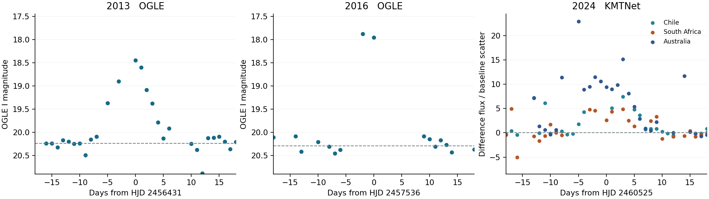

# Recurrent brightening at OGLE-2013-BLG-0769

OGLE independently alerted on two brightenings separated by 1,104.572 days at positions 0.100 arcsec apart. Both came through its difference-image channel for objects absent from the template. KMTNet independently observed the 2016 episode as KMT-2016-BLG-0228. Its alert pipeline later marked a 2023 episode at the same KMT extraction coordinates as `not-ulens` (KMT-2023-BLG-0713). An additional multiday brightening in 2024 is present in public KMTNet photometry. The record supports recurrent variability in the unresolved scene. A dwarf-nova-like source is a plausible interpretation. An assignment to a particular baseline star or a spectroscopic subtype would require additional observations.

[2013 OGLE alert](https://ogle.astrouw.edu.pl/ogle4/ews/2013/blg-0769.html) · [2016 OGLE alert](https://ogle.astrouw.edu.pl/ogle4/ews/2016/blg-0935.html) · [2016 KMT alert](https://kmtnet.kasi.re.kr/ulens/event/2016/view.php?event=KMT-2016-BLG-0228) · [2023 KMT alert](https://kmtnet.kasi.re.kr/ulens/event/2023/view.php?event=KMT-2023-BLG-0713)

| Season | Observation | What the measurement adds |
| --- | --- | --- |
| 2013 | OGLE-2013-BLG-0769, BLG511.01:1070N | The published 876 measurements resolve a rise and decline. The brightest nightly median was I = 18.444 on the survey's artificial baseline scale. |
| 2016 | OGLE-2016-BLG-0935, BLG511.01:1799N and KMT-2016-BLG-0228 | The 1,122 OGLE measurements include a brightest nightly median of I = 17.878. Independent KMTNet pySIS light curves show the brightening in Australia, Chile and South Africa. KMTNet classified this event as possible microlensing. |
| 2023 | KMT-2023-BLG-0713 | The same KMT extraction coordinates brightened again in early May. All three KMT sites detected the episode in the event-specific reductions. KMTNet had already flagged this event as outside its microlensing sample. |
| 2024 | KMTNet public I-band photometry, HJD 2460520–2460530 | A further multiday brightening appears in both nearby extractions. Australia recorded elevated nightly medians on all 11 nights of the window. The coordinates also brighten in independent Chilean and South African observations. |



The dashed OGLE lines trace the artificial baseline chosen by the pipeline. The measured peak-minus-baseline amplitudes depend on this choice. The horizontal axes use integer HJD bins. Each KMT site in the right panel uses its own off-event median and robust scatter.

## How the association was found

We matched every pair of different seasons among 22,080 OGLE-IV bulge EWS entries in 2011–2019 and 2022–2026, using spherical separations. This is the closest pair with distinct difference-image object identifiers and peaks in distinct seasons. OGLE lists 18:05:05.39, −27:49:21.7 and 18:05:05.39, −27:49:21.6 (J2000). The 0.100 arcsec separation is measured from rounded catalog coordinates. One pair at identical coordinates used the same template ID and had overlapping long-event timescales. A separate pair 0.527 arcsec apart recovered the published double bump of OGLE-2017-BLG-1489 as a positive control. All five pairs within 1 arcsec are in [close_pairs.csv](close_pairs.csv). [OGLE EWS](https://ogle.astrouw.edu.pl/ogle4/ews/ews.html) · [Oliveira et al., 2025](https://arxiv.org/abs/2504.21085)

The cross-season annuli at 3–15, 10–20 and 20–60 arcsec imply 0.0144, 0.0132 and 0.0132 unrelated alert pairs within 0.1 arcsec across the survey, respectively, under locally smooth pair density. These are expected background counts. The binning of reported coordinates, subarcsecond blending, duplicates and the targeting of variable objects limit any interpretation as a false-association probability.

## The 2024 evidence

We examined 2016–2025 KMTNet public DIAPL I-band curves at two template positions within 1.13 arcsec of the OGLE centroid and at three comparison positions roughly 14 arcsec east, north and west. The two target extractions overlap on the sky and share images. We used separate observatories to test repeatability.

| Site | Measured nights | Median contrast, scene B | Nights above three baseline scales | Range of median contrasts, three controls |
| --- | ---: | ---: | ---: | ---: |
| Chile | 5 | 4.78 | 4 | −1.21 to 0.08 |
| South Africa | 7 | 4.35 | 4 | −0.75 to −0.28 |
| Australia | 11 | 9.51 | 11 | −0.68 to 0.20 |

Contrast subtracts the median of off-window nightly flux and divides by 1.4826 times its median absolute deviation. Individual control nights reached higher excursions, including one of 5.98 in Australia. Persistence and agreement among observatories carry more information than a single large value. Within 40 days of HJD 2460525 we kept epochs with positive flux error, airmass below 2, and seeing between 3 and 7 KMT pixels. A nightly median requires three exposures. The central window is ±5 days. Baseline nights lie 15–40 days from center. Scene A gives median contrasts of 4.81, 2.63 and 8.43 at the same sites. [Public photometry query](https://kmtnet.kasi.re.kr/search/)

A whole-archive check applied an 11-day moving window to each position. Windows need three nights per site and twelve surrounding baseline nights per site. We retained runs where every site exceeded 2.5 local scales and at least one exceeded 5. The only episode recovered in both target extractions was the 2024 brightening. Neither extraction passed at every independently known outburst, so this test is incomplete. All three control series gave zero passing runs. These thresholds were explored after inspecting the scene and do not supply a calibrated false-alarm probability. [All passing runs](decade_scan.csv) · [Per-site 2024 checks](2024_checks.csv)

For the 2016 and 2023 listed events, independently downloaded pySIS field-03 light curves were binned by night with positive measurement error and seeing below 9 pixels. Their on-window median excesses exceeded nine local baseline scales at each site in each episode. These image reductions use the opposite difference-flux sign, which the analysis reverses before comparing brightness. The event sheets and magnification-model fits already existed. The proposed addition is the connection between the 2013, 2016 and 2023 events together with the 2024 photometric signature.

## Identification and limitations

The OGLE dwarf-nova catalog of 1,091 entries has its closest entry, OGLE-BLG-DN-0658, 98.6 arcsec away. SIMBAD and the VizieR mirror of VSX returned zero objects within 12 arcsec on 2026-11-15. We searched the 2015–2026 KMT annual event lists for matching positions and found the 2016 and 2023 alerts within 5 arcsec. Searches for the exact OGLE and KMT event identifiers, alone and in pairs, and inspection of Oliveira et al.'s OGLE-IV two-bump paper did not locate a published linkage for this candidate. These checks leave open the possibility of an identification under another alias. [OGLE CV catalog](https://ogle.astrouw.edu.pl/ogle/ogle4/OCVS/CV/) · [SIMBAD query return](simbad-harvard.txt) · [VSX query return](vsx-harvard.txt) · [KMTNet annual event tables](https://kmtnet.kasi.re.kr/ulens/)

The two OGLE detections have the strongest positional evidence. The KMT template coordinates are about 1.13 arcsec from the OGLE position. In this crowded field the strongest 2024 measurements come from overlapping template positions. KMTNet's database reports using a file-size estimate of the number of stars on the template when a star-count list is absent. Neither those template positions nor the comparison apertures provide a new difference-image centroid. The independent 2016 OGLE/KMT cross-identification ties the two surveys together. Different blended variables could still account for part of the subsequent signal. The recurrent, days-long episodes favor an eruptive variable over repeated point-lens events. The data do not establish a dwarf-nova subtype, an orbital period, a recurrence interval, or the identity of a quiescent counterpart. Difference-image centroiding in the 2023 and 2024 exposures could test the common-source interpretation directly. A spectrum during another outburst could distinguish an accreting white dwarf from other eruptive sources.

## Reproduction

Python 3, NumPy, pandas, SciPy and Matplotlib reproduce the tables and figure. Run from this directory. The first command downloads the original catalogs and light curves into the selected cache and verifies their SHA-256 hashes against the archived input manifest. The yearly 2026 EWS page or the live KMT query can change. Hash mismatches identify an updated upstream input. The tabulated nightly measurements preserve the data used in the figure.

```bash
python analyze.py --cache /tmp/ogle-0769-cache --download
python scan.py --cache /tmp/ogle-0769-cache
python plot.py
```

[Input locations and hashes](sources.json) · [Complete nightly measurements](nightly.csv) · [Search counts](screen.json) · [OGLE observing system, Udalski et al.](https://acta.astrouw.edu.pl/Vol65/n1/a_65_1_1.html) · [Kim et al. 2016, KMTNet](https://ui.adsabs.harvard.edu/abs/2016JKAS...49...37K) · [Kim et al. 2018, KMTNet data release](https://arxiv.org/abs/1804.03352)

This research used public KMTNet data from the Korea Astronomy and Space Science Institute, observed at CTIO in Chile, SAAO in South Africa and SSO in Australia. The Korea Research Environment Open NETwork (KREONET) supported data transfer to KASI. OGLE supplied the public Early Warning System catalog, photometry and dwarf-nova catalog.
