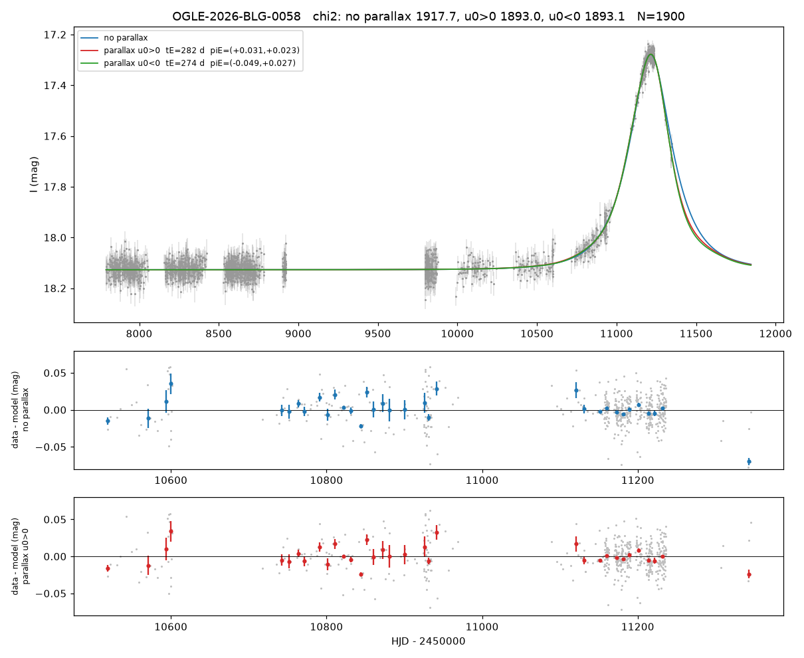

# OGLE-2026-BLG-0058 is a candidate isolated black hole

A star in the Galactic bulge has been magnified for most of 2025 and 2026 by an unseen foreground object. The public OGLE photometry gives an Einstein-radius crossing time of about 275 days and a microlens parallax of 0.04–0.06. Parallaxes of 0.2 or more are excluded with Δχ² = 134, provided the blend flux is not allowed to be strongly negative. A long event with a small parallax needs a heavy lens: the fit corresponds to 2.4 or 1.6 solar masses for every milliarcsecond per year of lens–source proper motion, depending on which side of the source the lens passed. The light that is not being magnified has a median of I ≈ 19.5 and is brighter than I ≈ 18.9 in under 5% of samples, which rules out an ordinary star of that mass. With a Galactic model that includes white dwarfs, neutron stars and black holes, the lens is a black hole of about 11 solar masses with a probability of 0.83–0.93.

This event ranked first in a screen of 5,641 OGLE-IV alerts from 2022–2026, of which 5,519 had enough usable data to fit for parallax and 125 passed the ranking cuts. As of 15 November 2026 we found no public report identifying it as a black-hole candidate. It is a candidate. The mass depends on a proper motion that photometry cannot measure, the two geometric solutions give different answers, and the detection of a non-zero parallax rests on few points after the 2026 peak. A separately written analysis of the same photometry reproduces the fit. [Event page](https://ogle.astrouw.edu.pl/ogle4/ews/2026/blg-0058.html) · [Deposited photometry](data/ews/2026/blg-0058.dat) · [Posterior](posteriors/2026-BLG-0058.json) · [Independent check](#independent-check)



| OGLE-only fit (1,900 points, 2017–2026) | Lens passes with u0 > 0 | Lens passes with u0 < 0 |
| --- | ---: | ---: |
| χ² (no parallax: 1917.7) | 1893.1 | 1893.1 |
| Crossing time tE, days | 277 (+34/−31) | 273 (+34/−30) |
| Impact parameter u0 | 0.40 (+0.06/−0.05) | −0.43 (+0.05/−0.06) |
| Parallax, north | +0.031 ± 0.007 | −0.049 ± 0.011 |
| Parallax, east | +0.022 ± 0.006 | +0.027 ± 0.007 |
| Parallax magnitude (95% upper) | 0.039 ± 0.006 (0.049) | 0.057 ± 0.009 (0.072) |
| Source brightness, I | 18.50 ± 0.22 | 18.38 ± 0.21 |
| Unmagnified share of baseline light | 0.29 (+0.13/−0.17) | 0.21 (+0.13/−0.17) |
| Lens mass per mas/yr of proper motion | 2.4 M☉ | 1.6 M☉ |

The event is at 17:52:38.09, −31:47:36.1 (J2000), Galactic l = 358.3°, b = −2.8°. The fitted parallax-model peak was near 24 June 2026 (HJD 2461215.7); the OGLE alert's unblended fit instead lists 21 June. Values are posterior medians with 16–84% ranges from 40-walker ensemble chains. Uncertainties were rescaled so the best fit has χ²/dof = 1.

## How heavy is the lens

The lens mass is θE/(κ πE), where the angular Einstein radius θE equals the relative proper motion times tE. Photometry measures tE and πE. The proper motion has to come from a model of the Galaxy until someone measures θE directly. We weight each posterior sample by the event rate for a double-exponential disc and a bar, with Gaussian velocity distributions, and draw the proper motion and source distance. The mass function is a power law without an upper cutoff, so the three slopes below bracket the answer and are not a population model. [Prior and kinematics](galaxy.py)

| Mass-function slope | u0 > 0: mass, M☉ | P(M > 3 M☉) | u0 < 0: mass, M☉ | P(M > 3 M☉) |
| --- | ---: | ---: | ---: | ---: |
| −1 (flat in log M) | 18 (+11/−7) | 1.00 | 5.5 (+6.1/−3.0) | 0.77 |
| −1.75 | 15 (+9/−7) | 0.99 | 3.4 (+4.2/−1.8) | 0.56 |
| −2.35 (Salpeter) | 12 (+9/−6) | 0.96 | 2.4 (+2.9/−1.2) | 0.38 |

The two solutions fit equally well. For u0 > 0 the parallax vector points 36° east of north, within 5° of the direction of Galactic rotation, which is what a disc lens in front of a bulge star produces. That solution puts the lens near 4 kpc with θE ≈ 4 mas. For u0 < 0 the motion is across the plane and the prior prefers a slower, lighter and more distant lens. Averaging the two with equal weight gives P(M > 3 M☉) between 0.67 and 0.88.

**With stellar remnants in the population, the lens is most likely a black hole near 11 M☉.** The power laws above give a 10 M☉ lens the same standing as an ordinary star. In an old population, stars above about one solar mass have already become white dwarfs, neutron stars or black holes, and black holes are about 0.2% of all objects. A separately written model uses a Kroupa initial mass function with a 1 M☉ main-sequence turn-off, white dwarfs from the Kalirai et al. (2008) initial–final mass relation, neutron stars at 1.35 M☉ with 265 km/s natal kicks, black holes log-normal about 9 M☉ with 0–100 km/s kicks and a rotating bar. It applies the same main-sequence light test to each sample. [Population model](check/galaxy_check.py)

| Lens type | u0 > 0 | u0 < 0 |
| --- | ---: | ---: |
| Black hole | 0.93–0.98 | 0.19–0.42 |
| Main-sequence star | 0.015–0.04 | 0.35–0.49 |
| White dwarf | 0.009–0.023 | 0.21–0.29 |
| Neutron star | 0.001–0.004 | 0.02–0.03 |
| Black-hole mass, M☉ | 11.4 (+4.2/−3.2) | 9.7 (+3.7/−2.7) |

The ranges span black-hole kicks of 0–100 km/s; total extinctions of A_I = 1.5–2.5 change them by less than 0.02. The Galactic model also favours u0 > 0 by 4–15 to 1, because that parallax direction matches disc rotation. The combined probability of a black hole is therefore 0.83–0.93, or 0.6–0.7 if the two solutions are weighted equally. The u0 > 0 medians correspond to θE ≈ 3.5 mas, a lens about 3.9 kpc away and a relative proper motion near 4.6 mas/yr. Run with the power laws instead, the same code gives 19.6 (+10.3/−7.6) and 13.3 (+9.0/−7.6) M☉ for u0 > 0, in line with the table above. [Population results](check/out/population.json)

A main-sequence lens would outshine the measured blend in 81–100% of the weighted samples across every row and total I-band extinctions of 1, 2 and 3 mag. The lens is therefore dark, or it is a star of about one solar mass or less that happens to move unusually slowly. A black hole is the leading explanation for the first case above three solar masses. A neutron star or white dwarf is possible in the low-mass tail of the u0 < 0 solution.

## What the data do and do not establish

**The upper limit on the parallax holds if the blend is physical.** Fixing the parallax magnitude and refitting its direction and everything else from 40 starts, with blend flux required to stay above that of a negative I = 20 star, gives Δχ² = 6.2 at 0.08, 19.3 at 0.10, 36.8 at 0.12, 68.3 at 0.15, 133.5 at 0.20 and 304.5 at 0.30. The crossing time falls as the parallax rises, to 196 days at 0.15 and 179 days at 0.20. Without the blend floor, fits with u0 of 4–9, crossing times of 20–40 days and a negative blend hundreds to thousands of times brighter than the baseline come within Δχ² = 42 of the best fit at every parallax from 0.15 up. Those fits are unphysical, but the limit rests on excluding them. Without the seven late points discussed below, the floor still gives Δχ² = 9.2 at 0.10, 24.2 at 0.15 and 35.7 at 0.20. [Profile](data/parallax-profile.json) · [Without the floor](data/parallax-profile-free-blend.json) · [Before the gap](data/parallax-profile-before-gap.json) · [Script](profile.py)

**The detection of a non-zero parallax is not.** Adding parallax improves χ² by 24.7. Across the 2,328 events in our screen with crossing times of 3–30 days, where parallax should be unmeasurable, 10% reach that improvement and the median is 3.6 against 1.4 expected. Multiplying every uncertainty by 1.6 to match that excess leaves the medians in place, widens the 95% parallax limits to 0.054 and 0.082, and keeps P(M > 3 M☉) at 0.96–1.00 for u0 > 0 and 0.64–0.98 for u0 < 0. Here 15.2 of the 24.7 comes from seven points taken after a 71-day gap that followed 13 July 2026. Without those points the u0 > 0 fit gives tE = 264 ± 42 days and a parallax of (0.019 ± 0.018, 0.021 ± 0.008), still long and still small. Smaller parallaxes mean heavier lenses, so losing the detection does not weaken the case. The remnant-aware model above agrees: without the seven points and with uncertainties multiplied by 1.6, it gives a black-hole probability of 0.98 for u0 > 0 and 0.92 for u0 < 0. [Inflated-uncertainty posterior](posteriors/2026-BLG-0058-inflated-errors.json) · [Before-gap population](check/out/population-pregap.json)

**The late points pass a holdout test.** On their own the earlier data favour parallax by only Δχ² = 6.3–6.5. Yet fits made without the seven points predict them: χ² = 10.5 and 8.8 for the two parallax solutions against 27.6 without parallax. The seven points were taken at airmass 1.3–1.9 and in poorer seeing than the rest of 2026. Adding an airmass-dependent photometric error to the fit without parallax recovers Δχ² = 0.5 of the improvement, and a seeing-dependent one recovers 13.8. Parallax is still preferred by Δχ² = 21–25 with either. [Holdout](check/out/holdout.json) · [Systematics](check/out/systematics.json)

**The method recovers a known candidate.** OGLE-2024-BLG-0062 is the target of JWST program 10476, whose abstract describes it as tE ~ 200 days with πE < 0.08. The same code and public data give tE = 231 (+67/−49) or 288 (+134/−86) days and πE = 0.05–0.07 with 95% limits of 0.11 and 0.10. It fell outside the ranked list only because its crossing time is uncertain by more than 25%. OGLE-2026-BLG-0058 has a longer crossing time, a tighter parallax limit and four times as many points. [JWST program 10476](https://www.stsci.edu/jwst-program-info/download/jwst/pdf/10476/) · [Control posterior](posteriors/2024-BLG-0062.json)

**Competing explanations remain.** A slow relative motion below 1.2–1.9 mas/yr brings the mass under three solar masses. Orbital motion of the source about a companion can imitate or cancel parallax. A blend of unrelated faint stars changes the source brightness and crossing time together. Season medians stay between I = 18.112 and 18.129 across 2017–2024, which argues against an intrinsic variable, but one filter cannot test for colour change.

## Frozen forecast

The models separate once the bulge returns to the night sky. Without parallax the source would be at I = 17.885 on 15 February 2027. The parallax solutions predict 17.934 (95% range 17.917–17.950) for u0 > 0 and 17.945 (17.924–17.966) for u0 < 0. On 1 April the values are 17.950 against 17.985 and 17.995. All three are within 0.02 mag of the I = 18.13 baseline by September 2028. OGLE points have uncertainties near 0.03 mag at this brightness, so a few weeks of data decide between a symmetric event and the low-parallax fits. The curves still differ by 0.025–0.035 mag on 1 May and 0.017–0.025 mag on 1 June, when the bulge is observed at lower airmass than the late-2026 points that carry the detection. The forecast cannot choose between the two parallax solutions. [Forecast table](data/forecast.csv)

The measurement needed to determine the mass is astrometric. For θE of 1–4 mas the unblended source-centroid shift has a maximum of 0.35–1.41 mas at u = √2. A 23 November replay of the frozen annual-parallax chains gives post-peak maximum dates centered on 6 May 2027 for u0 > 0 (95% interval 1 March–21 July) and 11 April for u0 < 0 (21 February–18 June). These are unweighted photometric-posterior predictions for the isolated source centroid, not measured deflections. The earlier July estimate used the rectilinear approximation of about 1.4 tE after peak; it did not propagate the annual-parallax trajectory. Blending can change the amplitude and timing of the unresolved photocenter signal. [Calculation, frozen inputs and follow-up packet](../../docs/followup-2026-11-23/ogle.md) · [Astrometric formalism, Sahu et al., §2.3](https://doi.org/10.3847/1538-4357/ac739e)

Spring 2027 merits astrometric follow-up, with later epochs to separate lensing from source proper motion and parallax. A daily geocentric solar-elongation calculation suggests JWST windows around 15 March–5 May and 6 August–27 September 2027; July is outside its 85°–135° field of regard. These are approximate planning windows, subject to the JWST ephemeris, guide stars, roll and APT scheduling checks. The model source shift remains large in August–September. Returning to photometric baseline in 2028 does not imply zero astrometric deflection. [JWST visibility tools](https://jwst-docs.stsci.edu/jwst-other-tools/jwst-target-visibility-tools) · [Lam et al.](https://doi.org/10.3847/2041-8213/ac7442)

## The screen

We downloaded the I-band photometry of every OGLE-IV Early Warning System event from the 2022–2026 seasons on 14 November 2026: 5,642 listed, 5,641 with complete table rows and 5,519 with at least 60 usable points. Each was fitted with a point lens, then with annual parallax for both signs of u0. Outliers beyond five scaled sigma were removed once. The model was checked against MulensModel 3.12 on 20 random events, with a largest fractional difference in magnification of 0.0013.

The ranked list keeps fits with 50 < tE < 1500 days, tE known to 25%, both parallax components known to 0.1, peak magnification above 1.34 and a blend fraction above −0.2. That leaves 125 events. They are ordered by the mass implied at 4 mas/yr after raising the parallax by twice its uncertainty. The amplitude and blend cuts were added after a first pass placed low-amplitude brightenings of bright stars near the top. [All fits](data/screen.csv.gz) · [Ranked list](data/ranked.csv) · [Posteriors for the top 20](data/candidates.csv)

| Rank | Event | tE, days | πE | Blend share | Baseline I | Note |
| ---: | --- | ---: | ---: | ---: | ---: | --- |
| 1 | 2026-BLG-0058 | 277 / 273 | 0.039 / 0.057 | 0.29 / 0.21 | 18.13 | This result |
| 2 | 2026-BLG-0587 | 617 / 279 | 0.12 / 0.08 | 0.87 / 0.61 | 17.51 | Still rising; solutions disagree on tE by a factor of two |
| 3 | 2026-BLG-0072 | 301 / 302 | 0.06 / 0.04 | 0.87 / 0.72 | 14.25 | 0.065 mag rise of a bright star over three years; microlensing not established |
| 4 | 2025-BLG-0397 | 325 / 136 | 0.08 / 0.08 | 0.95 / 0.71 | 13.58 | Bright blend, 349 points, parallax improves χ² by 13 |
| 8 | 2023-BLG-0126 | 239 / 226 | 0.06 / 0.08 | 0.04 / −0.02 | 17.94 | Unblended, but 223 points and the peak fell between seasons |
| 11 | 2025-BLG-0038 | 116 / 118 | 0.060 / 0.072 | 0.01 / 0.01 | 15.36 | Parallax improves χ² by 281; 0.65 or 0.55 M☉ per mas/yr |

Pairs are the u0 > 0 and u0 < 0 solutions. Events with a bright blend can have a luminous giant as the lens, which the main-sequence test does not exclude. OGLE-2025-BLG-0038 is the cleanest secondary case: an unblended I = 15.4 source, 4,565 points and a well-measured parallax that puts the lens at two to four solar masses for typical proper motions. Its light curve ends in October 2025, still 0.1 mag above baseline.

## Data rights

KMTNet lists the same event as KMT-2026-BLG-0521. KMTNet's 2026 photometry is proprietary until 1 July 2027 under its data policy, so none of it is used here: the fits and the forecast come from OGLE data alone. The public release next July allows an independent joint fit. [KMTNet data policy](https://kmtnet.kasi.re.kr/ulens/event/2026/)

OGLE photometry is from the Early Warning System of the Optical Gravitational Lensing Experiment. We credit the OGLE team for the observations, reductions and the public alert service. [EWS](https://ogle.astrouw.edu.pl/ogle4/ews/ews.html) · [Udalski, Szymański & Szymański 2015](https://ui.adsabs.harvard.edu/abs/2015AcA....65....1U)

## Independent check

A second analysis, written separately and sharing only the OGLE photometry, reproduces the fit. Its model takes the Sun's position from astropy rather than ERFA and agrees with MulensModel to 1 × 10⁻⁴ in magnification. It samples its own chains.

| | This page | Independent check |
| --- | --- | --- |
| χ² without / with parallax | 1917.7 / 1893.1 | 1917.9 / 1893.0 |
| tE, days (u0 > 0 / u0 < 0) | 277 / 273 | 277 (+35/−31) / 273 (+33/−30) |
| πE (95% upper limit) | 0.039 (0.049) / 0.057 (0.072) | 0.038 (0.048) / 0.057 (0.072) |
| Unmagnified share of baseline light | 0.29 / 0.21 | 0.29 / 0.21 |
| Mass per mas/yr | 2.4 / 1.6 M☉ | 2.48 / 1.63 M☉ |
| I on 15 Feb 2027 (no parallax / u0 > 0 / u0 < 0) | 17.885 / 17.934 / 17.945 | 17.884 / 17.934 / 17.946 |

Its own fixed-parallax scan, without the 0.004 mag error floor, gives Δχ² = 6.3, 19.5, 69.1, 135.5 and 312 at 0.08, 0.10, 0.15, 0.20 and 0.30. A first version of this page quoted 11, 24, 74, 213 and 309 from a scan that had not found these minima. Removing any one season of baseline changes the parallax improvement by less than 0.2; all of it comes from 2025 and 2026. A blend with no light at all is allowed (Δχ² = 1.4–2.7). [Scripts](check) · [Outputs](check/out)

## Replay

From this directory, with NumPy, SciPy, emcee, PyERFA and Matplotlib installed:

```sh
python candidate.py data/ews 2026-BLG-0058 out --ai 2.0 --steps 12000
python candidate.py data/ews 2026-BLG-0058 out-inflated --ai 2.0 --steps 12000 --inflate 1.6
python candidate.py data/ews 2024-BLG-0062 out --ai 2.0 --steps 8000
python forecast.py data/ews 2026-BLG-0058 posteriors/2026-BLG-0058-chains.npz forecast.csv
python plot.py data/ews 2026-BLG-0058 light-curve.png --forecast 500
python profile.py data/ews 2026-BLG-0058 data/parallax-profile.json
python profile.py data/ews 2026-BLG-0058 data/parallax-profile-free-blend.json --free-blend
python profile.py data/ews 2026-BLG-0058 data/parallax-profile-before-gap.json --tmax 11240
```

The independent check also needs astropy, plus MulensModel for `check/validate.py`. Each chain takes a few minutes and the full population run about ten:

```sh
python check/pspl.py data/ews/2026/blg-0058.dat check/out/fits.json
python check/validate.py
python check/baseline.py data/ews/2026/blg-0058.dat
python check/stress.py data/ews/2026/blg-0058.dat check/out/fits.json check/out/stress.json
python check/stress2.py data/ews/2026/blg-0058.dat check/out/fits.json check/out/stress.json lens.py check/out/holdout.json
python check/airmass.py data/ews/2026/blg-0058.dat check/out/fits.json check/out/stress.json check/out/systematics.json
python check/mcmc.py data/ews/2026/blg-0058.dat check/out/fits.json check/out/chains.npz
python check/mcmc.py data/ews/2026/blg-0058.dat check/out/fits.json check/out/chains-pregap.npz --tmax=2461240 --inflate=1.6
python check/galaxy_check.py check/out/chains.npz check/out/population.json
python check/galaxy_check.py check/out/chains-pregap.npz check/out/population-pregap.json quick
```

The first command reproduces every number in `posteriors/2026-BLG-0058.json`: the sampler uses fixed random streams. To repeat the full screen, download the archive first. OGLE updates current-season files daily, so later downloads of 2026 events contain more points.

```sh
python fetch.py ews 2022 2023 2024 2025 2026
python screen.py ews screen.csv
python rank.py screen.csv ranked.csv
```

Times are HJD − 2450000 in the code and tables. Magnitudes are OGLE I. The parallax vector is geocentric with the reference time fixed at the best no-parallax peak, and its sign conventions match MulensModel. File hashes and retrieval details are in [sources.json](sources.json).
