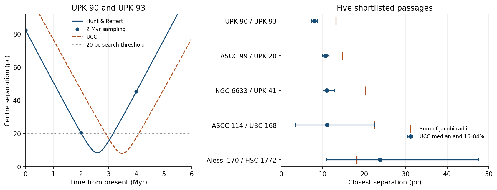

# Four candidate passages between Galactic open clusters

**UPK 90 and UPK 93 are on trajectories that bring their centres within about 8 pc.** Their present separation is 82 pc in the Hunt & Reffert catalogue and about 105 pc in the Unified Cluster Catalogue (UCC) member resampling. The two reductions predict closest approach in 2.59 and 3.49 million years, respectively. Their encounter speed is about 30 km/s. At this speed the passage through a sphere of radius 13.19 pc around the other centre lasts about 0.7 Myr. A search sampling every 2 Myr can step over it.

Three candidate past encounters emerged from the same search. The inferred separation for ASCC 99 and UPK 20 is particularly stable despite their present separation of 164–174 pc. For ASCC 114 and UBC 168 the epoch is much better constrained than the separation. Both are well-populated clusters with tens of radial velocities. The younger age estimate for UPK 41 overlaps the epoch of its possible passage by NGC 6633, so that extrapolation carries additional uncertainty.

| Clusters | Closest epoch in Galactic potential, Myr (HR / UCC) | Closest distance in Galactic potential, pc (HR / UCC) | UCC member bootstrap closest distance, pc (median and 16th–84th percentiles) | Sum of Jacobi radii, pc | Draws inside that sum |
|---|---:|---:|---:|---:|---:|
| UPK 90 / UPK 93 | +2.59 / +3.49 | 8.52 / 8.25 | 8.04 (7.31–8.78) | 13.19 | 99.98% |
| ASCC 99 / UPK 20 | −6.99 / −7.06 | 9.66 / 10.79 | 10.71 (9.94–11.56) | 14.75 | 99.95% |
| NGC 6633 / UPK 41 | −3.34 / −3.68 | 9.08 / 9.75 | 11.01 (10.17–12.90) | 20.30 | 98.12% |
| ASCC 114 / UBC 168 | −2.81 / −2.89 | 8.26 / 1.94 | 11.07 (3.49–22.56) | 22.48 | 83.80% |
| Alessi 170 / HSC 1772 | +2.96 / +2.94 | 10.66 / 8.66 | 23.85 (10.91–47.61) | 18.26 | 37.00% |

Positive times are in the future. The last row retains the fifth shortlisted pair, which becomes unconvincing when its members are resampled. The first four pairs have zero shared Gaia source IDs between the UCC membership lists for their two clusters. A Jacobi radius describes a tidal boundary in a Galactic potential. Two such boundaries can overlap while the dense central regions remain well separated. For UPK 90 and UPK 93 the half-number radii sum to 6.36 pc, and only 1.77% of baseline draws fall inside that sum. These are encounter predictions. An observed tidal disturbance, a merger, or a common birth site would require different evidence.



## Search and orbital checks

1. Select physically classified open clusters (Type o) from Hunt & Reffert 2024 with distance under 2 kpc, at least seven radial velocities, standard error on the mean RV below 4 km/s, cluster significance CST above 5, median colour–magnitude diagram score above 0.5, and probability of a valid Jacobi radius above 0.5. This leaves 622 of 7,167 entries, or 193,131 possible pairs. Restrict initial separation to 30–420 pc.
2. Rotate each ICRS centre, proper motion and line-of-sight velocity into heliocentric Cartesian position and velocity. For relative position **r** and velocity **v**, the linear closest time is −(**r**·**v**)/|**v**|² with unit conversion. Calculate the distance to the trajectory at this continuous time and at the nearest multiple of 2 Myr. Require |t| < 8 Myr, continuous distance below both 20 pc and 0.8 times the summed Jacobi radii, and sampled distance above 20 pc. Five pairs pass. These exploratory cuts seek short passages between separated systems. They do not estimate the Galactic encounter rate or a population significance.
3. Integrate both nominal centroids separately in galpy's MWPotential2014 from the present to ±8 Myr on a 0.02 Myr spacing. Minimize an interpolated separation around the encounter. Both sets of nominal orbits in the table include the Galactic tide. For UPK 90 and UPK 93 the minimum of the HR orbit sampled every 2 Myr is 20.50 pc. The UCC inputs give 17.82 pc on that grid. The HR result is near the 20 pc boundary, and differences in phase-space inputs or the solar parameters can change whether a coarse search selects this pair. Galactic forces shift the HR closest separation from 8.37 to 8.52 pc.
4. Re-estimate the centroids from individual Gaia DR3 sources identified by the UCC. Retain membership probability ≥0.5 and reported parallax uncertainty <0.18 mas for astrometry. Bootstrap entire astrometry rows, taking medians of the two coordinates, proper motions and parallaxes. For RV, keep independent samples from the same P-selected list with uncertainty <12 km/s and deviation from the sample median below the larger of 6 km/s and 4.5 unscaled median absolute deviations. This leaves 15 and 23 RVs for UPK 90 and UPK 93, 41 and 29 for ASCC 99 and UPK 20, 170 and 31 for NGC 6633 and UPK 41, and 25 and 29 for ASCC 114 and UBC 168.
5. In the baseline member bootstrap, add 0.017 mas to the median parallax, draw an independent residual offset with standard deviation 0.010 mas for each cluster, and invert the resulting parallaxes. Compute 6,000 linear relative trajectories per pair. The file includes 0 and 0.020 mas floors and a P≥0.8 rerun. At 0.020 mas the fractions inside the summed Jacobi radii are 100.00% for UPK 90 / UPK 93, 99.90% for ASCC 99 / UPK 20, 97.02% for NGC 6633 / UPK 41, and 60.88% for ASCC 114 / UBC 168. The fractions condition on membership, fixed model radii and the stated error assumptions. Sampling uncertainties in the radii, unmodeled binary velocities, catalogue selection and future cluster evolution can broaden the physical interpretation. The two membership reductions reuse Gaia and share instrument systematics.

Hunt & Reffert's distances in these four pairs have globalPlx=0, indicating their star-by-star parallax-offset correction was available. Their distance estimates, positions of highest density and RV aggregation differ from the UCC median-of-members procedure. The approximately 0.9 Myr difference between the two UPK 90 / UPK 93 point estimates should be retained when quoting the timing. The Bovy potential uses an 8 kpc solar radius, 220 km/s circular speed, 20.8 pc solar height and the Schoenrich solar motion in this replay. The orbit calculations neglect cluster mass loss and mutual forces.

## Prior results and spectroscopy

The 2025 *On the Encounter Rate of Open Star Clusters* paper evaluated HR cluster locations at 2 Myr intervals over ±32 Myr and used a 20 pc threshold. Its published appendix gives 490 current and future rows. None of the five pairs appears together there under the names and aliases examined. The appendix does not list the full past sample. The nominal HR integrations in this packet yield grid minima of 20.50 pc for UPK 90 / UPK 93, 24.99 for ASCC 99 / UPK 20, 20.29 for NGC 6633 / UPK 41 and 26.45 for ASCC 114 / UBC 168. These are our reconstructions. Other papers or unpublished calculations may contain these trajectories. [Encounter-rate study and Appendix](https://arxiv.org/html/2509.00471v1)

Cross-checks against the 617 pairs and 261 groups of Palma et al. and the 400 pairs and 82 groups of Liu et al. give zero exact HR identifier matches for the five pairs. The broad name search produced one apparent group match. HR lists UBC 32 among the aliases for UPK 20 (ID 6977, 461 pc) while also assigning UBC 32 its own entry (ID 6082, 282 pc). Palma group G12 contains ASCC 99 and ID 6082. UCC also separates UBC 32 and UPK 20. Recent cross-catalogue work searches HR-missing clusters, whereas both members of each analysed pair have a separate HR entry. Alias and targeted literature searches found no individual prior report of the four quantified passages. [Palma catalogue](https://doi.org/10.1051/0004-6361/202452672) · [Liu catalogue](https://doi.org/10.1051/0004-6361/202556299) · [Cross-catalogue study](https://arxiv.org/abs/2604.15968)

The external velocity check used LAMOST DR5 stellar parameters and APOGEE DR17 spectra within 1.4° of the eight leading cluster centres. UCC membership positions were matched to 1.5 arcsec, additionally requiring exact Gaia EDR3 identity in APOGEE wherever available. The single matched UPK 93 LAMOST star measured +50.69 ± 5.26 km/s, versus −15.34 ± 15.75 km/s from Gaia. It fails the primary RV error cut. Neither external survey supplied velocities for enough members of both UPK clusters to estimate independent systemic velocities. A clean three-visit ASCC 99 APOGEE member gives −29.88 km/s with 0.046 km/s visit scatter, consistent with the HR mean of −29.86 km/s. Sixteen NGC 6633 members have LAMOST measurements with median per-star RV −33.96 km/s versus HR −27.90 km/s. Only one UPK 41 LAMOST member matches, at −13.31 ± 6.63 km/s. The external measurements show the limits of treating any single member as the cluster velocity. [LAMOST data](https://vizier.cfa.harvard.edu/viz-bin/VizieR?-source=V/164/stellar5) · [APOGEE DR17](https://vizier.cfa.harvard.edu/viz-bin/VizieR?-source=III/286/catalog)

Tarricq et al. (2021) provide an earlier aggregate velocity for both ASCC 99 (−31.07 ± 0.92 km/s, ten selected members) and UPK 20 (−7.26 ± 1.83 km/s, four). Substituting just these two velocities into the HR astrometry yields a 10.78 pc linear passage 6.65 Myr ago. Their two-star UPK 93 mean of +13.83 ± 1.57 km/s gives a 7.90 pc passage in 2.79 Myr when combined with HR inputs for UPK 90. This catalogue combines Gaia DR2 and ground-based surveys, so it supplies a historical reduction with partly shared measurements. [Tarricq et al. catalogue](https://vizier.cfa.harvard.edu/viz-bin/VizieR?-source=J/A%2BA/647/A19/orbits)

## Reproduction

Run these commands from this directory. The first replays all 193,131 eligible combinations through the separation prefilter, looks up names and IDs, and regenerates every bootstrap row. The second performs the Galactic integration. The third regenerates the figure. The input snapshots are sufficient for an offline replay.

```sh
python replay.py --output encounters.json
python galactic_orbits.py > galactic_orbits.json
python plot.py
```

The baseline requires Python 3, NumPy, SciPy and pandas. The Galactic integration also uses astropy and galpy. Matplotlib renders the figure. Data URLs, release identifiers, query instructions and checksums appear in [SOURCES.md](SOURCES.md). Numerical results are in [encounters.json](encounters.json) and [galactic_orbits.json](galactic_orbits.json).

## Per-star Gaia distance calibration

A separate source-level check corrected each individual stellar parallax and repeated the flyby calculation using 1,367 membership entries. It gives 7.80 pc for UPK 90 and UPK 93, with a 16th–84th percentile range of 6.98–8.58 pc. [Full results and calibration sensitivity](gaia-zero-point/README.md)
