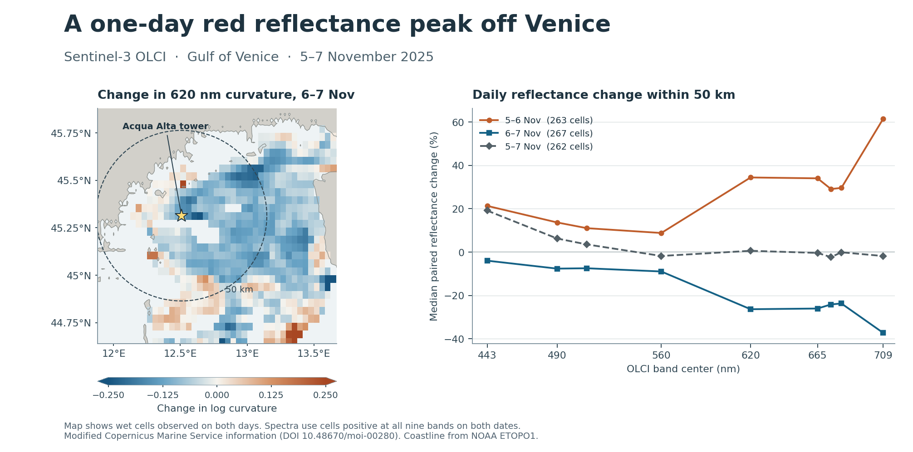

# Mission 06 · Ocean optical changes in PACE OCI observations

**The clearest regional event was a one-day peak in red reflectance on the northern Adriatic shelf on November 6, 2025.** PACE OCI, an offshore field radiometer and Sentinel-3 OLCI all measured the decline the following day. The signal extended tens of kilometers. November 7 spectra returned close to November 5 levels, comparable events appear in earlier observations, and contemporary measurements document turbid water. The available evidence supports a short-lived change in shelf water optics. Particle transport or clearing is plausible, with composition and cause unresolved. No candidate in this search met the criteria for a previously unreported process or an unusual phytoplankton community transition.

## The northern Adriatic event

At the Acqua Alta Oceanographic Tower (45.3139°N, 12.5083°E), field reflectance at 620 nm fell from 0.00217 to 0.000597 sr⁻¹ between November 6 and 7. PACE measured a 56% decline at 620 nm and a 54% decline at 665 nm. All 25 OCI matchup pixels contributed on each date, with absolute spectral quality index QWIP at most 0.060. The field-to-OCI time separation reached 79 minutes on November 7. A shape measure helps distinguish uniform brightness changes from a change in spectral shape. Here C is the natural logarithm of center-band reflectance minus the wavelength-interpolated logarithm between two flanking bands. Uniform multiplicative changes cancel. For the 560/620/665 nm triplet, the center reflects orange-red light. [Station spectra, timing, quality and seasonal field controls](adriatic/README.md)

| November 6–7 observation | Change in C at 620 nm | Support |
| --- | ---: | --- |
| PACE OCI | −0.174 | 5 × 5 matchup at the tower |
| Field radiometer | −0.337 | Independent tower radiometry |
| Sentinel-3 OLCI | −0.114 | Closest 4 km grid cell |
| Sentinel-3 OLCI | −0.083 | Median of 268 paired wet cells within 50 km |

Of those 268 cells, 225 declined. They account for about 3,400 km² of the 4,050 km² observed on both days. Intervening missing cells are excluded from area estimates. At cells with valid observations in all nine comparison bands, median 620 nm reflectance rose 34.4% on November 5–6 and fell 26.4% on November 6–7. A direct comparison of **the same 262 cells** on November 5 and 7 gives a net +0.59%. The peak was broad across the red wavelengths. [Spatial and temporal comparisons](sentinel3/README.md)

**Historical controls.** In 58 other-year, same-season one-day comparisons with at least half the regional event footprint observed, two declines matched or exceeded the event on their common cells. One preceded the event (October 25–26, 2019), and one followed it (October 30–31, 2026). In the tower archive, five of 151 comparable one-day changes from 2017–24 were at least as negative using 560/620/667 nm. The November 7 daily tower spectrum also falls near the historical median conditional on green brightness. Overlapping intervals, cloud-dependent sampling, and searching across multiple events make these descriptive ranks. [Matched regional controls](sentinel3/aaot_regional_seasonal.csv) · [Tower comparisons](adriatic/README.md)

**Physical interpretation.** Veneto's November 4–6 survey documented turbid water across all six monitored water bodies. At 29 coastal casts, median near-surface turbidity was 2.67 FTU and median chlorophyll a was 0.56 µg/L. Survey coverage ends on November 6. Po discharge at Pontelagoscuro fell from 1,241 to 1,118 m³/s on November 6–7. At the station, a regional ocean analysis gives a strengthening westward near-surface current from 0.030 to 0.151 m/s, with little change in neighborhood median temperature. Clearing or redistribution of a particle-rich water mass could produce the short red-bright peak. No paired particle, pigment or community samples resolve the material's identity on those two days. The red-curvature decline attenuates when red brightness is held relatively stable. All sampled wet cells within 100 km were 1–44 m deep. These facts leave suspended material, advection, bottom influence in the shallowest cells and changing water constituents open. [Regional casts](veneto/README.md) · [River, wind and model data](adriatic/README.md) · [Ocean analysis](environment/ENVIRONMENT.md) · [ARPAV survey bulletin](https://www.arpa.veneto.it/api/temi-ambientali/mare-e-lagune/acque-marino-costiere/qualita-acque-2025/informare-novembre_2025.pdf/@@download/file)

## Search coverage and rejected candidates

Before choosing the Florida survey, we inspected the repository's untruncated 4,905-entry main tree, 123 preexisting branch names, and open pull requests. We found no earlier PACE ocean-optics study and zero open PRs at review. We created this branch at main commit `41d833421cfbfd97e6084ff065690a28fb368e34` before regional selection. Florida provided accessible spatial spectra across several water masses. A separate global fixed-platform search supplied field observations and identified the Adriatic, California and Black Sea candidates. Sampling follows data availability. These regions do not constitute a global probability sample.

| Search | Observations | Selection and independent check |
| --- | --- | --- |
| NASA OCI–field radiometry | 932 matchup records, March 2024–April 2026, with 61 OCI bands from 400–700 nm at 5 nm spacing. 118 had field spectra at all 61 bands. | Six fixed platforms yielded 727 site-days and 644 intervals of 1–8 days. Blue, red and broad-band curvature measures were evaluated. Field data participated in selection. Independent OLCI provided the spatial and historical tests. |
| Eastern Gulf, West Florida slope, Florida Straits and adjacent Atlantic | 172 survey visits, March 2024–March 2026. Ten selected OCI bands across a 28 × 46 lattice. The May Florida follow-up retrieved all 149 published regional Rrs bands. | Nine of 684 regional date pairs passed coverage requirements on a depth-screened lattice. All nine underwent independent OLCI comparison, with 236 valid collocations among 256 paired OCI locations across those intervals. |

NASA distributes calibrated and atmospherically corrected spectral remote-sensing reflectance. The June 24, 2026 static matchup export does not identify the processing version internally. USF's separate gridded product reports V3.1. Source files, IDs, masks, retrieval dates or release information, and available per-request digests are documented with each analysis. [NASA data and validation](https://pace.oceansciences.org/pace_rrs.htm) · [Platform screen and full denominator](platforms/README.md) · [Florida grid and quality filters](florida/README.md)

| Candidate | Independent result | Disposition |
| --- | --- | --- |
| Southern California, March 11–15, 2024 | Blue curvature at 490 nm changed −0.377 in OCI, −0.382 in tower radiometry, and −0.445 in the nearest OLCI cell. The OLCI paired-cell median fell to −0.004 within 50 km (255 cells). Daily field data show a rebound on March 16. | Real local change. One OCI endpoint retained 14 of 25 pixels and exceeded the QWIP sensitivity threshold. A second local episode in April had historical field analogues. Neither establishes a distinct regional process. |
| East of Florida, May 13–17, 2025 | On the same 14 sites the median 490 nm curvature change was −0.237 in OCI and −0.002 in OLCI. All ten high-quality overpass-matched GOES positions had rising aerosol optical depth, with median 0.080 to 0.240. On May 17–21 the OCI rebound likewise lacked an OLCI counterpart. | Reject as a regional water signal at the measured amplitude. Aerosol conditions and a known V3.1 reflectance-correction issue remain plausible. The available data do not isolate the error. Concurrent current deflection or warming does not validate the OCI-only event. |
| Western Black Sea, March 9–12, 2026 | At Section-7, OCI and field blue curvature rose +0.622 and +0.329. OLCI gave +0.425 at the nearest cell and +0.056 across 426 paired cells within 50 km. Three of 33 neighborhood seasonal comparators were at least as strong. | Local change in a region where river inputs and suspended matter affect ocean color. The modeled water warmed and became more saline. Two of 924 same-month, three-day historical reanalysis windows matched both changes. An OCI endpoint exceeded the QWIP sensitivity screen. Plankton composition remains unresolved. |

The additional Casablanca, Irbe and USC August platform checks and every examined Florida regional pair are recorded with their coverage, including missing Sentinel-3 endpoints. A species assignment would require appropriate biological field samples. Atmospheric correction, cloud adjacency, processing effects and coastal sediment could be tested to differing degrees by site. The agreement between field and satellite measurements establishes a real Adriatic optical change while leaving its physical partition unresolved. [Other platform comparisons](sentinel3/other_station_checks.csv) · [All Florida collocations](sentinel3/olci_footprints_summary.csv) · [GOES, currents and temperatures](environment/ENVIRONMENT.md)

## Reproduce or audit

Each subdirectory links raw sources and describes its commands. Run `python verify.py` here for an offline check of coverage, colocated changes, sampled area and historical ranks using the committed tables. The Florida data guide gives the steps for downloading the gridded observations and recomputing the full spatial screen. To reproduce the station spectra, field controls, OLCI collocations and ancillary analyses from source, follow the respective guides. [NASA matchups](platforms/README.md) · [Florida](florida/README.md) · [Sentinel-3](sentinel3/README.md) · [Adriatic](adriatic/README.md) · [Hydrography and atmosphere](environment/ENVIRONMENT.md) · [Veneto field profiles](veneto/README.md)
