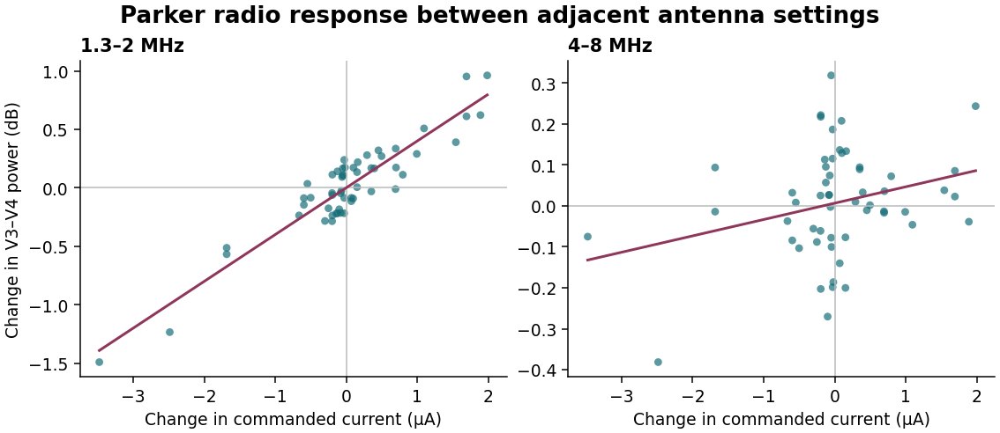
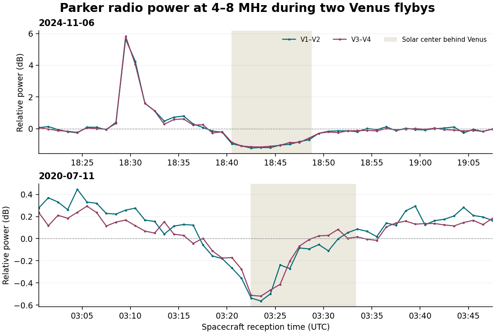

# Parker’s MHz radio power responded to antenna bias inside Venus’s shadow

During the 6 November 2024 Venus encounter, **changes in Parker Solar Probe’s commanded antenna current tracked changes in the V3–V4 radio spectrum at 1.3–2 MHz**. Across 55 adjacent pairs of seven-second settings, the measured slope was **+0.400 dB per microampere** and the Spearman rank correlation was **0.825**. The effect weakened with frequency. It identifies an instrument contribution on the timescale of a command step during the flyby.



| V3–V4 band | Slope (dB/µA) | Rank correlation |
| --- | ---: | ---: |
| 1.3–2 MHz | +0.400 | 0.825 |
| 2–4 MHz | +0.180 | 0.533 |
| 4–8 MHz | +0.040 | 0.206 |
| 8–16 MHz | +0.022 | 0.118 |

The computation pairs native FIELDS high-frequency spectra with the actual V3 whip-current commands in the antenna electronics telemetry. Both ends of each dipole received the same settings. It compares changes across adjoining positive-current intervals, which reduces the influence of a slow change in sky brightness or spacecraft–Venus distance. At 1.3–2 MHz the zero-offset correlation exceeds every one of 54 nonzero circular shifts of the commands. The low-band rank correlations are 0.919 and 0.661 in the first and second halves. Those checks share the same encounter. The second-half result at 2–4 MHz is much weaker. The other electronics board gives 0.118 at nominal packet times in the lowest band and about 0.68 with an exploratory one-step offset. It provides no independent nominal-time replication. [Per-board timing, measured-current and control results](bias_check.json)

## The broader eclipse signal

During Parker Solar Probe’s final Venus flyby on 6 November 2024, the two electric dipoles recorded **23.1% and 22.4% less power at 4–8 MHz** near closest approach than in the immediately surrounding minutes. The drop spans 1.3–16 MHz and is strongest at the low-frequency end. During the 20 minutes used for this comparison the spacecraft orientation in the local radial–tangential–normal frame varied by only 0.0173°. Geometric solar-center ingress and egress were 18:40:27 and 18:48:45 UTC. The command-step response establishes a contribution at short timescales. Its numerical slope alone cannot partition the slower eclipse-wide change in power.



Each point is a one-minute median for a dipole. The reference in each panel averages the two flanking medians measured 4–10 minutes from closest approach. The radio-power minimum in July 2020 develops before solar-center ingress, while the largest 2024 decrease falls inside the geometric eclipse. Short bursts are visible outside the central intervals. At MHz frequencies solar emission can extend beyond the apparent optical disk.

## Frequency dependence on 6 November 2024

The central six minutes are 18:41–18:47 UTC. The local reference uses 18:34–18:40 and 18:48–18:54 UTC. The first portion of the latter interval overlaps the geometric eclipse by about 45 seconds. Both dipoles used the same high-gain setting and 40-spectrum accumulation. The two dipoles share the spacecraft, plasma environment and electronics operations.

| Band | V1–V2 power change | V3–V4 power change | V1–V2 decrease | V3–V4 decrease |
| --- | ---: | ---: | ---: | ---: |
| 1.3–2 MHz | −1.928 dB | −1.860 dB | 35.9% | 34.8% |
| 2–4 MHz | −1.546 dB | −1.516 dB | 30.0% | 29.5% |
| 4–8 MHz | −1.140 dB | −1.104 dB | 23.1% | 22.4% |
| 8–16 MHz | −0.543 dB | −0.553 dB | 11.8% | 12.0% |

Power is the measured dipole voltage power spectral density. The percentage is 100 × (1 − 10^(ΔdB/10)). Unknown sky brightness, antenna response and receiver noise preclude converting the percentage into an intrinsic source flux. Separate before/after comparisons at 4–8 MHz are −1.32/−0.96 dB on V1–V2 and −1.34/−0.87 dB on V3–V4. A 5° slew before and after this pass makes the more distant reference intervals below a weaker control for 2024. The [quaternion and local contrast measurements](attitude_check.json) identify the stable-attitude interval.

## All seven flybys

Each row uses identical selection logic with the six-minute center and separate 20–50 minute flanks. Times are spacecraft reception UTC. The apparent radius is the largest sampled on a 15-second grid. A solar eclipse here means that the center of the Sun fell behind the solid limb of Venus within an hour of closest approach.

| Date | Apparent Venus radius | Sun eclipsed | 4–8 MHz contrast V1–V2 / V3–V4 | Coverage |
| --- | ---: | --- | ---: | --- |
| 2018-10-03 | 45.5° | No | — | Outbound reference missing |
| 2019-12-26 | 41.9° | No | — | No central spectra in the selected average-power product |
| 2020-07-11 | 61.5° | Yes | −0.700 / −0.616 dB | Both dipoles |
| 2021-02-20 | 45.8° | Yes | −0.250 / −0.297 dB | Both dipoles |
| 2021-10-16 | 37.9° | No | — | Central coverage below threshold |
| 2023-08-21 | 37.0° | No | +0.153 / +0.139 dB | Both dipoles |
| 2024-11-06 | 70.3° | Yes | −1.078 / −1.001 dB | Both dipoles |

All three measurable solar eclipses show a drop on each dipole. The one usable sunlit encounter shows a small increase at 4–8 MHz. Among same-day, same-setting control centers, zero of 9, 8 and 8 respectively were as low as the three eclipse measurements. Controls spaced 30 minutes apart share data in their flanks. These counts are descriptive. The four usable flybys rank in apparent-size order against radio power, but only four independent events enter that comparison (two-sided exact rank permutation 2/24). The exploratory band and windows, coupled with the small sample, limit any population inference. [All bands, controls and alternative windows](results.json) · [Solar contacts](solar-contacts.csv)

## What changed during shadow

The known Venus eclipses and maneuvers supply repeatable times for a radio measurement. They also change illumination, projected sky coverage, ambient plasma, antenna charging and, in 2024, commanded antenna bias. Mozer et al. used solar-panel current to identify the eight-minute 2024 shadow and documented a stepped bias-current experiment on the electric antennas. In the 2020 and February 2021 nightside crossings, the antennas kept the sunlight bias. Pulupa et al. had already identified blockage of Galactic radio emission by Venus as one possible contributor to the second flyby’s spectra. That work describes the commanded sweep and its low-frequency effects. This analysis measures its association with MHz radio power and gives the four-band eclipse contrast across repeated flybys. Targeted literature searches found the prior instrument and eclipse work cited here. Publication priority for this MHz measurement remains unverified. [Mozer et al. 2025](https://doi.org/10.1007/s11214-025-01242-x) · [Pulupa et al. 2021](https://doi.org/10.1029/2020GL091751) · [RFS instrument](https://doi.org/10.1002/2016JA023345)

The geometric eclipse and the changed electrical environment covary. No commanded-current setting is shared between the inner ±1 minute and the 2–4 minute positive-current shoulders of this pass. The experiment therefore supplies no matched-setting estimate of the residual dimming. A separation of missing solar or Galactic flux from a change in the antenna’s response would require an independently constrained MHz transfer function or an equivalent control.

## Reproduce the measurement

The frozen [one-minute spectra](minutes.csv.gz) contain median log power for each band, dipole and accumulation setting, plus accepted spectrum counts and apparent Venus radius. Each dipole contributes one channel per frequency. The daily product covers 64 frequencies, from which the four bands select channels. High gain, overrange flag zero, and positive in-range samples are required. For each minute use at least three valid spectra and at least half the channels of a band. At least 80% of the one-minute bins must be present in each of the core and both reference windows, on the same accumulation setting. Each UTC minute receives equal weight. Per-flyby CDF URLs, SHA-256 values and daily Horizons queries are in the [manifest](manifest.json). The [15-second sightlines](sightlines.csv) give the angular clearance above the Venus limb for the Sun, Earth and Jupiter.

With Python, NumPy and SciPy, run the frozen analysis from this directory. The second command also requires Matplotlib.

```sh
python analyze.py > replay.json
cmp replay.json results.json
python plot.py
```

With cdflib installed, full source reconstruction takes the following commands. Supply a scratch directory for the seven public FIELDS HFR products and a cache path for the SWEAP attitude product. Geometry reconstruction queries JPL Horizons for a two-hour interval around each flyby. [NASA FIELDS archive](https://spdf.gsfc.nasa.gov/pub/data/psp/fields/l2/rfs_hfr/) · [JPL Horizons API](https://ssd-api.jpl.nasa.gov/doc/horizons.html)

```sh
python prepare.py /tmp/psp-rfs-data
python sky_geometry.py
python analyze.py > replay.json
cmp replay.json results.json
python attitude_check.py --cdf /tmp/psp-sweap-20241106-v04.cdf > attitude-replay.json
cmp attitude-replay.json attitude_check.json
python plot.py
```

Rebuild the command-step statistics and scatter plot with the native high-frequency spectra and the independent antenna electronics file. Both scripts verify the CDF digests.

```sh
python bias_check.py --aeb /tmp/psp-aeb.cdf --hfr /tmp/psp-rfs-data/psp_fld_l2_rfs_hfr_20241106_v03.cdf > bias-replay.json
cmp bias-replay.json bias_check.json
python bias_figure.py --aeb /tmp/psp-aeb.cdf --hfr /tmp/psp-rfs-data/psp_fld_l2_rfs_hfr_20241106_v03.cdf
```
