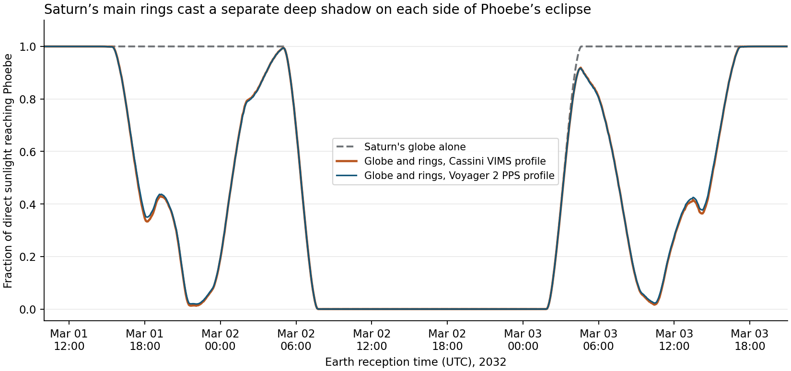

# Three predicted fades of Phoebe in Saturn’s shadow, 2032 March 1–3

Saturn’s B ring should remove about **98% of the sunlight reaching Phoebe twice**, with a nearly complete recovery between each ring shadow and a roughly 18-hour planetary eclipse. Both ring minima occur while Saturn’s solid disk clears the entire apparent Sun. A geocentric observer will see Phoebe roughly four arcminutes from Saturn. Two spacecraft measurements of ring opacity, made decades apart in different wavelength bands, predict the same sequence.



| Phase | Earth arrival, UTC | Direct light, Voyager 2 | Direct light, Cassini | Globe alone | Separation from Saturn |
|---|---|---:|---:|---:|---:|
| Inbound B-ring shadow | Mar 1 22:05 | 1.9% | 1.3% | 100% | 265″ |
| Recovery inside the main rings | Mar 2 05:00 | 99.5% | 99.5% | 100% | 259″ |
| Deep planetary eclipse | Mar 2 07:45 to Mar 3 01:50 | <0.1% | <0.1% | <0.1% | ~250″ at mid-eclipse |
| Recovery on exit | Mar 3 04:35 | 91.7% | 91.9% | 99.9% | 239″ |
| Outbound B-ring shadow | Mar 3 10:25 | 2.3% | 1.7% | 100% | 234″ |

The entries are samples on a five-minute grid. For a roughly V = 16.5 uneclipsed moon, the nominal ring-only minima correspond to direct-light losses of about four magnitudes. The fractions describe illumination of the moon's center. Phoebe’s rotation, light scattered by the rings and Saturn, and atmospheric refraction can change the observed floor. Its roughly 213-km diameter is much smaller than the ~15,100-km solar-disk footprint at Saturn. Absolute brightness and narrow ring structure require a more detailed model.

## Where the features can be measured

| Event | Site | Time sampled (UTC) | Phoebe altitude | Sun altitude |
|---|---|---|---:|---:|
| First ring minimum | Calar Alto, Spain | Mar 1 22:00 | 42° | −46° |
| First recovery | Kitt Peak, Arizona | Mar 2 05:00 | 46° | −45° |
| Second recovery | Kitt Peak, Arizona | Mar 3 04:30 | 51° | −39° |
| Second ring minimum | Siding Spring, Australia | Mar 3 10:30 | 29° | −24° |

Solar elongation stays between 93° and 95° through the two ring minima. The minute labels indicate sampling epochs. The time table assumes TAI−UTC remains 37 seconds. The site table samples Horizons' airless topocentric elevations every 15 minutes. [Site samples](checks/site-altitudes.csv) · [Geocentric prediction at five-minute cadence](prediction.csv)

## Evidence and falsification tests

1. An exploratory scan of selected Jovian, Saturnian, Uranian and Neptunian irregular satellites identified Phoebe. A full scan of Phoebe’s 2026–2040 Saturn-centric orbit finds one antisolar approach within 150,000 km. The geometric minimum is 10,093 km on 2032 March 2 at 15:31 TDB, at a depth of 14.83 million km behind the planet. The event model uses separate light-time-corrected vectors. Horizons' independent observer-table output flags Phoebe in total umbral eclipse on March 2. Its documented visibility flags use a spherical primary and omit main-ring opacity. [Observer table with flag definitions](checks/observer-table-march2.txt) · [Horizons manual](https://ssd.jpl.nasa.gov/horizons/manual.html)
2. For each reception time, subtract the Earth-to-Phoebe light time (~75 min) and evaluate the incoming Saturn and Sun astrometric vectors at Phoebe. Trace 2,048 equal-area rays across the finite Sun with linear limb-darkening coefficient 0.6. Intersect each ray with Saturn’s oblate ellipsoid (60,268/54,364 km) and equatorial plane. Apply the measured radial opacity as exp(−τ/|sin B|), with |B| ≈ 26.7°. Ray tracing includes the tilt and finite size of both projected disks. [Saturn radii](https://nssdc.gsfc.nasa.gov/planetary/factsheet/saturnfact.html) · [IAU Saturn pole model](https://naif.jpl.nasa.gov/pub/naif/generic_kernels/pck/pck00011.tpc)
3. Voyager 2 PPS measured a δ Scorpii occultation at 0.264 µm. The PDS 50-km radial product and label are frozen here. The alternate profile uses Cassini VIMS observations of R Hydrae on 2007 January 1 at 2.866–2.977 µm. Of 71 VIMS 10-km profiles in the archive index spanning 74,000–137,000 km, this had the nearest absolute opening angle (29.40°). The archive flags 829 of 7,890 bins as saturated and supplies the maximum detectable opacity for them. The profiles bracket different wavelengths and ring azimuths. Their agreement supports the two broad fades. A visible-band depth measurement on these dates would test the transfer of those opacities. [Voyager product](https://opus.pds-rings.seti.org/holdings/volumes/VG_28xx/VG_2801/EASYDATA/KM050/PS1P01.TAB) · [Cassini product](https://opus.pds-rings.seti.org/holdings/volumes/COVIMS_8xxx/COVIMS_8001/data/VIMS_2007_001_RHYA_I_TAU_10KM.TAB)
4. The alternate IMCCE PH20 orbit fitted to 1898–2019 observations differs from JPL SAT441 by at most 70 km in 25 three-hour barycentric samples across this window. Applying that offset to Phoebe's position moves the sampled ring minima by one 5-minute bin or less. The two orbital fits share observations, so the difference measures model sensitivity. An 8,192-ray calculation changes the direct-light fraction by less than 0.002 at the two deep ring minima and two recoveries relative to a 1,024-ray calculation. Halving every Voyager opacity leaves 12–14% light at the two ring minima. Doubling them leaves roughly 0.1%. [PH20 kernel and description](https://ftp.imcce.fr/pub/ephem/satel/phoebe/) · [Desmars et al. orbital model](https://doi.org/10.1051/0004-6361/201321114)
5. A historical screen also locates a globe-shadow passage on 2016 May 23. A CADC moving-object image crossmatch for May 22–25 returned 30 Las Cumbres image products on May 22 and one ALMA footprint on May 24. None cover the May 23 eclipse, so this check supplies no retrospective photometric validation. Other archives may have coverage. [Exact archive response](checks/2016-archive.tsv)

The specific result is the predicted **pair of separated ring-only fades and intervening brightness recoveries** for Phoebe. Ring shadows on other moons are established. NASA published a Cassini sequence of Janus moving through shadowed rings, and Tamayo et al. used Saturn’s shadow to image dust in the diffuse Phoebe ring. Searches for “Phoebe Saturn eclipse March 2032,” “Phoebe Saturn ring shadow,” and “Phoebe 2032 March 2 eclipse” did not locate a published light curve for this event. These are predictions for a known moon. The archives supply the ring measurements. [Cassini Janus sequence](https://science.nasa.gov/missions/cassini/spectacular-eclipses-in-the-saturn-system/) · [Tamayo et al. 2014](https://www.sciencedirect.com/science/article/abs/pii/S0019103514000529)

## Reproduce

From this directory with Python, NumPy and SciPy, run the following commands. Matplotlib is needed for the figure only. The offline tests take a few seconds.

```sh
python replay.py --csv prediction.csv
python replay.py --cassini
python replay.py --alternate
python checks.py
python plot.py
```

The five per-vector JSON receipts preserve each Horizons query URL, coordinate system, solution ID, epoch grid and input hashes. In the Cassini extract, columns 1, 4 and 14 of the PDS table give radius, normal opacity and note flag. The alternate orbit inputs include the direct JPL geometric response and the per-epoch Cartesian difference. To regenerate it, download the linked PH20 kernel and install jplephem, then run `python alternate_orbit.py ph20.bsp /tmp/ph20-check.csv`. Re-run the parent-orbit search with `python screen.py /tmp/phoebe-screen`. [Data receipts and URLs](checks/provenance.json)
