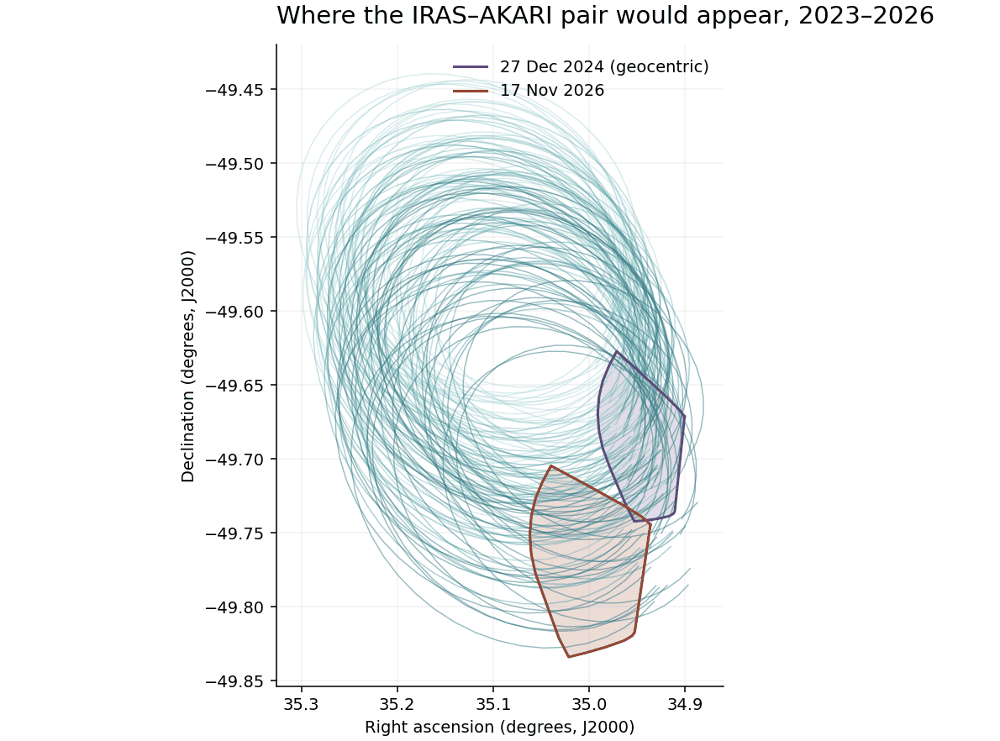
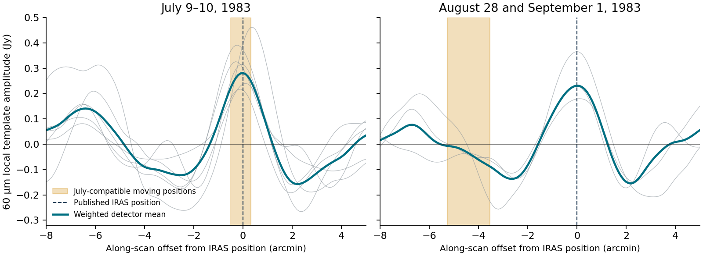

# Optical and infrared follow-up of the Phan et al. Planet Nine candidate

**No moving object survived the DES or Euclid searches. For a dark, compact 5 Earth-mass planet, at least one survey recovered 397 of 400 artificial planets on trajectories through the two published positions. When the historic positions were perturbed, 388 of 400 were recovered.** The 1983 IRAS timelines independently favor emission at a fixed sky position. A galaxy 32.86″ from the IRAS centroid is a plausible contributor. This constrains the published pair under specified assumptions. A giant planet elsewhere in the outer Solar System remains outside the experiment. Public-data cutoff: November 17, 2026. [Matched injections and sampling intervals](joint/README.md) · [Far-infrared evidence](historical/README.md) · [Original paper](https://doi.org/10.1017/pasa.2025.10024)

## How much of the candidate family did the images test?

Each row below uses the same 400 trial trajectories in both instruments. The darker model has radius 2.71 Earth radii and grey geometric albedo 0.10. The medium-albedo models use 5 Earth masses with 2.94 Earth radii or 10 Earth masses with 3.70 Earth radii, albedo 0.30. Each artificial source moves and changes apparent brightness between visits. Detector gaps, static-source masks and failed detection tests count as misses. The confidence intervals quantify finite sampling under the specified draw.

| Model and endpoint assumptions | DES recovered | Euclid recovered | At least one recovered | Wilson 95% interval |
|---|---:|---:|---:|---:|
| Dark 5 M⊕, published positions | 379/400 | 362/400 | **397/400 (99.25%)** | 97.82–99.74% |
| Dark 5 M⊕, perturbed positions | 371/400 | 271/400 | **388/400 (97.00%)** | 94.83–98.28% |
| Either medium-albedo model, published positions | 389/400 | 362/400 | 400/400 | 99.05–100% |
| Either medium-albedo model, perturbed positions | 379/400 | 271/400 | 392/400 | 96.10–98.98% |

The reconstructed family spans effective IRAS dates from June 26 through September 1, 1983, 500–700 au at the two positive December 26, 2006 AKARI scans, and signed radial changes out to the bound-orbit limit. The joint injections draw from a refined grid. The positional stress test varies the IRAS direction over its 18″ × 7″ ellipse and the AKARI direction by up to 40″ on a discrete set of axes. The AKARI offset is illustrative. Neither survey supplies a posterior over these orbits. Wider distance ranges, different endpoint identifications or darker spectra can change the result. [Orbit definition, convergence and uncertainties](orbits/ORBITS.md) · [Exact matched trial outcomes](orbits/euclid/paired_trials.csv.gz)

On November 17, 2026 at 00:00 UTC the nominal geocentric directions span RA 34.9358–35.0616°, Dec −49.8341 to −49.7047°, with apparent speeds of 0.197–0.278 arcsec/hour. These extrema bound a correlated footprint. Ecliptic inclinations span 115.03–117.33°, retrograde. The predicted prograde perturber in the dynamical Planet Nine literature occupies a different family. The calculation includes annual parallax and light time, with the spacecraft position used for Euclid. [Monthly ephemerides and rates](orbits/ephemeris.csv) · [Numerical validation](orbits/validation.json) · [Dynamical Planet Nine prediction](https://arxiv.org/abs/2108.09868)

## What the original far-infrared data show

The published J2000 coordinates are (35.74075°, −48.5125°) for IRAS and (35.18379°, −49.2135°) for AKARI. Their separation is 47.45856′. The IRAS Faint Source Catalog position agrees within 0.139″, and its fluxes are 0.2396 Jy at 60 µm and 0.5164 Jy at 100 µm. The paper's AKARI values are 0.09 Jy at 65 µm (flagged as unreliable by the authors) and 0.27 Jy at 90 µm. The public 90 µm all-scan map gives −0.058 Jy at that coordinate. The positive single-scan products used in the paper were unavailable for independent reproduction. [Catalogs, ISSA/IRIS and AKARI measurements](historical/README.md)

In late August and early September, the IRAS 60 µm detector timelines give **+0.231 Jy at the fixed IRAS position**, versus **−0.081 to −0.013 Jy** along 711 tracks consistent with the July along-scan detections. Those tracks predict a 3.83–5.28 arcmin along-scan displacement. Offset controls give a robust scatter of 0.053 Jy. On the full 3,617-node grid, no trajectory gives even 0.05 Jy in both intervals at its moving positions. In 31,656 continuous orbit draws with perturbed centroids, the largest flux present in both intervals is 0.075 Jy. These are measured profile amplitudes; sensitivity varies across each detector. A second extraction with a shifted origin verifies the scan orientation. WISEA J022301.05−483040.5 lies inside the beam and gives +0.221 Jy in the late scans at its fixed position. Detector throughput, confusion and the lack of an independent AKARI endpoint limit any source identification. [Individual 1983 profiles and control fits](historical/README.md#time-resolved-iras-test)

## Completed survey checks

| Public survey or product | Pixels, selection and result |
|---|---|
| DES / DECam, December 2016 | Two 90 s r exposures 21.47 h apart. No positive/negative PSF pair passes the dense 5.5 threshold (maximum 5.23). The final search recovered 387/400 off-grid sources at r_AB 23.0 and 235/400 at 23.5. Five initially high residuals were confined to one exposure. [Methods, physical models and injections](archives/OPTICAL.md) |
| Euclid DR1 VIS, December 27, 2024 | Seven 560.52 s exposures over 2.12 hours. Of 58 peaks above threshold, 26 coincided with cataloged stationary DES sources and the other 32 failed when an exposure was removed. JPL's two-pass known-object field check returned no matches. The independent continuous-orbit test recovered 3,597/3,917 (91.83%) at VIS_AB 24, 3,499/3,917 at VIS_AB 26, and 2,976/3,928 (75.76%) at VIS_AB 24 with its continuous centroid stress distribution. [Native data, thresholds, calibration and candidates](orbits/euclid/SEARCH.md) |
| DECam, 2024–25 | The two November 2024 g images recover 198/320 injected tracks at g_AB 21, 14/320 at 22. Their 62 s separation cannot show the expected motion. A July 2025 720 s N395 image has 1,466/3,617 usable nodes and no threshold crossing. Its absolute narrowband calibration is pending. [Modern imaging](archives/OPTICAL.md#20242026-imaging) |
| NEOWISE W1 and W2, 2023–24 | Three visits, 24 individual exposures per band. No repeated signal among 24,132 eligible central-position templates in W1 or 24,118 in W2. A separate 256-draw injection test recovered 223 at W1=16 and 100 at 16.5; 240 at W2=14 and 35 at 15 (Vega). W2 does not reach the grey reflected-light model range of about 17.3–22.3. [Field receipts, mask treatment and selection](wise/README.md) |
| unWISE time-resolved catalog, 2010–20 | On one tile with 17 visits per band, 3,617 tracks were propagated to each coadd. No nonpersistent catalog association matched a track at two visit midpoints. The 61 one-visit associations are consistent with the translated-field controls. Motion during a coadd spans 22–77″. The catalogs yield no independent magnitude limit. [Epochs and matched entries](unwise/README.md) |
| SPHEREx DR1 and Quick Release 3, 2025–26 | Across six detectors spanning 0.75–5 µm, 572 native exposures gave 2,551/3,617 eligible nominal tracks. No repeated signal. Of 320 injected tracks, 234 were eligible in at least one detector. Flat-spectrum recoveries were 234 at AB 18, 194 at AB 19 and 13 at AB 20. All model cases at grey albedo 0.10 yielded zero recoveries. The largest, brightest model gave 151/320. A second search varied the orbit parameters and the historical centroids continuously. Among 15,833 viable draws it found 10,464 eligible tracks and no source. Flat AB 19 recovered on 171/215 eligible injections. [Image hashes and injection curves](spherex/README.md) |
| Legacy Surveys DR10/DR11 and DELVE | Static coadds, photometric references, source masks and footprint checks. DECam products can share the same underlying exposures. The archive inventory propagated the family to 226 distinct DECam exposure midpoints. The per-exposure table distinguishes verified CCD intersections and missing information. No independent full-family limit is assigned to a coadd. [DECam exposure ledger](archives/decam_epochs.csv) · [Optical analysis](archives/OPTICAL.md) |
| Gaia DR3 | Of 243 commanded field passages inspected, 88 pass within 0.40° of at least one predicted direction. Object-specific window assignment and retained pixels are unknown. No calibrated fraction. [Epochs and raw archive responses](gaia/README.md) |
| Pan-STARRS1 3π and Rubin | The Phan field at about −49° is outside the −30° PS1 3π southern limit and all seven public Rubin DP1 fields. The public Rubin broker queries produced no associated alerts, with a known-object positive control. EDP2 image rights and alert selection preclude an injection-calibrated fraction here. [Pan-STARRS footprint](https://outerspace.stsci.edu/display/PANSTARRS/PS1+Surveys) · [Rubin receipts](rubin/README.md) |

Phan et al. used a 7–17 Earth-mass range for their initial selection. The 5–10 Earth-mass structural models tested here use radii from Fortney et al. and Linder & Mordasini, effective temperatures 36.7–48.3 K, geometric albedos 0.10, 0.30 and 0.75, reflected sunlight at full phase, and unit-emissivity blackbody thermal radiation. Across 500–700 au the models give r_AB 18.69–23.71 and grey VIS_AB 18.64–23.65. The 60 and 90 µm thermal ranges are 0.033–0.353 and 0.078–0.621 Jy. Each historic measurement fits its marginal range. Molecular opacity and atmospheric emission can change the near- and mid-infrared predictions substantially. [Model definitions and references](orbits/ORBITS.md#brightness-assumptions) · [Tabulated fluxes](orbits/brightness.csv)

## Other published candidates

Both one-day AKARI candidates from Chen et al., Rowan-Robinson's IRAS proposal and all twenty printed ACT peaks received separate ephemerides and field-level tests. The single-day positions require an explicit choice of distance and velocity. For the Chen and Rowan-Robinson cases we used circular orbits spanning all position angles. For ACT we used the tabulated distance and linear angular motion. At r_AB 23.0 the two DECam searches recovered 228/280 and 168/280 injected trajectories for Chen 1 (July 2007) and Chen 2 (July 2006). Their one linked residual apiece is explained by fixed sky emission, including a resolved edge-on galaxy for Chen 2. Three public ZTF frames test only 11/504 circular Rowan-Robinson hypotheses, all recovered at r=21. None of the twenty ACT W2 trajectories triggered within the tested ±60″ common offsets. Two positive W2 differences near a westward Rowan-Robinson path had no positive native-image peak within a PSF width. The brightest signals lie next to cataloged W2 stars of 6.23 and 7.28 Vega, including a Gaia long-period variable. Catalog and JPL checks support rejection as moving sources. The affected crowded positions remain unconstrained. [WISE trigger vetting](wise_vet/README.md) Results for a sky patch do not exclude the full underlying continuum. [Candidate coordinates, assumptions and published sources](other/README.md) · [DECam and ZTF images and vetted residuals](other_optical/README.md) · [WISE results for each field](wise/compact/field_summary.csv)

## Pending checks and limits of the public record

- Twelve dedicated 900 s DECam r exposures are listed on September 13, October 28 and November 15, 2026. The archive gives public release dates **March 5, April 19 and May 7, 2028**, respectively. A November science-file request returned HTTP 403. These observations can supply a much longer and deeper motion test when their pixels become public. [Exposure IDs and access evidence](archives/dedicated_2026.csv)
- The authors' AKARI monthly-unconfirmed list and two positive 90 µm scan products remain unavailable here. The public FIS bright-source catalog v1 and all-scan maps were tested. The preliminary v2 distribution requires registration. Cross-scan detector throughput, source confusion and astrometric uncertainties remain in the IRAS interpretation. [Historical material](historical/README.md)
- Additional DECam epochs, an absolute N395 flux calibration, full Gaia windows, unrestricted Rubin imaging, Euclid NISP pixel limits, non-grey planet spectra and broader prior families remain unmeasured. The orbit grids and their sampling intervals cover the stated hypotheses. They carry no absolute discovery or nonexistence probability.

## Reproduction

Run `python verify_results.py` to check the matched trials, top-level counts and manifests with the Python standard library. Each survey report gives its search code, public endpoint or query, observation selection, input hashes, control tests and injection tables. The orbit script accepts arbitrary exposure epochs. Start with orbits/ORBITS.md, then run the survey-specific preparations; joint/join.py recomputes the fixed-grid union. The matched physical draws and test outcomes are machine-readable. The repository audit identifies reused prior work and the two separate active projects. [Prior work](repository-audit.md) · [Matched selection](joint/README.md)
