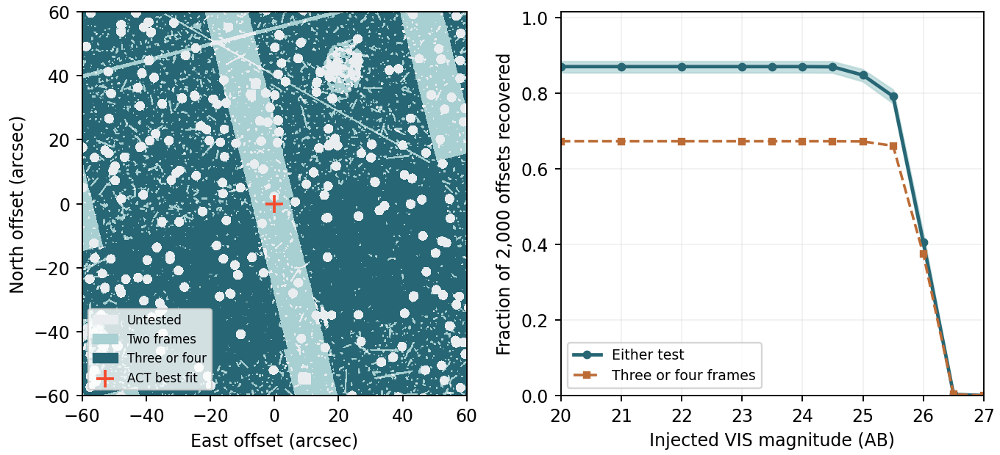

# Euclid test of ACT Table 4 peak 6

No moving optical source survived at the tabulated 300 au trajectory or within the surrounding ±60″ square. At VIS = 24.0 AB, the search recovered 1,740 of 2,000 synthetic objects placed uniformly in this square (87.0%, Wilson 95% interval 85.45–88.40%). The four public DR1 images were obtained on 2025-02-24 over 53.3 minutes. The motion predicted from Euclid was 0.309″ over that interval. These fractions apply to offsets about the published ACT best fit at fixed distance and velocity. ACT supplied a low-significance millimetre peak, rounded motion parameters and no orbit posterior for this comparison. Other distances and motions remain open. [Naess et al., Tables 3–4](https://arxiv.org/abs/2104.10264)

| VIS AB | Recovered with three or four frames | Additional recoveries with two frames | Fraction of all 2,000 offsets |
|---:|---:|---:|---:|
| 20.0 | 1,345 | 395 | 87.00% |
| 24.0 | 1,345 | 395 | 87.00% |
| 24.5 | 1,345 | 394 | 86.95% |
| 25.0 | 1,344 | 351 | 84.75% |
| 25.5 | 1,321 | 262 | 79.15% |
| 26.0 | 748 | 63 | 40.55% |



**At the exact tabulated track**, two of the four dither positions miss the object by 59.2 and 43.9 native pixels beyond the closest detector quadrant. The predicted first and last positions fall on the arrays. All four bilinear neighbours are clear in the first image and one is flagged in the last. The fit uses the remaining valid PSF pixels. The first–last differential score was +1.06 against a threshold of 8. The 99.9th percentile of 4,616 unconfused control cells was +3.05. Placing 300 shot-noise realizations on that same background yielded 300 recoveries at VIS = 25.5, 288 at 25.75 and 6 at 26.0. A grey 5-Earth-mass model with radius 2.71 Earth radii, geometric albedo 0.1 and heliocentric and observer distances of 300 au gives VIS = 19.97. All 300 realizations passed at that brightness. These repeats measure noise sensitivity at one exact location. The patch-wide experiment separately measures the effect of unknown sky position. [VIS solar magnitude calibration](../orbits/euclid/solar_vis.json)

## Pixel measurement and vetting

The Euclid mid-exposure ephemeris spans RA 69.409037° to 69.409031°, Dec −20.937114° to −20.937028°. The patch is centred at RA 69.409034°, Dec −20.937071°. We extrapolated the heliocentric ACT coordinates at MJD 57688 with the tabulated velocities and used Horizons' Euclid spacecraft vector for parallax. The peak's published proper motions are 3.9 and 1.4 arcmin/year in the east and north tangent directions. A 560.52 s exposure has 0.054″ of predicted drift. Off-grid injections integrate the stellar PSF along this trail with four equally spaced midpoint samples. 

The four VIS quadrant products contribute ten overlapping SCI/RMS/FLG sections, read from 69 archived requests including the quality-control JSONs and extension headers (246,973,766 bytes). Native SCI and RMS are in ADU. MAGZEROP 24.51642, exposure 560.52 s and gain 3.48 electrons/ADU yield 359.05 ADU or 1,249.51 electrons at VIS = 25. Every resampled pixel requires four valid native neighbours using the Euclid instrument mask. The interpolation check against the original celestial WCS is recorded separately for each quadrant. [Euclid VIS calibrated frame](https://euclid.esac.esa.int/dr/q1/dpdd/visdpd/dpcards/vis_calibratedquadframe.html) · [Euclid VIS flags](https://euclid.esac.esa.int/msp/dpdd/v1.1/visdpd/dpcards/vis_flagmap.html)

The blind fit used a per-pixel stationary sky and a common moving PSF. Of 1,442,401 raster cells (0.1″ sampling), 1,083,443 have three or four locally usable images and 972,413 also pass the 1.5″ stationary-source veto from DES DR2, Legacy Surveys DR10, Pan-STARRS DR2 and Gaia DR3. Six peaks exceed score 8. Five are within the external-source veto radius. The sixth has score 38.01 and drops to −0.97 when one exposure is removed. All thresholds are detection rules on correlated, structured residuals.

The supplementary two-image test adds 283,081 disjoint cells. These have exactly two usable images, no external source within 1.5″ and no large positive or negative residual within a 1.2″ square half-width. The image-pair motion spans 0.103–0.309″. Before the residual-neighbourhood avoidance, no external-catalogue-clear candidate peaked above the pair threshold of 8 in any of the six combinations. JPL's two-pass small-body search using the Euclid spacecraft state returned zero known objects in a larger 0.05° × 0.05° coordinate box at 18:43 UTC. The one-night data do not supply a new orbit. [JPL Small-Body Identification](https://ssd-api.jpl.nasa.gov/doc/sb_ident.html)

The 2,000 continuous uniform offsets lie independently between raster points. Synthetic objects are added to actual registered pixels with Poisson noise, the gain conversion above and an aperture-corrected PSF pooled from seven usable Gaia/Legacy Surveys point-source profiles. We compare each injection with the nearest searched raster cell. The three-or-four image test requires score ≥8, score ≥3 on every single-image removal and sufficient signal to exceed nearby pre-existing peaks. The two-image test uses the pair threshold and a larger avoidance mask for anomalous residuals. Masks and catalogue decisions are fixed before injection. The receiver recovers 87.0% in the bright limit, closely matching the 87.04% available sky area. The local model neglects detector-mask changes with source brightness. Field-dependent PSF differences remain relevant to the faint-end limits.

## Reproduction

Keep the adjacent orbits/euclid analysis available, or set PHAN_EUCLID to its location. Set ACT_VIS_CACHE to an optional local cache directory for range bytes and registered arrays. The required packages are NumPy, SciPy, Astropy, pyerfa and matplotlib.

```sh
python metadata.py
python pixels.py
python catalogues.py
python known.py
python detectors.py
python search_patch.py
python nominal.py
python two_frame_patch.py
python figure.py
```

coverage.json and detectors.json give native pixel coverage. ranges.json gives the public object URL, byte interval, SHA-256 and timestamp for each download. The archived ESA TAP, Horizons, JPL and crossmatch results have matching query receipts. triggers.json records every raw three-or-four-image peak and its single-image removals. injections.csv, supplementary_injections.csv and two_frame_nominal.json contain the three injection experiments.
