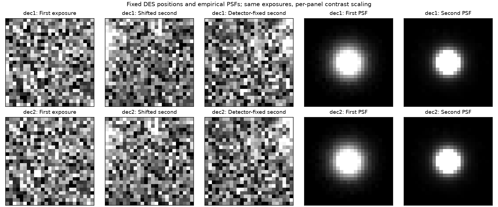

# Retrospective DES timing sensitivity

The Phan et al. paper's [Figure 6](https://doi.org/10.1017/pasa.2025.10024), page 8, labels two December 26, 2006 scans at 15:59:18.072 and 17:38:34.553 UTC. Its PDF SHA-256 is `ddc78cd212287f13b2db480498797a6c26f08eee1dd425fb6060ef209739d0f1`. The earlier analysis used 21:03:07.5 UTC, a midpoint of scan times incorrectly attributed to that figure. The two actual labels are conditional timing alternatives; the effective catalog centroid epoch and contributing scan remain unverified. June scans are counterfactuals, not claimed contributing detections.

This follow-up reruns the already-inspected DES exposures 605285 and 605571 with the same 800 mapped draws: 400 central positions and 400 deliberately perturbed positions. It is a retrospective sensitivity calculation, not an independent observation or external preregistration. The known historic joint DES/Euclid fractions and figures remain conditional on the old time; **they are not valid recovery estimates for either December alternative**. Euclid has not been rerun for these alternatives. The sampling, 40″ AKARI perturbation and optical brightness model are assumptions, not an orbital posterior or population exclusion.

| Case | Central eligible / masked | Stress eligible / masked | Dark model central recovered | Dark model stress recovered |
|---|---:|---:|---:|---:|
| Published legacy 21:03 analysis | — | — | 379/400 | 371/400 |
| Keyed-noise replay, 21:03 | 389 / 11 | 379 / 21 | 379/400 | 372/400 |
| December 15:59 label | 388 / 12 | 385 / 15 | 375/400 | 374/400 |
| December 17:38 label | 388 / 12 | 385 / 15 | 374/400 | 374/400 |

All 800 mapped states were bound in both December cases. The other two archived models each recovered 388 central and 385 stress draws in each case. The 21-model results and each per-draw outcome, including masks and uncovered cases, are archived. The keyed replay deliberately uses noise streams keyed by draw/model/exposure; they are not the legacy conditionally consumed streams. Its dark stress flags changed on draws 25 (recovered to missed), 62 and 382 (missed to recovered). The old intermediate scores were not archived, so the cause of each flip is not established. [Full comparison](evidence/pr143-des-december-comparison-f6b97d8-20261117.json)

Both December grid-track searches had zero tracks above the fixed threshold. Each dense search reported a single nearby-position residual: score 5.69 and 5.72, respectively, at approximately (608, 1312) and (609, 1312) zero-based first-exposure CCD pixels. These are **the same two exposures and substantially the same residual**, not two independent observations. The nearest model track is index 209, approximately 492–493 pixels away and masked; it is not a fitted association. Fixed-position reconstruction reproduced the search scores to within 5×10⁻⁷. The feature passed the recorded endpoint masks. The shifted-vector scores use the original noise and threshold; a fixed detector-coordinate alternative scored 2.34 and 2.20. The sky-fixed same-pixel difference is algebraically trivial and is not a goodness-of-fit test. Four fixed translated controls provide descriptive context only, not a post-selection false-alarm probability.

For the first exposure the two radius-4 raw aperture sums were +84.8 and +99.2 ADU; the shifted second exposure sums were −88.1 and −38.4 ADU. Planar-background estimates changed them to +99.3/+105.5 and −52.9/−38.6 ADU. These are noisy signed measurements, not calibrated source fluxes. The main apertures and sky annuli have full DQ-valid coverage; the retained centroid uncertainties are explicitly uncalibrated proxies. Empirical PSFs, DQ and reconstructed mask layers, fixed controls, native and registered stamps are included. The residual is unvetted; there is no independently confirmed moving source. [Fixed-position diagnostic](evidence/diagnostic/run/diagnostic.json)



## Provenance and replay

The run records are local freezes and authorizations, not independent external preregistration or trusted timestamps. Exact executed code snapshots are archived under `executed-code/`: mapping `e9ec0873`, historical DES `581c9c4e`, December DES `f6b97d8d`, fixed diagnostic `ca3d18bf`. They identify the actual executed code, not this publication commit. The mapping has 800 uniquely matched row identities and preserves eight repeated physical draws. Original 145 MB image inputs remain external; [acquisition receipt](evidence/retrieval_receipt.json) gives the public URLs, byte sizes and SHA-256. The evidence archives include original run manifests, authorizations, outputs and execution receipts; large JSON files are compressed with their original uncompressed bytes checked against the run receipt. Source pixel retrieval and the image analyses require the recorded dependencies and substantial resources; the compact verifier performs only an offline evidence check:

```text
python results/planet-nine-fir/timing-followup/verify.py
```

The release includes raw fixed diagnostic stamps only, not the full DES images. Plots use only those already-authorized fixed stamps and empirical PSFs. No June or Euclid pixels were opened in this follow-up.
