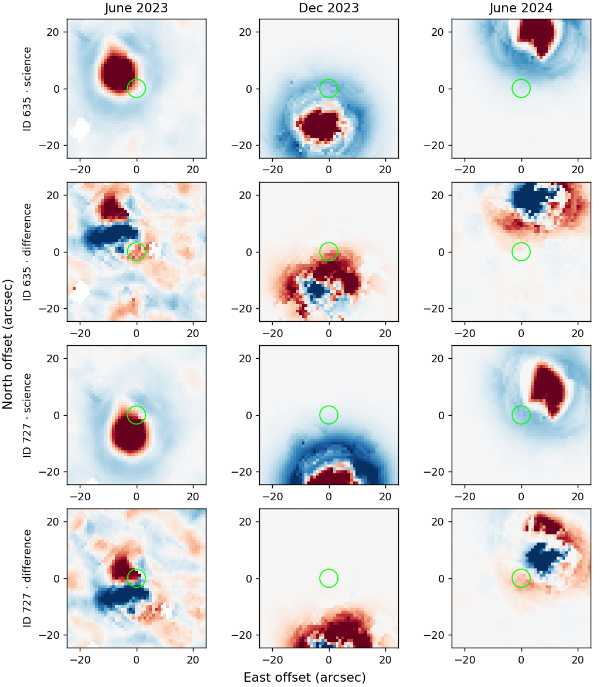

# Rowan-Robinson W2 alert vetting

Neither of the two threshold crossings in the 225 au, heading-270° offset search supplies a stationary-background-independent image of a moving source. The three visits place the marks on the wings of different stationary sources. In the strongest visit for each mark the native filtered science signal at the moving position is negative. The positive value in the inter-season difference comes from subtracting a more negative template. Crowding leaves a faint blended planet unconstrained at these positions.

The two marks are trials 635 and 727 of the 31 × 31, 4-arcsecond common-offset bank about the assumed circular track. Their fixed tangent-plane offsets are (0″, +20″) and (−4″, +32″). The separately evaluated 504-orbit physical bank has zero threshold crossings in these images. Neither mark is an orbit fitted to image detections. Each prescribed path traverses 32.64′ from June to December 2023 and 26.83′ from December to June 2024. The summer-to-summer displacement is 6.445′.

| Offset trial | June 2023 / Dec 2023 / June 2024 control-scaled residual | Distance to nearest positive science-image peak (arcsec) | Strongest visit |
|---|---|---|---|
| 635 | 3.08 / 78.32 / 4.55 | 7.07 / 14.32 / 16.55 | 14.40″ from AllWISE J204103.99+601012.3, W2=6.231. Gaia DR3 2193806661294321792 has G=11.83 and Gaia flags it as variable and its DR3 classifier assigns long-period variable (LPV), score 0.764. Its catalogue location is 0.055″ from the AllWISE centroid. |
| 727 | 4.88 / 4.83 / 23.94 | 7.07 / 12.37 / 11.40 | 12.47″ from AllWISE J204350.95+602801.4, W2=7.282, and 8.71″ from J204348.58+602749.8, W2=12.247. The latter carries W2 variability index 9 and a diffraction-spike flag. |

Re-registering the native science images on each exact track gives no positive filtered maximum within a W2 FWHM (6.4″) in any of the six visit/trial stacks. The June 2023 marks have valid filtered science estimates in only four of ten selected frames. The other visits have eight or nine. The cutouts below show the mask-aware, narrow-Gaussian-minus-broad-Gaussian response. Areas without sufficient references or native coverage are white. The green circle has radius 3.2″. Each panel has its own symmetric colour scale. Red denotes positive signal.



Using the other June visit as the summer template gives June control-scaled residuals +0.56 and −1.28 for trial 635. For trial 727 the alternate June residuals are +3.58 and +10.27. The latter remains sensitive to background structure even with this template change. The direct image centroids, bright neighbours and per-frame catalogue supply its additional rejection tests. The scores estimate local scatter in correlated residuals and have no calibrated Gaussian-tail interpretation.

IRSA's independent L1b source table yields no clean W2 detection (S/N ≥5, W2 contamination flag 0) within 3″ of either predicted trajectory on the 30 selected frames. There is no listed point source within 10.35″ of trial 635 in its strongest visit or within 8.38″ of trial 727 in its strongest visit. Some individual frames have no catalogue entry in the query region. JPL SB Identification found zero catalogued small bodies on both marks in fields with RA half-width 0.09° and Dec half-width 0.065°. Each query used a WISE spacecraft state from Horizons, a representative actual exposure UTC, two-pass propagation and no magnitude cutoff. These three epochs were 2023-06-22 05:11:36, 2023-12-01 10:18:01 and 2024-06-20 11:14:32. This test constrains catalogued objects at those instants. The absence of a clean L1b catalogue detection does not supply a completeness limit.

## Replay

Use the sibling NEOWISE search and its hashed RR-h270 inputs. Set WISE to the directory containing search.py and CACHE to the directory containing the RR-h270 FITS files subdirectory. Use NumPy, SciPy, Astropy and matplotlib.

```sh
python rr_w2.py --wise "$WISE" --cache "$CACHE"
python morphology.py --wise "$WISE" --cache "$CACHE"
python catalogs.py
python l1_catalogs.py
python known.py
python report.py
```

individual.csv records the science, reference and difference filtered signals and coordinates for every trial/exposure pair. positions.json contains the alternative-reference test. morphology.json records nearest peaks on the registered one-arcsecond sampling grid. vetting.json lists matched AllWISE, Gaia and per-exposure L1b sources and the representative field results from JPL. The .response files and matching receipt JSONs preserve the archival queries, response bytes and retrieval hashes. SHA256SUMS covers the full packet. Use the accompanying parent acquisition ledger to locate each native image and bit mask.

[NEOWISE image calibration and masks](https://irsa.ipac.caltech.edu/data/WISE/docs/release/NEOWISE/expsup/sec4_2a.html) · [AllWISE catalogue flags](https://irsa.ipac.caltech.edu/data/WISE/docs/release/AllWISE/expsup/sec2_1a.html) · [JPL Small-Body Identification API](https://ssd-api.jpl.nasa.gov/doc/sb_ident.html) · [ESA Gaia DR3 archive](https://gea.esac.esa.int/archive/)
