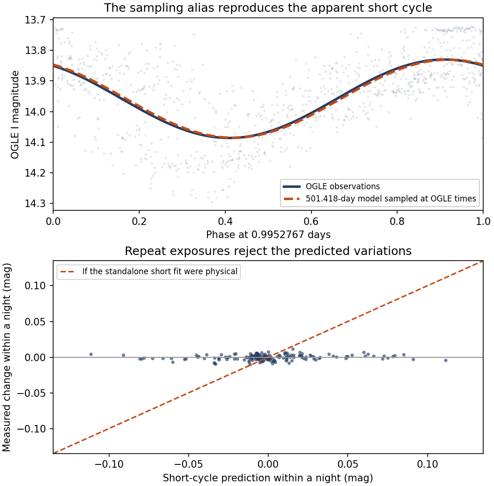

# A sidereal sampling alias in the proposed close binary PN Al 2-R

The reported 0.9952767-day photometric clock of PN Al 2-R can be accounted for by observing a slowly varying star through the OGLE night-time window. A model containing just the published 501.418-day variation, evaluated at the 925 actual observation times, reproduces **99.4% of the apparent short-period semiamplitude** and matches its phase to **0.0095 cycles**. Repeat exposures within a night measure a coherent semiamplitude of **0.0040 mag** where the standalone short-period fit predicts **0.1283 mag**. Gaia space photometry provides a second, later check. These measurements remove the published large short-period modulation as evidence for an irradiated binary in this source.



## Which claim is tested

NegmEldin et al. (2026) singled out this object in their abstract for having both a short binary period and a long photometric period. Both measurements in their Table 2 use OGLE observations. We use the precise periods printed there. The paper rounds the short period differently in its narrative. The coordinates in Table 1 (268.4019°, −31.4239°) identify Gaia DR3 4055678213978728320. OGLE-BLG-LPV-102396 lies 0.30 arcsec from the rounded position. The earlier OGLE catalogue classifies it as a semiregular variable, with periods of 514.3, 58.37 and 225.3 days. This investigation tests the proposed *second*, sub-day clock. [2026 paper, Tables 1 and 2 and Fig. 2](https://doi.org/10.1038/s41598-026-42163-1) · [Soszyński et al. (2013)](https://arxiv.org/abs/1304.2787) · [OGLE catalogue and identification tables](https://www.astrouw.edu.pl/ogle/ogle3/OIII-CVS/blg/lpv/)

## Constructing the alias from the measurements

The reported frequency difference is 1.00275137 cycles per day. It differs from one sidereal cycle per mean solar day by 0.00001346 cycles/day, only 0.038 of the inverse 2,830-day baseline. That agreement alone cannot choose which peak is physical. The modulus of the actual normalized time-sampling window at the frequency difference is 0.838. Fitting the 501.418-day sinusoid plus a mean, discarding the measured magnitudes, then fitting the short sinusoid to those model values at the original timestamps makes a direct prediction.

| OGLE statistic | Result |
| --- | ---: |
| Measured short-period semiamplitude, fitted on its own | 0.12826 mag |
| Predicted short-period semiamplitude, slow-only input | 0.12754 mag |
| Phase difference between the two fits | 0.00945 cycles |
| RMS around a constant / long-only / short-only / joint fit | 0.13137 / 0.07547 / 0.09313 / 0.07495 mag |

The single long sinusoid is intentionally simple. Residual long-period structure can enter a simultaneous two-frequency fit, which gives 0.02227 mag at the short period. We therefore use closely spaced exposures to isolate the proposed short modulation.

## Testing the predicted change within visits

An observing visit consists of consecutive measurements with adjacent gaps at most 12 hours. We subtract the visit mean from the magnitude and from each sine and cosine basis column, then fit the two centered basis columns together. A separate zero point for each visit absorbs the slow brightness variation. Single-measurement visits supply no information to this test. We fit the bands separately with equal observation weights. OGLE reports 0.004 mag uncertainty for every I-band measurement.

| Series | Transits or epochs in repeated visits | Repeated visits | Fitted semiamplitude | Approximate upper envelope | Leave-one-visit-out range |
| --- | ---: | ---: | ---: | ---: | ---: |
| OGLE I | 174 of 925 | 38 | 0.0040 mag | 0.0075 mag | 0.0028–0.0044 mag |
| Gaia G | 30 of 38 | 10 | 0.0052 mag | 0.0322 mag | 0.0027–0.0126 mag |
| Gaia RP | 27 of 36 | 9 | 0.0076 mag | 0.0211 mag | 0.0059–0.0135 mag |

The envelope adds the fitted amplitude to the 95th percentile of the two-dimensional displacement of the sine/cosine coefficients in 5,000 visit-level bootstrap resamples. Its coverage depends on visits being representative. Gaia's two passbands share visits and the bootstrap has few independent groups. The largest OGLE visit has 51 points. Excluding it gives 0.0042 mag. No single visit supplies more than 14.2% of the two-coefficient information by normalized trace leverage. Injections of a coherent 0.10 mag semiamplitude into the observed OGLE magnitudes at 12 evenly spaced phases yield 0.0960–0.1040 mag after visit subtraction. A 301-point sensitivity grid across 0.990–1.005 days gives a largest within-visit OGLE semiamplitude of 0.0064 mag on that grid.

The 38 Gaia G transits span 967 days, years after OGLE-III. We use the per-band variability rejection flag, the common photometric rejection flag and finite magnitudes. Two RP transits fail the band selection. These observations have a different cadence and bandpass from OGLE. The identity of the nebula's true central star, any much weaker or intermittent orbital signal, and the origin or stability of the long variation remain open. Searches using the object name, OGLE identifier, tabulated periods and “alias” found the 2026 claim and the earlier OGLE measurements. Priority for the alias identification remains unverified. [Gaia DR3 epoch-photometry data model](https://gea.esac.esa.int/archive/documentation/GDR3/Gaia_archive/chap_datamodel/sec_dm_photometry/ssec_dm_epoch_photometry.html)

The literature check on 14 November 2026 used the exact name “PN Al 2-R”, “OGLE-BLG-LPV-102396”, the two numerical periods, and combinations with “alias” in publisher and scholarly web searches. The July 2026 correction to the discovery paper concerns an author’s name. A future run of continuous photometry or phase-resolved velocity measurements on the proposed central star could test for an additional weak orbital signal. [Publisher correction](https://doi.org/10.1038/s41598-026-64053-2)

## Reproduction

Run from this directory with Python 3 and NumPy. The optional figure also requires Matplotlib. The program checks the frozen data hashes in [sources.json](sources.json) before calculating the values in [measurement.json](measurement.json). OGLE and Gaia retain their respective time origins. Fits use differences within each survey and allow the phase to vary independently across surveys.

```sh
python analyze.py
python plot.py
```

This work uses observations from the OGLE collaboration and from the European Space Agency mission Gaia, processed by the Gaia Data Processing and Analysis Consortium.
