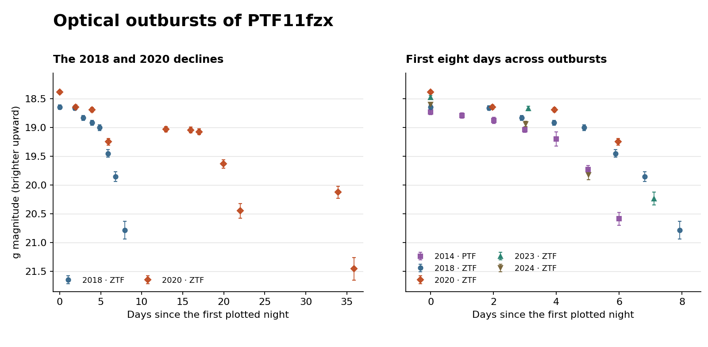

# A long 2020 outburst of PTF11fzx among shorter optical repeats

PTF11fzx faded by 2.07 magnitudes in ZTF g over **22.01 observed days** in November–December 2020. It had faded by 2.14 magnitudes in the same passband over **7.92 observed days** in November 2018. In 2020 it was still at g = 19.08 on day 17, 0.69 mag below its brightest sampled night. In 2018 it was already at g = 20.79 on day 8. Both events have preceding difference-image non-detections and detections in multiple filters. This is an outburst-by-outburst measurement of an established cataclysmic-variable candidate.

Fourteen Palomar measurements also recover a fast 2014 outburst, and the combined archive resolves **seven bright episodes on multiple UTC dates** from 2011 through 2026. Four more episodes meet the brightness cut on a single night each. The recurrence and diversity of the outbursts matter for using this source as a tracer of M31's outer nova population.

Each panel shows nightly medians and representative single-exposure uncertainties. The time origins mark the earliest plotted bright g-band night in each sequence.

## Measured light curves

The table uses nightly medians of calibrated direct photometry. The elapsed time runs between the two sample nights shown. Gaps around maximum and between visits leave the true peak, the duration of uninterrupted activity, and the physical time to decline two magnitudes uncertain. The uncertainties quoted below are representative single-exposure uncertainties, without reducing them for repeat exposures on the same night.

| Outburst | Band | Initial sampled brightness | Later sampled brightness | Elapsed days |
| --- | --- | ---: | ---: | ---: |
| October 2014 | PTF g | 18.733 | 20.587 | 5.99 |
| November 2018 | ZTF g | 18.646 ± 0.037 | 20.785 ± 0.152 | 7.92 |
| November–December 2020 | ZTF g | 18.384 ± 0.031 | 20.449 ± 0.129 | 22.01 |
| July 2023 | ZTF g | 18.475 ± 0.033 | 20.235 ± 0.113 | 7.11 |
| July 2024 | ZTF g | 18.602 ± 0.036 | 19.824 ± 0.085 | 5.03 |

The red light curves give a cross-check. Over the corresponding nights, ZTF r faded from 18.89 to 20.68 in 2018 and from 18.77 to 20.48 in 2020. The 2020 early decline reached g = 19.25 after six days. The ensuing observations from days 13 through 17 give g = 19.03–19.08. An additional detection at g = 20.12 on day 34 has a 12-day coverage gap before it. The photometry cannot distinguish uninterrupted emission, rebrightening or more than one short outburst across these gaps.

## The 2014 event and positional check

PTF measured the object on two June 2011 nights during the discovery eruption. From 2014 October 19–25 it measured a second event twice nightly in g. The source faded on every successive nightly median. All 17 PTF rows pass the archive good-epoch flag and have qaflags = 0. The median 2011 and 2014 single-exposure source positions are respectively **0.281″ and 0.165″** from the quality-selected ZTF difference-image position. In a 120″ Pan-STARRS1 DR2 field, the closest mean object with at least two detections is 0.039″ away. The next is 8.67″ away. This supports identification of the 2014 outburst with the source. It leaves room for sub-resolution blends and supplies no distance measurement.

## Bright episodes

The reproducible cut is a magnitude of 20.0 or brighter in any available band after quality filtering. Episodes split at gaps exceeding 45 days. The count is identical for thresholds of 25, 45, 70 and 90 days. ZTF alerts and direct light curves often measure the same exposure. The evidence here counts unique UTC dates and treats their agreement as a reduction cross-check. The direct and difference magnitudes measure different flux quantities.

| First bright UTC date | Last bright UTC date | Bright dates | Data |
| --- | --- | ---: | --- |
| 2011-06-18 | 2011-06-21 | 2 | PTF R |
| 2014-10-19 | 2014-10-24 | 6 | PTF g, with a seventh, fainter date October 25 |
| 2018-11-02 | 2018-11-11 | 9 | ZTF direct and difference |
| 2019-06-07 | 2019-06-07 | 1 | ZTF direct and difference |
| 2020-11-29 | 2020-12-20 | 11 | ZTF direct and difference |
| 2021-10-30 | 2021-10-30 | 1 | ZTF direct and difference |
| 2022-06-18 | 2022-06-18 | 1 | ZTF direct |
| 2022-12-09 | 2022-12-09 | 1 | ZTF direct and difference |
| 2023-07-16 | 2023-07-22 | 4 | ZTF direct and difference |
| 2024-07-20 | 2024-07-25 | 3 | ZTF direct and difference |
| 2026-05-19 | 2026-05-20 | 2 | Two positive ZTF r-band difference detections at 19.20 ± 0.19 and 19.53 ± 0.19 |

## Prior observations and interpretation

Cao et al. reported a blue continuum in June 2011, then Balmer and Fe II emission in July. They measured an Hα width near 800 km/s and a blueshift near 300 km/s and interpreted PTF11fzx as a classical nova in the outskirts of M31. Shafter, Hornoch & Zhao's living M31 catalog still lists M31N 2011-06e with a Fe II classification. Szkody et al.'s first-year ZTF work lists the counterpart among strong CV candidates, labels the 2018 event a superoutburst, flags two CRTS outbursts and records the earlier PTF observation. Its VizieR edition associates PTF 11fzx by name. VSX lists the source as a CV. The association, previous outbursts and CV interpretation predate this work. [2011 discovery spectroscopy](https://www.astronomerstelegram.org/?read=3498) · [Living M31 catalog](https://ashafter.sdsu.edu/m31_nova_table.html) · [Szkody et al.](https://arxiv.org/abs/2002.08447) · [VizieR Table 2](https://vizier.cds.unistra.fr/viz-bin/VizieR?-source=J/AJ/159/198/table2) · [AAVSO VSX](https://vsx.aavso.org/index.php?view=detail.top&oid=1542889)

The measured long and short bright phases support repeated accretion outbursts as an interpretation. The 2011 emission-line properties and the absence of a secure distance leave the host and the mechanism of the 2011 event open. The 2014, 2020, 2023 and 2024 light curves document evolution outside the first-year ZTF survey. The sampled intervals do not support a recurrence-period measurement. For the original spectrum, the Keck Observatory Archive has target-labeled LRIS exposures LR.20110702.52183.fits, LR.20110702.52670.fits and LB.20110702.52173.fits. Identifying the transient trace and using a wavelength-calibrated extraction would permit an independent check of the published line velocity. [Keck Observatory Archive](https://koa.ipac.caltech.edu/)

## Reproduction

Run `python analyze.py` from this directory to regenerate [measurements.json](measurements.json). Python 3's standard library is sufficient for the numerical result. Run `python plot.py` with matplotlib installed to rebuild the figure. The data directory preserves exposure and source identifiers, filter, epoch, brightness, uncertainty and selection flags. The queries, source credits and frozen-file SHA-256 hashes are in [sources.json](sources.json). The archive data were retrieved on 2026-11-15 UTC. The original selection was exploratory, using historical M31 nova positions to find repeated ZTF alerts. This object-level analysis supplies no estimate of the frequency of these sources in M31.
