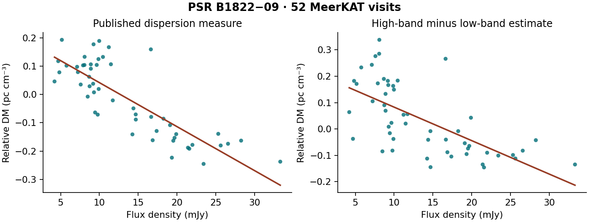

# Brightness-dependent radio delays in PSR B1822−09 and PSR J1840−0815

When PSR B1822−09 was brighter, MeerKAT measured a smaller dispersion delay. The median dispersion measure (DM) differed by **−0.2741 pc cm⁻³** between the brightest and faintest quarters of 52 visits from April 2019 to April 2023. This accounts for 63% of the observed peak-to-peak DM range. The apparent DM fell about twice as fast per unit increase in brightness in the upper half of the receiver band as in the lower half. A single varying column of cold plasma gives the same DM in both halves. At least one further contribution to the measured brightness-dependent delay is needed under the stated timing model.



B1822−09 was already known to switch between emission modes whose brightness and pulse shapes differ. Here the measured brightness dependence of its L-band dispersion estimates differs between two disjoint frequency pairs. Changes in the pulse shape sampled by the arrival-time template are a plausible source. These data allow frequency-dependent propagation and timing systematics as well. [Prior mode measurements and component morphology](https://doi.org/10.1051/0004-6361/202451384) · [Original MeerKAT data analysis](https://doi.org/10.1093/mnras/stae937)

## Reconstructing the delay from arrival times

For each visit, we read all eight channel-centre frequencies and arrival times from the published timing file. Channels numbered 0 and 3 averaged 944 and 1232 MHz in B1822−09. Channels 4 and 7 averaged 1333 and 1627 MHz. Each pair gives an effective DM from its arrival-time difference divided by 4148.808 times the difference of inverse squared frequencies in MHz, with delays in seconds. We remove a reference DM and unwrap each arrival relative to the top channel to the nearest rotation. A constant offset between subbands affects the zero point. The observable is the slope against simultaneous flux density, allowing a constant and linear time trend for each estimate.

| B1822−09 measurement | DM change per mJy (pc cm⁻³) |
| --- | ---: |
| Lower receiver pair | −0.01185 |
| Upper receiver pair | −0.02456 |
| Upper minus lower | **−0.01271** |
| 95% circular four-visit block bootstrap interval on the paired difference | −0.01584 to −0.00964 |
| Difference after adding duration, annual sine and cosine, and all eight effective channel frequencies | −0.01259 |

The slope difference is −0.01104 in the first 26 visits and −0.01369 in the last 26. Both estimates use the visit's actual channel centres. Frequency-dependent emission shape, multipath propagation and profile fitting can contribute to differences between bands. This is a test of the single-column explanation for the measured effect, with conditional uncertainties after selection. The two pairs use separate arrival times from the same exposures.

## Population and nearby control

The input release covers 597 pulsars. We retained the 476 with at least 20 unique same-epoch brightness and DM measurements. We ranked the absolute Spearman correlation after removing a separate linear time trend from each variable. We also explored DM, flux and rotation-measure combinations and the 27-target InPTA DR2 dispersion release before following up these three MeerKAT flux–DM targets. The quoted control counts cover the specified 476-object flux–DM screen. They do not cover every exploratory analysis. [MeerTime data release](https://doi.org/10.5281/zenodo.8430591) · [InPTA DR2 observations](https://doi.org/10.1017/pasa.2025.10066)

| Pulsar | Matched visits | Detrended rank correlation | Bright minus faint quartile DM (pc cm⁻³) | Later DM RMS, time-only → time and flux |
| --- | ---: | ---: | ---: | ---: |
| J1621−5039 | 23 | +0.822 | +0.5310 | 0.440 → 0.269 |
| J1840−0815 | 47 | +0.790 | +0.1551 | 0.0871 → 0.0501 |
| B1822−09 (J1825−0935) | 52 | −0.766 | −0.2741 | 0.1440 → 0.0748 |
| J1840−0809, nearby comparison | 46 | +0.042 | +0.0098 | 0.0404 → 0.0426 |

For the later RMS test, we fit the first half of each time series, hold its coefficients fixed, and apply the model with and without contemporaneous flux in the remaining visits. Selection used all visits. The comparison measures retrospective transfer across time. The RMS and the quartile contrasts have units of pc cm⁻³. We also permuted whole four-visit blocks of detrended DM ranks independently within every eligible pulsar, retaining serial order within each block. In 4,000 simulated surveys the **largest** absolute correlation reached each of the first three observed values 18, 44 and 78 times, respectively. Long-memory noise and differential instrument effects are outside this null model.

J1840−0815 has the opposite sign from B1822−09. Brightness predicts more apparent DM in both chronological halves. The two independent receiver-pair slopes, +0.171 and +0.159 pc cm⁻³ per mJy, agree within their broad uncertainties. The sightline 7.80 arcmin away, J1840−0809, had 38 matched visits within an hour of the target, with a median separation of 15.8 minutes between exposure start times. It shows little raw flux–DM relationship (rank correlation +0.020). Previous Parkes work highlighted their different pulse amplitude modulation. It did not establish the cause of the MeerKAT flux–delay relationship. J1621−5039 ranks first in the screen, but its separate channel-pair slopes are poorly constrained and do not give consistent positive evidence. [Published Parkes comparison of the neighbors](https://www.astron-soc.in/bulletin/11September/333-Keane_rrats.pdf)

## Independent Parkes check

We tested the predicted direction at Parkes with the search-mode snippets in PTD II. We dedispersed the 96 channels at the catalog DM. The middle 32 selected and aligned single pulses by brightness. The lowest and highest 32 independently measured the lag by cross-correlation of stacked pulse profiles. We required a single-pulse snippet and a fully covered ±8 ms window in every channel. We analysed each file with at least ten usable snippets, preserving all exclusions in the counts.

The three qualifying B1822−09 files contained 251, 380 and 192 usable snippets. In each, the low-minus-high lag was smaller in the bright than the faint stack, by 0.022, 0.031 and 0.054 ms. Every individual pulse-bootstrap interval includes zero. Only 25 J1840−0815 snippets qualified, all from one file. Their contrast was +1.48 ms with a 95% interval of −1.47 to +2.47 ms. These data leave the independent replication inconclusive. Parkes selected detected bright pulses, used a narrower receiver band, and tested pulse-by-pulse energy rather than flux across complete visits. The single-pulse bootstrap does not model correlation between adjacent pulses. [Original Parkes analysis](https://arxiv.org/abs/2508.14403) · [Parkes database and original data-reduction script](https://doi.org/10.25919/34am-zx04)

## Replay and provenance

On 14 November 2026 we searched the literature by the B1822−09 and J1825−0935 aliases, J1840−0815, J1621−5039, ‘dispersion measure’, pulse shape, brightness, and radio timing. We found published mode and pulse-shape measurements, the TPA release, and Parkes single-pulse statistics. We found no prior report of this specific paired-slope measurement.

Run from this directory with Python 3.11 or later, NumPy and SciPy. Matplotlib is needed only to redraw the figure. The release table, arrival times and Parkes database are credited to their original observers and authors. The derived tables preserve every screened target and every complete visit analysed for the four followed-up objects. The J1840−0809 control was chosen by sky proximity and observing cadence.

```sh
curl -fL https://zenodo.org/api/records/8430591/files/tpa_data.zip/content -o tpa_data.zip
python replay.py tpa_data.zip /tmp/flux-delay
diff screen.csv /tmp/flux-delay/screen.csv
python figure.py
```

The timing archive is 12,971,124 bytes. The replay checks its SHA-256 before reading it. The independently downloadable Parkes component is 1.60 GB compressed. Download `Pulsar_fits_database_v1.zip` from the linked CSIRO deposit, extract `Pulsar_fits_database_v1.db`, and run the following command. The script checks the database SHA-256. The archive SHA-256 is `5919e2f2e5b8e73d26e95158b9c9e2532b3f3526f29ef3f74245d2083dbfde0e`.

```sh
python parkes.py Pulsar_fits_database_v1.db /tmp/flux-delay/parkes.csv
```

[Full sample](screen.csv) · [Measurements, effective frequencies and observation IDs](visits.csv) · [Effect sizes and controls](results.csv) · [Independent Parkes observations and misses](parkes.csv)
