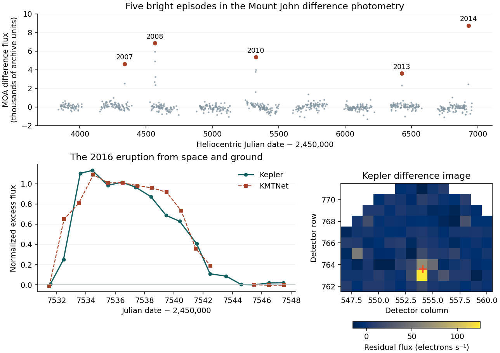

# Six eruptions at a K2 microlensing candidate

**The sightline cataloged as OGLE-2016-BLG-0935, KMT-2016-BLG-0228 and K2C9-R-0367 erupted in at least six observing seasons.** The earlier OGLE-2013-BLG-0769 alert is 0.10 arcsecond away. A single Mount John difference-photometry source shows five outbursts in 2007–2014, including the 2013 event. In 2016 the Kepler spacecraft and KMTNet recorded a sixth rise and decline at the same position. The recurrence and light curves favor an eruptive variable, plausibly a dwarf nova, as the source of the alerts. Spectroscopy would be needed to establish the subtype.

NASA’s archived K2C9 follow-up table assigns the 2016 candidate an ARTEMiS status of `pspl` (point source, point lens). Henderson presented a short-timescale fit to this alert in the Keck target-of-opportunity program. The new result is the six-episode association and its consequence for that interpretation. The work of OGLE, MOA, KMTNet, Kepler and the follow-up teams established the original detections and data products. [2013 OGLE alert](https://ogle.astrouw.edu.pl/ogle4/ews/2013/blg-0769.html) · [2016 OGLE alert](https://ogle.astrouw.edu.pl/ogle4/ews/2016/blg-0935.html) · [KMTNet entry](https://kmtnet.kasi.re.kr/~ulens/event/2016/view.php?event=KMT-2016-BLG-0228) · [Archived ARTEMiS status and alias](exofop/README.md) · [ExoFOP-K2C9 release](https://exoplanet.ipac.caltech.edu/docs/exofop_k2c9.html) · [Henderson presentation](https://nexsci.caltech.edu/conferences/2017/microlensing/k2c9_keck_too_cbhenderson_share.pdf)



## How the source was found

We compared 26,276 distinct event positions in 22 OGLE observing-season alert tables from 2002–2026. Nineteen cross-year pairs fell within 2 arcsec. The closest is two alerts for one database star with broad, overlapping 2026 fitted events. The next is the 2013/2016 pair, whose catalogued maxima differ by 1,104.572 days. Both refer to detections in the “new object” channel, and both alert pages explicitly describe an artificial baseline star of I = 20.2. The quoted alert baselines cannot establish the quiescent luminosity or the true eruption amplitudes. [Season sample and hashes](alert-seasons.csv) · [All 19 pairs](pairs.csv) · [Screen](screen.py)

The two OGLE positions lie 0.28 and 0.34 arcsec from MOA object `gb14-R-4-6-40096`. Its difference light curve spans 2006–2014. We used all 10,671 finite corrected exposures passing the error and seeing cuts, then screened all 794 nights with at least three retained exposures. Five groups of nights exceeded a six-unit threshold based on the night’s uncertainty and the full light curve’s robust scatter. Every group contains at least two such nights. Seasons and weather leave gaps, so these observations give a lower bound on the eruption count.

| Brightest sampled night (calendar date) | HJD − 2,450,000 | Peak corrected difference flux (MOA units) | Exposures on nights above 1,000 units |
|---|---:|---:|---:|
| 2007 Aug 27 | 4339.978 | 4,612 | 11 |
| 2008 Apr 10 | 4567.166 | 6,849 | 31 |
| 2010 May 10 | 5327.115 | 5,338 | 80 |
| 2013 May 15 | 6428.100 | 3,593 | 44 |
| 2014 Sep 30 | 6930.935 | 8,731 | 20 |

Raw and corrected MOA fluxes recover every episode. We selected the twelve nearest other MOA light-curve entries on the same chip, at separations starting at 11.4 arcsec. Between five and seven have usable, same-night measurements per eruption after the identical quality cuts. Their largest robust score is 1.46, compared with 12.38–26.78 at the target peaks. These scores measure contrast with each source’s own baseline. The dates above identify the brightest sampled nights. In particular, Mount John did not observe the maximum of the 2013 OGLE fit. [Exposure and control counts](moa-episodes.csv) · [Full nightly series](moa-nights.csv) · [NASA MOA archive](https://exoplanetarchive.ipac.caltech.edu/docs/MOAMission.html)

## The 2016 spacecraft test

We used target-pixel file **EPIC 200071045**, K2 Campaign 9b, channel 52. With the source position fixed from OGLE, Kepler’s predicted median detector position during the eruption is (554.09, 763.63). The strongest median positive residual within eight pixels is at **(554, 763)**, 0.64 pixel away. Local Kepler pixels are about four arcseconds wide. The localization supports the ground association while allowing an unresolved neighbor.

The main reduction uses 1,394 quality-zero cadences and 2,395 comparison pixels more than eight pixels from the source. It fits the target-pixel coefficients outside the eruption and reserves the last 4.4 days for a separate baseline check. Across reductions with 3–150 principal components, the event gives +203 to +227 weighted electrons per second. The 40-component reduction gives +203, with a held-out cadence RMS of 37. The weights describe the same fixed aperture throughout. They do not correct to a total source flux.

KMTNet’s Australian, Chilean and South African stations observed overlapping fields in I band. Each field and station has its own flux zero point. We normalize each series independently and require at least three exposures per contributing field per day. Kepler and the combined ground data give **Spearman ρ = 0.907 across 13 paired daily measurements**. Both record the rise, the broad bright state and the decline. The correlation describes the shape of this selected eruption, with serially correlated samples.  [Daily measurements](daily.csv) · [Spacecraft pixel measurements](k2-pixels.csv) · [Kepler campaign release notes](https://keplergo.github.io/KeplerScienceWebsite/k2-data-release-notes.html) · [Astrometric grids from Poleski et al.](https://github.com/CPM-project/MCPM)

An independent reduction fits each pixel using only quadratic or cubic functions of the measured pointing. Both recover the same brightest pixel, with event fluxes of +199 and +203 electrons per second. Their median residuals in the held-out baseline are +45 and +10. Of 141 offset apertures, two and five, respectively, exceed the target’s variability-normalized contrast. At South Africa, pairing ground observations within 0.04 days of a Kepler cadence gives correlations of 0.874 and 0.846 for the two fields over 12 matched days. Both fields share a telescope. Simple nearest-pointing subtraction and a linear pointing fit fail the held-out baseline test. [Alternative reductions and controls](detector-audit.json)

## Interpretation and priority

Six outbursts from one sightline over nine years give a common intrinsic explanation for both lensing alerts. These data cannot distinguish every physically possible blend, rule out an unrelated lens acting during one episode, measure an orbital period, or establish a dwarf-nova spectrum. Several nearby Gaia sources make that distinction important. The classification concerns this individual candidate. It does not change the status of a confirmed exoplanet.

We checked the source names and position against the OGLE dwarf-nova catalogue (nearest of 1,059 bulge entries, 98.6 arcsec), SIMBAD and the OGLE variable-star service (no entries within 20 arcsec), and the K2C9 follow-up release. McDonald et al. searched this campaign for short-duration events. Their rejected variable near the date of this eruption is at a different position, approximately 0.54 degrees away. We found no prior identification linking these six episodes. Catalog coverage and name searches cannot establish first publication. [Mróz et al. dwarf-nova catalogue](https://ogle.astrouw.edu.pl/cont/4_main/var/ogleiv/thousand_DN/) · [McDonald et al. K2C9 search](https://arxiv.org/abs/2107.02746)

## Reproduce

Use Python 3 with NumPy, SciPy, Astropy, lxml and Matplotlib. Run these commands from this directory. The main replay downloads the target-pixel file, astrometric solution, ground light curves and controls and verifies each SHA-256. Its numerical outputs are included here. The alert screen separately reports any upstream edits to live season pages.

```sh
python screen.py --cache alerts-cache --out pairs-replayed.csv
OPENBLAS_NUM_THREADS=2 python replay.py --cache cache --out replay-output
python detector_audit.py --cache cache
python figure.py
```

Observations are credited to the OGLE collaboration, the MOA collaboration at the University of Canterbury Mount John Observatory, KMTNet at SAAO, CTIO and SSO, and NASA’s Kepler/K2 mission and MAST. The K2 source coordinates use MCPM’s per-cadence astrometric grids. The OGLE alert positions and public alert metadata drive target selection. The independent numerical photometry used here comes from MOA, KMTNet and Kepler. [Download manifest and hashes](inputs.csv) · [Analysis](replay.py) · [Numerical summary](summary.json)
