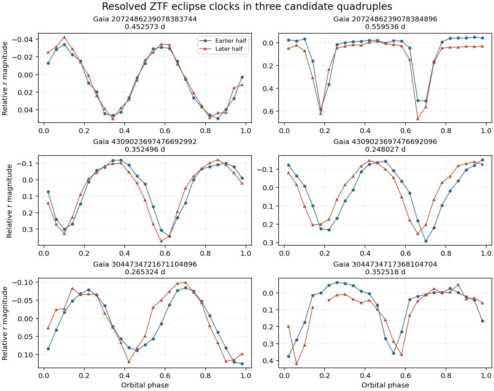

# Three resolved, doubly eclipsing candidate quadruples

Six previously catalogued eclipsing variables form three resolved pairs. For each pair, Gaia measures consistent distances and motions, while ZTF photometry at the two positions independently recovers different eclipse periods. Their projected separations range from 4,526 to 8,001 au. The proposed result is the identification of these specific wide pairs as candidate 2+2 stellar systems. The observations do not measure any of the three outer orbits.

| Primary variable | Gaia DR3 primary / secondary | Inner periods (days, Gaia) | Separation | Projected distance | Worst held-out R², own / best wrong clock |
|---|---|---|---:|---:|---:|
| ZTF J200018.70+390309.8 | 2072486239078383744 / 2072486239078384896 | 0.452573 / 0.559532 | 7.813″ | 8,001 au | 0.667 / 0.004 |
| ZTF J191747.13+094243.7 | 4309023697476692992 / 4309023697476692096 | 0.352496 / 0.248024 | 7.082″ | 6,129 au | 0.594 / −0.046 |
| ASASSN-V J070419.77−133619.1 | 3044734721671104896 / 3044734717368104704 | 0.265322 / 0.352521 | 5.391″ | 4,526 au | 0.720 / −0.084 |



## Selection and independent measurements

1. Join both 64-bit source IDs in all 1,730,237 rows of the Shariat et al. cleaned wide-binary catalog to the 2,184,477 unique source IDs in the Gaia DR3 eclipsing binary table. Exactly 71 pairs match twice. Each appears in [the complete join](gaia_join.csv).
2. For spatially resolved ZTF validation, retain every pair with primary declination ≥−27°, separation ≥5″ and catalog chance-alignment density ratio ≤0.01. There are 15. Query the IRSA public ZTF light-curve API in two disjoint 1.512″ cones for each pair, requesting series with at least 20 observations and excluding the bad-weather bit. [All 44,228 returned epochs](ztf_epochs.csv.gz) carry source ID, object ID, HJD, magnitude, uncertainty, quality flag, filter and position.
3. For each source and filter take the most sampled clean object ID. Retain catflags=0, 0<magerr<0.1, drop identical times and reject extreme magnitude outliers. Split on the midpoint in elapsed time. Require at least 40 visits per half over a total span greater than or equal to a year. Fit a four-harmonic Fourier model in the earlier half, searching ±2 cycles over the full time span around the Gaia clock. Freeze the frequency and coefficients. Score later magnitudes against the earlier mean, independently repeating the procedure around the other star's Gaia frequency. Thus a source blended with its neighbor has an opportunity to prefer the neighbor's clock. Bands share an instrument and the same underlying stellar variability.
4. For a transparent exploratory reporting rule, require own-clock test R²≥0.5 and other-clock R²<0.1 in both filters at both positions. Four of 15 pass. Three are listed above. The fourth, Gaia 1940568861172585088 / 1940569067331012736, is a previously published resolved quadruple in Fezenko et al. Other pairs, including other known systems, have insufficient coverage or fail the rule. Each status and fit is in [validation.json](validation.json). Thresholds summarize the inspected cohort and supply neither a completeness estimate nor a false-alarm probability.

The twelve median ZTF centroids for the three systems lie within 0.10″ of their respective Gaia coordinates. Both filters show modulation centered at the expected positions. For J200018, the closer-to-contact primary has a peak-to-peak fitted red modulation of 0.08 mag and the secondary has 0.53 mag. VSX classifies them as EW and EA respectively. The catalogued alignment-density ratios of the three pairs are 0.00143, 0.00070 and 0.00127 in the order above. These ratios come from the original whole-catalog calibration. They cannot be multiplied across systems or assigned as exact individual posterior probabilities.

The central relative tangential speeds, using the mean component parallax, are 0.52, 0.23 and 0.74 km/s. Combining each speed with the projected separation gives minimum binding masses of 1.20, 0.18 and 1.39 solar masses at the point estimates. These use only sky-plane motion. Missing radial differences, line-of-sight separation, photocenter motion and astrometric uncertainties limit their interpretation. A physical association is plausible for each system. Comparable center-of-mass radial velocities from both inner binaries would provide an independent test.

## What was known

Gaia DR3 and VSX already list all six variables. Shariat et al. provide each wide pair. The interpretation combines those records and checks which clock belongs to which star in a second survey. One primary (Gaia 4309023697476692992) also has a Gaia NSS eclipsing-binary model at 0.35249639 d. The architecture search found no match for the three candidates in the following checks.

- Fezenko et al. (2022) published eight resolved 2+2s. The article's exact IDs recover known objects elsewhere in our 15-pair cohort. [Paper](https://doi.org/10.1093/mnras/stac309)
- We queried both components in Hartman et al.’s SUPERWIDE TESS/K2 tables (530 coordinate entries), the VizieR Multiple Star Catalogue, Vaessen & van Roestel's ZTF candidates, and three Kostov TESS catalogs (including the 2026 false-positive list). The smallest separation of either candidate component from any of those catalog coordinates is 442″ for J200018, 1,470″ for J191747 and 3,033″ for J070419. The check includes all returned component and target coordinates and does not de-duplicate catalog rows. [Distances for all 15 pairs](catalog_distances.json)
- The 2026 Gaia RVS quadruple survey selected binaries using RVS information. None of the three pairs has a Gaia DR3 velocity for both components. The Gaia table contains one velocity for the six sources, and no robust RV amplitude for any of them. The [six-row RVS receipt](identity/rvs.csv) excludes these as two-component RVS identifications. The primary names, coordinates or paired periods also differ from the eight systems of Zasche et al. (2024), three changing-inclination systems of Zasche et al. (2025), six in arXiv:2608.22935, and the ten northern systems in MNRAS 547, stag417 (2026). [RVS survey](https://doi.org/10.1093/mnras/stag730) · [Hartman et al.](https://vizier.cds.unistra.fr/viz-bin/VizieR?-source=J/ApJ/934/72) · [Zasche et al.](https://doi.org/10.1051/0004-6361/202450400) · [Northern systems](https://doi.org/10.1093/mnras/stag417)
- [Position/identity receipts](identity) include SIMBAD aliases, VizieR VSX entries within 40″ and Washington Double Star Catalogue cones within 60″. None of the three WDS cones returned a row. SIMBAD references for the six stars document variability catalogs, anomaly scores, contact-binary properties and Gaia products. Exact Gaia-ID and variable-alias literature searches produced no object-specific earlier 2+2 identification. The search has incomplete coverage of free-text notes, unindexed publications and the full 781-system Kolář et al. (2025) compilation. Absolute literature priority remains open. [Kolář et al.](https://doi.org/10.1093/mnras/staf364)

## Reproduction

Run from this directory with Python 3, NumPy and pandas. SciPy is needed for the literature check and matplotlib for the figure. The first command replays every ZTF result from the frozen photometry, including insufficient-coverage cases.

```sh
python validate.py gaia_join.csv ztf_epochs.csv.gz replay.json
cmp replay.json validation.json
python plot_clocks.py
python check_catalogs.py ztf_cohort.csv literature-replay.json
```

For the 71-pair discovery join, download the catalog versioned at [Zenodo](https://doi.org/10.5281/zenodo.17957444) and use an untruncated TAP result from a Gaia DR3 mirror. Different archive row order and CSV rendering can change its byte hash. The replay verifies the exact number of unique Gaia EB source IDs.

```sh
curl -fL 'https://zenodo.org/records/17957444/files/wide_binaries_5kpc_clean.fits.gz?download=1' -o wide.fits.gz
curl -fLG 'https://gaia.ari.uni-heidelberg.de/tap/sync' --data-urlencode REQUEST=doQuery --data-urlencode LANG=ADQL --data-urlencode FORMAT=csv --data-urlencode MAXREC=3000000 --data-urlencode 'QUERY=SELECT source_id,frequency,global_ranking FROM gaiadr3.vari_eclipsing_binary' -o eb.csv
python census.py wide.fits.gz eb.csv rejoin.csv
cmp rejoin.csv gaia_join.csv
python fetch_ztf.py ztf_cohort.csv fresh-ztf
python build_receipts.py ztf_cohort.csv fresh-ztf fresh.csv.gz fresh-inputs.json
```

The original wide-binary FITS SHA-256 is `850a0c07ab5af4143181f08f1f8868a2cedfea89d6d4740220ebff957b9a5e40`. The Gaia EB projection SHA-256 is `e777c0aeecc67460bbd9ddf44a38a6e8b545bd83044f3447edc10a0135c7ab5e`. The per-source IRSA byte hashes and counts are in [ztf_inputs.json](ztf_inputs.json). Subsequent ZTF releases may extend series and alter source IDs, so the local validation uses the frozen observations. The join uses the published Gaia DR3 eclipsing-binary and spatially resolved wide-binary catalogs. ZTF observations are from the Zwicky Transient Facility at Palomar Observatory, served by Caltech/IPAC IRSA. [Gaia EB catalog](https://doi.org/10.1051/0004-6361/202245330) · [Wide-binary calibration](https://arxiv.org/abs/2101.05282) · [ZTF light curves](https://irsa.ipac.caltech.edu/docs/program_interface/ztf_lightcurve_api.html)
