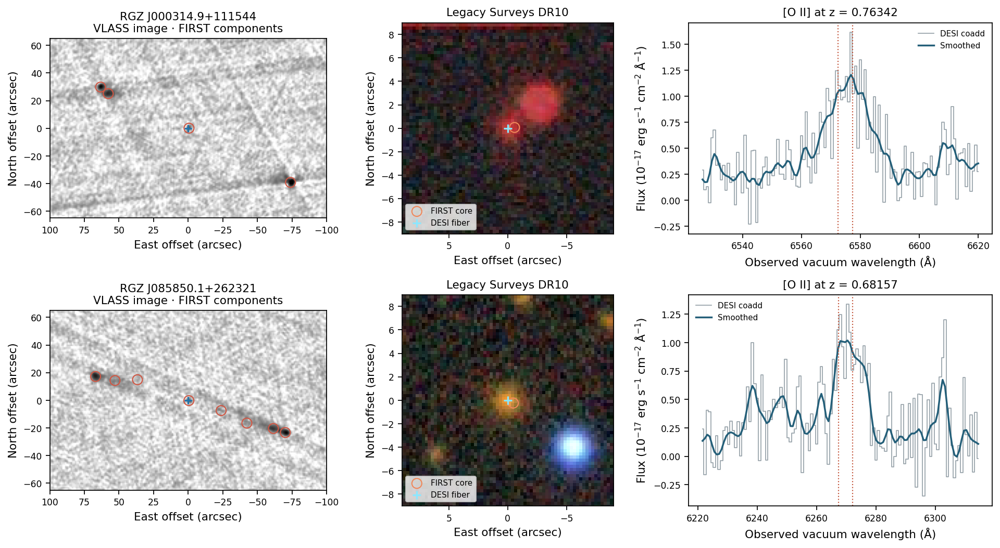

# Two giant-radio-galaxy candidates in Radio Galaxy Zoo

Two previously cataloged radio systems support megaparsec-scale jets when resolved FIRST cores and outer hotspots are associated with DESI spectroscopic host galaxies. The proposed finding is a giant classification for each system. The radio sources, the Radio Galaxy Zoo associations, and the underlying spectra are public prior observations.

| RGZ system | DESI DR1 target | Host redshift | Core–fiber separation | FIRST outer-peak separation | Projected peak separation | VLASS repeat |
|---|---|---:|---:|---:|---:|---:|
| J000314.9+111544 | 39628055064347506 | 0.763424 ± 0.000045 | 0.586″ | 153.57″ | **1.134 Mpc** | 1.140 Mpc |
| J085850.1+262321 | 39628405439727850 | 0.681566 ± 0.000090 | 0.541″ | 142.93″ | **1.010 Mpc** | 1.011 Mpc |

In the radio panels the rings mark FIRST component positions on independently acquired 3 GHz VLASS images. The optical panels zoom to the nucleus. The blue cross marks the DESI fiber. The red vertical dotted lines on the spectra show the vacuum wavelengths of the [O II] doublet at the catalog redshift. The displayed spectra have flux calibration from DESI, with smoothing only on the overplotted blue trace.

## Why the identifications hold up

- **J000314.9+111544.** Two FIRST lobe complexes straddle the DESI galaxy at an opening angle of 177.3°. The 1.4 GHz central component peaks at 2.67 mJy/beam (local FIRST rms 0.148 mJy/beam). The Legacy Surveys DR10 extended optical source is 0.094″ from the DESI fiber, whereas a brighter neighboring point source is 3.46″ away. That neighbor helps explain why the infrared/consensus coordinates alone are ambiguous. Both terminal hotspots recur at 3 GHz at more than 40 times the robust image noise. The coarser NVSS catalog independently separates both lobes. Radio Galaxy Zoo DR1 has a blank photometric redshift for this host.
- **J085850.1+262321.** A chain of eight FIRST components includes a 2.33 mJy/beam core, two outer peaks and intervening knots. The galaxy lies between the outer peaks at an angle of 176.0°. The DESI fiber lies 0.080″ from an extended optical galaxy. Both terminal peaks recur in VLASS at more than 27 times the robust image noise. RGZ already gives this host a photometric redshift of 0.72304. Its published data already implied a large projected size. The RGZ group comprises four components with an extent of 135.5″. FIRST catalogs eight Gaussian components in the field, including outer peaks 142.93″ apart. RGZ grouped emission regions from a selected cutout, whereas this baseline uses named Gaussian peaks also present in VLASS. The exact reason for the 7.43″ difference is unresolved. Both extents exceed the conventional 0.7 Mpc giant threshold at the spectroscopic distance.
- DESI classifies both spectra as galaxies with zero redshift warnings. The Redrock differences in chi-square between template solutions are 277.5 and 192.7. The calibrated R-band fluxes show [O II] at the expected observed wavelength in both spectra. An inverse-variance-weighted ±4.5 Å window exceeds the mean of local 10–28 Å sidebands by 9.3 and 5.1 formal standard errors. These are forced measurements on the **same photons** used by the catalog fitter. The errors use diagonal inverse variances and exclude calibration and continuum-model systematics.
- The linear scale uses a flat cosmology with H₀ = 70 km s⁻¹ Mpc⁻¹ and Ωₘ = 0.3. Each length is the projected angular-diameter distance between identified brightness peaks. Jet inclination, lifetimes, gas properties and the outermost diffuse radio emission remain unconstrained.

## Selection and controls

From the FIRST portion of Wong et al.'s RGZ DR1 (Zenodo 14195049), join host and classification tables by catalog ID. Retain largest angular extent ≥100″, at least two radio components, classification consensus ≥0.65 and a reported positive host RA. Sort by decreasing extent and increasing catalog ID, then collapse duplicate host positions. This produced 552 distinct coordinates. RGZ's extent is a bounding-box quantity. The reported lengths above instead use source components on opposite sides of each galaxy.

Query DESI DR1 at NOIRLab using the frozen requests. Accept a spectrum within 3″, z > 0, zero redshift warnings and Δχ² > 25. There are 113 matches. Applying the same rule 30″ north of every selected host gives 2 matches. That single shifted catalog gauges accidental spectroscopic matches in these fields. It does not estimate the probability of false radio morphology. Of the 53 objects with nominal RGZ extent above 0.7 Mpc, 47 have a listed giant or giant candidate within 180″. The wide catalog veto conservatively removes potential rediscoveries. Six survive. The two with the largest catalog-implied sizes were inspected at image level. The other four appear in the full screen with their measured separation to the nearest literature entry.

All ten catalog exports are identified by stable provider URLs in [provenance.csv](provenance.csv). The screen covers Gordon et al.'s VLASS discovery table, Proctor's NVSS candidates, SAGAN, Oei et al., Mostert et al., giant double-double systems, Andernach et al.'s >3 Mpc catalog, the TGSS quasar catalog, Lao et al.'s 5,595 TGSS candidates, and all 2,333 entries in Manik et al.'s November 2026 LoTSS DR3 Table 2. Several CDS exports contain multiple related tables and overlapping entries. The nearest literature coordinates are 2,119″ (J0003) and 2,553″ (J0858) away. SIMBAD returned no entry within 10.8″ of either queried field center. The global literature, unpublished compilations and alternate host associations remain possible sources of prior identifications. Absolute discovery priority is open.

## Reproduction

Run `python reproduce.py`, `python check_lines.py` and `python plot_fields.py` from this directory using Python, NumPy, SciPy, pandas and Matplotlib. Frozen target snapshots are in [inputs](inputs), including the original VLASS FITS images, optical JPEGs, FIRST and NVSS responses, and two DESI spectral windows. The first command rebuilds [screen.csv](screen.csv) and [measurements.json](measurements.json). The latter includes both exact peak identifications, coordinates in VLASS pixels and local peak-to-MAD ratios. The [provenance manifest](provenance.csv) identifies the public inputs with source URLs, byte counts and SHA-256 digests. The DESI coadds are at the two URLs listed for the spectrum extracts. [fetch_spectra.py](fetch_spectra.py) extracts the full target spectra using FITS byte ranges. Its output is saved in the current directory.

The RGZ sky region, angular-size cut and availability of DESI spectra select a small, incomplete part of the sky. These counts measure the stated search only.
