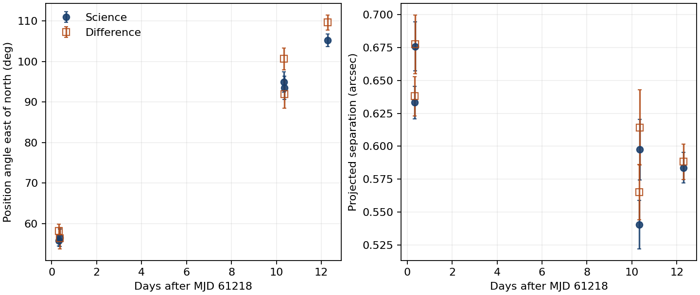
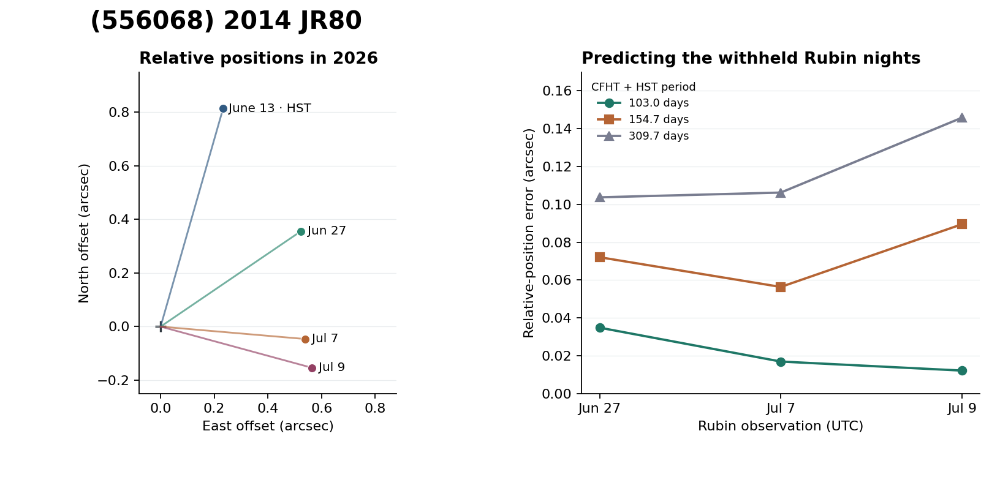

# Relative motion of (556068) 2014 JR80 in the 2026 Rubin alert stream

Five ALeRCE-selected Rubin exposures reveal the changing orientation of the trans-Neptunian binary 2014 JR80. Combined with older astrometry, they favor a **103.03-day mutual orbit and a total mass of 8.9 × 10¹⁹ kg**. The frozen preliminary 103-day model predicted three independent DECam positions within 0.070 arcsec. The final fit gives a maximum residual of 0.0722 arcsec on those images. The *i*-band axis turns **49.46° in 11.963 days**, from June 27 to July 9 UTC. Hubble images an additional 13.7 days earlier give an independent orientation. The binary discovery belongs to Proudfoot et al.; their September 2026 CBET reported its separation and orientation with HST and six earlier CFHT/Blanco epochs spanning separations of 0.5–1.0″. The new measurement uses Rubin’s dated relative positions to constrain the mutual motion. [Discovery circular](http://www.cbat.eps.harvard.edu/iau/cbet/005700/CBET005739.txt) · [ALeRCE public alerts](https://science.alerce.online/alerce-lsst/)

| UTC date in 2026 | Instrument and band | Independent exposures | Separation | Position angle east of north, modulo 180° |
| --- | --- | ---: | ---: | ---: |
| June 13 | HST/WFC3 F350LP | 4 | 0.8461″ | 15.98° |
| June 27 | Rubin LSSTCam *i*, *z* | 2 | 0.633″, 0.676″ | 55.77°, 56.50° |
| July 7 | Rubin LSSTCam *i*, *z* | 2 | 0.541″, 0.597″ | 94.91°, 93.55° |
| July 9 | Rubin LSSTCam *i* | 1 | 0.584″ | 105.23° |

Rubin exposures use the ALeRCE identifiers and ephemerides; the matching cutouts were recovered from Fink’s copy of the same Rubin packets. Three observing nights and four HST exposures within one visit supply four 2026 epochs. Because the components are similar in brightness, every geometric or orbital inference must allow a 180° component swap.

## What the orbital fit adds

A joint fit to CFHT, HST and Rubin relative astrometry favors a **103.03-day mutual period**, eccentricity **0.29**, relative semimajor axis **22,900 km** and total mass **8.9 × 10¹⁹ kg**. The final fit combines 13 observing nights, weighting nights instead of counting every exposure as an independent epoch. The 103-day solution has χ² = 2.26 for 26 coordinates and seven fitted orbital parameters. The next period family, 154.62 days, has χ² = 17.11. Restoring one CFHT night excluded for disagreement with nearby measurements raises those values to 54.46 and 72.27 for 21 degrees of freedom. The 103-day family still ranks first in this two-family refit. Larger allowances for systematic astrometric error narrow the difference to 4.95. Formal within-family errors do not capture that ambiguity. Johnston's orbital period of about 150 days is explicitly marked as an estimate; its entry gives no measured mass or eccentricity. We did not locate an earlier publication of the 103-day orbit in the [documented literature searches](novelty.md). [Orbit solutions, data and code](orbit/README.md) · [Johnston's Archive](https://johnstonsarchive.net/astro/astmoons/am-556068.html)

**What do the new Rubin photons contribute?** With all Rubin data omitted, the fitted 103-day family predicts the three Rubin relative positions to **0.035″, 0.017″ and 0.012″**, allowing either component to be the primary. The 155-day family misses by 0.072″, 0.056″ and 0.090″. The Rubin measurements improve the separation between the two fits and directly resolve motion taking place in 2026. Both historical CFHT seasons matter to distinguishing the cycle counts. [Archival measurements](archive/README.md) · [Period and error-floor sensitivity](orbit/README.md)

**Independent archival tests.** Three Blanco/DECam images resolve the binary on dates spanning nearly four years, all withheld from the fits. The image analyst measured them without the numerical forecasts. The frozen preliminary 103-day model predicted all three measured axes to within 4.2° and all three relative positions to within 0.070″. The frozen preliminary 155-day model missed each relative position by more than 0.58″. The last column gives the retrospective errors of the final 103.026-day fit, which also excludes all three DECam images.

| DECam epoch | Measured separation and axis | Frozen 103-day prediction | Frozen 103-day error | Frozen 155-day error | Final 103-day error |
| --- | --- | --- | ---: | ---: | ---: |
| 2019 June 2 | 0.654″ at 30.92° | 0.667″ at 29.05° | 0.026″ | 0.622″ | 0.02264″ |
| 2022 August 6 | 0.660″ at 147.85° | 0.592″ at 146.56° | 0.069″ | 0.587″ | 0.07216″ |
| 2023 May 19 | 0.660″ at 42.09° | 0.618″ at 46.19° | 0.062″ | 1.241″ | 0.06301″ |

A separate image-moment estimator gives 30.7°, 148.2° and 39.0°, respectively. Three of 13 examined DECam products passed the frozen image-quality criteria. The component brightness ratio reaches its fit limit in the 2022 frame, making the orientation the stronger measurement there. These dates can overlap the six unidentified ground epochs in CBET 5739. They are independent tests of the present orbit fit. The archival census records the other attempted images, including frames that missed the target or failed the image-quality test. [Frozen forecast residuals](orbit/blind_residuals.csv) · [Final fit on the same images](orbit/final_decam_residuals.csv) · [Image measurements and quality controls](archive/README.md)

The two leading families make different predictions at the next opposition. On **2027 August 6 at 05:00 UTC**, the 103-day family predicts **0.751″ at 31.5°** and the 155-day family predicts **1.369″ at 148.5°**, with position angles taken modulo 180°. The target is predicted to be 78° above the Rubin horizon. A resolved observation could discriminate between them. [Prediction table](orbit/forecast.csv)

**Physical constraint.** For a bound pair, the earliest Rubin *i* measurement with the June HST position sets a system-mass floor of **1.71 × 10¹⁹ kg**, conditional on relative-position error envelopes of 0.02″ for HST and 0.06″ for Rubin. Enlarging both envelopes to 0.10″ gives 8.33 × 10¹⁸ kg. This finite-time estimate permits either component assignment and unconstrained depths in the tangent-plane projection. It includes distance and light-time sensitivity. The error radii represent explicit assumptions without a probability calibration. [Derivation, code and every epoch pair](dynamics/README.md)

**What limits the image-only interpretation.** The telescope rotator moved about 56° during the interval, nearly tracking the change in celestial position angle. A fixed distortion in detector coordinates is a serious alternative using Rubin alone. Rebuilding the PSF separately for each visit from 50 stationary reference sources on the same detectors gives 49.15° of rotation. Omitting each reference star in turn moves the fitted angle by at most 0.63°. One comparison star resembles the pair on July 7; none of the 19 reference stars on the two endpoint visits reproduces its morphology. The alternate fitting radius, broadened PSF and difference images also give comparable turns. The science and difference products share the same photons. The likelihood improvements for a two-source fit also reach large values in some other moving objects. The strongest test uses independent telescope data and same-detector reference stars. [Rubin measurements and controls](METHODS.md) · [Hubble remeasurement](hst/README.md)

**Reproduction.** Start with the frozen ALeRCE queries, source and peer tables, per-exposure cutout hashes and the commands in the methods. The HST measurement and mass constraint each have an offline reconstruction. Archive identifiers, timestamps, pixel conventions, selection and controls accompany the respective products. [Selection and reproduction](METHODS.md) · [Other questions tested in the same database](../rubin-alerce-2026/README.md)
