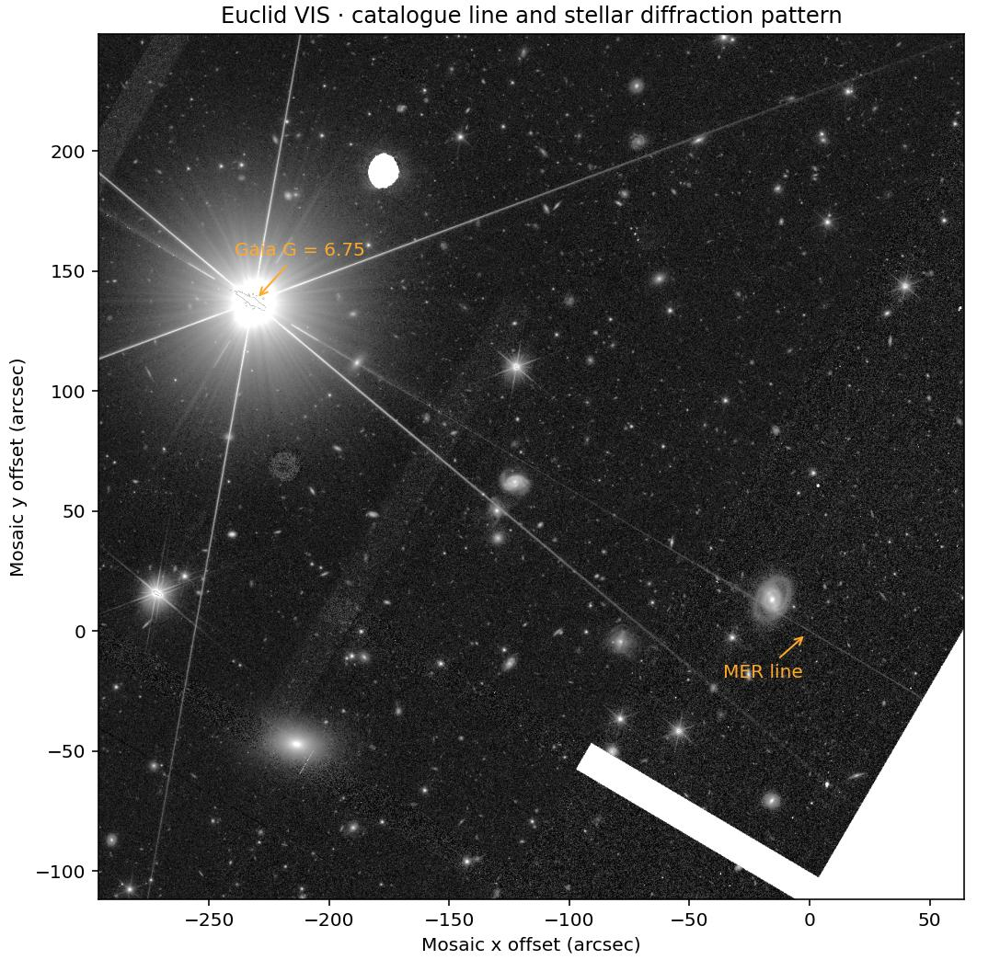
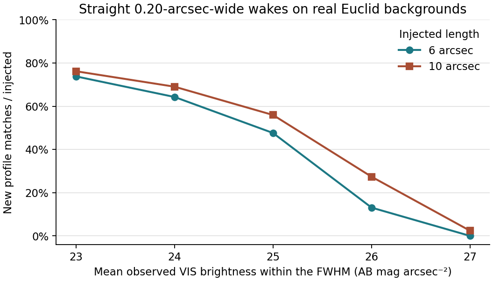

# A search for runaway supermassive black hole wakes

**No new runaway-SMBH wake reached the discovery bar.** We searched calibrated Euclid Q1 VIS pixels at every extragalactic tile centre and separately queried the complete Q1 MER catalogue. The known RBH-1 line was recovered in two original HST filters. The strict endpoint test missed its host in both. The result constrains the response of a specified line detector on real backgrounds. It does not give a population upper limit.

## What was actually searched

| Selection | Denominator | Result |
|---|---:|---|
| Blind Euclid Q1 VIS | 344 extragalactic tile-centre cutouts, 272 with usable pixels | 0.056445 deg² of usable VIS/rms pixels. A conservative interior supporting the full stripe at every angle covers 0.018989 deg². The nominal deep fields cover 63.1 deg². |
| Euclid catalogue | 29,953,430 entries in all 114 IRSA HATS partitions, including 22,349,951 VIS detections | 5,134 entries pass the frozen shape proxy. Of these, 5,120 lie in the deep fields and 14 in the Galactic cloud LDN1641. Segmented fragments and diffuse uncatalogued wakes can escape this selection. |
| HST XDF / JWST JADES GOODS-S | 5.24288 arcmin² in HST F606W and F814W, with 0.26205 arcmin² of blind JWST F150W imaging inside the HST area | One HST pair passed the continuity test at its separately fitted positions. The ridge failed on a fixed sky axis in two further HST bands and targeted JWST imaging. |
| RBH-1, original ACS control | Two targeted HST cutouts | Blind line fitting recovered 5.6″ and 9.2″ segments with respective aspect ratios of 26 and 33. Their axes lay within 0.45° of the published direction. Targeted observations contribute zero blind search area. |

The 352 directories in the Q1 MER inventory include 148 southern, 124 northern and 72 Fornax deep-field tiles, plus eight Orion cloud tiles. We froze four 102.4″ centre cutouts and 340 further 51.2″ cutouts before the search. Their sky areas do not overlap. Science and RMS masks remove uncovered pixels; the advertised area of a mosaic is a poor denominator for these data. [Prospective selection](selection.md) · [Tile list](euclid/q1_tiles.csv) · [IRSA mosaic identities and publisher checksums](euclid/q1_products.csv) · [700 cutout receipts](euclid/q1_cutouts.csv)

## What survived the tests

The blind matched-filter search found **8,264** VIS segments with a measured aspect ratio above 20. The exploratory extended-profile test retained **651**, compared with **450** in the sign-inverted images. In each sign, roughly 43% of those segments had a catalogue galaxy proxy within 1″ of a fitted end or in the widened corridor up to 5″ past an end (281/651 and 191/450). A 90° rotation of the host geometry gave 124/651 and 86/450. A chance endpoint association is common. Inverted images retain real structure and its sidelobes, so these counts do not estimate a discovery false-alarm probability.

A separate fixed-axis VIS photometry test left **68 positive segments** for visual inspection in their full cutouts and in NISP Y/J/H, with 19 on the inverted images. The 68 are individual segments, some on the same structure. Eighteen trace stellar diffraction spikes. Other rows include long crossing streaks, blends, disk-like light and contaminated backgrounds. **Thirty-two remained weak or confused.** The data do not establish a physical origin for them. Four weak priorities gave no ≥3 local-contrast measurement in 16 usable individual VIS exposures. Single-exposure sensitivity is lower than coadd sensitivity. The [32 unresolved segments and the specific checks needed to decide each](detector/unresolved_followup.md) are tabulated separately. [Per-segment review](detector/review_rows.csv) · [VIS and NISP photometry](euclid/filament_photometry.csv) · [Profile shapes](detector/tables/shapes.csv)

One catalogue feature appeared to meet a bright, resolved galaxy. A **360″ VIS image** traces the line from a G = 6.75 Gaia star, through the galaxy and beyond it. The star is 269.0″ away. The line recurs in two usable native VIS exposures. Its persistence reinforced an instrumental false positive. A second, 18″ Euclid segment led back to a G = 10.52 star about 95″ away and recurred in three individual exposures. A separate detached streak, MER object 2675970977684150669, was overwhelmingly bright in one exposure and absent at its fixed sky position in the other usable exposure (+1664 and −1.09 local scatter units). Those data distinguish it from a persistent wake; they do not identify the moving or instrumental source. [Wide-field measurement](catalog/spike_context.json) · [Individual-exposure receipts](catalog/dithers/)

Among the 5,120 catalogue shape selections in the deep fields, **4,490** pointed within 1″ of a Gaia G < 16 star at a separation of 3–120″. Perpendicular axes gave **92** matches to the same stars. The cutout measurements tested both position-angle conventions in the Q1 documentation. The north-through-east axis gave greater VIS contrast in 177 of 179 clean entries measurable in both orientations. The 198 quality-flag-zero deep-field entries all received paired VIS/H inspection. None shows a convincing line terminating at a distinct host. A star alignment is a contamination diagnostic, not individual proof. [Catalogue selection and receipts](catalog/README.md) · [Clean-sample visual audit](catalog/clean_review/README.md)

DESI DR1 yielded just **one distinct spectrum**, z = 0.531167, in two overlapping cones of the 68 reviewed Euclid segments. No Euclid line has a spectroscopic sequence tying it to its proposed host. Catalogue photo-z intervals overlap for some components and are disjoint for others. The HST western feature has one on-axis MUSE source at z = 4.049 and a tentative one at z = 2.516 beyond one end. Catalogue radio checks in the applicable LoTSS DR2, VLASS and RACS areas found no radio component within 20″ of a coherent Euclid segment. Radio-faint jets remain possible. [DESI products and coverage](desi/README.md) · [Host redshift geometry](euclid/host_redshift_geometry.csv) · [Radio query receipts](euclid/radio_field_queries.json) · [Archival checks](archive/README.md)

## How much could the detector recover?

We injected 840 straight synthetic wakes into 27 preselected Euclid cutouts, including the masks and real backgrounds. Each model has an observed transverse Gaussian FWHM of 0.20″. The table counts new matches passing the morphology and continuity cuts out of 84 placements in each bin. Positions and angles recur across surface-brightness levels. These trials measure a single-band line response; they do not calibrate the probability of a true wake passing the galaxy-association, dither, redshift or morphology interpretation checks.

| Mean VIS surface brightness within FWHM (AB mag arcsec⁻²) | 6″ long | 10″ long |
|---:|---:|---:|
| 23 | 62/84 | 64/84 |
| 24 | 54/84 | 58/84 |
| 25 | 40/84 | 47/84 |
| 26 | 11/84 | 23/84 |
| 27 | 0/84 | 2/84 |

In RBH-1 the recovered endpoint missed the known host centroid by **2.53″ in F606W and 1.14″ in F814W**. F606W passed the continuity test; in F814W one bright part supplied 51.6% of the positive flux, exceeding the 40% rule. These outcomes motivated the separately reported outward-axis association. The original 2023 discovery, JWST shock interpretation and competing edge-on-galaxy interpretation motivate using this object as a positive control for **imaging morphology**. [2023 discovery](https://arxiv.org/abs/2302.04888) · [JWST shock analysis](https://arxiv.org/abs/2512.04166) · [JWST edge-on interpretation](https://arxiv.org/abs/2602.10682) · [Control measurements](archive/tables/rbh1_measured.json) · [Injection results by sampling group](detector/tables/recovery_by_sample.csv)

## Independent compact-data referee replay

Run `python referee_replay.py` from the repository checkout (Python standard library only). This independently recomputes the pixel and area denominators, both signed detection counts, all 840 injection outcomes, all 114 catalogue partition totals and 5,134 individual shape selections, the Gaia alignment control, the 68 visual-review classifications, the HST/JWST paired outcomes and the RBH-1 host misses. It checks the frozen SHA-256 of the tile list and the complete **700-row cutout receipt**, and verifies that all **688 VIS/RMS hashes** used by the coverage table match their individual receipt entries. The other 12 rows are Y/J/H cutouts of four tiles. The dedicated [CI replay](../../.github/workflows/runaway-smbh-wakes-referee.yml) also runs synthetic detector and guard tests.

**Reproduction boundary:** these checks reconstruct deposited compact outputs, not the full native image or HATS/Parquet reductions. The original FITS cutout bytes and parent HATS partitions are held in external caches/public sources, not the git tree; matching the receipt and coverage hashes does **not** establish that the remote files were re-fetched and re-hashed. Full reproduction requires independent acquisition with byte-level comparison and rerunning the image and partition scripts described in the detector, catalogue and archival methods. Even a successful full replay would validate only this selection and detector, **not a wake population rate or upper limit**.

## Completed and pending

**Completed.** Image acquisition and input digests; both signed Q1 pixel searches; Q1 catalogue and Gaia comparisons; real-background injections; two-filter recovery of the published control; multiband measurements of every coherent host-associated Q1 segment; selected independent exposures; DESI, radio and photo-z checks; HST, JWST and shallow Legacy Surveys comparisons. [Detector and cuts](detector/METHOD.md) · [Archive images and measurements](archive/README.md)

**Pending or outside measured coverage.** The unsampled Q1 pixels and other archival fields, exposure-by-exposure tests on every weak shape, complete radiative-transfer or dynamical fits distinguishing disks, streams, arcs and jets, and spatially resolved spectra of the diffuse features. Finite patch boundaries, width and length templates, masks, source segmentation and host selection limit the result. The 32 weak/confused segments and the catalogue star matches cannot support a statement that every physical wake has been excluded.

This work has made use of the Quick Release (Q1) data from the Euclid mission of the European Space Agency (ESA). [Q1 release](https://doi.org/10.57780/esa-2853f3b) · [MER imaging](https://doi.org/10.26131/IRSA601) · [MER catalogue](https://doi.org/10.26131/IRSA602) · [IRSA access and acknowledgments](https://irsa.ipac.caltech.edu/data/Euclid/docs/overview_q1.html). The detector and acquisitions reuse the repository's [Q1 lens search](../euclid_q1_dark_lenses/arc_search/README.md) and its [DR1 repeat-visit work](../euclid-foundation-eligibility/README.md). A separate two-visit [DR1 streak control](dr1_control/README.md) reproduces how rapidly a line can disappear.
