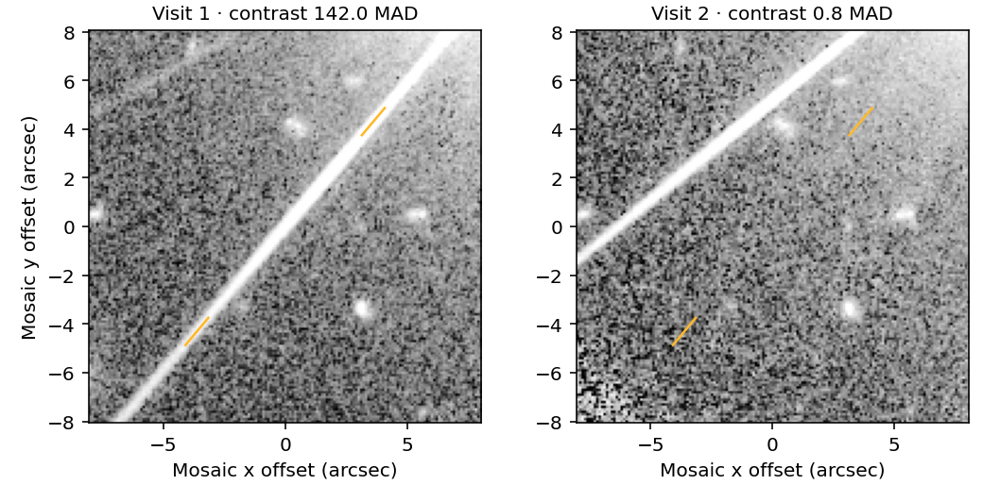

# An independent-visit test on a known streak

The straight feature reported in the repository's DR1 development screen is present in only the first of its two development mosaics. Along the first-visit best-fitting axis, the axial contrast measures 142.0 local MAD units in visit 1 and 0.84 in visit 2. This is a negative control for persistent sky emission. Its physical origin is unknown.

We reused the archived sky coordinate and two **disjoint exposure sets** for the first crossing in the [DR1 study](../../euclid-foundation-eligibility/README.md). On each VIS mosaic we dropped the central 1.3 arcsec and compared the central stripe with parallel flanks out to 4.4 arcsec on either side. In the first visit we maximized over 180 image angles. We then held that 50° axis fixed on the second aligned mosaic. Each reported MAD is the scatter of 52 offset parallel stripes. They overlap, and the angle was fitted, so the resulting numbers are descriptive contrast scores. The parent study's third, reserved visit was not used.

The [measurements](measurement.json) include the primary-header hashes and exact SHA-256 science, RMS and flag byte ranges. The contrast uses finite science and valid RMS. The coadd flags are recorded as inputs. To reproduce from this directory with NumPy, SciPy, Matplotlib and Astropy, run `python paired_streak.py --cache /path/to/temporary/dr1-cache`.
