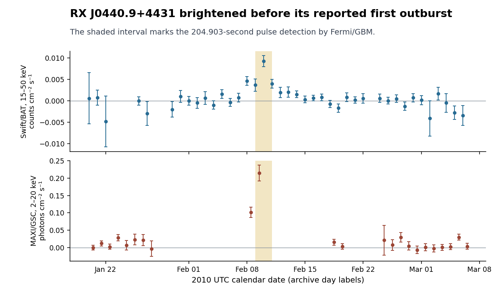

# The 2010 February flare of RX J0440.9+4431

On February 9–10, 2010, three spacecraft recorded a flare from the accreting neutron star RX J0440.9+4431, also called LS V +44 17. Fermi/GBM measured **204.903 ± 0.024 s pulsations**. Over the same two-day integration, Swift/BAT and MAXI/GSC measured excesses of **6.86 and 9.01 formal standard errors** above their local baselines. February 10 precedes the March 29 Swift detection of the widely reported spring outburst by 47 days. Between the first GBM pulse measurements in the two episodes, **51.95 days** elapsed. The difference between these intervals comes from the monitors' different observing dates.

The February GBM detection is already public. The archival result is the association of that pulse measurement with a distinct flare in two independently measured energy bands, and its placement in the source's published outburst history. Usui et al. described the spring episode as the first transient activity since the source's identification. Li et al., in the January 2026 *Astrophysical Journal*, also placed the first type-I outburst in March 2010. The February flare is fainter and its accretion geometry is undetermined. [Original Swift detection circular](https://gcn.nasa.gov/circulars/10561) · [Usui et al.](https://doi.org/10.1093/pasj/64.4.79) · [Li et al.](https://doi.org/10.3847/1538-4357/ae1a6a)



## Measurements in the fixed Fermi window

GBM's integration spans MJD 55236 through 55238, upper endpoint exclusive. The reported barycentric epoch is 55237.03423. The period and uncertainty come from the catalog frequency and its propagated first-order uncertainty. The catalog pulsed amplitude divided by its quoted error is 6.07. GBM searched for this source using a binary orbit in its timing product. This analysis uses its measured pulse frequency without refitting that orbit. [GBM source history](https://gammaray.msfc.nasa.gov/gbm/science/pulsars/lightcurves/rxj0440.html)

| Instrument and band | Daily bins in window | In-window weighted mean | Local baseline | Contrast / error |
|---|---:|---:|---:|---:|
| Swift/BAT, 15–50 keV, counts cm⁻² s⁻¹ | 2 | 0.006643 ± 0.000959 | −0.000022 ± 0.000160 | 6.86 |
| MAXI/GSC, 2–20 keV, photons cm⁻² s⁻¹ | 1 | 0.215059 ± 0.022820 | 0.009001 ± 0.001599 | 9.01 |

The baseline uses the available bins 5 to less than 30 days from the integration midpoint. Quoted contrast errors combine the inverse-variance mean errors of the event and baseline in quadrature. Swift's highest daily rate in the pulse interval has day label 55237. MAXI's single available daily bin has midpoint 55236.5. MAXI also measured 0.1017 ± 0.0151 photons cm⁻² s⁻¹ on the preceding day. The figure retains gaps in coverage. [Swift/BAT monitor](https://swift.gsfc.nasa.gov/results/transients/weak/LSVp4417/) · [MAXI source products](https://maxi.riken.jp/star_data/J0440+445/J0440+445.html)

## Other episodes along this line of sight

A separate scan of the joint Swift and MAXI record recovered seven groups of simultaneous excesses in 2009–2011. The table gives the day label with the largest weaker-instrument contrast within each group. This statistic uses a three-day window, so it can differ from either instrument's individual peak and from flare onset.

| Three-day window center (UTC) | MJD | Swift contrast / error | MAXI contrast / error | Evidence |
|---|---:|---:|---:|---|
| 2009 December 20 | 55185 | 4.5 | 6.0 | Earlier flare candidate in both monitors, without a GBM pulse detection |
| 2010 February 9 | 55236 | 7.9 | 10.2 | Flare with a 204.903 s GBM detection |
| 2010 April 9 | 55295 | 38.3 | 28.5 | Published spring outburst |
| 2010 September 8 | 55447 | 21.0 | 7.5 | Published second major outburst |
| 2010 December 9 | 55539 | 5.4 | 10.7 | Intermediate flare candidate in both monitors, without a GBM pulse detection |
| 2011 January 30 | 55591 | 13.0 | 6.3 | Published third major outburst |
| 2011 June 1 | 55713 | 4.8 | 12.0 | MAXI had already issued a position-matched source alert on May 28 |

The December 2009 and February 2010 search centers are 51 days apart. The December 2010 and January 2011 centers are 52 days apart. The weaker December events have less secure source attribution because the public GBM product contains no matching pulse detection. The irregular separations, measurement gaps and small number of episodes cannot establish a stable 50–60-day clock. The three well-known large events retain their roughly 150-day spacing. [2010–2011 literature](https://doi.org/10.1051/0004-6361/201118221) · [May 2011 alert](https://maxi.riken.jp/alert/novae/5709375073/5709375073.htm)

### Search and controls

The scan uses the overlapping MJD 55056–61333 range. It retains positive quoted errors, Swift DATA_FLAG = 0, and MAXI broad-band errors below 0.2 photons cm⁻² s⁻¹. For each trial day it compares the inverse-variance mean on days −1 to +1 to days 6–25 on both sides, requiring at least eight measured baseline days per instrument. The event window can contain one to three measured days. Both instrument contrasts must exceed four formal standard errors. Passing window centers separated by at most 12 days form a group. Of 3,940 usable joint centers, ten groups passed, including three later groups in 2023 and September 2026. The machine-readable output lists all ten. Groups can mark substructure within a longer outburst.

To assess accidental cross-mission alignment, the replay circularly shifts the complete MAXI score series, including its gaps, against Swift through every lag at least 30 days from zero. The 6,219 shifts yield a median of one group and a maximum of seven. This compares the **full set**, including known outbursts. It gives no individual false-alarm probability for a December candidate. Discovery screening included other sources and the significance of the chosen source was not calibrated across that search. Formal error ratios can include contributions from source variability and unmodeled instrumental backgrounds.

## November 2026 pulse detection

The MAXI team reported four outbursts in March, May, July and September 2026 with an approximate 60-day recurrence. GBM subsequently measured **205.609 ± 0.041 s** at MJD 61356.52529, on November 12, **55.54 days** after its first September pulse epoch. The archive integration is MJD 61356–61358, ending November 14 at 00 UT. Its amplitude/error ratio is 6.59. MAXI's sole daily point within that interval lies 1.94 quoted standard errors above the available local baseline, and the frozen BAT series ends in October. The GBM result supports renewed November pulsed activity. Its total-flux peak and duration remain unmeasured here. [September activity report](https://www.astronomerstelegram.org/?read=18071) · [GBM November measurement](data/gbm-detections.csv)

## The original 113-day lead

Two separate searches tested a near-113-day recurrence in Swift hard-X-ray flux and in Jodrell Bank radio pulsar glitches. The handoff did not specify a target or measured quantity. The strongest Swift result belongs to the known orbit of A 0535+26. No new recurrence met the validation criteria. [Searches, controls and full source lists](lead-113d/README.md)

## Reproduce

Run from this directory with Python and NumPy. The replay uses frozen full daily series and the complete GBM detection table. The two short February CSVs expose the event and its background in plain text.

```sh
python replay.py > /tmp/rxj0440-results.json
diff -u results.json /tmp/rxj0440-results.json
python plot.py
```

The figure additionally uses Matplotlib. To reconstruct the reduced tables from original files, run `python prepare.py /path/to/raw-cache` with NumPy and Astropy. Place byte-identical originals in the cache or allow the script to download the current mission products. Each raw input has a SHA-256 digest in [sources.json](sources.json). Monitoring URLs roll forward, so later downloads may differ. [Full results](results.json) · [February Swift rows](data/bat-february.csv) · [February MAXI rows](data/maxi-february.csv) · [MAXI day labels and units](https://maxi.riken.jp/top/lc_readme.txt)
