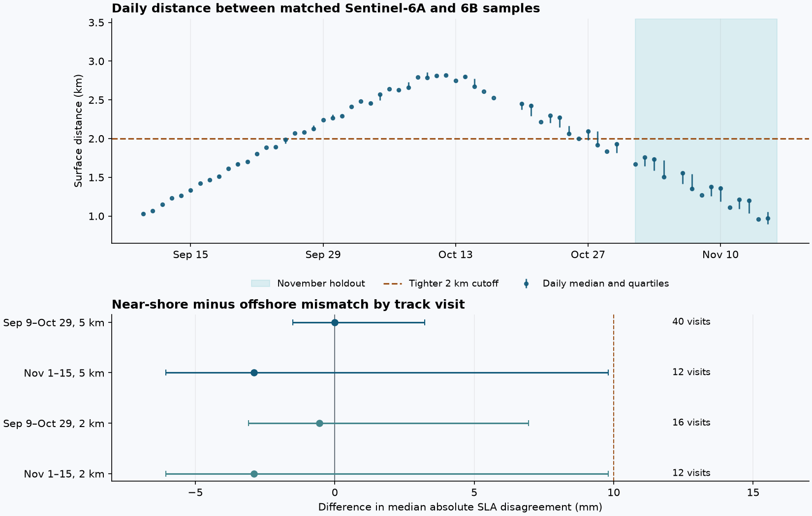

# Sentinel-6A and 6B CoastWatch files use different explicit latency edits

**Noteworthy archive finding · Measured.** All **67** Sentinel-6B daily files from September 9 through November 15, 2026 show an explicit sea-level anomaly (SLA) latency limit in their extraction histories. None of the **67** Sentinel-6A files shows that option. On the paired support of the U.S. Pacific margin, the test found no repeatable **1 cm** excess in near-shore SLA disagreement. The independent wave-height comparison with buoys gave no consistent advantage to either spacecraft. [Frozen protocol](PROTOCOL.md) · [Native headers](native-metadata.json) · [Computed results](summary.json)

## The products select records differently

Both daily files are trajectories in a common RADS format. The producer histories show that Sentinel-6B adds "-Qsla=latency -Llatency=0,1" to its extraction. In the public RADS implementation, this appends latency to the normal SLA quality checks and accepts only codes 0 and 1, which identify near-real-time and short-time-critical inputs. Code 2 identifies non-time-critical inputs. Sentinel-6A's headers contain the usual SLA checks and show no added latency check. The headers establish the difference in explicit export settings. They leave the effective upstream latency mix and the count of records rejected by this particular check unknown. [RADS user manual](https://github.com/remkos/rads/blob/master/doc/manuals/rads4_user_manual.tex) · [RADS data manual](https://raw.githubusercontent.com/remkos/rads/master/doc/manuals/rads4_data_manual.pdf) · [RADS source](https://github.com/remkos/rads/blob/master/src/rads.f90)

The deposited bytes contain **3,256,880** native rows for 6A and **3,310,061** for 6B. Both October 18 files are absent from the frozen archive indexes. The totals combine the effects of availability, orbit coverage, upstream processing and edits. No per-record edit flags, latency codes, retracker labels or pass IDs are carried in these NetCDFs. The numeric analysis is conditional on the delivered observations. [Input manifest](sources.json) · [CoastWatch product](https://coastwatch.noaa.gov/cwn/products/along-track-significant-wave-height-wind-speed-and-sea-level-anomaly-multiple-altimeters.html)

## A paired coastal comparison

We matched **13,802** regional sample pairs by independent coordinates and times. Median separation was **1.94 km** and median lag was **30 s**, with 6B following 6A. Allowing either time order as a sensitivity found the same pairs. A one-day offset admitted **zero** pairs. Two implementations using different distance calculations agree on coordinate-pair counts for four separately checked dates.

For each visit, we subtracted the median absolute SLA disagreement 150–300 km from the coast from the median disagreement 20–80 km from the coast. The medians below summarize visits with at least three pairs in each band. Intervals resample UTC days and are descriptive for these tracks and dates.

| Period | Paired coordinates | Visits with both bands | Median near-shore excess (mm) | Day-block 95% interval (mm) |
| --- | ---: | ---: | ---: | ---: |
| Sep 9–Oct 29 reference | 10,606 | 40 | 0.00 | −1.50 to 3.22 |
| Nov 1–15 holdout | 3,051 | 12 | −2.90 | −6.05 to 9.80 |

Using a tighter **2 km** tolerance retained **4,036 of 10,606** reference pairs and **3,049 of 3,051** holdout pairs. Daily separation increased to around 3 km then decreased across the period, so the tighter rule changes the mix of dates in the reference period. The near-shore medians remain close to zero on both radius definitions. This test covers the retained records in this rectangle and these distance bands.

In the primary pairing, the median absolute disagreement was larger in the high-wave subset in both periods. In reference it was **22.2 mm** when mean satellite SWH was at least 3 m versus **17.9 mm** when SWH was below 2 m. In holdout it was **24.4 mm** versus **18.5 mm**. At 2 km both reference medians were **17.3 mm**, with only 74 high-wave pairs. The low and high subsets differ in date and geometry, and their assignments use the same two instruments. These are descriptive contrasts.

## Independent wave-height observations

At 50 km and 30 minutes, **38 station-visits** at **eight** NDBC buoys qualified, with median absolute per-visit errors of **0.254 m** for 6A and **0.2585 m** for 6B. The paired median difference in absolute errors, 6B minus 6A, was **−0.014 m** in reference and **+0.033 m** in holdout. Only **14** holdout station-visits qualified, below the fixed 20-visit rule. A 25 km radius left **16 station-visits** in total. The 50 km and 25 km overall paired differences have opposite signs. A station samples a point, while the altimeter footprint and sampling time differ, and the buoy files carry real-time automated QC. The comparison supplies an independent check on wave height. [NDBC real-time data](https://www.ndbc.noaa.gov/faq/rt_data_access.shtml) · [Wave height definition](https://www.ndbc.noaa.gov/faq/wavecalc.shtml)

CNES reported mission-wide validation after comparing the Sentinel-6 satellites and SWOT. The 2026 science team also studied the tandem coastal wet-troposphere correction. The measurements here concern the NOAA CoastWatch exports, their latency settings and local paired support. [CNES validation](https://www.aviso.altimetry.fr/en/news/front-page-news/news-detail.html?tx_ttnews%5Btt_news%5D=3243) · [Coastal wet-troposphere study](https://ostst.aviso.altimetry.fr/?id=95&no_cache=1&tx_ausyclsseminar_pi2%5Baction%5D=show&tx_ausyclsseminar_pi2%5Bcontroller%5D=Abstracte&tx_ausyclsseminar_pi2%5BobjAbstracte%5D=4437)

## Replay

From this folder, run the analysis with Python, NumPy and SciPy. Install Matplotlib for the figure.

~~~text
python analyze.py --output summary.json
python plot.py --output tandem-sla.png
~~~

The compact [regional extract](regional-inputs.npz) contains the exact decoded satellite quantities used in the test, regional coastline points and a time-clipped buoy series. The [source manifest](sources.json) pins the original products and the two frozen archive indexes. With the native files staged, install netCDF4 and pyshp to rebuild the extract.

~~~text
python prepare.py --data-root NATIVE_DIRECTORY --output replay-inputs.npz --metadata replay-metadata.json
~~~

Satellite and buoy observations are courtesy of NOAA CoastWatch, NOAA NESDIS/STAR and NDBC. Coastline geometry is from Natural Earth.
