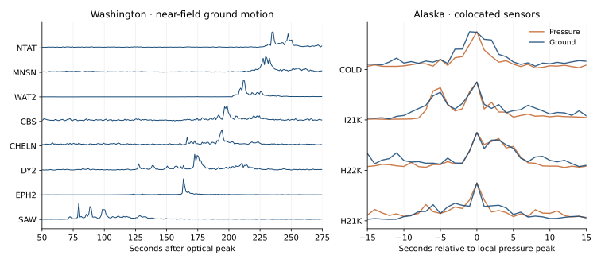

# Ground recordings of the Sims Corner bolide and the 2022 interior Alaska fireball

At 07:49:55.5 UTC on August 14, 2026, a seismometer 0.25 km horizontally from the rounded CNEOS peak-brightness coordinates of the Washington fireball recorded a one-second pulse with 76 times the local background RMS. Eight near-field stations resolve an expanding wavefront. The arrival time at the closest station is difficult to reconcile with an acoustic source confined to the 45.5–77.9 km path reported by NASA Skyfalls. The two satellite lightning mappers put the brightest 40 ms at 31.85 km. All 40 groups contributing to this bin appear in the NASA Ames event selection. This independently supports acoustic emission below the reported camera endpoint and agrees with the cataloged CNEOS 30 km peak. [GOES stereo analysis](stereo/README.md) · [NASA Skyfalls camera/GLM solution](https://fireballs.ndc.nasa.gov/skyfalls/events/20260814-074833) · [JPL fireball catalog](https://cneos.jpl.nasa.gov/fireballs/) · [NASA radar and recovery-area report](https://ares.jsc.nasa.gov/meteorite-falls/?os=f)

The Alaska investigation identifies coupled pressure and ground-motion pulses at four sites for a separate CNEOS bolide at 20:23:03 UTC on January 1, 2022. It supplies an independent example of the recording mechanism. Neither bolide is a newly identified impactor. Published work already described the Washington optical flash, meteorites and signals on Cascade volcano infrasound arrays. The new measurements here concern the near-field arrival times, the resulting conditional height constraint, and the Alaska pressure–ground pairs. [Washington observation inventory](https://planetarypat.com/meteorite-falls/sims-corner-2026/) · [Alaska Earthquake Center's other bolide examples](https://earthquake.alaska.edu/nontectonic/other)



The figure shows one-second RMS envelopes in the 0.6–6 Hz passband. Each displayed trace is normalized to its own peak in the plotted window. Left, stations are ordered by range. Right, the two instruments at each site share a clock relative to that site’s single-second pressure maximum. The tables report unscaled local background ratios and four-second peak picks.

## Washington wavefront

Each trace is a 70-minute EarthScope miniSEED record. Measurements use the largest four-second RMS inside an acoustic window built from the satellite latitude, longitude and altitude. The window spans a straight-line celerity of 0.27–0.36 km/s, widened by 10 s on each side. Ratios divide the peak by that station's median off-event four-second RMS, after excluding the gate and 90 s on either side. The table lists all eight near stations meeting the calibration cuts in the primary 0.6–6 Hz band. Station elevation enters the fit. Instrument counts suffice for within-channel ratios. Waveforms from separate stations are distinct measurements of one source. [Pacific Northwest Seismic Network](https://doi.org/10.7914/SN/UW) · [All station measurements](stations-0.6-6.csv)

| Station | Range (km) | Peak after flash (s) | RMS / background |
|---|---:|---:|---:|
| UW.SAW..HHZ | 0.2 | 88 | 39.9 |
| UW.EPH2..HHZ | 39.9 | 165 | 126.9 |
| UW.DY2..HHZ | 42.2 | 174 | 23.6 |
| UW.CHELN..HNZ | 47.9 | 194 | 7.9 |
| UW.CBS..HHZ | 49.4 | 198 | 11.3 |
| UW.WAT2..HHZ | 54.2 | 211 | 218.5 |
| UW.MNSN..HNZ | 59.7 | 231 | 26.0 |
| UW.NTAT..HNZ | 62.0 | 236 | 15.6 |

The effective point-source fit fixes the source time to the CNEOS epoch, and uses one effective celerity for every path. Its optimum is 47.6950° N, 119.3791° W, 26.16 km above sea level and 0.2890 km/s. The eight peak times have 0.81 s RMS residual. Fixing source coordinates and altitude to the CNEOS entry (47.7° N, 119.4° W, 30.0 km) while fitting celerity gives 4.81 s RMS. Fixing the Skyfalls terminal point (47.850° N, 119.408° W, 45.5 km) gives 25.87 s RMS. All models use exactly the same eight selected arrival times. The free fit has four parameters, the two fixed-position fits one each. The alternative passbands yield free heights of 26.49 and 24.11 km. These point solutions summarize the dominant arrival. Branch choices, atmospheric refraction and winds, extended source geometry, and the trade between height and speed limit their physical interpretation. The 0.81 s residual is an in-sample statistic. [Full model and control output](analysis.json)

The distance split was frozen after inspection of the first near stations and before inspection of the outer traces. Of the 23 velocity channels at 70–120 km, nine have a ≥6× RMS peak within ±25 s of the near-field fit prediction. Applying the same station-specific windows with 102 common shifts of ±200 to ±1,200 s in steps of 20 s gives a maximum of five. The 1–4 Hz test gives 10 versus a maximum of six. The 2–8 Hz test gives seven versus a maximum of seven. Some stations show larger pulses outside the prediction window, especially to the south. The model captures one part of a multi-arrival signal. The time tolerance and summary statistic were chosen during analysis. Neighboring shifts overlap, so these counts are empirical diagnostics without a formal false-alarm probability. The 23-channel inventory includes weak and failed predictions. [All predictions and time shifts](analysis.json)

### What the earliest bright pulse permits

UW.SAW (47.70193° N, 119.40162° W, elevation 0.700 km) lies almost directly below the rounded CNEOS coordinates. Its largest one-second RMS in the gate is centered at +79.5 s. The four-second maximum occurs at +88.0 s. Both belong to a train of strong pulses. Assigning the *end* of the one-second bin (+80 s) as the latest arrival, and allowing emission as early as 07:48:33 UTC, gives at most 83 s of travel. Under an intentionally generous 0.400 km/s atmospheric speed ceiling, direct propagation to SAW requires an emission height ≤33.9 km, even at zero horizontal range. A direct signal from 45.5 km would require an average vertical speed of at least 0.540 km/s. Horizontal travel only increases the requirement. A source at the published Skyfalls terminal coordinates would require an even longer path. This bound concerns a source of the measured pulse and depends on both the emission-time allowance and the propagation mechanism. [Station metadata and waveforms](manifest.json) · [Published Skyfalls timing and endpoint](https://fireballs.ndc.nasa.gov/skyfalls/events/20260814-074833)

A pressure wave can enter the solid Earth at one location and propagate rapidly through rock to the station. Even allowing **instantaneous** transport through rock, the acoustic leg must first reach terrain. Allowing a 4.4 km coupling elevation anywhere in Washington, an upper envelope that includes Mount Rainier, loosens the conditional 83 s height bound to **37.6 km**. An acoustic leg from 45.5 km to that ceiling in 83 s still requires ≥0.495 km/s. This test assumes the transfer occurs into solid ground in the region. A weak shock traveling faster than ambient sound over part of its path is possible. A prolonged supersonic effective propagation speed, earlier unobserved emission, a different energy-transfer mechanism or an unassociated SAW precursor would require a different interpretation. No near-source pressure channel occurs in the EarthScope inventory queried here. The nearest cataloged microphone is 138 km away. [USGS Mount Rainier elevation](https://www.usgs.gov/volcanoes/mount-rainier) · [Waveform and catalog receipts](manifest.json)

The 05:33 UTC Spokane radiosonde, roughly 133 km east, reached 36.17 km. The largest local sound speed plus the *entire* horizontal wind speed at a measured level is 349.7 m/s. The 17:02 UTC ascent gives 347.6 m/s. Sound speed was evaluated as sqrt(1.4 × 287.05 × T) with temperature in kelvin. The two extracted profiles bracket the event; neither directly samples the upper part of the camera path or the air column above SAW. The assumed 400 m/s ceiling is a sensitivity choice. The USGS query found three small regional earthquakes in the 07:45–08:05 UTC window. The first originated at 07:59:50 UTC, after the near-station pulse train. The catalog cannot exclude uncataloged local transients. A finite descending line source or propagating fragmentation can change when and where different stations receive their strongest pulse. Either can include acoustic emission from below the camera endpoint. The data do not establish a unique breakup height or count. [NOAA IGRA source](https://www.ncei.noaa.gov/pub/data/igra/data/data-por/USM00072786-data.txt.zip) · [Extracted radiosondes](spokane-igra.txt) · [USGS query and returned IDs](manifest.json)

## January 1, 2022 interior Alaska pressure and ground motion

The satellite catalog places this event at 66.1° N, 152.6° W and 35.5 km altitude with 0.42 kt estimated impact energy. The analysis includes all network AK BHZ/BDF records in the inventory within 200 km for which the requested waveforms were obtained. Nine sites have usable records of both channels. At each site, the maximum four-second RMS in the acoustic gate is picked independently in pressure and vertical ground motion. Four sites have peaks within three seconds of each other and each channel at least four times its off-event median. The last column is the correlation of the two one-second RMS envelopes over 30 s centered on the pressure peak. Shared signal onset and coda support an air-to-ground association. Statistical independence between co-located sensors is not assumed. [Alaska Geophysical Network](https://doi.org/10.7914/SN/AK) · [Station and waveform provenance](manifest.json)

| Station | Range (km) | Pressure peak (s) | Ground peak (s) | Pressure / background | Ground / background | Envelope correlation |
|---|---:|---:|---:|---:|---:|---:|
| H21K | 50.1 | 181 | 180 | 6.0 | 18.5 | 0.81 |
| H22K | 59.9 | 206 | 206 | 13.1 | 4.5 | 0.93 |
| I21K | 106.1 | 336 | 335 | 36.1 | 28.5 | 0.93 |
| COLD | 163.8 | 616 | 616 | 28.8 | 6.4 | 0.92 |

None of the 102 common time shifts yields more than one passing site. Each alternative passband yields six passing sites versus at most one for the shifted controls. The relatively late Coldfoot pulse, at 616 s, has an effective slant celerity near 0.27 km/s. One common constant speed would not reproduce all four. The USGS six-degree earthquake search from 20:19 to 20:40 UTC returned zero events. Regional wind structure, direct pressure coupling and coupling through local structures can change the local amplitude and timing. This is a measurement of acoustic arrivals associated with the known fireball; energy, trajectory and event frequency cannot be inferred uniquely from these data. [Full Alaska results including non-passing pairs](analysis.json)

The Alaska Earthquake Center page reports 2016, October 2020 and September 2021 bolides. The Sandia study concerns a different Alaska event, and the widely reported Pennsylvania bolide on January 1, 2022 occurred at a different UTC hour and site. Targeted searches combined the Alaska date, time, coordinates, station names, “infrasound”, “seismic”, and “bolide”. For Washington they combined “Sims Corner”, “SAW”, “EPH2”, “seismometer”, “altitude”, and “infrasound”. These searches located the published Washington regional infrasound detections. They did not surface the specific local-height test or the four Alaska pressure–ground pairs. This is a dated search of public reports, not a claim of priority. [Alaska Earthquake Center](https://earthquake.alaska.edu/nontectonic/other) · [Sandia Alaska case study](https://newsreleases.sandia.gov/how-scientists-support-planetary-defense-by-reconstructing-a-fireballs-path-using-sound-waves/) · [NASA Pittsburgh case](https://science.nasa.gov/earth/earth-observatory/looking-for-lightning-finding-fireballs-149381/)

## Reproduce

Use Python with NumPy, SciPy and ObsPy (tested with ObsPy 1.5.1). From this directory run:

```sh
python analyze.py --cache /tmp/open-space-bolides --output /tmp/open-space-bolide-results
```

The manifest includes FDSN request URLs, channel IDs, station coordinates, CNEOS rows, checksums, inventory queries, and earthquake catalog receipts. EarthScope can repackage miniSEED or revise an interval. The script verifies SHA-256 and fails loudly on changed responses. Each station is filtered independently by a third-order Butterworth applied forward and back. Separate trace segments remain separate at gaps. The first and last 10 s of each segment and incomplete seconds are excluded. The 0.6–6 Hz primary and two sensitivity bands yield all measurements in CSV and all fit parameters and time-shift counts in JSON. The distance holdout tests the effective model's extrapolation. Calendar controls use different days and keep the same instruments and UTC time. See the additional diagnostic below.

The candidate selection was exploratory. The broader search considered a Washington case with known distant detections, the Alaska event, Florida (November 2025), Manitoba (September 2026), Massachusetts (May 2026), and inventory feasibility in British Columbia (September 2017) and Quebec (January 2013). Some preliminary traces were inspected for Florida, Massachusetts and Manitoba. The strongest supported datasets are examined here. This record does not measure the sensitivity or false-positive rate of an all-fireball survey.

### Independent calendar dates

At the same UTC time 1 and 7 days before and after each event, we requested 23-minute records of the three closest primary Washington velocity stations (SAW, EPH2, DY2) and the three closest Alaska pressure/velocity pairs (H21K, H22K, I21K). On-event data are rescored over the same duration. In Washington all 3/3 pass the 6× background and off-gate-maximum cuts on August 14, versus 0/12 station-dates on the four control days. In Alaska all 3/3 pairs pass on January 1, versus 0/10 covered pair-dates. Two of the 12 requested Alaska pair-dates lacked archive data. These comparisons test repeated local noise at the same time of day and use event-selected instruments. [All 36 control requests](calendar-controls.json) · [Control counts](analysis.json)

To reproduce the figure after the main run, use `python plot.py --cache /tmp/open-space-bolides --output /tmp/open-space-bolide-results/wavefronts.svg` with Matplotlib installed. The saved measurements were produced with NumPy 2.3.5, SciPy 1.17.0 and ObsPy 1.5.1.
