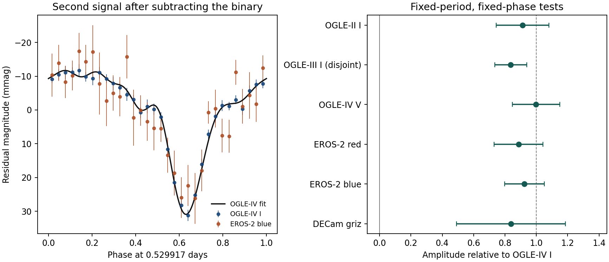

# A second photometric period toward OGLE-SMC-ECL-01293

OGLE-SMC-ECL-01293 is a known contact eclipsing binary. Its OGLE-IV I-band light curve contains a second, sharply peaked dimming every **0.529917 days** (12.718 hours). The full fitted excursion is **0.0426 mag**, alongside the known **0.670384-day** binary waveform. Independent EROS-2 and DECam measurements recover the second waveform using the period, phase and shape fitted to OGLE-IV alone. The physical origin of the second signal is open.

The pointing is at J2000 **00:47:51.45, −73:07:11.9**. Cross-identifiers are Gaia DR3 4685948309445516544, TIC 180617538, OGLE J004751.48−730711.4, SMC_SC4_175213 and EROS-2 sm0010l7230.



## How it surfaced

The discovery cohort comprised 1,800 of the 10,795 SMC eclipsing-binary entries with catalog periods. We took the 166 entries with an OGLE-IV remark first to include known positive controls, then the 1,634 brightest remaining entries through I = 16.691. The archive contained I-band files for 1,791 selections. The minimum of 210 usable points and phase-coverage requirements returned 6,100 residual peaks across 1,530 objects. A later exploratory sweep of 4,400 fainter selections was separate from this cohort and the target's ranking.

For each target, we subtracted a running median in phase at the catalog orbital period, removed yearly zero points, clipped individual residuals at −5 and +8 robust scatter units, then searched 0.05–5 cycles/day with weighted Lomb–Scargle. The candidate list retained up to four separated peaks per object. We rejected neighborhoods of orbital harmonics and common window aliases and ranked phase-localized dimmings by their persistence in the two halves of the OGLE-IV time series and an OGLE-III positional counterpart. Of 4,663 peaks reaching validation across 1,272 targets, 134 targets received a positive score. Ranking each target by its highest score places 01293 nineteenth. Sixteen of the eighteen above it are flagged as double eclipsers by OGLE-IV. The other two, 05925 and 01086, are independent recoveries of published double-binary candidates. Selection and the choice of which lead to pursue were exploratory. There is no calibrated population false-alarm probability or completeness estimate. The frozen independent surveys below provide the follow-up test.

## Fixed-period tests

The training fit uses eight sine/cosine harmonics per waveform, annual zero points and robust inverse-variance regression on 2,338 OGLE-IV I-band points. It refines both periods jointly. The two peak-to-peak excursions are 0.09691 and 0.04261 mag. We then freeze both waveforms, including their phases, and refit only their scales and zero points in each comparison series. A scale of one reproduces the OGLE-IV I amplitude. The errors below use a sandwich covariance with observations grouped by integer HJD. These are conditional measurement uncertainties and omit errors in the training templates. OGLE-III I entered candidate selection. All 331 retained OGLE-II I timestamps also occur in the released OGLE-III series with different reported magnitudes or errors. These two fits share observing epochs, and they contributed shared information to selection. EROS and DECam are the independent survey checks obtained after selecting 01293.

| Photometry | Measurements | Observing nights | Scale of second signal ± 1 SE |
| --- | ---: | ---: | ---: |
| OGLE-II I | 331 | 316 | 0.913 ± 0.086 |
| OGLE-III I, released series | 1,063 | 1,036 | 0.859 ± 0.045 |
| OGLE-III I, excluding every OGLE-II epoch | 732 | 720 | 0.837 ± 0.052 |
| OGLE-III V | 53 | 53 | 0.458 ± 0.141 |
| OGLE-IV V | 87 | 86 | 0.998 ± 0.077 |
| EROS-2 red | 876 | 752 | 0.886 ± 0.080 |
| EROS-2 blue | 965 | 838 | 0.924 ± 0.064 |
| DECam griz | 396 | 40 | 0.837 ± 0.177 |

EROS red and blue share many epochs. Their projections are reported individually. Each of the four comparison stars within six arcseconds has lower precision and a secondary amplitude consistent with zero within twice its conditional standard error. DELVE DR3 Magellanic Clouds photometry supplies 396 distinct, unforced DECam exposures in four filters. Each exposure is measured relative to at least three of seven comparison sources. A joint regression allows each filter its own baseline. The separate g, r, i and z scales are 0.70, 1.00, 0.75 and 0.93, with 21, 40, 8 and 5 observing nights, respectively. The i and z night-cluster error estimates have few independent clusters. Exposures in overlapping DELVE tiles are counted once.

## Evidence for and against a second binary

- The two frequencies are 1.49168 and 1.88709 cycles/day. In a joint refit of the same OGLE-IV data, the second signal's solar-day and sidereal-day aliases give higher robust loss. The smallest loss increase among five tested aliases exceeds 1,065. This comparison measures fit quality.
- Folding on twice the recurrence time admits a 1.059834-day binary with similar eclipses. Adding ten alternating-cycle Fourier coefficients improves the robust loss by only 6.8. The current data establish one repeating dimming profile. They leave the secondary orbital period and stellar multiplicity ambiguous. Stellar pulsation or other surface variability also remain possible.
- OGLE's nearest other cataloged eclipsing/ellipsoidal system is 37.27 arcseconds away. The nearest cataloged OGLE RR Lyrae, classical Cepheid and delta Scuti variables are 102.8, 74.9 and 153.2 arcseconds away, respectively. In the 8-arcsecond VSX cone the matching source has the known 0.67038-day period. Gaia DR3 also fitted the known binary period. The SIMBAD references, 2013 OGLE-III doubles, 2025 OGLE remarks, and the published 2024 and 2025 SMC candidate lists checked here did not identify the 0.529917-day recurrence. A missing catalog entry cannot establish publication priority. [OGLE-III catalog and double candidates](https://acta.astrouw.edu.pl/Vol63/n3/pdf/pap_63_3_2.pdf) · [2024 quadruples](https://doi.org/10.1051/0004-6361/202450400) · [2025 double-binary study](https://doi.org/10.1093/mnras/staf364)
- The nearest distinct DELVE entry, 0122m730.213171, lies 1.07 arcseconds away at r = 20.30 versus r = 16.90 on the target. It has three r detections and one z detection. A complete disappearance of a star 3.40 mag fainter would dim the combined r light by about 0.046 mag if all its light entered the target measurement. This is comparable to the signal, so dilution alone cannot exclude it. A centroid regression on the differential DECam measurements gives 0.033 ± 0.099 arcsec/mag east and 0.030 ± 0.234 arcsec/mag north for the secondary waveform. These are PSF-fit catalog centroids with possible deblending and systematic errors. They do not securely localize the variable flux within the closest 1.07 arcseconds.
- Obtain resolved time-series imaging across several predicted secondary minima, measuring both the target and the 1.07-arcsecond neighbor at the same times. An on-target two-period detection would favor an unresolved variable component. A dip confined to the neighbor would identify a projected blend. Time-series spectroscopy could distinguish an additional binary orbit from pulsation and test physical association.

## Reproduce the measurements

From this directory, run the following with Python, NumPy and SciPy. The figure also needs Matplotlib. The target fit and projections run entirely on the frozen selected rows.

```sh
OPENBLAS_NUM_THREADS=1 python replay.py > replay-result.json
OPENBLAS_NUM_THREADS=1 python figure.py
sha256sum -c SHA256SUMS
```

`data/photometry.csv.gz` holds the original three numeric OGLE columns and the valid EROS target/comparison photometry. HJD is absolute, including the 2,450,000-day offsets in OGLE-III and EROS. `data/decam.csv.gz` holds the unforced target and comparison measurements with exposure lengths. The replay uses exposure midpoints and a low-order heliocentric correction that is adequate at this period. `sources.json` includes the full URLs, exact queries and SHA-256 of raw upstream responses. Service-generated header dates and temporary OGLE-II URLs can change. Catalog values of 99.99 are missing photometry. The seven comparison objects and their exposure IDs are explicit in the DECam table.

The compressed population table contains every retained peak. Columns P, p2 and pref are the catalog period, preliminary residual period and refined residual period in days. Power is the Lomb–Scargle standard normalization. High and low measure the smoothed binned excursions in scatter units. Columns a3/c3 are the OGLE-III scale/correlation, c4 is the cross-half OGLE-IV correlation, and av/cv are the OGLE-IV V scale/correlation. The last column is the exploratory ranking score. Empty cells mark peaks below the validation threshold. The neighbor field lists catalog IDs, separations in arcseconds and catalog periods, with zero for ellipsoidal entries outside the ECL period table.

To repeat the population search, install Astropy, fetch the pinned survey archives into a separate directory and run the same target selection. Versions used were NumPy 2.3.5, SciPy 1.17.0, Astropy 8.0.2 and Python 3.12. Compare decompressed CSV content because a gzip file header can include the write date.

```sh
python acquire.py /tmp/ogle-01293-archives
OPENBLAS_NUM_THREADS=1 python population.py /tmp/ogle-01293-archives /tmp/ogle-01293-scan.csv.gz
```

Observational credit belongs to OGLE, EROS-2, DELVE and the original DECam programs, ESA Gaia/DPAC, AAVSO VSX, SIMBAD and CDS. [OGLE-IV catalog](https://doi.org/10.32023/0001-5237/74.4.1) · [EROS-2 release](https://doi.org/10.1051/0004-6361/202557321) · [NOIRLab DELVE archive](https://datalab.noirlab.edu/data/delve) · [Gaia DR3 eclipsing-binary catalog](https://doi.org/10.1051/0004-6361/202245330)
