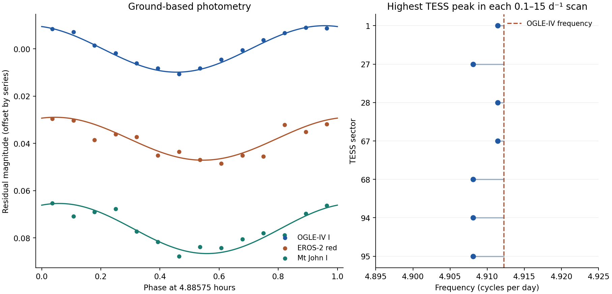

# A 4.886-hour oscillation toward the massive eclipsing binary 2dFS 757

The optical light toward OGLE-SMC-ECL-01844 varies every **4.88575 hours** in addition to the known **1.83988-day** eclipses. Its fitted OGLE-IV I-band excursion is **0.01967 mag peak to peak**, or about 1.8% in flux. A search of the TESS pixel light curve found the same frequency as the strongest residual peak in **each of seven sectors**, including two in 2025. Independent EROS-2 and Mount John University Observatory measurements also recover the signal at the phase predicted by OGLE-IV. Measurements extend from 1996 through 2025.



The binary is also known as MOA J005018.4−723855, MACHO 208.15971.22, TIC 181043469 and Gaia DR3 4688978627856961664. Its J2000 position is 00:50:18.49, −72:38:56.4. The published spectral type B0.5(V) and short oscillation period make a β Cephei-type pulsation a plausible interpretation if the light originates in the binary. A blend with a nearby variable can produce the same periodic light. The oscillation's physical source and mode remain open.

## What was known

Bayne et al. derived the eclipsing orbit, modeled a semi-detached system and discussed photometric blending and unequal orbital maxima. Kourniotis et al. cataloged an eclipsing variable at 1.839888 days. The Open-Space 1,800-target search deposited a 0.203573-day residual peak for this star as one row in its population table. This analysis followed up that peak, measured its light curve, tested its orbital-harmonic and daily aliases, and independently recovered its oscillation in other telescopes. The initial selection was retrospective. OGLE-III had already entered the original screen. [Bayne et al. 2004](https://doi.org/10.1111/j.1365-2966.2004.07535.x) · [Kourniotis et al. 2014](https://doi.org/10.1051/0004-6361/201322856) · [Original screening table](../smc-01293/data/population.csv.gz)

VSX lists the 1.83986-day eclipsing period at 0.08 arcsec. We checked the twelve SIMBAD references, target aliases, the Eze & Handler 2024 paper, and Zhou's 2025 catalogue of pulsating eclipsing binaries. None of the 3,323 coordinate-readable rows in Zhou's file lies within 39 arcminutes. An exact identifier check also covered the remaining row. These checks located no earlier identification of this short oscillation in the binary literature. The Open-Space candidate row predates this validation. An independent discovery or classification under another name remains possible. [Prior checks and hashes](prior-checks.json) · [Eze & Handler](https://arxiv.org/abs/2403.12281) · [Zhou catalogue](https://doi.org/10.5281/zenodo.17096360)

## Frozen waveform

The training fit uses 2,489 OGLE-IV I observations on 1,037 nights, an 11-harmonic orbital waveform and a separate sinusoid. We locally refine the previously selected frequency, with a robust iteratively reweighted fit and a fixed catalog orbit. At the reference HJD 2460000.0436, the magnitude coefficients are −0.0094684 for cosine and +0.0026546 for sine at 4.91224665 cycles/day. Each external light curve gets its own orbital waveform, baseline and free sine/cosine coefficients. The table gives their projection on the frozen OGLE phase. Positive signed semiamplitude means that the new observations vary in the predicted direction. Errors use a sandwich covariance grouped by integer HJD. They condition on the training waveform and do not represent a survey-wide false-alarm probability. Mount John used a separate eight-harmonic orbital fit per band and equal weights within that band. [Full measurements](measurements.json)

| Observation | Measurements | Nights | Signed semiamplitude ± one SE (millimagnitudes) |
| --- | ---: | ---: | ---: |
| OGLE-IV I, training | 2,489 | 1,037 | 9.83 ± 0.28 |
| OGLE-III I | 762 | 730 | 9.60 ± 0.42 |
| OGLE-IV V | 93 | 92 | 11.03 ± 1.36 |
| OGLE-III V | 89 | 80 | 7.53 ± 1.57 |
| EROS-2 red | 577 | 482 | 7.70 ± 0.86 |
| EROS-2 blue | 847 | 745 | 7.15 ± 1.14 |
| Mount John u | 141 | 28 | 8.49 ± 2.08 |
| Mount John V | 138 | 28 | 9.31 ± 1.88 |
| Mount John I | 149 | 31 | 8.48 ± 1.07 |

The two EROS bands have shared epochs, as do the three Mount John filters. Mount John's Table 2 was published in 2004 and supplies an independent telescope and time series on the same star studied by Bayne et al. EROS source sm0066k12361 lies 0.37 arcsec from the target and recovers the waveform in both bands. Two other EROS records lie within 5 arcsec. The one 3.66 arcsec away has a noisy positive blue projection (257 ± 72 mmag from 58 measurements) and a red projection of 13 ± 6 mmag. EROS therefore does not resolve the emitting star unambiguously. The entry 4.59 arcsec away is consistent with zero in both bands. [Mount John observations](https://vizier.cds.unistra.fr/viz-bin/VizieR?-source=J/MNRAS/349/833/table2) · [EROS-2 release](https://doi.org/10.1051/0004-6361/202557321)

DECam independently recovered the phase in 156 spatially resolved measurements on 26 nights. The scale relative to OGLE-IV I is 1.11 ± 0.10 across g, r, i and z. The nearest catalog source, 1.62 arcseconds away, is bright enough to warrant testing with higher-resolution exposures across a full oscillation. [DECam measurements and neighbor tests](decam/README.md)

## Tests with the TESS images

At the Gaia coordinates, we retrieved 7×7-pixel TessCut images for all seven visits returned by the MAST position inventory. We extracted the pixel nearest the target minus the median of the four corner pixels. We retained 50,722 quality-zero cadences with finite 7×7 images. A joint fit removed a local intercept and slope per 0.8-day block and eight orbital harmonics. A single-term Lomb–Scargle search then evaluated 0.1–15 cycles/day on a grid spaced by 0.0033 cycles/day. The peak in each sector is the unrestricted maximum of that scan. Windows are around 25–28 days long. The tabulated grid points are coarser than the OGLE frequency measurement. In a separate joint regression, the amplitude at the exact OGLE phase has a positive sign in every visit. Errors group observations into 0.8-day blocks. They describe these fits, with no assumption that all seven sectors have different astrophysical sources of contamination. [TESS results](tess.json)

| Sector | Good cadences | Highest frequency (cycles/day) | Fixed-phase amplitude / block SE |
| ---: | ---: | ---: | ---: |
| 1 | 1,267 | 4.9114 | 9.7 |
| 27 | 3,351 | 4.9081 | 10.4 |
| 28 | 3,449 | 4.9114 | 8.5 |
| 67 | 11,490 | 4.9114 | 8.3 |
| 68 | 11,218 | 4.9081 | 8.1 |
| 94 | 9,933 | 4.9081 | 8.7 |
| 95 | 10,014 | 4.9081 | 11.2 |

Separate per-pixel regressions produce a short-oscillation image and an eclipse image. We fit each with a Gaussian on the same local pixels. The sector 27, 28 and 95 differential centroid offsets in (east, north) arcseconds are (−1.5, −0.6), (+1.1, −1.0), (+0.3, +0.5). Their individual 95% block-bootstrap intervals include zero in both directions. The other sectors give larger offsets, poor precision, or both. Sector 68's fit is unstable, with a point estimate displaced by about 61 arcsec and a wide, multimodal bootstrap. TESS pixels subtend about 21 arcsec. These results favor the same sky neighborhood and cannot distinguish sources separated by a few arcseconds. The raw images remain available via MAST. The released cross-products preserve each block's 14×14 design Gram matrix and the 14×49 pixel cross-products for replay. Centroid bootstraps use 150 resamples per sector and omit blocks with <25 cadences or <0.35 day span. [Image source URLs and byte hashes](sources.json)

## Checks on the interpretation

- The nearest orbital harmonic is the ninth, 4.89163 cycles/day. Its phase drifts through a complete cycle relative to the measured signal roughly every 49 days. Removing ±0.12 orbital cycles around each eclipse retains 1,354 OGLE-IV measurements and a 9.33 ± 0.34 mmag oscillation.
- Varying orbital harmonic order from 8 to 15 gives 0.01959–0.02011 mag full excursions. The ±1 sidereal-day aliases increase robust loss by at least 698 in OGLE-IV. Jointly refining the orbital period gives 1.83987693 days and 4.91224744 cycles/day for the oscillation. [Control fits](controls.json)
- The stellar spectrum and period justify testing a β Cephei interpretation. To establish which star produces the modulation, obtain short-cadence spectroscopy at the 4.886-hour phase and resolve the binary from its closest projected neighbors. Pulsational line-profile changes following the orbital radial-velocity curve of a component would identify the host. The available time series establish periodic light in this direction.

## Reproduce

With Python, NumPy, SciPy, Astropy and Matplotlib installed, run the following commands from this directory.

```sh
OPENBLAS_NUM_THREADS=1 python replay.py > replay-result.json
OPENBLAS_NUM_THREADS=1 python controls.py > controls-result.json
OPENBLAS_NUM_THREADS=1 python tess.py > tess-result.json
OPENBLAS_NUM_THREADS=1 python figure.py
sha256sum -c SHA256SUMS
```

To rebuild the seven pixel extractions, use `python extract_pixels.py refreshed` or pass `--fits-dir` with 1844-sN.fits files from MAST. TessCut can assign fresh FITS header dates and checksums each time it generates a cutout. The shipped light curves fix the actual quality-zero samples used here. TESS time is approximately HJD(UTC), obtained from the barycentric TDB times by subtracting 0.0008 days. The heliocentric–barycentric difference is negligible at this period. The OGLE and Mount John wavelengths and original reported quantities are retained. EROS times and OGLE-III times use HJD minus 2450000. `sources.json` records the source URLs and SHA-256 of the upstream bytes for the analysis files. The released Mount John excerpt selects only the target table. The scientific analysis and scripts were prepared with AI assistance. Observational credit belongs to OGLE, EROS-2, Bayne et al. and the Mount John observers, NASA TESS and STScI/MAST, Gaia/DPAC, CDS and AAVSO/VSX.
