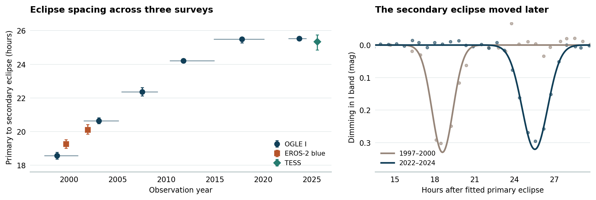

# The widening eclipse interval of OGLE-SMC-ECL-04602

Three phases of OGLE I-band photometry give a primary-to-secondary eclipse interval of 18.58 hours in 1997–2000 and 25.53 hours in 2022–2024 for this previously cataloged binary. The endpoint difference, calculated before rounding, is 6.96 hours (95% night-bootstrap interval 6.73–7.16). Two EROS-2 pointings corroborate early widening. TESS sectors 94 and 95 recover a recent spacing of 25.34 hours (95% orbit-bootstrap interval 24.86–25.75). Resolved DECam measurements place both eclipses on the target near a brighter neighbor. Apsidal motion in an eccentric orbit is a possible explanation. The timing data presented here leave the mechanism and the direction of any change after 2022 open.

[Download the illustrated research note (PDF)](research-note.pdf)



## Selection and what is new

Open-Space released four fitted epochs for a comparison population of 676 OGLE binaries as part of its study of a different source, OGLE-SMC-ECL-06090. Using the published quality designation and maximum uncertainty of 0.015 orbital cycle in each of four epochs left 442 stars. For each star we formed the later minus earlier eclipse interval separately in OGLE-III and OGLE-IV. We kept 207 with the same sign in both surveys and ranked on the smaller absolute change divided by its quadrature-summed formal error. This retrospective rule searches for sustained change. The ranking is descriptive and subject to selection. The first-ranked star, OGLE-SMC-ECL-05625, was already identified by the OGLE-III team as exhibiting apsidal motion. We followed up the second-ranked star. The upstream table already contains its four selection measurements. The OGLE-II extension, outside-screen OGLE-IV epoch, independent EROS, DECam and TESS reductions, and endpoint uncertainty and cadence checks were performed for this investigation.

[Upstream comparison table and selection](https://github.com/dovvnloading/Open-Space/tree/d3cec82599d4bf332debb9c7f1e1522e2893acc5/results/smc-06090/population) · [Original OGLE-III remarks](https://www.astrouw.edu.pl/ogle/ogle3/OIII-CVS/smc/ecl/remarks.txt)

## Measurements and controls

J2000 position 01h02m55.78s, −72°52′23.8″. The OGLE-IV ephemeris has epoch HJD 2460001.4679 and period 1.7295874 days (41.51 hours). “Primary” follows the deeper OGLE eclipse near phase zero in that ephemeris. Separations are the difference between the two profile centers in each epoch, converted to hours. Year ranges pool many orbits. The intervals quantify sampling variability conditional on the adopted model.

| Epoch | Usable measurements | Hours from primary to secondary | 95% interval (h) |
| --- | ---: | ---: | ---: |
| OGLE-II, 1997–2000 | 303 | 18.58 | 18.37–18.78 |
| OGLE-III, 2001–early 2005 | 356 | 20.65 | 20.49–20.83 |
| OGLE-III, mid-2005–2009 | 338 | 22.37 | 22.13–22.62 |
| OGLE-IV, 2010–2014 | 428 | 24.21 | 24.08–24.33 |
| OGLE-IV, late 2014–early 2020 | 236 | 25.49 | 25.28–25.61 |
| OGLE-IV, 2022–2024 | 1,666 | 25.53 | 25.46–25.60 |
| TESS, June–August 2025 | 21 well-covered orbits | 25.34 | 24.86–25.75 |

OGLE-III photometry uses HJD minus 2450000. OGLE-II and IV supply full HJD. We required finite measurements and quoted errors above zero and at most 0.10 mag. Each epoch has separate fitted eclipse centers, amplitudes and widths, a constant magnitude and a second-harmonic term. The primary inference uses Gaussian eclipse profiles, a soft-L1 robust loss and 0.012 mag added in quadrature to the quoted error. The 600 per-epoch bootstrap replicates resample whole nights within one-year strata. No bootstrap fit required replacement in the reported run. The rank and bootstrap are conditional on the searched population and cannot establish priority or a global false-alarm probability.

Triangular eclipse profiles give +6.88 hours. Changing the folding period by one part per million changes each OGLE estimate by less than 0.005 hours. Restricting OGLE-II to flag-zero measurements retains 265 observations and gives 18.52 hours. The cadence check fixes a common pair of centers while retaining the two epochs' distinct fitted amplitudes and widths, original timestamps, and residuals with a shared random sign per observing night. Over 300 simulations the middle 95% of apparent changes spanned −0.19 to +0.19 hours. This control covers residual noise and sampling under the simulated shapes. Changes in unresolved light or eclipse asymmetry may still affect fitted centers.

EROS-2 red and blue measurements came from a coordinate query of radius 8 arcsec. The nearest source in each overlapping field is sm0021k11605 (0.455 arcsec) and sm0057l21161 (0.066 arcsec). We used finite magnitude measurements with errors above zero and at most 0.4 mag and added 2450000 to the catalog HJD. At an exploratory split of HJD 2452000 the blue spacings increased by 1.15 hours (0.80–1.44) and 0.85 hours (0.51–1.25), respectively. The corresponding red estimates were 1.56 hours (0.55–2.54) and 1.12 hours (0.46–1.62). The pointings share a survey and the two passbands can be simultaneous. One representative blue series appears in the figure. EROS apertures can blend the neighbor.

The DELVE catalog separates the target and the neighbor 2.11 arcsec away. In four filters on 2020 October 29 the secondary eclipse centered at HJD 2459151.5696 (approximate UTC scale), phase 0.6121. The preceding primary's partial coverage limits an independent same-orbit spacing estimate. See [DECam event, controls and prior-report search](delve/README.md). The TESS aperture blends the two positions, but both dips peak in the pixel nearest the target in both sectors. Earlier TESS sectors were also examined and do not resolve a change across the TESS baseline. See [TESS extraction and replay](tess/README.md).

## Replay

Use Python 3.12 with NumPy, SciPy and Matplotlib for the main scripts. The TESS reader requires Astropy. Main analysis versions were NumPy 2.3.5, SciPy 1.17.0 and Matplotlib 3.10.8. The endpoint and EROS fits run offline from the checked-in observations. The selection reads the existing population table in the neighboring smc-06090/population directory. The EROS epoch table is stored with lossless gzip compression. The digest in data/sources.json refers to its original uncompressed archive bytes. From a repository checkout, run the following commands.

```sh
cd results/smc-04602
sha256sum -c SHA256SUMS
OPENBLAS_NUM_THREADS=1 python analyze.py --draws 600 --workers 4
OPENBLAS_NUM_THREADS=1 python cadence.py
python figure.py
```

`results/timing.json` contains the centers, times, night counts, bootstrap intervals and sensitivity checks. `results/ranking.csv` preserves the full same-sign ranking. Separate replay commands and their data are in the DELVE and TESS directories. Original TESS images reside with MAST. This directory includes per-orbit sums for the two 2025 sectors. For a new archive retrieval of the OGLE/EROS inputs and upstream screen in a separate directory, run `python fetch_inputs.py refreshed`. `data/sources.json` records byte counts, URLs and SHA-256 for the copies analyzed. Temporary OGLE-II download URLs expire; the retrieval script reissues its field-and-star query. VizieR responses may differ in header timestamps and archive services may revise their products.

An AI assistant wrote the analysis scripts and research note. The survey light curves and images are observational data. The 300 fixed-center cadence trials are simulations.

Observational credit belongs to OGLE, EROS-2, NASA TESS and STScI/MAST, DELVE and the original DECam observations, Gaia/DPAC and CDS. Open-Space's published population measurements and robust eclipse-fitting work supplied the starting point. [Original OGLE-II catalog entry](https://acta.astrouw.edu.pl/Vol48/n4/pap_48_4_1_7.pdf) · [OGLE-III catalog](https://ogle.astrouw.edu.pl/cont/4_main/var/ogleiii/ebssmc/) · [OGLE-IV release](https://doi.org/10.32023/0001-5237/74.4.1) · [EROS data release](https://doi.org/10.1051/0004-6361/202557321) · [TESS archive](https://mast.stsci.edu/tesscut/) · [NOIRLab DELVE release](https://datalab.noirlab.edu/data/delve)
